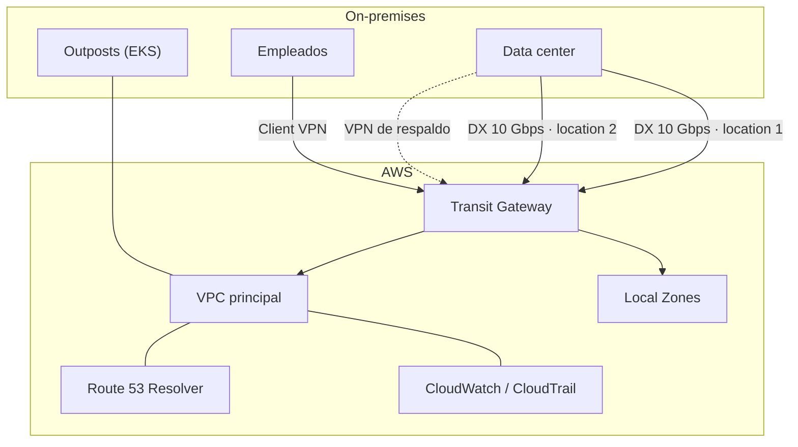

# Finished Architecture

> [!abstract] Qué es este archivo
> Lección **11** y **capstone del módulo**: la arquitectura completa de la **institución financiera** del caso, con
> **todas las piezas de las lecciones 03–10 en una sola solución**. No hay conceptos nuevos: hay **decisiones**,
> **trade-offs** y un **modelo de crecimiento**.
>
> Recorre **conectividad** (Direct Connect doble + VPN + TGW), **borde** (Local Zones), **acceso** (Client VPN),
> **DNS** (Resolver + RAM), **residencia** (Outposts), **observabilidad y seguridad** (CloudWatch, CloudTrail,
> cifrado, Organizations + SCPs, IAM) y el **futuro** (Wavelength como *maybe one day*).
>
> Video: **5 min 27 s** + **un recap** con la lista de servicios. **Sin demo y sin Knowledge Check.**

> [!quote] La idea que ordena todo
> **“The basic architecture stays the same.”**
>
> Es la frase que cierra el video y la que hay que llevarse: cuando la empresa crezca, **no se rediseña** — se
> **conecta lo nuevo al Transit Gateway** y **hereda** el mismo modelo de seguridad y conectividad.

---

## Resumen en una frase

> Una arquitectura híbrida **por capas** —**Direct Connect a dos locations con VPN de respaldo y Transit Gateway**
> como columna, **Local Zones** para latencia, **Client VPN** para empleados, **Route 53 Resolver** para DNS,
> **Outposts** para residencia— **monitoreada y auditada de punta a punta** y diseñada para que **cada recurso nuevo
> se cuelgue del mismo hub y herede el mismo modelo**.

---

## 1. El caso y los cuatro requisitos

**El enunciado del caso:**

> *“Una institución financiera con una infraestructura on-premises sustancial necesita **extenderse a AWS** para
> **disaster recovery** y **cloud bursting**, manteniendo **requisitos estrictos de seguridad, compliance y
> rendimiento** para sus **aplicaciones de trading**.”*

**Los cuatro requisitos, y qué los resuelve:**

| Requisito | Qué significa | Pieza que lo atiende |
| --- | --- | --- |
| **Disaster recovery** | Poder operar cuando el sitio principal falla | **DX a dos locations** + **VPN de respaldo** + **Route 53 failover** |
| **Cloud bursting** | Absorber picos sin comprar hardware | **EC2 con Auto Scaling** |
| **Seguridad y compliance** | Cifrado, auditoría, políticas y residencia | **CloudWatch/CloudTrail**, **cifrado**, **Organizations + SCPs**, **Outposts** |
| **Rendimiento de trading** | *“Every millisecond counts”* | **DX** (latencia consistente) + **Local Zones** |

> [!important] Cómo se lee esta lección
> No trae conceptos nuevos: trae **el orden de las decisiones**. Si en el examen aparece un caso híbrido grande, la
> respuesta casi siempre es **una combinación** —**conectividad redundante + TGW + borde + DNS + residencia +
> observabilidad**— y no un solo servicio.

---

## 2. La arquitectura por capas

| Capa | Pieza | Para qué, según la fuente |
| --- | --- | --- |
| **Conectividad primaria** | **AWS Direct Connect**, **10 Gbps**, a **dos locations** | Enlace **privado y dedicado** con **latencia baja y consistente**; **redundancia geográfica** |
| **Respaldo** | **AWS Site-to-Site VPN** | *“Nuestra póliza de seguro”*: si DX falla, **el tráfico conmuta automáticamente** |
| **Hub** | **AWS Transit Gateway** | **Administrar todas las conexiones**, operar y escalar más fácil |
| **Borde** | **AWS Local Zones** en **centros financieros clave** | **Cargas sensibles a la latencia** cerca de los usuarios, **con el core en las Regions** |
| **Acceso de usuarios** | **AWS Client VPN** | Acceso **seguro y autenticado** a AWS **y** on-premises, **un solo plano de control** |
| **DNS** | **Route 53 Resolver**, **inbound + outbound**, reglas por **RAM** | Resolución **en las dos direcciones**, consistente entre cuentas |
| **Residencia** | **AWS Outposts** | Cargas que **deben quedarse on-premises** por regulación |
| **Observabilidad** | **Amazon CloudWatch** | Monitoreo unificado, **alertas en tiempo real** y **logging** |
| **Auditoría** | **AWS CloudTrail** | **Rastro de acciones** de usuarios y administradores |
| **Gobierno** | **AWS Organizations + SCPs** | **Políticas de seguridad consistentes** en todo el footprint |
| **Acceso y permisos** | **AWS IAM** | Gestión de accesos **según la regulación financiera** |
| **Cómputo elástico** | **Amazon EC2 con Auto Scaling** | **Bursting** en eventos de mercado y cierres de trimestre |

---

## 3. Conectividad: la columna

### Direct Connect

**La decisión:** **Direct Connect** como **conexión primaria**, con **10 gigabits por segundo** para la carga
actual **con espacio para crecer**.

**El detalle que no es obvio:** **no una sola conexión**, sino **dos locations distintas de Direct Connect**. Eso
da **redundancia geográfica** para los requisitos de **disaster recovery** y **resiliencia adicional**.

> **Lectura propia:** dos conexiones en dos locations es el modelo **high resiliency** de la lección 06 — cubre la
> falla de una location. **No** es **maximum** (que exige **dispositivos separados en más de una location**).

### Site-to-Site VPN

**El rol:** **respaldo**, *“nuestra póliza de seguro”*.

**El comportamiento:** si hay un problema con Direct Connect, **el tráfico conmuta automáticamente a la VPN**.

**La advertencia, textual:** *“puede que no iguale el rendimiento de Direct Connect, pero mantiene los sistemas
críticos funcionando”*.

### Transit Gateway

**El rol:** **administrar todas esas conexiones** —DX, VPN y las VPC— **en un solo lugar**, lo que hace el conjunto
**mucho más fácil de operar y escalar**.

> [!warning] La VPN no es un segundo enlace de capacidad
> Es **failover**. Si el requisito incluyera **mantener el throughput** durante la caída de DX, la VPN **no
> alcanza** (lección 06): haría falta **otra conexión dedicada**.

---

## 4. Borde y acceso

### Local Zones para el trading

**La decisión:** **AWS Local Zones en centros financieros clave**.

**Por qué:** correr las **cargas sensibles a la latencia más cerca de los usuarios** **manteniendo la
infraestructura core en las Regions principales**.

**El doble beneficio que nombra el video:** las **plataformas de trading** y las **sucursales** que necesitan
**acceso seguro a los recursos de AWS**.

### Client VPN para los empleados

**Qué da:** **acceso seguro y autenticado** a **AWS y a los recursos on-premises**, todo **administrado desde un
único plano de control**.

**El detalle que evita duplicar identidades:** **se integra con el identity provider existente**, así que **no hay
que administrar credenciales separadas**.

> [!important] El patrón del borde
> **Local Zones** acerca el **cómputo a los usuarios de negocio**; **Client VPN** acerca **a los empleados a la
> red**. Son dos problemas distintos del mismo bloque y en este diseño **conviven**.

---

## 5. DNS: el Resolver en las dos direcciones

**La decisión:** **Route 53 Resolver con endpoints en ambas direcciones**.

| Endpoint | Qué resuelve |
| --- | --- |
| **Inbound** | Los **sistemas on-premises** resuelven **nombres de recursos de AWS** |
| **Outbound** | Las **cargas de AWS** resuelven los **nombres de dominio internos** de la empresa |

**El multiplicador:** las **Resolver rules se comparten entre todas las cuentas de AWS con Resource Access Manager
(RAM)**, lo que **mantiene todo consistente** y **reduce el overhead de administración**.

> **Lectura propia:** es exactamente el **modelo de cuenta de red** de la lección 07 —endpoints centralizados y
> reglas por RAM— aplicado a un caso real. Y la **trampa** de esa lección sigue vigente: **inbound ≠ outbound**.

---

## 6. Residencia: Outposts para lo regulado

**La decisión:** para las cargas que **absolutamente deben quedarse on-premises por requisitos regulatorios**, se
despliega **AWS Outposts**.

**El argumento del video:** *“lo mejor de los dos mundos”* — **las mismas APIs y herramientas** que usan en la nube,
pero **la infraestructura vive físicamente en su data center**. **Perfecto para sus requisitos de data residency**.

**El detalle del recap:** **Outposts extiende la nube al data center** y les permite **correr sus clústeres de
Kubernetes on-premises** con **hardware administrado por AWS**.

> [!warning] La razón correcta
> Outposts acá **no** está por latencia ni por “tener AWS cerca”: está por **residencia**. Si el requisito fuera
> solo latencia, la pieza sería **Local Zones**, y si fuera solo capacidad, **EC2 en la Region**.

---

## 7. Observabilidad, seguridad y auditoría

| Pieza | Qué aporta |
| --- | --- |
| **Amazon CloudWatch** | **Monitoreo unificado**, **alertas en tiempo real** y **logging detallado** en todo el entorno híbrido |
| **AWS CloudTrail** | **Rastros de auditoría** de las **acciones de usuarios y administradores** en cualquier parte del entorno con datos sensibles |
| **Cifrado** | **Todo el tráfico de red va cifrado**, **venga por Direct Connect o por VPN** |
| **AWS Organizations + SCPs** | **Políticas de seguridad consistentes** en **todo el footprint de AWS** |
| **AWS IAM** | **Gestión de accesos segura** en el entorno híbrido, **como exige la regulación financiera** |

> [!note] Cruce con la lección 05 (lectura propia)
> La fuente afirma que **todo el tráfico va cifrado**. Ojo con el matiz que ya viste: **Direct Connect no cifra
> por default** —el cifrado hay que ponerlo (MACsec, TLS o el propio túnel de la VPN)—. La frase del video describe
> el **resultado del diseño**, no una propiedad automática del enlace.

---

## 8. Trade-offs y crecimiento

### Los tres trade-offs que el video reconoce

| Decisión | Costo / complejidad | Por qué se justifica |
| --- | --- | --- |
| **Direct Connect redundante** | *“No es barato”* | El **costo de la caída** de los sistemas de trading lo justifica |
| **Local Zones** | **Agregan complejidad** a la arquitectura | La **ganancia de performance** para trading lo vale |
| **Outposts** | **Inversión significativa** | **Más rentable** que mantener **stacks de infraestructura separados** para las cargas reguladas |

**El criterio que hay que copiar:** **no se elige por precio unitario, se elige por costo de no tenerlo**. Ese es el
razonamiento que el examen espera en los escenarios de “¿está justificado?”.

### El modelo de crecimiento

**La frase:** *“La arquitectura básica se mantiene igual.”*

**El mecanismo:** cuando se **expande a nuevas Regions** o se **agregan aplicaciones**, **se conectan los recursos
nuevos al Transit Gateway** y **todo hereda el mismo modelo de seguridad y conectividad**.

| Lo que se agrega | Cómo entra |
| --- | --- |
| **Nueva Region** | Se conecta al **TGW** |
| **Nueva aplicación** | Se conecta al **TGW** |
| **Nueva VPC** | Se conecta al **TGW** |
| **Nuevo requisito de 5G** | **Wavelength**, *“sin reestructurar”* |

### El futuro: Wavelength

**Lo que dice el video, con cuidado:** se construyó **flexibilidad para integrar Wavelength Zones** si deciden
**explorar casos de uso habilitados por 5G**. **No es un requisito actual**: surgió como un *“tal vez algún día”*.
La arquitectura **puede acomodarlo sin una reestructuración mayor**.

> [!important] La distinción que puede costar una pregunta
> En este diseño **Wavelength no está implementado**: es **capacidad futura**. Un enunciado que diga “la solución
> **usa** Wavelength” está **mal** descrito; el video dice **“we've built in the flexibility to integrate”**.

---

## 9. Los límites de esta fuente

> [!note] Huecos registrados (no se inventan)
> - **Sin demo y sin Knowledge Check**: video de **5 min 27 s** + **un recap** de servicios.
> - **Sin precios**: los trade-offs se argumentan **cualitativamente** (*“no es barato”*, *“inversión
>   significativa”*), sin cifras.
> - **Sin latencias ni SLA**: no se repiten los números de Local Zones ni de Wavelength.
> - **Sin cantidades**: no dice **cuántas Local Zones**, **cuántas cuentas**, **cuántas VPC** ni **cuántos
>   Outposts**.
> - **Sin el diagrama final** en el vault: solo el pie de la imagen.
> - **Sin nombres de los servicios de seguridad del detalle**: no menciona **KMS**, **Security Hub**, **GuardDuty**,
>   **WAF** ni **Network Firewall**.
> - **Sin el detalle del IdP**: no dice **qué** proveedor de identidad ni **qué** protocolo de federación.
> - **Sin alta disponibilidad de los endpoints** de Resolver ni de los Outposts.
> - **La lección no agrega objetivos nuevos**: es la integración de los **ocho** de la lección 01.
> - **La fuente no indica cuántas lecciones tiene el módulo**: con esta van **11**.

---

## 10. Traducción del contenido

> [!info] Sección de referencia (opcional)
> Esto es la **traducción fiel** de las fuentes, para verificar que no se perdió nada. **No hace falta leerla
> para estudiar**: lo que se estudia son las secciones **1 a 9** y se cierra con la **12**.
> Usala solo si (a) algo de arriba te quedó dudoso, (b) querés el detalle textual de las decisiones, o (c) antes
> del examen querés chequear que no se escapó un matiz.

### 10.1 Video: Finished Architecture (transcripción)

Ahora que compartí nuestro **proceso de relevamiento de requisitos**, déjame mostrarte la **arquitectura híbrida**
que diseñamos para esta **institución financiera**. Lo que **me encanta** de esta solución es **cómo atiende sus
necesidades inmediatas** y a la vez **sienta una base para el crecimiento futuro**.

Empecemos por la **conectividad**, que es **absolutamente crítica** para su negocio. Estamos implementando un
**enfoque multicapa**. **AWS Direct Connect** va a ser nuestra **conexión primaria**, aportando ese **enlace
privado dedicado** que necesitan para un **rendimiento consistente de baja latencia**. Estamos armando una
**conexión de 10 gigabits por segundo** para manejar su **carga actual con espacio para crecer**. Pero acá está lo
interesante: **en vez de una sola conexión, nos conectamos a dos locations distintas de Direct Connect**, y eso nos
da la **redundancia geográfica** que necesitan para sus **requisitos de disaster recovery** y para **resiliencia
adicional**.

También estamos configurando **site to site VPN como respaldo**. Podés pensarlo como **nuestra póliza de seguro**.
Si alguna vez hay un problema con Direct Connect, **el tráfico conmuta automáticamente a la conexión VPN**.
**Seguro, puede que no iguale el rendimiento de Direct Connect, pero mantiene sus sistemas críticos funcionando.**
Estamos usando **AWS Transit Gateway** para **administrar todas estas conexiones**, lo que hace que **todo el
setup sea mucho más fácil de operar y escalar**.

Ahora hablemos de sus **necesidades de edge computing**. Dados sus **requisitos de latencia para las aplicaciones
de trading**, estamos **aprovechando AWS Local Zones en centros financieros clave**, y esto les permite **correr
esas cargas sensibles a la latencia más cerca de sus usuarios** **manteniendo su infraestructura core en las
Regions principales de AWS**. Es **una gran ganancia** para sus **plataformas de trading** y para sus **sucursales**
que necesitan **acceso seguro a los recursos de AWS**.

Estamos implementando **AWS Client VPN**. Esto les da a sus empleados **acceso seguro y autenticado tanto a AWS
como a los recursos on-premises**, todo **administrado a través de un único plano de control**. **La belleza de
este setup** es que **se integra con su identity provider existente**, así que **no hay necesidad de administrar
credenciales separadas**.

La **resolución DNS** fue un **desafío interesante**, y estamos usando **Route 53 Resolver con endpoints en ambas
direcciones**. El **endpoint inbound** les permite a **sus sistemas on-premises resolver nombres de recursos de
AWS**, mientras que el **endpoint outbound** maneja la **resolución de sus nombres de dominio internos**. Y estamos
**compartiendo estas Resolver rules entre sus cuentas de AWS usando Resource Access Manager**, lo que **mantiene
todo consistente** y **reduce el overhead de administración**.

Y acá hay algo **único** de su setup: para **cargas que absolutamente deben quedarse on-premises por requisitos
regulatorios**, estamos **desplegando AWS Outposts**, y eso les da **lo mejor de los dos mundos**. Obtienen **las
mismas APIs y herramientas de AWS** que usan en la nube, pero **la infraestructura vive físicamente en su data
center**. Es **perfecto para sus requisitos de data residency**.

Hablemos de **monitoreo y seguridad**, porque son **no negociables** para una institución financiera.
**CloudWatch y CloudTrail** están configurados para dar **visibilidad integral** en sus **entornos híbridos**.
**Todo el tráfico de red está cifrado**, ya sea que fluya por **Direct Connect o por VPN**, y estamos usando **AWS
Organizations con SCPs** para **imponer políticas de seguridad consistentes** en **todo su footprint de AWS**.

Ahora hablemos de **algunos trade-offs**. **Direct Connect con conexiones redundantes no es barato**, pero cuando
analizamos **el costo de la caída** para sus sistemas de trading, **claramente se justificaba**. **Las Local Zones
agregan algo de complejidad** a su arquitectura, pero **los beneficios de performance** para sus aplicaciones de
trading **lo hacen valer la pena**. Y si bien **Outposts representa una inversión significativa**, en realidad es
**más rentable que mantener stacks de infraestructura separados** para sus cargas reguladas.

Lo que **particularmente me gusta** de este diseño es **cómo les da espacio para crecer** a medida que **se
expanden a nuevas Regions** o **agregan más aplicaciones**. **La arquitectura básica se mantiene igual**: solo
**conectan los recursos nuevos al Transit Gateway** y **todo hereda el mismo modelo de seguridad y conectividad**.
Es **escalable, seguro y manejable**. Esta solución los **prepara para el éxito tanto ahora como en el futuro**.
Obtienen la **conectividad híbrida de alta disponibilidad** que necesitan, **latencia ultrabaja donde más importa** y
un **modelo operativo consistente en toda su infraestructura**. Es **exactamente lo que necesitan** para **sostener
su negocio** manteniendo **los estándares de seguridad y compliance** que su industria exige.

Mirando hacia adelante, también **construimos flexibilidad para integrar Wavelength Zones de AWS**. Así, si deciden
**explorar casos de uso habilitados por 5G en el futuro**, van a estar **bien preparados**. **No es un requisito
actual**, pero **surgió como un “tal vez algún día”** en nuestras conversaciones. La arquitectura que diseñamos
**puede acomodar fácilmente esa expansión sin una reestructuración mayor**. Y eso **cierra nuestro recorrido por la
arquitectura**.

### 10.2 Lectura: Architecture Recap

*[Imagen: el diagrama de la arquitectura final, como se describe en el video anterior y en la sección siguiente.]*

- **AWS Direct Connect** provee la **conectividad altamente segura, privada y de baja latencia** entre su data
  center on-premises y AWS para **aplicaciones de trading** donde *“cada milisegundo cuenta”*.
- **AWS Site-to-Site VPN** sirve como **opción de conectividad segura adicional** que **complementa Direct Connect**
  para su infraestructura híbrida.
- **Amazon EC2 con Auto Scaling** habilita **capacidades de compute bursting** durante **eventos de mercado** y
  **picos de procesamiento de cierre de trimestre**, manteniendo **performance consistente**.
- **AWS Outposts** **extiende la nube de AWS a su data center**, permitiéndoles **correr sus clústeres de
  Kubernetes on-premises** usando **hardware administrado por AWS**.
- Una **AWS Local Zone** **sirve Amazon EKS y otros servicios de AWS a los usuarios locales** con **comunicaciones
  de baja latencia**.
- **Amazon CloudWatch** provee **monitoreo unificado**, **alertas en tiempo real** y **logging detallado** en su
  entorno híbrido, para **satisfacer necesidades operativas y de compliance**.
- **AWS CloudTrail** provee **rastros de auditoría** para **registrar acciones de usuarios y administradores** en
  cualquier parte de su entorno que **contenga datos sensibles**.
- **Amazon Route 53** facilita el **failover y el routing basados en DNS** para **escenarios de disaster recovery**
  entre **entornos on-premises y AWS**.
- **AWS Identity and Access Management (IAM)** asegura **protocolos de gestión de accesos** en su entorno híbrido,
  **como lo exigen las regulaciones financieras**.

---

## 11. La arquitectura en una tabla (cierre)

| Requisito del caso | Decisión | Servicio |
| --- | --- | --- |
| **Enlace primario privado y de baja latencia** | **DX de 10 Gbps** | **AWS Direct Connect** |
| **Sobrevivir a la caída de una location** | **Dos locations distintas** | **AWS Direct Connect** |
| **Failover si el enlace dedicado cae** | **VPN de respaldo**, conmutación automática | **AWS Site-to-Site VPN** |
| **Operar y escalar muchas conexiones** | **Hub único** | **AWS Transit Gateway** |
| **Latencia para trading y sucursales** | **Cómputo cerca del usuario, core en la Region** | **AWS Local Zones** |
| **Acceso de empleados a AWS y on-premises** | **Un plano de control + IdP existente** | **AWS Client VPN** |
| **On-premises resuelve nombres de AWS** | **Endpoint de entrada** | **Route 53 Resolver inbound** |
| **AWS resuelve dominios internos** | **Endpoint de salida** | **Route 53 Resolver outbound** |
| **Consistencia entre cuentas** | **Reglas compartidas** | **AWS RAM** |
| **Cargas reguladas que no pueden salir** | **AWS en el data center** | **AWS Outposts** |
| **Picos de mercado y cierre de trimestre** | **Escalado automático** | **Amazon EC2 Auto Scaling** |
| **Visibilidad y alertas** | **Monitoreo unificado** | **Amazon CloudWatch** |
| **Auditoría de acciones** | **Rastro por usuario y API** | **AWS CloudTrail** |
| **Políticas en todo el footprint** | **SCPs** | **AWS Organizations** |
| **Acceso según regulación** | **Permisos** | **AWS IAM** |
| **DR entre on-premises y AWS** | **Failover por DNS** | **Amazon Route 53** |
| **5G, si algún día** | **Capacidad futura, no implementada** | **AWS Wavelength** |

**La lección de método:** en un caso híbrido completo, **la respuesta no es un servicio** — es **un conjunto
coherente**, y el **Transit Gateway** es lo que lo mantiene coherente cuando crece.

---

## 12. Para el examen (SAP-C02)

> [!important] Lo que hay que retener
> 1. **Conectividad multicapa**: **Direct Connect primario** + **VPN de respaldo** + **Transit Gateway** como hub.
> 2. **Dos locations de DX** dan **redundancia geográfica** para **DR**; es el modelo **high resiliency** (no
>    **maximum**).
> 3. **La VPN es failover, no capacidad**: *“puede que no iguale el rendimiento de Direct Connect”*.
> 4. **Local Zones** para **latencia de trading** sin sacar el **core** de las Regions.
> 5. **Client VPN** para empleados, **integrado con el identity provider**: **no se administran credenciales
>    separadas**.
> 6. **Route 53 Resolver con endpoints en ambas direcciones** + **reglas compartidas por RAM** = DNS híbrido
>    consistente entre cuentas.
> 7. **Outposts por residencia**, no por latencia: las mismas APIs, **el hardware en el data center**.
> 8. **Observabilidad y auditoría**: **CloudWatch** (monitoreo, alertas, logs) y **CloudTrail** (acciones de
>    usuarios y administradores).
> 9. **Gobierno**: **Organizations + SCPs** para políticas consistentes; **IAM** para el acceso.
> 10. **Crecimiento**: **todo recurso nuevo se conecta al TGW** y **hereda** seguridad y conectividad.
> 11. **Wavelength es futuro**, no parte de la solución actual: *“flexibility to integrate”*.

> [!warning] Trampa clásica del examen
> Escenario: “la solución **incluye** Wavelength para los casos de 5G”. **Falso según la fuente**: está la
> **flexibilidad** para integrarlo, pero **no es un requisito actual**. Segunda trampa: describir el diseño como
> **maximum resiliency** por tener “dos conexiones” — con **una conexión por location** es **high**. Tercera: creer
> que **Outposts** está ahí por latencia; está por **residencia de datos**.

---

## Relacionado

- [[AWS Wavelength]] — la capacidad **futura** que este diseño puede integrar
- [[AWS Outposts]] — la pieza de **residencia** dentro de la solución
- [[AWS Local Zones]] — la pieza de **latencia** del borde
- [[Amazon Route 53 Resolver]] — el DNS híbrido con endpoints en ambas direcciones
- [[AWS Direct Connect - Redundancy and Resilience]] — de dónde sale el modelo de **dos locations**
- [[AWS Direct Connect - Connection Options]] — el enlace dedicado de **10 Gbps**
- [[AWS Site-to-Site VPN]] — el respaldo que conmuta solo
- [[AWS Client VPN]] — el acceso de empleados con el IdP existente
- [[Gathering the Customer Requirements - Hybrid]] — el caso y los requisitos que esta arquitectura resuelve
- [[Course Overview - Optimizing Hybrid Architectures]] — los ocho objetivos que la solución cubre
- [[AWS Solutions Architect Advanced - Optimizing Hybrid Architectures]] *(índice del módulo)*
- [[Use Cases - Transit Gateway]] — el hub del modelo de crecimiento
- [[1.1 Diseñar estrategias de conectividad de redes]] — la tarea que la arquitectura resuelve de punta a punta
- [[2.2 Diseñar una solución para garantizar la continuidad de actividades]] — el DR del caso
- Cierre del módulo: queda el **quiz integrador** y el **mapa de progreso final**

---

## Registro de integración

| Fecha | Qué llegó | Dónde se integró |
| --- | --- | --- |
| 29/10/2026 | Lección 11 completa: video (5:27) del *walkthrough* de la arquitectura + lectura *Architecture Recap* con los nueve servicios | Nota completa (secciones 1–12) |

**Discrepancias y vacíos registrados (no corregidos):**

1. **Route 53 Resolver vs Route 53 failover**: el video describe **Route 53 Resolver** (endpoints inbound y
   outbound); el recap describe **Amazon Route 53** para **failover y routing basados en DNS** en DR. **Son dos
   funciones distintas** del mismo servicio y la fuente **no las separa**. Se integran las dos en §5 y en §11, y se
   registran acá.
2. **EKS en Outposts aparece solo en el recap** (*“correr sus clústeres de Kubernetes on-premises”*); el video no
   menciona Kubernetes. Se integra en §6 marcando el origen.
3. **La Local Zone “sirve Amazon EKS y otros servicios”** (recap) frente a *“cargar cargas sensibles a la latencia”*
   (video). Se conservan las dos formulaciones.
4. **El recap no menciona** **Transit Gateway**, **Client VPN**, **RAM**, **Organizations/SCPs** ni **Wavelength**;
   el video **no menciona** **EC2 Auto Scaling**, **IAM** ni **Route 53 failover**. Ninguna de las dos fuentes está
   completa por separado.
5. **“AWS client”** en el video es **AWS Client VPN** truncado; se normaliza y se registra.
6. **Artefacto de transcripción:** *“ensure it might not match Direct Connect's performance”* por *“sure, it might
   not match”*. Se traduce por el sentido en §3 y §10.1.
7. **El video termina truncado** (*“And that wraps up our architecture walkthrough. I.”*); no se completa la frase.
8. **“Todo el tráfico está cifrado”** es una **afirmación del diseño**, no una propiedad automática de Direct
   Connect (que **no cifra por default**, lección 05). Se marca como cruce en §7.
9. **Los trade-offs no tienen cifras**: *“no es barato”*, *“complejidad”*, *“inversión significativa”*. No se
   convierten en números.
10. **El diagrama final no está en el vault**: solo el pie de la imagen del recap.
11. **Sin demo, sin Knowledge Check, sin precios, sin SLA y sin cantidades** (Local Zones, cuentas, VPC, Outposts).
12. **La lección no introduce objetivos nuevos**: cierra los **ocho** de la lección 01.
13. **La fuente no indica cuántas lecciones tiene el módulo**: con esta van **11**, todas entregadas.

**Decisiones de transcripción:**

- Se conservan **AWS Direct Connect**, **Site-to-Site VPN**, **Transit Gateway**, **Local Zones**, **Client VPN**,
  **Route 53 Resolver**, **inbound/outbound endpoint**, **Resource Access Manager (RAM)**, **AWS Outposts**,
  **CloudWatch**, **CloudTrail**, **AWS Organizations**, **SCP**, **IAM**, **Auto Scaling**, **EKS** y
  **Wavelength**.
- Las **cifras** se transcriben literales: **5 min 27 s**, **10 gigabits por segundo**, **dos locations**, **nueve
  servicios en el recap**, **una imagen**.
- Se conservan las **expresiones del video** —**“póliza de seguro”**, **“lo mejor de los dos mundos”**, **“la
  arquitectura básica se mantiene igual”**, **“tal vez algún día”**, **“cada milisegundo cuenta”**— porque son el
  hilo argumental.
- Las tablas de **§1**, **§2**, **§8** y **§11** son **lectura propia** que ordenan la fuente; la fuente **no** las
  trae.
- El mapeo a **high resiliency** (§3) y el cruce con el **cifrado de DX** (§7) son **lectura propia** de las
  lecciones 05 y 06; la fuente **no** los nombra.
