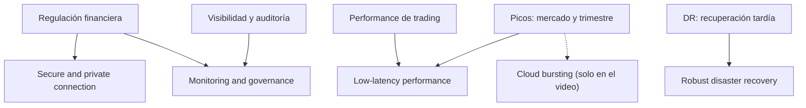

# Gathering the Customer Requirements - Hybrid

> [!abstract] Qué es este archivo
> Segunda lección del módulo y **primera con caso**. Una **institución financiera** con un footprint **on-premises**
> grande quiere **extender** su infraestructura a AWS para **disaster recovery** y **cloud bursting**, sin mover
> todavía sus aplicaciones.
>
> Es el caso que va a volver en cada lección siguiente: acá se fija **qué pide el negocio**; las próximas traen
> **con qué servicio se resuelve**.
>
> Video: **3 min 56 s**.

> [!quote] La frase que ordena todo
> **“Every millisecond counts when you're dealing with financial transactions.”** — el **CTO** del cliente.
> No es una queja de performance: es un **requisito de negocio** que va a filtrar todas las decisiones de
> arquitectura del módulo.

---

## Resumen en una frase

> El cliente **no quiere migrar: quiere extenderse**. De **cinco conversaciones** salen **cuatro requisitos**
> —**conectividad privada segura**, **DR con RTO/RPO**, **performance de baja latencia** y **monitoreo y
> gobierno**— que son la vara contra la que se va a medir toda la arquitectura.

---

## 1. El caso: extender, no migrar

| Dato | Detalle de la fuente |
| --- | --- |
| **Sector** | **Institución financiera**, bajo **regulación estricta** |
| **Punto de partida** | **Footprint on-premises sustancial**, con **numerosas aplicaciones** que **todavía no están listas para migrar** |
| **Movimiento** | **Extender** la infraestructura a AWS, **no reemplazarla** |
| **Para qué** | **Disaster recovery** y **cloud bursting** |
| **Con qué restricción** | **Conectividad segura y privada**, performance **consistente** y **compliance** financiero |
| **Quién habla** | El **equipo de liderazgo**; el **CTO** pone la frase que ordena el caso |

**La distinción que hay que leer primero:** la fuente dice *“not yet ready to migrate”*, no *“never”*. El híbrido
acá **no es el destino**: es la **etapa** que permite convivir con lo que queda on-premises mientras se gana
**resiliencia** y **elasticidad** del lado de AWS.

> [!important] El error de encuadre más caro
> Tratar este caso como una **migración** lleva a diseñar un **cutover**. El cliente pidió lo contrario: **seguir
> operando on-premises** y usar AWS como **extensión**. Todo lo que sigue —el enlace, el DNS, el monitoreo, el
> failover— se diseña **entre** los dos entornos, no **de un entorno al otro**.

> [!note] Errata de la fuente
> La transcripción dice *“We recently completed with a financial institution for architects working in the
> financial sector”*: falta el objeto de *completed* (**a requirements gathering process**) y la segunda frase
> quedó **sin verbo**. Se interpreta como *“Este es un trabajo especialmente relevante para arquitectos del
> sector financiero”*. Se registra en el **Registro de integración**; **no se corrige el original**.

---

## 2. Los cuatro requisitos

**La fuente los fija al final del video, en un bloque propio (“Architecture requirements”).** Son la lista corta
contra la que se va a diseñar:

| # | Requisito | Qué significa | Qué descarta |
| --- | --- | --- | --- |
| 1 | **Secure and private connection between on-premises and AWS** | Un enlace **privado** entre el data center y AWS, que **no dependa de internet pública** | Atajos por internet, accesos de usuario y cualquier “VPN de escritorio” como solución de sitio |
| 2 | **Robust disaster recovery** | Recuperación **dentro de objetivos aceptables** para el negocio | “Tenemos backups” como respuesta de continuidad |
| 3 | **Monitoring and governance across environments** | **Visibilidad, controles y auditoría consistentes** en **los dos lados** | Monitoreo que solo mira lo que corre **dentro** de AWS |
| 4 | **Low-latency performance** | Latencia **suficiente y, sobre todo, consistente** para las aplicaciones de trading | Enlaces con latencia **variable**, aunque el promedio sea bueno |

**La frase que cierra el bloque, atribuida a Joe Gallagher:**

> *“We need to design a solution that not only performs well, but also satisfies their strict compliance
> requirements.”*

**Lo que agrega:** los requisitos **no compiten** entre sí. Performance **y** compliance son **dos condiciones
simultáneas**; una solución que gana en una y pierde en la otra **no sirve** para este cliente.

> [!warning] Discrepancia entre la transcripción y la lista fija
> El video enumera como tercer requisito **“burst compute resources during peak periods without compromising
> security”** (**cloud bursting**). La lista **“Architecture requirements”** lo reemplaza por **“Low-latency
> performance”**. Son **dos listas distintas de la misma fuente**.
>
> **Lectura propia:** la lista fija es la **destilación** que el curso usa como contrato; el **bursting** queda
> como **capacidad** que la extensión habilita (§5), no como requisito de arquitectura comparable. Se registra
> sin corregir: si una lección posterior vuelve sobre el bursting como requisito, se actualiza acá.

---

## 3. Las cinco conversaciones

**El método de la lección:** antes de proponer servicios, el arquitecto **pregunta por el negocio**. Cada
conversación produce un requisito.

| Conversación | Lo que dijo el cliente | Pregunta que abrió | Requisito al que alimenta |
| --- | --- | --- | --- |
| **Performance** | Necesitan **performance consistente**, sobre todo en **trading**; *“every millisecond counts”* | ¿Qué latencia exige la operación y cómo es la **red actual**? | **4** — low latency |
| **Seguridad y regulación** | Operan bajo **regulación financiera estricta**; preocupa la **protección de datos** | Cifrado, **access management**, **audit trail** y controles actuales | **1** — conexión privada, y **3** — gobierno |
| **Disaster recovery** | Hubo escenarios en los que la **recuperación tardó más de lo aceptable** | ¿Qué significa **“aceptable”** en su contexto? ¿Cómo entra AWS en la **continuidad**? | **2** — DR robusto |
| **Capacidad** | El patrón es **predecible en general**, pero hay **picos significativos** en **eventos de mercado** y **cierre de trimestre**; la infraestructura **no los absorbe bien** | ¿Qué **scaling** necesitan y con qué **métricas**? | **4** — latencia, y **cloud bursting** (§5) |
| **Monitoreo** | Necesitan **visibilidad integral** del entorno híbrido | **Tiempo real**, **alertas automatizadas** y **logging detallado** para **compliance** | **3** — monitoreo y gobierno |

> [!note] Lectura propia (no está en la fuente)
> El diagrama y la columna “requisito al que alimenta” son **mi orden**, no un esquema de la fuente. La
> transcripción **no numera** las conversaciones ni las cruza con los requisitos: las cuenta en prosa, en ese
> orden.

> [!important] El patrón del método
> Ninguna conversación empieza por un servicio. Todas empiezan por una **consecuencia de negocio** —una
> transacción, una multa, una recuperación tardía, un pico de mercado, una auditoría— y **de ahí** sale el
> requisito técnico.

---

## 4. RTO y RPO: el par que traduce “aceptable”

**La fuente dice que el cliente tenía escenarios donde la recuperación “tardó más de lo aceptable” y que eso
abrió una conversación sobre sus requisitos de RTO y RPO.** El arquitecto no aceptó el adjetivo: preguntó
**qué significaba exactamente “aceptable” en su contexto**.

> [!note] Ampliación (no está en la fuente)
> La lección **nombra** RTO y RPO pero **no los define**. Para fijar el vocabulario:
>
> | Sigla | Nombre | Pregunta que responde |
> | --- | --- | --- |
> | **RTO** | **Recovery Time Objective** | **Cuánto tiempo** puede estar caído el servicio sin romper el negocio |
> | **RPO** | **Recovery Point Objective** | **Cuántos datos** —medidos en tiempo— se puede perder sin romper el negocio |
>
> Son **objetivos de negocio**, no métricas de infraestructura: se aprueban con el dueño del proceso, no con el
> equipo de redes.

**Por qué el par importa en un caso híbrido:** si el DR se hace **hacia AWS**, el **RPO** determina cuánto dato
tiene que viajar y con qué frecuencia (**replicación**), y el **RTO** determina cuánto puede tardar el
**failover** y cuánta capacidad tiene que estar **lista del otro lado**. Los dos números definen el **costo** de
la solución.

> [!warning] “DR robusto” sin números no es un requisito
> Sin **RTO** y **RPO**, cualquier diseño de continuidad es una apuesta. La primera entrega de este caso no es
> una arquitectura: es **sacar esos dos números** y confirmarlos con el negocio. La fuente **no los da** (ver
> §8), así que en estas notas **no se inventan**.

---

## 5. Capacidad y picos: por qué el bursting es híbrido

**Lo que dice la fuente:** el patrón de carga es **generalmente predecible**, pero hay **picos significativos**
durante **eventos de mercado** o el **cierre de trimestre**, y la infraestructura actual **no maneja esos picos
con eficiencia**.

| Pieza | Cómo se lee |
| --- | --- |
| **Base predecible** | La capacidad **on-premises** alcanza para la operación normal |
| **Picos** | **Eventos de mercado** y **cierre de trimestre**: demanda muy por encima de la base |
| **Problema** | Comprar capacidad para el pico **la deja ociosa** el resto del año |
| **Respuesta** | **Cloud bursting**: la base se queda on-premises y el **excedente** corre en AWS |

> [!note] Ampliación (no está en la fuente)
> **Cloud bursting** no se define en la lección. La definición operativa: **capacidad elástica en AWS para
> absorber el pico**, mientras la carga base sigue on-premises. Para que funcione en serio hacen falta **cuatro
> condiciones**, y ninguna es “tener una cuenta de AWS”:
>
> 1. **Red** con **bandwidth** y **latencia** suficientes para mover el trabajo y sus datos.
> 2. **Datos** accesibles desde el lado que se desborda —o replicados— sin convertir el enlace en el cuello de
>    botella.
> 3. **Identidad y seguridad** equivalentes en los dos entornos: el pico **no** puede relajar controles.
> 4. **Ruteo y DNS** que manden el excedente a AWS y lo devuelvan cuando baja la demanda.

> [!important] Por qué el bursting no aparece como requisito en la lista fija
> **Lectura propia:** el bursting **no se pide**: se **habilita**. Lo que se pide es **performance de baja
> latencia** (§2, requisito 4); el bursting es **una de las formas** de sostenerla en los picos. Por eso la lista
> fija puede nombrar la latencia y omitir el bursting sin contradecirse. Es la misma lógica del módulo de redes:
> el requisito es una **propiedad**, el mecanismo viene después.

---

## 6. Monitoreo y gobierno: el requisito que cruza todo

**Lo que pide el cliente, en tres capas:**

| Capa | Lo que pidió | Para qué |
| --- | --- | --- |
| **Visibilidad** | **Monitoreo en tiempo real** de todo el entorno híbrido | Ver qué pasa **ahora**, en los dos lados |
| **Respuesta** | **Alertas automatizadas** | Que alguien se entere **sin mirar un tablero** |
| **Evidencia** | **Logging detallado** para **reportes de compliance** | Demostrar el control **después** |

**La frase que define el alcance:** el equipo de seguridad necesita **controles y capacidades de auditoría
consistentes**, **sin importar dónde corre la carga**.

> [!warning] Gobierno híbrido no es “CloudWatch en la cuenta de AWS”
> Si la mitad de las aplicaciones sigue **on-premises**, un tablero que solo ve AWS **no cumple** el requisito:
> el cliente pidió **consistencia entre entornos**. El control tiene que ser **el mismo** —o al menos
> **equivalente y comparable**— en los dos lados, y la **evidencia** tiene que poder presentarse junta.

> [!note] Lectura propia (no está en la fuente)
> La lección **no nombra ni un servicio** de monitoreo. El cruce con las herramientas concretas queda para el
> módulo de **Observability** y para las lecciones de servicio de este curso; acá se fija **qué propiedad** tiene
> que cumplir la herramienta, no cuál es.

---

## 7. De requisito a servicio

> [!note] Lectura propia (no está en la fuente)
> **La fuente no asigna servicios**: ni el video ni la lista de requisitos nombran uno solo. Este cuadro es **mi
> cruce tentativo** con los **ocho objetivos** del curso ([[Course Overview - Optimizing Hybrid Architectures]]).
> Se confirma o se corrige **cuando llegue cada lección**.

| Requisito | Candidato del curso | Objetivo | Qué falta confirmar |
| --- | --- | --- | --- |
| **1. Conexión privada y segura** | **AWS Direct Connect**, con **Site-to-Site VPN** como respaldo | 3 y 4 | Diseño del enlace y su **alta disponibilidad** |
| **2. DR robusto con RTO/RPO** | **HA de Direct Connect + VPN de respaldo** | 4 | La **orquestación** del failover **no** está en los objetivos: hueco |
| **3. Monitoreo y gobierno** | *(sin objetivo en el curso)* | — | **Hueco declarado**: lo cubre el módulo de Observability |
| **4. Performance de baja latencia** | **Direct Connect** para latencia **consistente**; **Local Zones / Wavelength / Outposts** solo si el cómputo tiene que **acercarse** | 3, 6, 7, 8 | Si el trading se queda on-premises, el acercamiento **no aplica** |
| *(transcripción)* **Cloud bursting** | Se apoya en **1** y **4** | 3 y 4 | No es un objetivo propio del curso |

> [!warning] Dos huecos declarados, no disimulados
> **a)** El curso enseña **conectividad**; el **DR** completo —orquestación, replicación, runbooks— **no** está
> entre los ocho objetivos. **b)** El **gobierno híbrido** tampoco. Si una lección no los cubre, quedan como
> **deuda del módulo**, no como contenido inventado.

---

## 8. Los límites de esta fuente

| Qué falta | Consecuencia |
| --- | --- |
| **El contenido de las flashcards** (prompts y propuestas) | No se pueden reconstruir las propuestas de Joe Gallagher; **no se inventan** |
| **La imagen `assets/images/MB6PYGGJBC.jpeg`** | No está en el vault; se registra **sin describir lo que no se ve** |
| **Los valores de RTO y RPO** | El requisito queda **cualitativo**: no se puede dimensionar la solución |
| **Cantidad de aplicaciones, tráfico, usuarios y tamaño del data center** | No hay con qué calcular **bandwidth** ni capacidad de bursting |
| **La arquitectura de red actual** | Se sabe que existe y que tiene problemas de performance, pero **no cómo está armada** |
| **El marco regulatorio concreto** | Se dice “regulación financiera estricta”, **sin nombrar norma ni jurisdicción** |
| **Nombres de servicios** | La lección es **de requisitos**: no propone ni un servicio |

**Lo que sí trae:** el video completo, la lista de **cuatro requisitos**, la cita de **Joe Gallagher** y el
**puente explícito** a la lección siguiente: *“cómo traducimos estos requisitos en un diseño de arquitectura
concreto”*.

> [!note] Sin Knowledge Check
> La lección cierra con las **flashcards** y el anticipo de la próxima. **No hay preguntas de control** en esta
> página.

---

## 9. Traducción del contenido

> [!info] Sección de referencia (opcional)
> Esto es la **traducción fiel** de las fuentes, para verificar que no se perdió nada. **No hace falta leerla
> para estudiar**: lo que se estudia son las secciones **1 a 8** y se cierra con la **11**.
> Usala solo si (a) algo de arriba te quedó dudoso, o (b) querés el texto exacto de un requisito o de la cita.

### 9.1 Video: Business summary and requirements (transcripción)

Hola a todos. Hoy quiero **recorrerles un proceso de relevamiento de requisitos** que **completamos hace poco**
con una **institución financiera**. Para los arquitectos que trabajan en el **sector financiero**, es **crítico
entender a fondo el contexto de negocio** antes de **saltar a las soluciones técnicas**. Hace poco me reuní con
**su equipo de liderazgo** para hablar de **sus necesidades de infraestructura híbrida**. Y lo que hace este caso
particularmente interesante es que tienen un **footprint on-premises sustancial**, con **numerosas aplicaciones
que todavía no están listas para migrar a la nube**. Sin embargo, **necesitan extender su infraestructura a AWS**
para **disaster recovery** y **capacidades de cloud bursting**, manteniendo **conectividad segura y privada**.

Durante **nuestra discusión inicial**, me enfoqué en **entender sus desafíos operativos**, y **un punto clave que
surgió** fue **su necesidad de performance consistente**, particularmente para **sus aplicaciones de trading**. Y
**su CTO lo resumió perfecto** cuando dijo: **“Every millisecond counts when you're dealing with financial
transactions”**. Eso llevó a **preguntas importantes** sobre **sus requisitos de latencia** y **su arquitectura de
red actual**.

Cuando **profundizamos en los requisitos de seguridad**, compartieron **sus preocupaciones por operar bajo
regulaciones financieras estrictas**, y eso me llevó a **hacer preguntas detalladas** sobre **sus necesidades de
protección de datos**, **requisitos de compliance** y **controles de seguridad actuales**. Hablamos **de todo**,
desde **requisitos de cifrado** hasta **protocolos de gestión de accesos** y **necesidades de audit trail**.

**Sus requisitos de disaster recovery eran bastante específicos.** Compartieron **algunos escenarios
preocupantes** en los que **la recuperación del sistema tardó más de lo aceptable** para su negocio, y eso llevó a
**una conversación detallada sobre sus requisitos de RTO y RPO**. Me aseguré de **entender exactamente qué
significaba “aceptable” en su contexto** y **cómo imaginan que AWS encaja en su estrategia de continuidad de
negocio**.

También **exploramos sus desafíos de gestión de capacidad**. Si bien **sus patrones de carga son generalmente
predecibles**, experimentan **picos significativos durante eventos de mercado o el procesamiento de cierre de
trimestre**, y **su infraestructura actual tiene problemas para manejar esos picos con eficiencia**. Eso levantó
**preguntas importantes** sobre **sus necesidades de scaling** y **sus métricas de performance**.

Mirando **sus requisitos de monitoreo**, necesitan **visibilidad integral en sus entornos híbridos**. **Su equipo
de seguridad necesita mantener controles y capacidades de auditoría consistentes**, **sin importar dónde corre
una carga de trabajo**. Esto incluye **monitoreo en tiempo real**, **alertas automatizadas** y **logging detallado
para reportes de compliance**.

A partir de **estas conversaciones**, **identifiqué varios requisitos clave** que **necesitamos abordar**.
Necesitan **conectividad privada altamente segura** entre **su data center y AWS**. Necesitan **capacidades
robustas de disaster recovery** con **objetivos específicos de RTO y RPO**. Necesitan **la capacidad de
desbordar recursos de cómputo durante los períodos de pico sin comprometer la seguridad**, y necesitan
**monitoreo y gobierno integrales en sus entornos híbridos**.

Ahora, **lo que hace este caso particularmente interesante** es **cómo sus requisitos abarcan tanto dominios
técnicos como regulatorios**. Necesitamos **diseñar una solución que no solo rinda bien, sino que también
satisfaga sus estrictos requisitos de compliance**. En **nuestra próxima sesión**, les voy a mostrar **cómo
traducimos estos requisitos en un diseño de arquitectura específico** que **atiende sus necesidades** y, al mismo
tiempo, **provee una base para el crecimiento futuro**. Vamos a **explorar cómo varios servicios de AWS pueden
ayudarlos a alcanzar sus objetivos** mientras **mantienen los estándares de seguridad y compliance** que **su
negocio exige**.

*Duración del video: **3 minutos 56 segundos**.*

> [!note] Erratas de la transcripción
> Además del fragmento del inicio (§1), la transcripción dice **“When we drove into security requirements”**.
> Por el contexto, es **“when we dug into”** (cuando profundizamos). Se traduce por el sentido y se registra.

### 9.2 Architecture requirements

- **Conexión segura y privada entre on-premises y AWS**
- **Disaster recovery robusto**
- **Monitoreo y gobierno en todos los entornos**
- **Performance de baja latencia**

*“Necesitamos diseñar una solución que no solo rinda bien, sino que también satisfaga sus estrictos requisitos de
compliance.”*

**— Joe Gallagher**

> [!note] La imagen de la fuente no está en el vault
> `assets/images/MB6PYGGJBC.jpeg` — imagen asociada a la cita del autor. **No se describe** porque su contenido
> **no viene en el texto**.

### 9.3 Flashcards

> [!note] Flashcards sin propuestas en la fuente
> El texto dice: *“Revisá la información de cada una de las siguientes flashcards y pensá qué solución
> propondrías. Después elegí la flashcard para darla vuelta y ver mis propuestas. Para ir a la tarjeta anterior,
> elegí la flecha izquierda. Para ir a la siguiente, elegí la flecha derecha.”*
>
> **Los prompts y las propuestas no vienen en el texto**: son un componente interactivo. **No se reconstruyen.**

**El puente al resto del curso:** *“A lo largo del curso, vas a aprender más sobre los servicios de AWS que van a
impulsar la solución híbrida.”*

---

## 10. Cómo se usa este caso

| Pieza del caso | Dónde vuelve |
| --- | --- |
| **Institución financiera regulada** | El filtro de **compliance** de todas las soluciones del módulo |
| **Footprint on-premises que no migra** | La razón de ser de **Direct Connect** y del **DNS híbrido** |
| **“Every millisecond counts”** | El criterio de **latencia consistente**, no solo baja |
| **RTO/RPO sin números** | La deuda que hay que cerrar **antes** de diseñar el DR |
| **Picos de mercado y cierre de trimestre** | El argumento del **cloud bursting** y de la elasticidad |
| **Controles iguales en los dos entornos** | El requisito de **gobierno híbrido** |
| **Cuatro requisitos** | La lista de verificación de la arquitectura final |

**El criterio que conviene llevarse:** los requisitos **no piden productos**, piden **propiedades** —
**privacidad**, **recuperabilidad**, **consistencia** y **observabilidad**—. Elegir el producto es el paso
siguiente, y **cambia si cambia el contexto**.

---

## 11. Para el examen (SAP-C02)

> [!important] Lo que hay que retener
> 1. El caso es de **extensión**, no de **migración**: las aplicaciones **se quedan** on-premises.
> 2. **Cuatro requisitos**: conexión **privada y segura** · **DR** robusto · **monitoreo y gobierno** ·
>    **performance de baja latencia**.
> 3. La frase del CTO —**“every millisecond counts”**— convierte la latencia en **requisito de negocio**, no en
>    detalle técnico.
> 4. **Performance consistente** ≠ **performance promedio buena**: en trading, la **variabilidad** es el
>    problema.
> 5. **RTO** y **RPO** son **objetivos de negocio**; el arquitecto pregunta **qué significa “aceptable”**.
> 6. **Cloud bursting** aparece en el video, pero **no** en la lista fija de requisitos: la lista lo reemplaza
>    por **low-latency performance**.
> 7. El patrón de carga es **predecible**, con **picos** en **eventos de mercado** y **cierre de trimestre**.
> 8. **Monitoreo** = **tiempo real** + **alertas automatizadas** + **logging detallado** para **compliance**.
> 9. **Gobierno** = controles y auditoría **consistentes** **sin importar dónde corre la carga**.
> 10. La fuente **no nombra servicios**: el cruce de §7 es **lectura propia** y está sujeto a las lecciones
>     siguientes.

> [!warning] Trampas clásicas del examen
> **a) “La empresa quiere migrar todo a AWS.”** Este caso dice lo contrario: **extender**. Si el enunciado pide
> **conectividad híbrida**, la respuesta no es un plan de migración.
>
> **b) “Basta con una Site-to-Site VPN, es más barata.”** Con **latencia variable** y **“every millisecond
> counts”**, el enlace por internet no cumple el requisito de **performance consistente**: el discriminador es
> **Direct Connect**.
>
> **c) “DR robusto = tenemos backups.”** Sin **RTO/RPO** definidos no hay diseño de continuidad que se pueda
> evaluar. Y si el **RPO** exige replicación continua, el enlace y su **bandwidth** pasan a ser parte del
> requisito.
>
> **d) “Monitoreo = CloudWatch en AWS.”** El requisito es **entre entornos**; mirar solo un lado **no** cumple.

---

## Relacionado

- [[AWS Solutions Architect Advanced - Optimizing Hybrid Architectures]] *(índice del módulo)*
- [[Course Overview - Optimizing Hybrid Architectures]] — los ocho objetivos con los que se cruzan estos cuatro
  requisitos
- [[Gathering the Customer Requirements - Security]] — el mismo método de relevamiento, con un caso de auditoría
- [[Gathering the Customer Requirements - Networking]] — el mismo método, con un caso de gaming
- [[Gathering the customer REquirements]] — la versión del módulo Multi-Account, con un caso de e-commerce
- [[1.1 Diseñar estrategias de conectividad de redes]] — la tarea que cubre el requisito de conexión privada
- [[2.2 Diseñar una solución para garantizar la continuidad de actividades]] — el cruce con el DR y el failover
- [[2.5 Diseñar una solución para cumplir con los objetivos de rendimiento]] — el cruce con la latencia
- [[Guia AWS]] — pesos y tareas oficiales del SAP-C02
- Siguiente paso del módulo: [[AWS Client VPN]] — la VPN **de usuarios** que responde a la pregunta del developer

---

## Registro de integración

| Fecha | Qué llegó | Dónde se integró |
| --- | --- | --- |
| 27/10/2026 | Lección 02 completa: caso, cinco conversaciones y cuatro requisitos | Nota completa (secciones 1–11) |

**Discrepancias y vacíos registrados (no corregidos):**

1. **Dos listas de requisitos en la misma fuente.** La transcripción enumera como tercer requisito **cloud
   bursting**; el bloque **“Architecture requirements”** pone **“Low-latency performance”**. Se transcriben
   ambas (§9.1 y §9.2) y la diferencia se analiza en **§2** como **lectura propia**.
2. **Las flashcards no traen su contenido**: el texto invita a darlas vuelta, pero **no incluye prompts ni
   propuestas**. **No se reconstruyen.**
3. **La imagen `assets/images/MB6PYGGJBC.jpeg` no está en el vault** y su contenido no viene descrito.
4. **La transcripción tiene erratas**: *“We recently completed with a financial institution for architects
   working in the financial sector”* (falta **“a requirements gathering process”** y el verbo de la segunda
   frase) y *“When we drove into security requirements”* (por **“dug into”**). Se traducen por el sentido y se
   dejan registradas.
5. **La fuente no da valores de RTO ni de RPO.** Se explican los conceptos como **ampliación** y se marca que
   **no se inventan cifras**.
6. **La fuente no da métricas** de aplicaciones, tráfico, usuarios ni tamaño del data center.
7. **La fuente no nombra el marco regulatorio** ni la jurisdicción: solo dice **“strict financial
   regulations”**.
8. **La fuente no asigna servicios a los requisitos.** El cuadro de **§7** es **cruce propio** con los ocho
   objetivos del curso.
9. **Dos huecos del curso quedan declarados**: la **orquestación del DR** y el **gobierno híbrido** no figuran
   entre los ocho objetivos.
10. **Sin Knowledge Check**: la lección cierra con flashcards y el puente a la siguiente.
11. **El nombre del archivo original choca** con las otras tres notas `Gathering the Customer Requirements`
    (Multi-Account, Networking y Security); se usa el sufijo **`- Hybrid`**.

**Decisiones de transcripción:**

- Se conservan **cloud bursting**, **disaster recovery**, **RTO**, **RPO**, **compliance**, **audit trail**,
  **access management**, **trading**, **on-premises**, **footprint** y **flashcards**.
- Las **cifras** se transcriben literales: **3 min 56 s**, **cuatro requisitos**, **cinco conversaciones**,
  **dos objetivos** (RTO y RPO).
- Se conserva el nombre del autor, **Joe Gallagher**, junto a la cita, y la frase del **CTO** en su idioma
  original.
