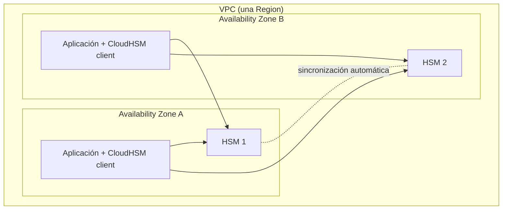

# AWS CloudHSM

> [!abstract] Qué es este archivo
> Décima cuarta lección del módulo y **la que cierra el arco de cifrado**. Responde la pregunta que quedó
> pendiente desde [[Cryptography]]: **cómo tener acceso directo a un HSM de nivel 3 que controlás vos**.
>
> Cubre **qué es CloudHSM**, el **modelo de responsabilidad compartida**, **requisitos**, **arquitectura**,
> **clústeres** (1–28 HSMs), **backups**, **SSL offload**, **envelope encryption**, **Oracle TDE**,
> **cross-Region por backup**, **KMS custom key store** y **costos**. Video de **7 min 46 s** + **nueve lecturas**.
> **Ocho imágenes**, ninguna en el vault.

> [!quote] La idea que ordena todo
> **AWS pone el hardware; vos ponés las claves.** *“AWS administra el appliance del HSM pero **no tiene acceso a
> tus claves**.”* Es la diferencia exacta con [[AWS KMS]]: allá **AWS administra el módulo**, acá **el módulo es
> tuyo** —y la operación también—.

---

## Resumen en una frase

> **CloudHSM** da **HSMs dedicados, validados por terceros y FIPS 140-2 Level 3** dentro de **tu VPC**, agrupados
> en **clústeres de 1 a 28** que se mantienen **en sincronía solos**, con **backups automáticos** que permiten
> clonar el clúster **en la misma Region o en otra**, y que además se puede enchufar a **KMS como custom key
> store**.

---

## 1. El problema y la respuesta

**La pregunta del caso, literal:**

> *“¿Cómo podemos mantener **acceso directo a un HSM de nivel 3** que **controlamos** en AWS?”*

**El requisito de compliance:** tener **acceso directo a un HSM que cumpla FIPS 140-2 Level 3**.

**La respuesta:** **AWS CloudHSM** está **diseñado exactamente para eso**. La fuente lo plantea así:

> *“Pensá en tener **tu propio módulo de seguridad de hardware dedicado** dentro de AWS. Uno que **cumple los
> requisitos de compliance más estrictos**, mientras te da **control completo sobre tus operaciones
> criptográficas**.”*

| Necesidad del cliente | Cómo la cubre CloudHSM |
| --- | --- |
| **Acceso directo al HSM** | **Tus aplicaciones hablan con el HSM** por **canales SSL mutuamente autenticados** |
| **FIPS 140-2 Level 3** | **Hardware validado por terceros**, con **AWS responsable del cumplimiento** |
| **Control exclusivo de las claves** | **AWS no accede a tus claves**; **vos las administrás** |
| **Que el hardware no sea un problema** | **AWS** compra, mantiene, actualiza y respalda el dispositivo |
| **Que no agregue latencia** | **Los HSMs viven en tu VPC**, **cerca de tus cargas** |

> [!important] El caso que la fuente cuenta
> Un **cliente de contratación gubernamental** eligió CloudHSM **por el nivel de control**: necesitaba
> **probarle a los reguladores federales** que mantenía **acceso exclusivo a sus claves de cifrado** para
> **datos de proyectos clasificados**. No era un problema de cifrado: era un problema de **evidencia de
> control**.

> [!note] Lectura propia (no está en la fuente)
> El requisito “**acceso directo**” es el que descarta a KMS en un examen. **Con KMS no hay acceso directo al
> módulo**: hay una **API** y un **servicio administrado** en el medio. **Con CloudHSM, la aplicación es cliente
> del HSM.** Si el enunciado dice *“la aplicación debe conectarse al HSM”*, la respuesta es CloudHSM; si dice
> *“queremos la comodidad de KMS con el material en nuestro módulo”*, es **custom key store** (§9).

---

## 2. Qué es y quién hace qué

**La definición de la fuente:** **AWS CloudHSM** provee **módulos de seguridad de hardware en la nube de AWS**.
Un **HSM** es **un dispositivo de cómputo que procesa operaciones criptográficas y provee almacenamiento seguro
para claves criptográficas**.

**La naturaleza del servicio:** **CloudHSM es un servicio administrado por AWS, pero la responsabilidad es
compartida**. No te ocupás del **mantenimiento del dispositivo** ni de **configuraciones de balanceo de carga**,
pero **sí** de otras tareas.

### 2.1 La tabla de responsabilidades

| **AWS** | **Vos** |
| --- | --- |
| **Mantener los dispositivos** | **Integración de aplicaciones** |
| **Configurar el balanceo de carga** | **Administración de usuarios** |
| **Asegurar el cumplimiento FIPS 140-2 Level 3** | **Alta disponibilidad** |
| **Aprovisionar el hardware** | **Administrar las claves de CloudHSM** |
| **Actualizar firmware y hacer el mantenimiento físico** | **Elegir la configuración del clúster** |

**La frase que resume el reparto:** *“Esto deja **el trabajo pesado a nivel de dispositivo** en manos de AWS.”*

> [!important] La línea que no se cruza
> *“**AWS administra el appliance del HSM pero no tiene acceso a tus claves.**”* **Administrar el aparato** y
> **poder leer lo que guarda** son dos cosas distintas, y **la separación es el producto**: si AWS pudiera leer
> las claves, **el requisito de compliance no se cumpliría**.

> [!note] La experiencia de la presentadora
> Cuenta que **años atrás aprovisionó HSMs en un data center** y que **administrar hardware físico no es poca
> cosa**: **instalaciones seguras**, **controles de acceso físico**, **mantenimiento de hardware** y
> **actualizaciones de firmware** —“y eso es solo el comienzo”—. **CloudHSM se lleva exactamente eso**: el
> **aparato**, no **las claves**.

---

## 3. Los requisitos que puede cumplir

**Dónde corre:** **en tu propia Amazon VPC**, así que **podés usarlo con aplicaciones que corren en instancias
Amazon EC2**. **El acceso se controla con los controles de red estándar de VPC** —**security groups** y **ACLs**—.

**Cómo se conectan las aplicaciones:** con **canales SSL mutuamente autenticados**, **establecidos por el
software cliente del HSM**.

**La ventaja de latencia:** como los HSMs están **en data centers de AWS cerca de tus instancias EC2**, **la
latencia de red es menor que con un HSM on-premises**.

### 3.1 La lista de requisitos

| # | Requisito | Detalle |
| --- | --- | --- |
| **1** | **Claves en HSMs dedicados** | **Validados por terceros**, **bajo tu control exclusivo** |
| **2** | **FIPS 140-2 Level 3** | **Cumplimiento asegurado por AWS** |
| **3** | **Integración con aplicaciones** | **PKCS #11**, **JCE** o **Microsoft CNG** |
| **4** | **Aceleración criptográfica en la VPC** | **Alto rendimiento** (*bulk crypto*) |

**Qué significan las tres interfaces:**

| Interfaz | Nombre completo | Para qué |
| --- | --- | --- |
| **PKCS #11** | **Public-Key Cryptography Standards #11** | **Librería estándar** que usan bases de datos y appliances (por ejemplo, **Oracle TDE**) |
| **JCE** | **Java Cryptography Extension** | **Aplicaciones Java** |
| **CNG** | **Microsoft Cryptography API: Next Generation** | **Aplicaciones Windows / .NET** |

### 3.2 Las características clave

- **AWS administra el appliance pero no tiene acceso a tus claves.**
- **Vos controlás y administrás tus propias claves.**
- **La performance de la aplicación mejora** por la **cercanía con las cargas de AWS**.
- **Almacenamiento seguro en hardware a prueba de manipulación** (*tamper-resistant*), **disponible en múltiples
  Availability Zones**.
- **Los HSMs están en tu VPC y aislados de otras redes de AWS.**

> [!important] “A prueba de manipulación” es la traducción de *tamper-resistant*
> Es **la propiedad física que sostiene el nivel 3**: si alguien **abre o altera el módulo**, **el material se
> destruye** en vez de quedar expuesto. **Eso es lo que un HSM tiene y un servidor con disco cifrado no.**

> [!warning] El matiz que se paga caro
> **Aislamiento de red no es aislamiento de cuenta.** Los HSMs **están en tu VPC**, pero **el clúster está en tu
> cuenta** y **AWS no puede ver las claves**. Si el escenario pide **“que ni AWS pueda acceder al material”**,
> CloudHSM lo cumple; **si pide “que nadie más en la cuenta pueda usar el clúster”**, eso se resuelve con
> **usuarios y quorum** (§4), no con la VPC.

---

## 4. Arquitectura y clústeres

**Dónde están:** **en data centers de AWS**, **físicamente cerca de tus cargas** y **accesibles con latencia
mínima**. **Los appliances están dentro de tu VPC**, así que **se limitan con security groups y ACLs**.

**La unidad de despliegue:** el **clúster de CloudHSM**. **La configuración mínima recomendada** es **dos HSMs en
dos Availability Zones distintas**: *“como perder un appliance significa perder tus claves, **necesitás un HSM de
respaldo** para que la falla de uno **no resulte en perder el acceso a todos tus datos cifrados**”*.

> [!note] Reconstrucción (no está en la fuente)
> El esquema **reconstruye** la imagen `QMMF44UM89.png`, que **no está en el vault**: el texto alternativo
> describe **un VPC en dos AZ**, **un HSM en cada una** y **aplicaciones con el cliente de CloudHSM en cada AZ
> accediendo a los dos HSMs**.

### 4.1 Qué es un clúster

**La definición:** **una colección de HSMs individuales que CloudHSM mantiene en sincronía**. *“Podés pensar el
clúster como **un solo HSM lógico**.”* **Cuando hacés una operación en un HSM, los otros se actualizan
automáticamente.**

| Propiedad | Regla |
| --- | --- |
| **Cantidad de HSMs** | **De 1 a 28** por clúster |
| **Límite por defecto** | **6 HSMs por cuenta de AWS por Region** |
| **Ubicación** | **Distintas Availability Zones dentro de una Region** |
| **Efecto de agregar HSMs** | **Mayor performance** |
| **Efecto de repartir en AZs** | **Redundancia y alta disponibilidad** |
| **Qué definís al crear el clúster** | **Una VPC y una o más subnets** |
| **Recomendación** | **Una subnet por AZ** en la Region elegida |

**Qué se sincroniza y qué no:**

| Elemento | Sincronización |
| --- | --- |
| **Claves** | **Automática**: *“no necesitás hacer nada”* |
| **Usuarios y políticas** | **Requiere actualizar el archivo de configuración del cliente** antes de administrar usuarios |
| **Balanceo de carga** | **Automático** con **más de un HSM**: el cliente **distribuye las operaciones según la capacidad** de cada uno |

> [!important] El detalle que se pregunta
> **Las claves se sincronizan solas; los usuarios y las políticas, no.** Antes de **administrar usuarios** hay
> que **actualizar la configuración del cliente**. **Confundir los dos planos** es el error que deja un HSM
> “nuevo” sin el usuario que la aplicación necesita.

> [!warning] La mención sin desarrollo: quorum authentication
> El video dice que **el soporte de autenticación por quorum agrega una capa extra de protección para las
> operaciones más sensibles**, y **no lo define**. **No se completa** (§ registro, punto 7). **Lo que sí queda**:
> es una **protección adicional sobre el clúster**, **no sobre la red**.

> [!note] Lectura propia (no está en la fuente)
> **1 a 28** parece un rango de escala, pero en realidad son **dos ejes**: **más HSMs = más throughput** y
> **HSMs en más AZs = más disponibilidad**. **Uno solo no es alta disponibilidad**: es **un punto único de
> falla con nombre de clúster**.

---

## 5. Backups, restauración y clonado

**Cómo funcionan:** **CloudHSM hace backups periódicos del clúster**. **No podés pedirle un backup cuando
quieras**, pero **sí podés hacer acciones que lo disparen**.

| Acción | Qué pasa con el backup |
| --- | --- |
| **Agregar un HSM a un clúster que ya tenía HSMs activos** | **Se restaura el backup más reciente** en el HSM nuevo |
| **Borrar un HSM** | **Dispara un backup automático** |
| **Crear un HSM nuevo en el mismo clúster** | **Restaura el HSM anterior** desde el backup |
| **Crear un clúster nuevo desde el backup de otro** | **Clon**, **en la misma Region** que el backup |

**El caso de uso que la fuente destaca:** **mantener entornos de desarrollo y producción separados** con
**configuraciones de seguridad consistentes**, **partiendo del mismo backup**.

> [!important] “No se puede forzar el backup”
> Es **una de las trampas más finas de la lección**: **no hay un botón de “backup now”**. El backup **se dispara
> por eventos** —**agregar** o **borrar** un HSM— y **CloudHSM** además lo hace **periódicamente** por su cuenta.
> Si un enunciado dice *“programar backups manuales cada hora”*, **está describiendo algo que el servicio no
> ofrece**.

> [!warning] La restricción de Region
> **El clon nace en la misma Region que el backup.** Para **cruzarlo de Region** hay que **copiar el backup
> primero** (§8). **No son el mismo procedimiento y el examen los separa.**

---

## 6. SSL/TLS offload: el HSM en el camino de cada transacción

**El caso:** el **HSM se pone en el camino de cada transacción**, *“como un **puesto de control de seguridad**
súper eficiente”*. **Podés descargar las operaciones SSL/TLS directamente a los dispositivos**, *“perfecto
cuando no podés permitirte demoras”*.

**La versión de la lectura:** **este proceso se conoce como SSL acceleration**. **Descargar** reduce **la carga
computacional del servidor web** y **agrega seguridad al guardar la clave privada del servidor en los HSMs**.

### 6.1 El handshake, paso a paso

| # | Paso | Qué ocurre |
| --- | --- | --- |
| **1** | **Initiate** | El **cliente** manda un **hello** al servidor |
| **2** | **Reply** | El **servidor** responde con **hello y su certificado** |
| **3** | **Validate** | El **cliente valida el certificado**, **extrae la clave pública**, **genera el premaster secret** y **lo cifra con la clave pública del servidor** |
| **4** | **Decryption** | El **servidor descarga el descifrado a CloudHSM**: el **HSM descifra el premaster secret con su clave privada** y **lo devuelve**. **Ambos calculan el master secret** |
| **5** | **Post-handshake** | **Toda la comunicación se cifra con derivados del master secret** |

> [!important] Por qué el offload es seguro y no solo rápido
> **La clave privada del servidor nunca sale del HSM.** El servidor **delega el descifrado** y **recibe el
> premaster secret**, no la clave. **Ese es el doble beneficio**: **menos CPU** en el servidor y **mejor
> postura** para la clave más valiosa del sitio.

> [!note] Matiz entre las dos fuentes
> El **video** dice que **podés descargar “todas” las operaciones SSL/TLS**; la **lectura** dice que **podés
> descargar “parte” de ese cómputo**. Se conservan las dos formulaciones y se registran (§ registro, punto 3).

---

## 7. Envelope encryption y el caso Oracle TDE

**La regla general:** **el envelope encryption se usa en todos los servicios de AWS en los que los datos se
cifran en nombre del cliente** —**server-side encryption**— **para minimizar la degradación de performance**. Si
querés **cifrar en tus propias aplicaciones** —**client-side encryption**—, **se recomienda envelope encryption
con AWS KMS o CloudHSM**. **Los dos ofrecen librerías cliente y SDKs**. **El AWS Encryption SDK** es un ejemplo
de herramienta que **se puede usar en cualquier lado**, no solo en aplicaciones que corren en AWS.

**La analogía:** *“Pensalo como **tu bóveda de nivel superior** que protege todas tus otras claves.”* **El HSM
guarda las claves primarias** y **esas claves protegen todas las data keys**.

> [!important] La misma idea que [[AWS KMS]] §5, con otro dueño del módulo
> **La diferencia no es el mecanismo: es quién controla el HSM que cifra la root key.** **Con KMS, AWS**; **con
> CloudHSM, vos**. **La data key sigue siendo local y la clave raíz sigue sin viajar.**

### 7.1 Oracle TDE

**Qué hace TDE:** **algunas versiones del software de base de datos de Oracle** ofrecen **Transparent Data
Encryption (TDE)**, donde **el software de la base cifra los datos antes de guardarlos en disco**.

**La jerarquía de claves:**

| Nivel | Clave | Qué protege |
| --- | --- | --- |
| **1** | **Table key** o **tablespace key** | **Las columnas o tablespaces** de la base |
| **2** | **TDE master encryption key** | **La table/tablespace key** |
| **3** | **HSM de CloudHSM** | **La TDE master key** |

**Cómo se integra:** **la base Oracle corre en una instancia Amazon EC2** y **se integra con la librería de
software de CloudHSM para PKCS #11** para **guardar la TDE master key en los HSMs del clúster**. **La base habla
directo con el HSM** y *“tus aplicaciones ni siquiera necesitan saber que esto pasa”*.

> [!warning] La restricción literal
> ***“Amazon RDS for Oracle TDE no está soportado en CloudHSM. Oracle TDE está soportado para bases Oracle
> (11g y 12c) en Amazon EC2.”*** **Si el escenario pide TDE con CloudHSM en RDS, la respuesta es que no se
> puede**: va **sobre EC2**.

> [!note] La contradicción de la fuente (registrada)
> La misma sección enlaza a una nota de AWS titulada ***“Amazon RDS integrates Oracle Transparent Data
> Encryption with AWS CloudHSM **Classic**”***. **CloudHSM Classic es el servicio anterior**, no el actual. **Se
> conserva el enlace y la contradicción**; **no se resuelve** (§ registro, punto 4).

---

## 8. Cross-Region: clonar por backup, no por replicación

**El mecanismo:** **copiar el backup del clúster a otra Region** y **crear un clúster nuevo desde ese backup**.
**Los backups de clúster son paquetes de datos cifrados** que **contienen los elementos de un clúster
particular**.

**Para qué sirve:** **simplificar el proceso de disaster recovery** y **sostener operaciones globales**, con
**entornos HSM idénticos en varias Regions**.

### 8.1 El procedimiento y los estados

| # | Paso | Estado / resultado |
| --- | --- | --- |
| **1** | **Copiar el backup** con **`copy-backup-to-region`** (AWS CLI o API de CloudHSM) | **`CREATE_IN_PROGRESS`** en la Region destino |
| **2** | **Esperar** | **`READY`** si salió bien |
| **3** | **Crear el clúster** desde el backup copiado | Un **clon** con **los mismos usuarios y claves** que el original **al momento del backup** |
| **4** | **Mantenerlos sincronizados** | **Manual**: *“si querés que los clústeres se mantengan en sync, tenés que actualizar los dos”* |

**Si la copia falla:** el backup copiado queda en **`DELETED`**. **Qué revisar:** **los parámetros de entrada**
y que **el backup de origen no esté en estado `DELETED`** antes de reintentar.

> [!important] El “casi” de la replicación
> **El clon no se mantiene solo.** **Los usuarios y las claves quedan congelados en el momento del backup** y,
> **desde ahí, la sincronización es tu responsabilidad**. **Es un clon, no un par**: **no hay replicación
> continua entre Regions**.

> [!note] Lectura propia (no está en la fuente)
> **Esto responde la duda 5 del índice, pero solo para CloudHSM**: acá **no se usan multi-Region keys**; **se usa
> un backup**. **Son dos soluciones distintas al mismo problema** y **el examen las puede mezclar**: **KMS tiene
> claves multi-Region; CloudHSM tiene clones por backup**.

---

## 9. KMS custom key store: el puente entre los dos mundos

**La definición:** un **custom key store** es **un recurso de AWS KMS asociado a un clúster de CloudHSM**.
**Cuando creás una KMS key en tu custom key store**, **AWS KMS genera una clave AES simétrica de 256 bits,
persistente y no exportable, en el clúster de CloudHSM asociado**.

**La garantía:** **ese material nunca sale de tus HSMs sin cifrar**. **Cuando usás una KMS key de un custom key
store, las operaciones criptográficas se hacen en los HSMs del clúster.**

**Qué se gana:**

| Se gana | De dónde viene |
| --- | --- |
| **Interfaz de administración completa** | **Consola y APIs de AWS KMS** |
| **Control del hardware** | **Clúster de CloudHSM en tu cuenta** |
| **Control del clúster, los HSMs y los backups** | **Consola, APIs, cliente y librerías de CloudHSM** |
| **Rotación, políticas y aliases** | **KMS** |
| **El material dentro de tu módulo** | **CloudHSM** |

> [!important] La respuesta a “¿KMS o CloudHSM?”
> **No es una elección excluyente.** *“Combinan la interfaz **conveniente y completa** de KMS con **los
> controles adicionales** que da un clúster de CloudHSM en tu cuenta.”* **Si el enunciado pide las dos cosas
> —comodidad de KMS y módulo propio—, la respuesta es custom key store.**

> [!warning] Lo que cambia en la operación
> **El clúster sigue siendo tuyo**: **si se borra o se queda sin HSMs disponibles, las KMS keys del custom key
> store dejan de poder usarse**. **La comodidad de KMS no te exime de administrar el clúster** —backups,
> usuarios, alta disponibilidad—.

---

## 10. Costos y límites de servicio

**La lógica del precio:** **pagás solo lo que aprovisionás**. No hay una cifra de precio en la fuente.

| Entorno | Qué hacer | Por qué |
| --- | --- | --- |
| **Desarrollo y prueba** | **Borrar las instancias de HSM al final del día** | **Pausa el facturado** |
| **Reanudar** | **Crear una instancia de HSM** | **Retoma donde quedaste** (restaura el backup) |
| **Producción** | **Escalar el clúster hacia arriba o abajo** según la carga | **Elasticidad** |
| **Producción** | **Compartir un clúster poco usado entre cuentas** | **Maximizar utilización** |
| **Almacenamiento** | **Envolver las data keys y guardarlas afuera cuando no se usan** | **Límite de almacenamiento de claves** |

**El dato de ahorro:** *“Un cliente **redujo sus costos de desarrollo un 70%** solo implementando
**programación automatizada de HSMs**, corriéndolos **solo en horario laboral**.”*

> [!important] Las tres palancas de costo
> **1) Borrar en dev** (y recrear restaura el backup). **2) Escalar en prod.** **3) Compartir el clúster entre
> cuentas.** **La cuarta —envolver data keys y guardarlas afuera— no es costo: es un límite de almacenamiento.**

> [!note] Lectura propia (no está en la fuente)
> **Borrar el HSM en dev no borra las claves**: **dispara un backup** (§5) y **recrear restaura**. **Es la misma
> mecánica que hace posible el clon entre Regions.** **La economía del servicio se apoya en el backup.**

---

## 11. Traducción del contenido

> [!info] Sección de referencia (opcional)
> Esto es la **traducción fiel** de la fuente. **No hace falta leerla para estudiar**: lo que se estudia son las
> secciones **1 a 10** y se cierra con la **13**.

### 11.1 Video: Introduction to AWS CloudHSM (transcripción)

**Bien, ahora tu deployment manager pregunta: “¿cómo podemos mantener acceso directo a un HSM de nivel 3 que
controlamos en AWS?”.** **Esto es exactamente para lo que se diseñó CloudHSM.** **Pensá en tener tu propio
módulo de seguridad de hardware dedicado dentro de AWS.** **Uno que cumple los requisitos de compliance más
estrictos, mientras te da control completo sobre tus operaciones criptográficas.**

**Sabés, hace años trabajé en un data center aprovisionando módulos de seguridad de hardware, y te puedo decir
de primera mano que administrar HSMs físicos no es una tarea menor.** **Tenés que preocuparte por instalaciones
seguras, controles de acceso físico, mantenimiento de hardware, actualizaciones de firmware, y eso es solo el
comienzo.** **Con CloudHSM, AWS se lleva todo ese trabajo pesado.** **Proveen el hardware que cumple FIPS 140-2
Level 3, administran los dispositivos físicos, se ocupan del mantenimiento y los backups, y de todo el
aprovisionamiento.**

**Pero acá está el beneficio para los equipos.** **Seguís teniendo todo el control que tendrías en un data center
tradicional, sin los dolores de cabeza del hardware.** **Vos administrás todas tus claves dentro de CloudHSM.
Te ocupás de la integración de aplicaciones, controlás la administración de usuarios y configurás la alta
disponibilidad.** **Uno de nuestros clientes de contratación gubernamental eligió CloudHSM específicamente por
este nivel de control.** **Necesitaban probarle a los reguladores federales que mantenían acceso exclusivo a sus
claves de cifrado para datos de proyectos clasificados.**

**CloudHSM no se trata solo de control, se trata de cumplir requisitos de seguridad específicos.** **Habiendo
trabajado con estos HSMs físicos, te puedo decir que estos dispositivos son esencialmente computadoras
especializadas diseñadas para una sola cosa: operaciones criptográficas seguras.** **Tus claves se guardan en
HSMs dedicados validados por terceros, bajo tu control exclusivo.** **Obtenés el cumplimiento crucial de FIPS
140-2 Level 3, integración con interfaces estándar de la industria, y aceleración criptográfica de alto
rendimiento dentro de tu VPC.**

**Ahora, la forma en que CloudHSM encaja en tu entorno de AWS es relativamente simple.** **Tus dispositivos HSM
viven dentro de tu VPC y podés desplegar hasta 28 HSMs por clúster.** **Lo que lo hace más útil es la
flexibilidad.** **Podés agregar o quitar HSMs para responder a la demanda con unos pocos clics, y solo pagás por
lo que aprovisionás.** **Además, el soporte de autenticación por quorum agrega una capa extra de protección para
tus operaciones más sensibles.**

**Pero el verdadero diferenciador de CloudHSM viene de cómo trabajan juntos los clústeres.** **AWS mantiene
automáticamente todos los HSMs de tu clúster en sincronía.** **Los usuarios, las claves y las políticas se
mantienen consistentes en todos tus HSMs.** **Es como tener múltiples copias de tu bóveda segura que se mantienen
perfectamente coordinadas.** **Podés pensar el clúster como un solo HSM lógico, aunque esté hecho de múltiples
dispositivos.**

**La administración de backups en CloudHSM es simple y poderosa.** **Cuando agregás un HSM nuevo a un clúster
existente, usa automáticamente el backup más reciente.** **Borrar un HSM dispara un backup automático, y acá hay
algo realmente útil.** **Podés crear clústeres nuevos desde backups existentes.** **Los clientes pueden usar esta
característica para mantener entornos de desarrollo y producción separados, manteniendo configuraciones de
seguridad consistentes en ambos.**

**¿Querés saber otra cosa interesante de CloudHSM?** **Puede manejar tus operaciones de seguridad más exigentes
en tiempo real.** **Imaginá esto: tu HSM se sienta justo en el camino de cada transacción, como un puesto de
control de seguridad súper eficiente.** **Podés descargar todas tus operaciones SSL/TLS directamente a estos
dispositivos, lo que es perfecto cuando no podés permitirte ninguna demora.** **Este tipo de performance y control
es exactamente lo que tu deployment manager estaba pidiendo.** **Operaciones criptográficas aceleradas por
hardware con acceso directo al HSM.** **Obtienen el cumplimiento de seguridad que necesitan sin sacrificar
performance, y mantienen control completo sobre sus operaciones criptográficas.**

**CloudHSM para envelope encryption es una característica particularmente única.** **Pensalo como tu bóveda de
nivel superior que protege todas tus otras claves.** **Tu HSM mantiene tus claves primarias a salvo, y esas
claves protegen todas tus data keys.** **La belleza de este enfoque es cómo combina seguridad máxima para tus
claves raíz con la flexibilidad de cifrar cantidades masivas de datos de forma eficiente.**

**Dejame mostrarte algo que demuestra CloudHSM en acción.** **Cuando corrés Transparent Data Encryption de
Oracle, cifra todos tus datos antes de que lleguen al disco.** **La parte linda es cómo funciona sin
fricción con CloudHSM.** **Tu base de datos habla directamente con el HSM para proteger la clave raíz y tus
aplicaciones ni siquiera necesitan saber que todo esto está pasando.** **Es como tener un guardia de seguridad
invisible cuidando tus datos 24/7.** **Funciona tan suavemente que te olvidás de que está ahí.**

**Con CloudHSM también podés configurar replicación segura de claves entre Regions.** **En la práctica, copiás
tu backup a una Region nueva y creás un clúster nuevo desde ese backup.** **Después de eso, tenés que mantener
manualmente los cambios sincronizados entre tus clústeres.** **Esto es particularmente relevante para las
necesidades de tu deployment manager en nuestro escenario.** **Si estás planificando disaster recovery o
necesitás sostener operaciones globales, podés mantener entornos HSM idénticos entre Regions.** **Es un backup
completo de tu infraestructura de seguridad, listo para cuando lo necesites.**

**Y acá es donde podemos juntar CloudHSM y KMS.** **KMS puede usar tu clúster de CloudHSM como custom key
store.** **Esto significa que podés generar y guardar tus KMS keys directamente en tus HSMs, y todas las
operaciones criptográficas también pasan ahí.** **¿Te acordás de cómo el deployment manager quería control y
comodidad?** **Bueno, esta es la combinación perfecta.** **Obtenés la facilidad de KMS con el control adicional de
tener las claves en tus propios HSMs.** **Es como obtener lo mejor de los dos mundos.**

**Antes de cerrar CloudHSM, hablemos de administrar costos de forma efectiva.** **Para desarrollo y prueba, podés
borrar las instancias de HSM al final del día y crear otras nuevas cuando las necesites.** **Solo pagás por lo que
usás.** **En producción, podés escalar tu clúster según la demanda e incluso compartir clústeres poco usados entre
cuentas.** **Vi organizaciones ahorrar costos significativos ajustando así sus despliegues de HSM.** **Un cliente
incluso redujo sus costos de desarrollo un 70% solo implementando programación automatizada de HSMs.** **Corriéndolos
solo durante el horario laboral.**

*Duración del video: **7 minutos 46 segundos**.*

### 11.2 Lectura: CloudHSM Management

**AWS CloudHSM provee módulos de seguridad de hardware en la nube de AWS.** **Un HSM es un dispositivo de
cómputo que procesa operaciones criptográficas y provee almacenamiento seguro para claves criptográficas.**

**CloudHSM es un servicio administrado por AWS, pero la responsabilidad es compartida entre AWS y vos.** **No
tendrás que enfocarte en el mantenimiento del dispositivo ni en configuraciones de balanceo de carga, pero SÍ
tendrás que realizar otras tareas.**

**Responsabilidad de AWS** — **Como AWS administra los dispositivos de CloudHSM, los clientes no tienen que
enfocarse en el mantenimiento del dispositivo ni en configuraciones de balanceo de carga.** **AWS también es
responsable de asegurar el cumplimiento de FIPS 140-2 Level 3.**

**Tu responsabilidad** — **Te enfocarías en la integración de aplicaciones, la administración de usuarios y la
alta disponibilidad.** **También serías responsable de administrar tus claves de CloudHSM.** **Esto deja el
trabajo pesado a nivel de dispositivo en manos de AWS.**

### 11.3 Lectura: requisitos que CloudHSM puede cumplir

**CloudHSM corre en tu propia Amazon Virtual Private Cloud (Amazon VPC), así que podés usar tus HSMs con
aplicaciones que corren en tus instancias Amazon EC2.** **Con CloudHSM, podés usar los controles de seguridad
estándar de VPC para administrar el acceso a tus HSMs.**

**Tus aplicaciones se conectan a tus HSMs usando canales SSL mutuamente autenticados, establecidos por el
software cliente del HSM.** **Como tus HSMs están en data centers de Amazon cerca de tus instancias EC2, podés
reducir la latencia de red entre tus aplicaciones y los HSMs en comparación con un HSM on-premises.**

- **Claves guardadas en HSMs dedicados, validados por terceros y bajo tu control exclusivo.**
- **Cumplimiento FIPS 140-2 Level 3.**
- **Integración con aplicaciones usando las interfaces Public-Key Cryptography Standards (PKCS) #11, Java
  Cryptography Extension (JCE) o Microsoft Cryptography API: Next Generation (CNG).**
- **Aceleración criptográfica de alto rendimiento dentro de la VPC (bulk crypto).**

**Algunas características clave de CloudHSM:**

- **AWS administra el appliance del HSM pero no tiene acceso a tus claves.**
- **Vos controlás y administrás tus propias claves.**
- **La performance de la aplicación mejora por la cercanía con las cargas de AWS.**
- **Almacenamiento seguro de claves en hardware a prueba de manipulación, disponible en múltiples Availability
  Zones.**
- **Tus HSMs están en tu VPC y aislados de otras redes de AWS.**

### 11.4 Lectura: CloudHSM Architecture

**Los HSMs están en data centers de AWS, físicamente cerca de tus cargas y accesibles con latencia de red
mínima.** **Los appliances de CloudHSM están dentro de tu VPC, así que podés usar security groups y listas de
control de acceso (ACLs) conocidas para limitar el acceso al HSM.** **Cuando usás el servicio CloudHSM, creás un
clúster de CloudHSM.** **Este es un ejemplo de la configuración mínima recomendada para CloudHSM.**

**Este ejemplo despliega dos HSMs en Availability Zones distintas para proveer los estándares mínimos de
disponibilidad redundante para tus claves.** **Como perder un appliance de HSM significa perder tus claves,
necesitás un appliance de HSM de respaldo para asegurar que la falla de un appliance no resulte en perder el
acceso a todos tus datos cifrados.**

### 11.5 Lectura: CloudHSM Clusters

**CloudHSM provee HSMs en un clúster.** **Un clúster es una colección de HSMs individuales que CloudHSM mantiene
en sincronía.** **Podés pensar el clúster como un solo HSM lógico.** **Cuando realizás una tarea u operación en
un HSM de un clúster, los otros HSMs de ese clúster se mantienen automáticamente actualizados.**

**Podés crear un clúster que tenga de 1 a 28 HSMs (el límite por defecto es 6 HSMs por cuenta de AWS por Region
de AWS).** **Podés ubicar los HSMs en distintas Availability Zones dentro de una Region de AWS.** **Agregar más
HSMs a un clúster provee mayor performance.** **Repartir los clústeres entre Availability Zones provee redundancia
y alta disponibilidad.**

**Hacer que HSMs individuales trabajen juntos en un clúster sincronizado, redundante y de alta disponibilidad
puede ser difícil, pero CloudHSM hace parte de ese trabajo pesado indiferenciado por vos.** **Podés agregar y
quitar HSMs de un clúster y dejar que CloudHSM mantenga los HSMs conectados y en sincronía.** **Cuando creás un
clúster, especificás una Amazon VPC de tu cuenta de AWS y una o más subnets de esa VPC.** **Recomendamos crear
una subnet en cada Availability Zone de la Region de AWS elegida.** **Cada vez que creás un HSM, especificás el
clúster y la Availability Zone del HSM.** **Al poner los HSMs en distintas Availability Zones, lográs redundancia
y alta disponibilidad en caso de que una Availability Zone no esté disponible.**

**En un clúster de CloudHSM, CloudHSM mantiene las claves de los HSMs individuales en sincronía.** **No necesitás
hacer nada para sincronizar las claves de tus HSMs.** **Para mantener los usuarios y las políticas de cada HSM en
sincronía, actualizá el archivo de configuración del cliente de CloudHSM antes de administrar los usuarios del
HSM.** **Cuando creás un clúster de CloudHSM con más de un HSM, obtenés automáticamente balanceo de carga.**
**Balanceo de carga significa que el cliente de CloudHSM distribuye las operaciones criptográficas entre todos
los HSMs del clúster según la capacidad de cada HSM para procesamiento adicional.** **CloudHSM hace backups
periódicos de tu clúster.** **No podés indicarle a CloudHSM que haga backups cuando quieras, pero podés tomar
ciertas acciones que resultan en que CloudHSM haga un backup.**

### 11.6 Lectura: Managing cluster backups

**Cuando agregás un HSM a un clúster que antes contenía uno o más HSMs activos, CloudHSM restaura el backup más
reciente en el HSM nuevo.** **Esto significa que podés usar CloudHSM para administrar un HSM que usás con poca
frecuencia.** **Cuando no necesitás usar el HSM, podés borrarlo, lo que inicia un backup.** **Después, cuando
necesitás usarlo de nuevo, podés crear un HSM nuevo en el mismo clúster, restaurando efectivamente tu HSM
anterior.** **También podés crear un clúster nuevo desde un backup existente de otro clúster.** **Tenés que crear
el clúster nuevo en la misma Region de AWS que contiene el backup existente.**

### 11.7 Lectura: CloudHSM for Direct Transactions

**Para aprender más, elegí cada uno de los marcadores numerados.**

1. **Initiate**: **el cliente inicia enviando un hello al servidor.**
2. **Reply**: **el servidor responde con un hello y su certificado.**
3. **Validate**: **el cliente valida el certificado del servidor, extrae su clave pública, genera un premaster
   secret, lo cifra usando la clave pública del servidor y lo envía al servidor.**
4. **Decryption**: **el servidor descarga el descifrado del premaster secret cifrado a CloudHSM.** **Usando su
   clave privada almacenada, el HSM descifra el premaster secret y lo devuelve al servidor.** **Cliente y
   servidor calculan un master secret usando el premaster secret y los mensajes hello.**
5. **Post-handshake**: **después del handshake, todas las comunicaciones entre cliente y servidor se cifran usando
   derivados del master secret.**

**Los servidores web y sus clientes (navegadores web) pueden usar SSL o TLS.** **Estos protocolos confirman la
identidad del servidor web y establecen una conexión segura para enviar y recibir páginas web u otros datos por
internet.** **Esto se conoce comúnmente como HTTPS.** **El servidor web usa un par de claves pública-privada y un
certificado de clave pública SSL/TLS para establecer una sesión HTTPS con cada cliente.** **Este proceso implica
mucha computación para el servidor web, pero podés descargar parte de eso a los HSMs de tu clúster de
CloudHSM.** **Esto se conoce a veces como SSL acceleration.** **Descargar reduce la carga computacional del
servidor web y provee seguridad extra al guardar la clave privada del servidor en los HSMs.**

### 11.8 Lectura: CloudHSM for Envelope Encryption

**El proceso de envelope encryption se usa en todos los servicios de AWS en los que los datos se cifran en nombre
de un cliente (conocido como server-side encryption) para minimizar la degradación de performance.** **Si querés
cifrar datos en tus propias aplicaciones (client-side encryption), se te recomienda usar envelope encryption con
AWS KMS o CloudHSM.** **Ambos servicios ofrecen librerías cliente y SDKs para agregar funcionalidad de cifrado al
código de tus aplicaciones y usar la funcionalidad criptográfica de cada servicio.** **El AWS Encryption SDK es un
ejemplo de una herramienta que se puede usar en cualquier lado, no solo en aplicaciones que corren en AWS.**

**Ejemplo: Oracle TDE y CloudHSM** — **Algunas versiones del software de base de datos de Oracle ofrecen una
característica llamada Transparent Data Encryption (TDE), donde el software de la base cifra los datos antes de
guardarlos en disco.** **Los datos de las columnas de tabla o tablespaces de la base se cifran con una table key o
tablespace key cifrada con la TDE master encryption key.** **Es posible guardar la TDE master encryption key en
los HSMs de tu clúster de CloudHSM para proveer seguridad adicional.**

**En esta solución, la base de datos Oracle está instalada en una instancia Amazon EC2.** **La base se integra con
la librería de software de CloudHSM para PKCS #11 para guardar la TDE master key en los HSMs de tu clúster.**

**Nota:** **Amazon RDS for Oracle TDE no está soportado en CloudHSM.** **Oracle TDE está soportado para bases de
datos Oracle (11g y 12c) en Amazon EC2.**

**Amazon RDS integra Oracle Transparent Data Encryption con AWS CloudHSM Classic** — **Para más información sobre
la integración de una instancia de Oracle en Amazon RDS, visitá el enlace del sitio de AWS.**

**Oracle database transparent data encryption (TDE) with AWS CloudHSM** — **Para más información sobre Oracle TDE
y CloudHSM, visitá el enlace de la guía del usuario.**

### 11.9 Lectura: Cross-Region Redundant Workloads

**Con CloudHSM podés copiar un backup de un clúster a una Region distinta, donde podés usarlo para crear un
clúster nuevo como clon del original.** **Los CloudHSM Cluster Backups son paquetes de datos cifrados que
contienen los elementos de un clúster particular.** **Para clonar un clúster en una Region distinta, primero
copiá el backup del clúster a la Region de destino y después creá un clúster nuevo desde el backup copiado.**
**Podrías querer hacer esto por varias razones, incluida la simplificación del proceso de disaster recovery.**

**Podés copiar un backup de clúster entre Regions desde la AWS CLI o la API de CloudHSM.** **Al emitir el comando
copy-backup-to-region, el backup copiado aparece en la Region de destino con un estado CREATE_IN_PROGRESS.** **Al
completarse exitosamente, el estado del backup copiado es READY.**

**En el caso de que el comando copy-backup-to-region no pueda completarse exitosamente, el estado del backup
copiado es DELETED.** **Revisá tus parámetros de entrada por errores y asegurate de que el backup de origen
especificado no esté en estado DELETED antes de reintentar la operación.**

**Cualquier HSM creado en el clúster clonado tendrá los mismos usuarios y claves que el clúster original en el
momento en que se tomó el backup.** **A partir de ahí, si querés que los clústeres se mantengan en sincronía,
tenés que actualizar manualmente los dos.**

### 11.10 Lectura: AWS KMS Custom Key Store

**Si necesitás más control de los HSMs, podés crear un custom key store respaldado por HSMs FIPS 140-2 Level 3 en
un clúster de CloudHSM que vos poseés y administrás.** **Un custom key store es un recurso de AWS KMS asociado a
un clúster de CloudHSM.** **Cuando creás una KMS key en tu custom key store, AWS KMS genera una clave AES
simétrica de 256 bits, persistente y no exportable, en el clúster de CloudHSM asociado.** **Ese material de clave
nunca sale de tus HSMs sin cifrar.** **Cuando usás una KMS key en un custom key store, las operaciones
criptográficas se realizan en los HSMs del clúster.**

**Los custom key stores combinan la interfaz de administración de claves conveniente y completa de AWS KMS con los
controles adicionales que provee un clúster de CloudHSM en tu cuenta de AWS.** **Con esta característica
integrada, podés crear, administrar y usar KMS keys en AWS KMS manteniendo control total de los HSMs que guardan
su material de clave, incluida la administración de clústeres, HSMs y backups.** **Podés usar la consola y las
APIs de AWS KMS para administrar el custom key store y sus KMS keys.** **También podés usar la consola, las APIs,
el software cliente y las librerías de software asociadas de CloudHSM para administrar el clúster asociado.**

### 11.11 Lectura: Managing Cost and Service Limits

**Para terminar nuestra lección sobre CloudHSM, hablemos de algunas notas y buenas prácticas sobre cómo
administrar costos y límites de servicio.**

- **Para administrar el costo de CloudHSM en cargas de desarrollo y prueba, borrá las instancias de HSM al final
  de la jornada laboral para pausar el facturado.**
- **Para reanudar el trabajo, creá una instancia de HSM para retomar donde quedaste.**
- **Para cargas de producción, escalá el clúster hacia arriba o hacia abajo según varíe la carga, y compartí un
  clúster poco usado entre cuentas para maximizar la utilización.**
- **Para optimizar el almacenamiento, envolvé las data keys y guardalas externamente cuando no se usan.**

**Para cargas de desarrollo y prueba** — **Pausar el facturado**: **borrar las instancias de HSM al final de la
jornada laboral.** **Reanudar el trabajo**: **crear una instancia de HSM para retomar donde quedaste.**

**Para cargas de producción** — **Usar elasticidad**: **escalar el clúster hacia arriba o hacia abajo según varíe
la carga.** **Maximizar utilización**: **compartir un clúster poco usado entre cuentas.** **Administrar el límite
de almacenamiento de claves**: **envolver las data keys y guardarlas externamente cuando no se usan.**

> [!note] Las ocho imágenes de la fuente no están en el vault
> `SDNQPDXZV5.png` y `PM2EWXNAK1.png` (responsabilidades de AWS y tuyas) **llegan sin texto alternativo**: **no se
> describe lo que no se puede leer**. `B1S3ZWH39M.png` (requisitos), `QMMF44UM89.png` (arquitectura),
> `VWBSARDM3A.png` (backups y clon), `W642PYCWGX.png` (envelope encryption), `G6T27SW7KX.png` (Oracle TDE) y
> `BCPJ24P3QY.png` (custom key store) **solo se citan por su descripción**. El único esquema de la nota (§4) es
> una **reconstrucción declarada**.

---

## 12. Cuadro de cierre: qué hace cada pieza

| Necesidad | Pieza | Mecanismo |
| --- | --- | --- |
| **HSM dedicado y propio** | **CloudHSM** | **Appliance en tu VPC**, **sin acceso de AWS a las claves** |
| **Cumplir FIPS 140-2 Level 3** | **CloudHSM** | **Hardware validado por terceros**; **AWS sostiene el cumplimiento** |
| **Integrarlo a la aplicación** | **PKCS #11 / JCE / CNG** | **Cliente del HSM** y **canales SSL mutuamente autenticados** |
| **Que no sea un punto único** | **Clúster en varias AZs** | **Mínimo recomendado: 2 HSMs en 2 AZs** |
| **Escalar throughput** | **Más HSMs en el clúster** | **1 a 28**; **el cliente balancea** |
| **No perder claves si falla un HSM** | **Backup automático** | **Agregar un HSM restaura el más reciente**; **borrar dispara backup** |
| **Separar dev y prod con la misma base** | **Clon desde backup** | **Mismo clúster, misma Region** |
| **Descargar TLS del servidor web** | **SSL acceleration** | **El HSM descifra el premaster secret** con su clave privada |
| **Cifrar grandes volúmenes** | **Envelope encryption** | **Root key en el HSM**, **data keys afuera** |
| **Proteger la master key de Oracle** | **Oracle TDE + CloudHSM** | **PKCS #11**, **EC2**, **11g/12c** (**no RDS**) |
| **Tener el mismo HSM en otra Region** | **`copy-backup-to-region`** | **Copiar backup y crear clúster**; **después, sync manual** |
| **Comodidad de KMS con módulo propio** | **Custom key store** | **KMS key de 256 bits generada en tu clúster** |
| **Bajar el costo en dev** | **Borrar el HSM** | **Pausa el facturado**; **recrear restaura el backup** |
| **Bajar el costo en prod** | **Elasticidad y clusters compartidos** | **Escalar según demanda**, **compartir entre cuentas** |

---

## 13. Para el examen (SAP-C02)

> [!important] Lo que hay que retener
> 1. **CloudHSM = HSM dedicado bajo tu control**, en **tu VPC**, con **FIPS 140-2 Level 3** y **sin acceso de
>    AWS a tus claves**.
> 2. **Responsabilidad compartida**: **AWS** el **dispositivo, el mantenimiento, el firmware, el balanceo y el
>    cumplimiento**; **vos** las **claves, los usuarios, la integración y la alta disponibilidad**.
> 3. **Clúster = un HSM lógico**: **1 a 28 HSMs**, **límite por defecto 6 por cuenta por Region**, **mínimo
>    recomendado 2 en 2 AZs**.
> 4. **Las claves se sincronizan solas**; **usuarios y políticas requieren actualizar la configuración del
>    cliente** antes de administrarlos.
> 5. **Con más de un HSM hay load balancing automático**, según la **capacidad** de cada uno.
> 6. **Backups**: **periódicos y no programables a demanda**; **agregar un HSM restaura el último backup** y
>    **borrar un HSM dispara uno**.
> 7. **Clonar en la misma Region** se hace **desde el backup**; **cruzar de Region** exige
>    **`copy-backup-to-region`**.
> 8. **Estados del backup copiado**: **`CREATE_IN_PROGRESS` → `READY`**; si falla, **`DELETED`**.
> 9. **El clon no se mantiene sincronizado solo**: **desde el backup, la sincronización es manual**.
> 10. **SSL acceleration**: **el HSM descifra el premaster secret** con su clave privada; **la clave nunca sale del
>     módulo**.
> 11. **Oracle TDE**: **soportado en EC2 con 11g y 12c**; **no soportado en Amazon RDS for Oracle**.
> 12. **KMS custom key store**: **AWS KMS genera una clave AES de 256 bits, persistente y no exportable en tu
>     clúster**; **el material nunca sale de tus HSMs sin cifrar**.
> 13. **Costos**: **borrar HSMs en dev pausa el facturado**; **en prod, escalar y compartir clústeres**;
>     **envolver data keys y guardarlas afuera** para el límite de almacenamiento.

> [!warning] Trampa clásica del examen
> Escenario: *“la auditoría exige un **HSM FIPS 140-2 Level 3 al que la empresa tenga acceso directo**, y **un
> regulador debe ver que AWS no puede acceder a las claves**”*. La respuesta **no** es **KMS con customer managed
> keys** (AWS administra el módulo) **ni SSE-KMS**: es **CloudHSM**. Y si el requisito agrega *“pero queremos
> seguir usando la consola y las APIs de KMS para administrar las claves”*, la respuesta **no** es “migrar todo a
> CloudHSM”: es **KMS custom key store respaldado por el clúster**. **Ojo con el detalle de Region**: si pide
> **el mismo HSM en otra Region**, **no** se replica solo: **se copia el backup y se crea el clúster**.

---

## Relacionado

- [[AWS Solutions Architect Advanced - Securing Networks and Data]] *(índice del módulo)*
- [[AWS KMS]] — la lección anterior: **el módulo administrado por AWS**, y el **custom key store** que apunta acá
- [[Demo - AWS KMS]] — la demo que usó KMS desde la consola y dejó abierto **quién controla el hardware**
- [[Cryptography]] — donde nació la duda: **HSM**, **Level 3** y **quién administra el módulo**
- [[Network Segmentation]] — la **VPC**, los **security groups** y las **ACLs** con las que se aísla el clúster
- [[Security Hub]] — el control de **compliance** que puede exigir **FIPS 140-2**
- [[Gathering the Customer Requirements - Security]] — el **requisito 4**, ahora con **dos implementaciones**
- [[1.2 Prescribir controles de seguridad]] — la tarea que este módulo cubre
- [[2.3 Determinar los controles de seguridad en función de los requisitos]] — el cruce con Dominio 2
- [[Guia AWS]] — pesos y tareas oficiales del SAP-C02
- Siguiente paso del módulo: [[AWS Secrets Manager]] — **el siguiente eslabón**: si KMS y CloudHSM cuidan las
  claves, **Secrets Manager cuida las credenciales**

---

## Registro de integración

| Fecha | Qué llegó | Dónde se integró |
| --- | --- | --- |
| 27/10/2026 | Lección 14 completa: CloudHSM (caso de compliance, responsabilidad compartida, requisitos, arquitectura, clústeres, backups, SSL offload, envelope encryption, Oracle TDE, cross-Region, custom key store y costos) | Nota completa (secciones 1–13) |

**Discrepancias y vacíos registrados (no corregidos):**

1. **El rango de HSMs se dice de dos formas**: el video, *“hasta **28 HSMs por clúster**”*; la lectura, **“de 1 a
   28”** **con un límite por defecto de 6 HSMs por cuenta por Region**. **Se conservan las dos** y se concilian en
   §4.1: **1–28 es el rango del clúster; 6 es el límite por defecto de la cuenta**.
2. **Los backups se atribuyen a AWS en el video** (*“AWS … se ocupa del mantenimiento y los backups”*) **y en la
   lectura son una acción tuya** (*“no podés indicarle a CloudHSM que haga backups cuando quieras, pero podés
   tomar acciones que resultan en un backup”*). **No es contradicción**: **AWS opera la infraestructura de
   backup** y **vos disparás los eventos**. Se declara en §5.
3. **El video dice que podés descargar “todas” las operaciones SSL/TLS**; la lectura, **“parte de eso”**. Se
   conservan las dos formulaciones y se registran en §6.
4. **La fuente se contradice con Oracle TDE en RDS**: el texto dice **“Amazon RDS for Oracle TDE is not supported
   on CloudHSM”** y **el mismo bloque enlaza** a una nota titulada **“Amazon RDS integrates Oracle Transparent
   Data Encryption with AWS CloudHSM **Classic**”**. **CloudHSM Classic es el servicio anterior.** **Se conserva
   literal y no se resuelve.**
5. **Dos imágenes llegan sin texto alternativo** (`SDNQPDXZV5.png`, `PM2EWXNAK1.png`): **no se describe lo que no
   se puede leer**. Las otras seis se citan **solo por su descripción**.
6. **La errata de la lectura** *“You would also be responsible for **manager** your CloudHSM keys”* debe ser
   *managing*. Se traduce al sentido evidente y se registra.
7. **La “autenticación por quorum” se menciona una sola vez, en el video, y nunca se define** en las lecturas.
   **No se completa**; queda como hueco (§4).
8. **“CloudHSM Classic” aparece solo en el título del enlace**, sin explicación. **No se agrega** qué era ese
   servicio.
9. **No hay precios en la fuente**: solo **“pagás por lo que aprovisionás”** y **un ahorro del 70%** en un
   cliente. **No se inventan tarifas.**
10. **No se dice cuántos HSMs son necesarios para quorum** ni **cuántos backups se retienen**. **No se completa.**
11. **La fuente no explica cómo se comparte un clúster entre cuentas**: lo menciona como palanca de costo y no
    da el mecanismo. **Queda como hueco.**
12. **No hay Knowledge Check** en esta lección.
13. **El nombre de archivo `AWS CloudHSM.md` no colisiona** con ninguna nota del vault (verificado: **0 basenames
    duplicados**). **No había notas previas de CloudHSM.**
14. **Esta lección cierra la duda 4 del índice** sobre *“Level 3 HSMs”*: acá el nivel **se exige, se cumple y se
    asocia a hardware validado por terceros y a prueba de manipulación**. **La fuente sigue sin detallar los
    criterios formales del estándar.**

**Decisiones de transcripción:**

- Se conservan **CloudHSM**, **HSM**, **cluster**, **Availability Zone**, **tamper-resistant**, **quorum
  authentication**, **SSL acceleration**, **offload**, **premaster secret**, **master secret**, **envelope
  encryption**, **TDE**, **table key**, **tablespace key**, **master encryption key**, **custom key store**,
  **copy-backup-to-region**, **CREATE_IN_PROGRESS**, **READY**, **DELETED**, **bulk crypto**, **PKCS #11**,
  **JCE**, **CNG**, **appliance** y **bare minimum**.
- Las **cifras** se transcriben literales: **7 min 46 s**, **1–28 HSMs**, **6 por cuenta por Region**, **una clave
  de 256 bits**, **dos HSMs en dos AZs**, **Oracle 11g y 12c**, **un 70%** de ahorro, **FIPS 140-2 Level 3**.
- Se conservan los **nombres de servicio** tal como aparecen, incluidos **AWS CloudHSM Classic** y **AWS
  Encryption SDK**.
