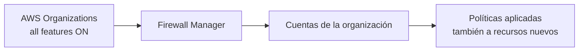
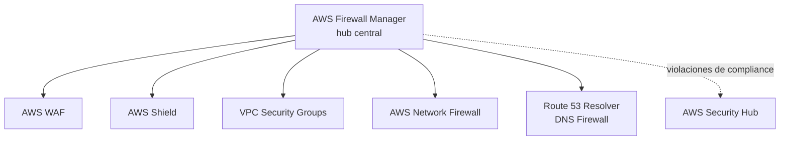

# AWS Firewall Manager

> [!abstract] Qué es este archivo
> Tercera lección del módulo y **la primera de servicio**. Trae **dos mitades**: primero el **problema** —**DoS
> y DDoS**, y cómo evolucionó su mitigación hasta **AWS Shield**—; después la **solución de escala** —**AWS
> Firewall Manager** administrando **cinco servicios de seguridad** de forma centralizada—.
>
> Cubre el requisito **1** (gestión centralizada) y el **2** (DDoS) del caso de la lección anterior. **Cierra el
> hueco de Shield**, que en [[Gathering the Customer Requirements - Security]] había quedado sin servicio.

> [!quote] La frase que ordena todo
> **Firewall Manager es el director de orquesta: no toca un instrumento, hace que todos toquen juntos.** No
> reemplaza a WAF, Shield, Network Firewall ni a los security groups; **los aplica igual en todas las cuentas**.

---

## Resumen en una frase

> **Shield** absorbe el ataque **dentro de la infraestructura global de AWS**; **Firewall Manager** se asegura de
> que esa protección —y las políticas de WAF, Network Firewall, DNS Firewall y security groups— **exista y sea
> idéntica en todas las cuentas**, incluidas **las que todavía no creaste**.

---

## 1. DoS vs. DDoS: la diferencia que decide la defensa

**Denial of service (DoS)** —definición literal de la fuente—: ataque caracterizado por **un intento explícito de
impedir el uso legítimo de un servicio**. El objetivo es **volver inaccesible** una máquina o recurso de red para
sus usuarios previstos, **interrumpiendo el servicio temporal o indefinidamente**.

**Cómo se logra:** **inundando** la máquina o el recurso objetivo con **peticiones superfluas**, para
**sobrecargar los sistemas** y **evitar que se atiendan** algunas o todas las peticiones legítimas.

> La fuente remata: **“los ataques más serios son distribuidos”**.

| | **DoS** | **DDoS** |
| --- | --- | --- |
| **Origen** | Uno (implícito) | **Más de una IP única**, a menudo **miles** |
| **Por qué es difícil de frenar** | Volumen | **El tráfico viene de muchos puntos** distintos |
| **¿Alcanza el filtrado de ingreso?** | Puede ayudar | **No**: es **imposible** detenerlo solo con ingress filtering |
| **Distinguir tráfico legítimo** | Posible | **Muy difícil** cuando se reparte entre tantos orígenes |

### La agravante: IP spoofing

> **Además del DDoS —o combinado con él— los ataques pueden falsificar las direcciones IP del remitente.**

Eso **complica todavía más** identificar y derrotar el ataque: si la dirección de origen es mentira, **bloquear
por IP** castiga a un inocente y **deja pasar al atacante**.

> [!warning] El error de diagnóstico
> “Filtro las IPs que me están pegando”. Con **miles de IPs** y **spoofing** encima, la lista negra **nunca
> alcanza**: llega tarde y siempre incompleta. La mitigación tiene que estar **en la red de alguien con más
> capacidad que el atacante**, no en tu lista de reglas.

> [!important] El dato de escala
> **En 2023 solo, AWS reportó haber mitigado varios ataques DDoS que superaban los 900 Gbps.** Por eso la fuente
> dice que la protección DDoS robusta **no es opcional**: a medida que las aplicaciones escalan, **se vuelven
> blancos más visibles**.

---

## 2. La evolución de la mitigación: tres eras

**La protección DDoS evolucionó junto con las infraestructuras cloud.** La fuente la describe en **tres etapas**,
cada una arreglando el problema de la anterior y **creando uno nuevo**:

| # | Etapa | Cómo funcionaba | Lo que costaba |
| --- | --- | --- | --- |
| **1** | **On-premise** | La organización **compraba capacidad suficiente para absorber el ataque** y **lo administraba ella misma** | **CAPEX alto** por la capacidad ociosa, **mantenimiento caro** y **personal especializado caro**: había que contratar la expertise |
| **2** | **SaaS** (cloud-routing) | Se **enviaba el tráfico a un tercero** y ese tercero **mitigaba en nombre de la organización** | Se libera del mantenimiento, pero **introduce latencia**, **puntos adicionales de falla** y **costos operativos mayores** |
| **3** | **Cloud-first** | **AWS Shield**: la mitigación está **incorporada en la infraestructura global de AWS** | **El tráfico no tiene que ir a ningún otro lado** |

> [!important] La diferencia que hay que poder decir en una línea
> Las tres etapas mitigan; **solo la tercera evita el desvío**. On-premise **sobredimensiona**, SaaS
> **desvía**, cloud-first **absorbe donde el tráfico ya está**.

> [!note] Ampliación (no está en la fuente)
> La etapa 1 no es “peor tecnología”: es **el mismo principio** —absorber— con **capacidad propia**. El problema
> no es técnico sino **económico**: pagás por picos que casi nunca ocurren, y **el pico siempre puede ser más
> grande que tu compra**.

---

## 3. AWS Shield: qué protege

**Definición de la fuente:** AWS Shield **protege redes y aplicaciones** haciendo **dos cosas**:

1. **Identifica problemas de configuración de seguridad de red**.
2. **Defiende las aplicaciones** contra **explotación web activa** y **eventos de denegación de servicio
   distribuida (DDoS)**.

> [!note] Hueco declarado: las “dos capacidades”
> El texto dice: *“AWS Shield hace esto ofreciendo **dos capacidades clave**. Para aprender más sobre estas
> capacidades, seleccioná **cada una de las siguientes flashcards**”*.
>
> **El contenido de esas flashcards no viene en el texto**: son un componente interactivo. **No se reconstruyen**,
> igual que en la lección 02. Queda registrado.

> [!note] Ampliación (no está en la fuente)
> Para ubicarse —**no reemplaza** las dos capacidades que faltan—: Shield se ofrece en **dos niveles**, **Standard**
> (automático y sin costo adicional, para todos los clientes de AWS) y **Advanced** (suscripción paga, con
> **DDoS Response Team** y **protección por costos**). La fuente nombra **Shield Advanced** explícitamente al
> hablar de Firewall Manager, pero **no** describe esa división acá.

**Lo que sí queda claro del texto:** Shield **no es solo un bloqueador de tráfico**. También **detecta
configuraciones de red mal puestas** — es decir, **mira tu configuración**, no solo el paquete que entra.

---

## 4. AWS Firewall Manager: el problema que resuelve

**El diagnóstico de la fuente:** Shield y WAF **protegen bien**, pero **administrar esos controles en múltiples
cuentas y aplicaciones se vuelve complejo en organizaciones grandes**.

**Firewall Manager ataca exactamente esa complejidad:** da **administración centralizada de los servicios de
protección**, incluidos **Shield Advanced**, **reglas de WAF** y **security groups**.

**La analogía textual:** *“Pensá en Firewall Manager como el **director de una orquesta** de seguridad: se asegura
de que **todas tus cuentas de AWS toquen juntas**”*.

### Los cinco servicios que administra

| # | Servicio | Qué controla desde el centro |
| --- | --- | --- |
| 1 | **AWS WAF** | Reglas de filtrado de tráfico web |
| 2 | **AWS Shield Advanced** | Protección DDoS |
| 3 | **Amazon VPC security groups** | Permisos de tráfico por instancia/recurso |
| 4 | **AWS Network Firewall** | Inspección de tráfico dentro de la VPC |
| 5 | **Amazon Route 53 Resolver DNS Firewall** | Filtrado de consultas DNS |

### La regla que hace la diferencia

> **Con Firewall Manager configurás tus reglas una sola vez. El servicio las aplica automáticamente en tus
> cuentas y recursos, incluso cuando agregás recursos nuevos.**

> [!important] “Incluso cuando agregás recursos nuevos”
> Esa cláusula es **el corazón del servicio** y la que gana casi cualquier pregunta de escala. La alternativa
> manual no falla el día uno: **falla el día que alguien crea una cuenta o un recurso nuevo** y nadie se acordó de
> replicar la política.

---

## 5. Los dos requisitos que no se negocian

**Para usar Firewall Manager, la fuente exige dos cosas:**

| # | Requisito | Qué significa |
| --- | --- | --- |
| 1 | **Ser miembro de una organización en AWS Organizations** | La cuenta tiene que estar **dentro** de una organización |
| 2 | **La organización debe tener “todas las funciones” activadas** | **All features turned on**: sin eso, el servicio no opera |

> [!warning] El orden importa
> No es “Firewall Manager y además Organizations”. Es **Organizations primero, con all features, y después
> Firewall Manager**. Si falta cualquiera de las dos condiciones, **el servicio no puede aplicar políticas** —y el
> síntoma es exactamente el de la segunda Knowledge Check de §8: **recursos que quedan sin proteger**.

---

## 6. Quién lo usa: los tres marcadores

**La fuente lo presenta con tres marcadores numerados:**

| # | Marcador | Contenido literal |
| --- | --- | --- |
| **1** | **Organizations** | Organizaciones con un **equipo central de seguridad de la información y compliance** |
| **2** | **Firewall Manager** | **Configurar y administrar políticas de firewall de forma centralizada** |
| **3** | **Enterprise customers** | Clientes enterprise con **cinco o más cuentas de AWS** |

> [!note] Lectura propia (no está en la fuente)
> Los tres marcadores no son tres servicios: son **el quién, el qué y el para quién**. Un **equipo central**
> (**1**) necesita **una consola** (**2**) para **muchas cuentas** (**3**). Si falta el equipo central, Firewall
> Manager resuelve un problema que nadie tiene; si faltan las cuentas, no hay nada que centralizar.

**El umbral de “cinco o más cuentas”** conviene tomarlo como **el punto donde lo manual deja de escalar**, no como
un límite técnico del servicio.

---

## 7. Qué pasa cuando alguien se sale de la política

**La pieza que cierra el dibujo:** Firewall Manager **reporta las violaciones de compliance a AWS Security
Hub** —la fuente lo marca con **una línea punteada** en el diagrama—.

> [!important] Aplicar y demostrar son dos trabajos distintos
> Firewall Manager **aplica** la política; **Security Hub** es donde se ve **quién quedó fuera**. Eso es
> exactamente el requisito **6** del caso —**reporte de compliance y evidencia**—: no alcanza con que la regla
> exista, tiene que quedar **registro de que se cumple**.

**El diagrama de la fuente, reconstruido con lo que dice el texto:**

> [!note] Reconstrucción, no copia
> El diagrama original (`assets/images/UWCS8NF8VM.png`) **no está en el vault**. Este esquema se armó con el
> **texto alternativo de la imagen** y el párrafo que lo acompaña, que sí nombran los cinco servicios y la línea
> punteada hacia Security Hub. **No agrega relaciones que la fuente no mencione.**

---

## 8. Las dos Knowledge Check

### 8.1 Caso: 50 cuentas, 20 más en camino

**Enunciado (resumido):** e-commerce global con **50 cuentas** en varias regiones, **20 más el próximo
trimestre**. Ya sufrieron **DDoS** y ya implementaron **Shield Advanced** y **reglas de WAF** en **la cuenta
principal**. Preocupa: mantener la protección **consistente**, proteger **cuentas y recursos nuevos**,
**reducir la sobrecarga operativa** y **cumplir estándares**.

| Opción | Veredicto |
| --- | --- |
| **A.** CloudFormation con configuraciones idénticas por cuenta | ❌ Sigue siendo **por cuenta**: no protege lo nuevo solo |
| **B.** Organizations + aplicar Shield y WAF **a mano** al crear cuentas | ❌ Es el problema, no la solución |
| **C.** Script con AWS CLI que replique las configuraciones | ❌ **Automatiza el trabajo manual**, no lo elimina |
| **D.** **Firewall Manager** con políticas que despliegan y administran **Shield Advanced + WAF** en toda la organización | ✅ **Correcta** |

**Rationale literal:** Firewall Manager **aplica políticas consistentes en todas las cuentas, incluidas las
nuevas**, con **visibilidad centralizada**, **menos sobrecarga operativa** e **integración nativa con Shield
Advanced y WAF**, y **escala automáticamente** a medida que la organización crece.

> [!important] El patrón de las tres distractoras
> **A, B y C son la misma respuesta con distinto envoltorio**: todas **replican por cuenta**. CloudFormation,
> consola y CLI **no cambian el modelo**; solo cambian **quién aprieta el botón**. Firewall Manager es la única
> que cambia el modelo: **la política vive afuera de las cuentas**.

### 8.2 Caso: hay recursos sin proteger

**Enunciado:** la empresa implementó la solución correcta, pero **algunos recursos no quedan cubiertos** por las
políticas. **¿Cuál podría ser la causa?**

| Opción | Veredicto |
| --- | --- |
| **A.** **Las cuentas no forman parte de AWS Organizations** | ✅ **Correcta** |
| **B.** Los tipos de recurso no están soportados por la política actual | ❌ Distractor |
| **C.** No se designó la cuenta administradora de Firewall Manager | ❌ Distractor |
| **D.** Los recursos están en una región donde Firewall Manager no está disponible | ❌ Distractor |

**Rationale literal:** Firewall Manager **requiere que las cuentas sean parte de AWS Organizations** para
funcionar; **sin esa integración no puede aplicar políticas entre cuentas**, deja recursos sin proteger y **rompe
el enfoque de gestión centralizada**.

> [!warning] Trampa real de esta pregunta
> **B, C y D son condiciones reales de Firewall Manager** —los tipos de recurso soportados, la cuenta
> administradora y la disponibilidad regional **existen**—, así que se leen plausibles. La fuente elige **A**
> porque el rationale apunta al **requisito de integración**: es el único que **anula el servicio entero**, no una
> política puntual. Cuando dos opciones son técnicamente ciertas, **la respuesta es la que explica el fallo
> completo**.

---

## 9. Traducción del contenido

> [!info] Sección de referencia (opcional)
> Esto es la **traducción fiel** de la fuente, para verificar que no se perdió nada. **No hace falta leerla para
> estudiar**: lo que se estudia son las secciones **1 a 8** y se cierra con la **11**.
> Usala solo si (a) algo de arriba te quedó dudoso, (b) querés el texto exacto de una definición, o (c) antes del
> examen querés chequear que no se escapó un matiz.

### 9.1 Introduction to AWS Firewall Manager

**AWS Firewall Manager provee gestión centralizada de seguridad para tus cuentas de AWS Organizations.** Como
Solutions Architect que opera **a escala enterprise**, **a menudo vas a necesitar implementar y administrar
políticas de seguridad en múltiples cuentas y aplicaciones**.

Antes de meternos en la gestión centralizada con Firewall Manager, **abordemos una amenaza crítica que toda
solución enterprise tiene que defender: los ataques DDoS**. A medida que tus aplicaciones **escalan**, **se
vuelven blancos más visibles** para actores maliciosos. **Solo en 2023, AWS reportó haber mitigado varios ataques
DDoS que superaban los 900 Gbps**, lo que **destaca por qué la protección DDoS robusta no es opcional**.

### 9.2 Denial of Service (DoS)

Los ataques de **denegación de servicio (DoS)** se caracterizan por **un intento explícito de los atacantes de
impedir el uso legítimo de un servicio**. El objetivo es **hacer que una máquina o un recurso de red quede no
disponible para sus usuarios previstos**, **interrumpiendo los servicios de un host conectado a internet de forma
temporal o indefinida**. La denegación de servicio **se logra típicamente inundando la máquina o el recurso
objetivo con peticiones superfluas**, para **sobrecargar los sistemas** y **evitar que se atiendan algunas o
todas las peticiones legítimas**. **Los ataques más serios son los distribuidos**.

Un **DDoS (denegación de servicio distribuida)** es un ataque DoS donde **el perpetrador usa más de una dirección
IP única, a menudo miles**. Como **el tráfico entrante que inunda a la víctima se origina en muchas fuentes
distintas**, **es imposible detener el ataque simplemente usando filtrado de ingreso (ingress filtering)**.
También **hace muy difícil distinguir el tráfico de usuarios legítimos del tráfico de ataque** cuando está
**repartido entre tantos puntos de origen**. **Como alternativa o complemento de un DDoS, los ataques pueden
incluir la falsificación de direcciones IP del remitente (IP address spoofing)**, lo que **complica aún más
identificar y derrotar el ataque**.

#### Evolución de la mitigación de DDoS

**La protección contra ataques DDoS evolucionó con el crecimiento de las infraestructuras cloud.** Para aprender
más, **elegí cada uno de los tres marcadores numerados**.

**1: On-premise** — **Antes de que existieran los proveedores cloud**, las aplicaciones **corrían on-premise con
su propio sistema de mitigación DDoS**. Las organizaciones **tenían que comprar capacidad suficiente para absorber
un ataque y administrarlo**. Había **gran gasto de capital (CAPEX)**, **altos costos de mantenimiento** y **altos
costos de personal**, porque **había que contratar la expertise para lidiar con los ataques DDoS**.

**2: Software as a Service (SaaS)** — Después llegó el **cloud-routing como software as a service (SaaS)**, donde
las organizaciones **enviaban el tráfico a un servicio de terceros y les pedían que mitigaran en nombre de la
organización**. Esto **eliminó la carga pesada de mantener un sistema DDoS**, pero **también introdujo latencia,
puntos adicionales de falla y mayores costos operativos**.

**3: Cloud-first** — Hoy, **la mitigación DDoS cloud-first la provee AWS a través de AWS Shield**. **La
diferencia es que la mitigación DDoS está incorporada en la infraestructura global de AWS y el tráfico no necesita
ir a otro lado.**

### 9.3 AWS Shield

**AWS Shield protege redes y aplicaciones identificando problemas de configuración de seguridad de red y
defendiendo las aplicaciones contra explotación web activa y eventos de denegación de servicio distribuida
(DDoS).** AWS Shield hace esto **ofreciendo dos capacidades clave**. Para aprender más sobre estas capacidades,
**seleccioná cada una de las siguientes flashcards**.

### 9.4 AWS Firewall Manager overview

**Mientras AWS Shield (y AWS WAF) proveen protección robusta contra ataques DDoS y vulnerabilidades de
aplicaciones web, administrar estos controles de seguridad en múltiples cuentas y aplicaciones puede volverse
complejo en organizaciones grandes.** **Acá es donde entra AWS Firewall Manager.**

**AWS Firewall Manager aborda el desafío de la seguridad a escala proveyendo administración centralizada de tus
servicios de protección, incluidos Shield Advanced, reglas de WAF y security groups.** **Pensá en Firewall
Manager como el director de la orquesta de seguridad: se asegura de que todas tus cuentas de AWS toquen juntas.**

**Firewall Manager simplifica tus tareas de administración y mantenimiento en múltiples cuentas y recursos.
Se integra con Network Firewall, Route 53 Resolver DNS Firewall, AWS WAF, Shield Advanced y los security groups de
Amazon VPC.**

**Con Firewall Manager, configurás tus reglas una sola vez. El servicio aplica automáticamente tus reglas en tus
cuentas y recursos, incluso a medida que agregás recursos nuevos.** **Para usar Firewall Manager, tu cuenta debe
ser miembro de una organización en el servicio AWS Organizations y la organización a la que pertenecés debe tener
todas las funciones activadas (all features turned on).**

#### Gestión centralizada de políticas con Firewall Manager

**Implementá AWS Firewall Manager para aplicar controles consistentes en tus AWS Organizations.** Para aprender
más sobre cómo funciona Firewall Manager, **elegí cada marcador numerado**.

**1: Organizations** — **Organizaciones con un equipo central de seguridad de la información y compliance.**

**2: Firewall Manager** — **Configurar y administrar políticas de firewall de forma centralizada.**

**3: Enterprise customers** — **Clientes enterprise con cinco o más cuentas de AWS.**

#### Gestión de seguridad unificada

**AWS Firewall Manager sirve como un hub central para administrar múltiples servicios de seguridad en tu entorno
de AWS.** **Firewall Manager se conecta directamente a cinco servicios de seguridad clave: AWS WAF, AWS Shield,
VPC Security Groups, AWS Network Firewall y Amazon Route 53 Resolver DNS Firewall.** **Cuando ocurren violaciones
de compliance, Firewall Manager reporta estos hallazgos a AWS Security Hub (mostrado por la línea punteada),
habilitando visibilidad integral sobre tu postura de seguridad.**

> [!note] Las tres imágenes de la fuente no están en el vault
> `assets/images/3V7WNDP637.png` (esquema de DoS/DDoS), `assets/images/WJZFN7FS7V.jpeg` (Firewall Manager como
> orquestador) y `assets/images/UWCS8NF8VM.png` (hub de los cinco servicios + Security Hub). **No se describen
> más allá del texto alternativo**, y el esquema de §7 es una **reconstrucción** declarada.

### 9.5 Knowledge Check

**Pregunta 1** — Una empresa global de e-commerce tiene **50 cuentas de AWS** en múltiples regiones, con planes de
**agregar 20 cuentas más el próximo trimestre**. **Recientemente sufrieron ataques DDoS** en sus aplicaciones de
cara al cliente y **ya implementaron AWS Shield Advanced y reglas de WAF con éxito en su cuenta principal**. Al
equipo de seguridad le preocupa: **mantener protección DDoS consistente en todas las cuentas**, **proteger
automáticamente cuentas y recursos nuevos**, **reducir la sobrecarga operativa** de la gestión de seguridad y
**asegurar el cumplimiento de estándares**. **¿Qué combinación de acciones proveería la solución más eficiente y
escalable?**

- A. Usar plantillas de **AWS CloudFormation** para desplegar configuraciones de seguridad idénticas en cada cuenta.
- B. Configurar **AWS Organizations** y **aplicar Shield Advanced y reglas de WAF manualmente** a medida que se
  crean cuentas nuevas.
- C. Crear un **script** para replicar las configuraciones de Shield Advanced y WAF en todas las cuentas usando
  **AWS CLI**.
- D. **Implementar AWS Firewall Manager para crear políticas de seguridad que desplieguen y administren Shield
  Advanced y reglas de WAF automáticamente en toda la organización.** ✅

**Correcto.** *Rationale:* Firewall Manager **provee la solución óptima aplicando políticas de seguridad
consistentes automáticamente en todas las cuentas, incluidas las nuevas**, mientras ofrece **visibilidad
centralizada**, **menor sobrecarga operativa** e **integración nativa con Shield Advanced y WAF**, todo lo cual
**escala automáticamente a medida que la organización crece**.

**Pregunta 2** — **La empresa implementa la solución correcta, pero nota que algunos recursos no están siendo
protegidos por las políticas de seguridad. ¿Cuál podría ser la causa?**

- A. **Las cuentas no forman parte de AWS Organizations.** ✅
- B. Los tipos de recurso no están soportados por la política actual de Firewall Manager.
- C. No se designó la cuenta administradora de Firewall Manager.
- D. Los recursos están en una región donde Firewall Manager no está disponible.

**Correcto.** *Rationale:* **AWS Firewall Manager requiere que las cuentas sean parte de AWS Organizations para
funcionar correctamente.** **Sin esta integración, Firewall Manager no puede aplicar políticas entre cuentas**,
**dejando algunos recursos sin proteger y socavando el enfoque de gestión centralizada de la seguridad**.

---

## 10. Quién hace qué (cuadro de cierre)

| Necesidad | Servicio | Qué hace exactamente |
| --- | --- | --- |
| **Absorber un DDoS** | **AWS Shield** | Mitiga **dentro de la infraestructura global de AWS**, sin desviar tráfico |
| **Detectar configuraciones de red mal puestas** | **AWS Shield** | **Identifica problemas de configuración** de seguridad de red |
| **Filtrar tráfico web malicioso** | **AWS WAF** | Reglas de aplicación sobre HTTP/HTTPS |
| **Inspeccionar tráfico dentro de la VPC** | **AWS Network Firewall** | Control e inspección a nivel VPC |
| **Filtrar consultas DNS** | **Route 53 Resolver DNS Firewall** | Bloqueo en la resolución de nombres |
| **Permitir/negar tráfico por recurso** | **VPC security groups** | Control de estado a nivel recurso |
| **Aplicar todo lo anterior en N cuentas, también en las nuevas** | **AWS Firewall Manager** | **Políticas una vez, aplicadas automáticamente** en la organización |
| **Ver quién quedó fuera de la política** | **AWS Security Hub** | Recibe las **violaciones de compliance** reportadas por Firewall Manager |

**La jerarquía en una línea:** **Shield/WAF/Network Firewall/DNS Firewall/security groups protegen; Firewall
Manager administra; Security Hub muestra.**

---

## 11. Para el examen (SAP-C02)

> [!important] Lo que hay que retener
> 1. **DoS** = impedir el uso legítimo de un servicio inundándolo con peticiones superfluas. **Los peores son los
>    distribuidos**.
> 2. **DDoS** = **más de una IP única**, a menudo **miles**. **El ingress filtering solo no alcanza**, y el **IP
>    spoofing** lo complica más.
> 3. **Tres eras de mitigación**: **on-premise** (CAPEX + mantenimiento + personal) → **SaaS** (latencia, puntos
>    de falla, costo operativo) → **cloud-first** (**Shield**, sin desviar tráfico).
> 4. **En 2023 AWS mitigó varios ataques DDoS de más de 900 Gbps.**
> 5. **Shield** hace dos cosas: **identifica problemas de configuración** de red y **defiende contra explotación
>    web activa y DDoS**.
> 6. **Firewall Manager** administra **cinco servicios**: **WAF**, **Shield Advanced**, **security groups**,
>    **Network Firewall** y **Route 53 Resolver DNS Firewall**.
> 7. **Reglas una vez, aplicadas en todas las cuentas y recursos, incluidos los nuevos.** Ese es el argumento de
>    escala.
> 8. **Dos requisitos**: cuenta **miembro de una organización** de **AWS Organizations** y organización con
>    **all features turned on**.
> 9. **Firewall Manager reporta violaciones de compliance a Security Hub.** Aplicar ≠ demostrar.
> 10. **Perfil de cliente**: **equipo central de seguridad y compliance** + **cinco o más cuentas**.

> [!warning] Trampa clásica del examen
> Escenario: *“ya tenemos Shield Advanced y WAF en la cuenta principal, y vamos a sumar 20 cuentas más”*. La
> respuesta **no** es **CloudFormation**, ni **CLI**, ni “aplicar a mano”: esas tres **replican por cuenta** y
> **no cubren lo que todavía no existe**. La respuesta es **Firewall Manager**, porque la política **vive fuera de
> las cuentas**. Y si la pregunta dice que **algunos recursos quedaron sin proteger**, mirá primero si las cuentas
> **están en Organizations** con **all features**.

---

## Relacionado

- [[AWS Solutions Architect Advanced - Securing Networks and Data]] *(índice del módulo)*
- [[Gathering the Customer Requirements - Security]] — los requisitos **1** (centralización) y **2** (DDoS) que
  esta lección empieza a resolver
- [[Course Overview - Securing Networks and Data]] — el bloque 1 del curso: **Firewall Manager + Network
  Firewall**
- [[AWS Organizations and IAM Identity Center]] — **Organizations** y **all features**, el requisito de entrada
- [[1.2 Prescribir controles de seguridad]] — la tarea que este módulo cubre
- [[2.3 Determinar los controles de seguridad en función de los requisitos]] — el cruce con Dominio 2
- [[Guia AWS]] — pesos y tareas oficiales del SAP-C02
- Siguiente paso del módulo: [[Network Segmentation]] — de la política centralizada al diseño de red, con
  **Network Firewall** como ejecutor

---

## Registro de integración

| Fecha | Qué llegó | Dónde se integró |
| --- | --- | --- |
| 27/10/2026 | Lección 03 completa: DoS/DDoS, evolución de la mitigación, Shield, Firewall Manager, dos Knowledge Check | Nota completa (secciones 1–11) |

**Discrepancias y vacíos registrados (no corregidos):**

1. **Las dos capacidades de Shield no traen contenido**: el texto remite a **flashcards** que no vienen en la
   fuente. No se reconstruyen (§3).
2. **Las tres imágenes no están en el vault**: `3V7WNDP637.png`, `WJZFN7FS7V.jpeg` y `UWCS8NF8VM.png`. El esquema
   de §7 es una **reconstrucción** basada en el texto alternativo y el párrafo de la fuente, declarada como tal.
3. **La fuente no define Shield Standard vs. Advanced** acá. La división se agrega como **ampliación marcada**
   (§3), porque el examen la usa, pero **no sustituye** las dos capacidades que faltan.
4. **La fuente no aclara si el requisito de “all features”** aplica a toda la organización o solo a la cuenta
   administradora; se transcribe literal (“la organización a la que pertenecés debe tener todas las funciones
   activadas”).
5. **La segunda Knowledge Check marca como correcta la opción A (Organizations)** aunque **B, C y D son
   condiciones reales** del servicio. Se respeta la respuesta y el rationale de la fuente, y se explica el
   criterio en §8.2.
6. **“Cinco o más cuentas”** aparece como perfil de cliente (**marcador 3**), no como límite técnico. Se registra
   esa lectura en §6.
7. **No hay duración de video** ni demo en esta lección: es texto más interactivos (marcadores y flashcards).
8. **El nombre de archivo `AWS Firewall Manager.md` no colisiona** con ninguna nota del vault (verificado: **0
   basenames duplicados**).

**Decisiones de transcripción:**

- Se conservan **DoS**, **DDoS**, **ingress filtering**, **IP address spoofing**, **CAPEX**, **SaaS**,
  **cloud-first**, **Shield Advanced**, **WAF**, **security groups**, **Network Firewall**, **Route 53 Resolver
  DNS Firewall**, **Security Hub**, **all features turned on** y **compliance**.
- Las **cifras** se transcriben literales: **2023**, **900 Gbps**, **más de una IP / a menudo miles**, **cinco
  servicios**, **cinco o más cuentas**, **50 cuentas + 20 nuevas**.
- Se conserva el nombre del servicio tal como lo escribe la fuente, **AWS Shield** y **AWS Shield Advanced**.
