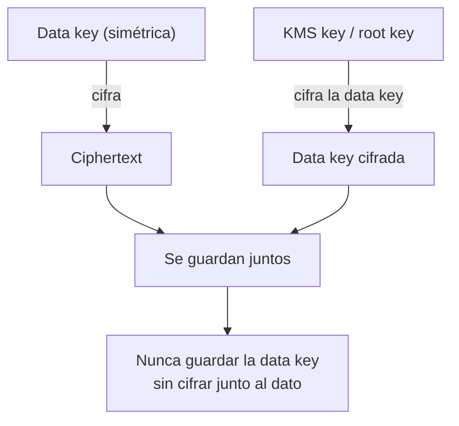

# AWS KMS

> [!abstract] Qué es este archivo
> Décima segunda lección del módulo y **la más larga hasta ahora**: **video de 12 min 48 s** más **once
> lecturas**. Es la respuesta de servicio a la pregunta que abrió [[Cryptography]]: **cómo mantener las claves
> bajo control**.
>
> Cubre **qué es KMS**, **defense in depth**, **las tres formas de material de clave**, **envelope encryption**,
> **el ciclo de vida**, **AWS managed vs. customer managed**, **simétricas vs. asimétricas**, los **tres SSE de
> S3**, **rotación**, **ABAC**, **CloudTrail** y **BYOK**. Trae **doce imágenes**, ninguna en el vault.

> [!quote] La idea que ordena todo
> **KMS no cifra tus datos: administra las claves con las que se cifran.** Y su valor no está en el algoritmo
> —**AES-256**, el mismo de siempre— sino en **la separación**: *“separa el acceso a las claves de descifrado del
> acceso a tus datos”*. **Aunque alguien entre al bucket, sin permisos de KMS no descifra nada.**

---

## Resumen en una frase

> **KMS** es el servicio administrado que **crea y controla las claves** (**protegidas por HSMs FIPS 140-2**,
> **con excepción de China**), se integra con **más de 100 servicios**, usa **envelope encryption** para no
> mandarle tus datos por la red, y **registra cada operación en CloudTrail** —con **rotación anual opcional** y
> **borrado diferido de 7 a 30 días**—.

---

## 1. El problema y la respuesta

**La pregunta, literal, es la misma que cerró la lección anterior:**

> *“¿Cómo podemos asegurar que los **datos sensibles de nuestra aplicación sigan cifrados** una vez que movemos la
> app a AWS?”*

**La respuesta:** **AWS Key Management Service (KMS)** está **diseñado específicamente para ese desafío**. Es un
**servicio administrado** que **facilita crear y controlar las claves de cifrado** usadas para cifrar tus datos.

**Por qué encaja con el caso:**

| Necesidad del cliente | Cómo la cubre KMS |
| --- | --- |
| **Cifrado consistente** entre **bases de datos, storage y compute** | **Integración nativa con más de 100 servicios de AWS** |
| **Capas de seguridad** que trabajen juntas | **Defense in depth** implementado en el servicio |
| **Proteger las claves cuando no se usan** | **HSMs** que resguardan el material |
| **Que un acceso indebido al dato no alcance** | **Separación entre el acceso a la clave y el acceso al dato** |

> [!important] La frase que hay que retener
> **KMS separa el acceso a las claves de descifrado del acceso a los datos.** El ejemplo de la fuente: *“aunque
> alguien **gane acceso a tu bucket de S3**, sin los **permisos adecuados de KMS** **sigue sin poder descifrar**
> los datos de adentro”*.
>
> Eso es **separación de deberes** (*separation of duties*), y es **el argumento central** para mover aplicaciones
> sensibles a la nube.

> [!note] Lectura propia (no está en la fuente)
> Fijate el orden: **primero el permiso, después la clave**. Un bucket público **no filtra nada** si el objeto
> está cifrado con una KMS key a la que el atacante **no tiene `kms:Decrypt`**. Y al revés: **un bucket privado
> con una key demasiado abierta es el agujero real**. **La seguridad terminó migrando del bucket a la política de
> la clave.**

---

## 2. Defense in depth: por qué el cifrado es la capa que aguanta

**La definición de la fuente:** **defense in depth** es una **estrategia de seguridad enfocada en crear múltiples
capas**. KMS es una **extensión natural** de ese enfoque, que es **una buena práctica**.

**Las capas que enumera:** **borde de red** · **VPC** · **balanceo de carga** · **cada instancia y servicio de
compute** · **sistema operativo** · **aplicación** · **código**.

> *“Cuando corrés aplicaciones en la nube, **la seguridad de la aplicación es tan crítica como la seguridad de la
> instancia**. Si las aplicaciones que corren en una instancia tienen **vulnerabilidades o configuraciones
> erróneas**, puede haber **consecuencias serias**.”*

### 2.1 El argumento criptográfico

**Por qué el cifrado mitiga un fallo de control de acceso:** *“¿Qué pasa si un **mecanismo de control de acceso
falla** y permite **acceso a los datos crudos en disco** o **viajar por un enlace de red**?”* **Si el dato está
cifrado con una clave fuerte, y la clave de descifrado no está en el mismo sistema**, **es computacionalmente
inviable** que un atacante lo descifre.

**El dato de magnitud:**

| Dato | Valor |
| --- | --- |
| **Algoritmo** | **Advanced Encryption Standard (AES) con claves de 256 bits (AES-256)** |
| **Por qué ese** | El **más fuerte adoptado por la industria y aprobado por gobiernos** para cifrar datos |
| **Dónde se usa** | **En AWS**, incluido **Amazon S3 server-side encryption** |
| **Tiempo para romperlo** | **Al menos un billón de años** con la tecnología de cómputo actual |
| **¿Y la computación cuántica?** | La investigación actual sugiere que **no reduciría lo suficiente** el tiempo para romper AES |

> [!important] El número que se pregunta
> **AES-256 = 256 bits = al menos un billón de años.** No es “difícil”: es **inviable por márgenes que no se
> pueden dimensionar**. Y la fuente agrega el matiz que casi nadie recuerda: **ni la computación cuántica, según
> la investigación actual, cambia la conclusión**.

### 2.2 El segundo problema: políticas demasiado permisivas

> *“¿Y si **creás por error políticas de acceso demasiado permisivas** sobre tus datos? Un sistema de cifrado y
> administración de claves **bien diseñado** también puede evitar que esto se convierta en un problema,
> **separando el acceso a la clave de descifrado del acceso a tus datos**.”*

> [!warning] La condición sin la cual no funciona
> **La clave de descifrado no puede estar en el mismo sistema que el dato.** La fuente lo dice dos veces: en §2
> (*“as long as the decryption key is not on the same system as your data”*) y en §5 (*“it needs to be derived and
> stored separately from the system in which data is processed”*). **Un disco cifrado cuya clave vive en el mismo
> disco no está cifrado: está ofuscado.**

---

## 3. Qué es KMS y qué permite hacer

**La definición:** **servicio administrado** para **crear y controlar KMS keys**, que son **las claves usadas
para cifrar tus datos**.

**La protección:** las KMS keys están **protegidas por HSMs validados por el programa de validación FIPS 140-2**
(*Federal Information Processing Standards*), **excepto en las Region de China (Beijing) y China (Ningxia)**.

### 3.1 Las operaciones criptográficas

| Operación | Con qué clave |
| --- | --- |
| **Encrypt, decrypt y re-encrypt** | **Simétrica o asimétrica** |
| **Sign y verify** mensajes | **Asimétrica** |
| **Generar data keys exportables** (simétricas) y **pares de data keys asimétricos** | **KMS** |
| **Generar números aleatorios** aptos para aplicaciones criptográficas | **KMS** |

### 3.2 Las capacidades avanzadas

| # | Capacidad | Qué habilita |
| --- | --- | --- |
| **1** | **Importar material criptográfico** a una KMS key | **BYOK** (§12) |
| **2** | **Crear KMS keys en un custom key store propio**, respaldado por un **clúster de CloudHSM** | Control del **módulo** que genera y usa el material |
| **3** | **Conectarse directo a KMS por un private endpoint en la VPC** | **Tráfico privado**, sin salir a internet |
| **4** | **TLS híbrido post-cuántico** para el cifrado en tránsito hacia KMS | Preparación para el **futuro** |

> [!important] Los dos caminos de control
> **Importar material** te da control **sobre el origen** de la clave; **el custom key store con CloudHSM** te da
> control **sobre el módulo** que la usa. **No son lo mismo** y el examen los separa: uno es **BYOK**, el otro es
> **HSM propio** —que es exactamente la pregunta de *“Level 3 HSMs”* que dejó abierta [[Cryptography]]—.

### 3.3 Integraciones: los servicios (y los asteriscos)

| Categoría | Servicios |
| --- | --- |
| **Compute** | **Amazon EC2**, **AWS Lambda**, **Amazon Lightsail\*** |
| **Storage** | **Amazon EBS**, **Amazon EFS**, **Amazon FSx for Windows File Server**, **Amazon S3 Glacier**, **Amazon S3**, **AWS Storage Gateway** |
| **Databases** | **Amazon Aurora**, **Amazon DynamoDB**, **DynamoDB Accelerator (DAX)\***, **Amazon Neptune**, **Amazon Redshift**, **Amazon RDS** |
| **Analytics** | **Amazon Athena**, **Amazon OpenSearch Service**, **Amazon EMR**, **AWS Glue**, **Amazon Kinesis Data Firehose**, **Kinesis Data Streams**, **Amazon MSK** |
| **Machine learning** | **Amazon Comprehend**, **Amazon Lex**, **Amazon SageMaker**, **Amazon Translate** |
| **Application services** | **Amazon Elastic Transcoder**, **Amazon SES**, **Amazon SQS** |
| **Migration and transfer** | **AWS Snowball**, **AWS Snowball Edge**, **AWS DMS** |
| **Developer tools** | **AWS CodeBuild**, **AWS CodeDeploy**, **AWS CodePipeline**, **AWS X-Ray** |
| **Management tools** | **CloudTrail – Amazon CloudWatch Logs**, **AWS Systems Manager** |
| **Media services** | **Amazon Kinesis Video Streams** |
| **Security and identity** | **AWS Certificate Manager (ACM)\***, **AWS Secrets Manager** |
| **Enterprise applications** | **Amazon WorkMail**, **Amazon WorkSpaces** |
| **Business productivity** | **Alexa for Business\*** |
| **Contact center** | **Amazon Connect** |

**\* Servicios que solo soportan AWS managed keys.**

> [!important] Los cuatro asteriscos
> **Lightsail**, **DAX**, **ACM** y **Alexa for Business** **solo aceptan AWS managed keys**. Si el escenario pide
> **customer managed key** en alguno de esos cuatro, **la respuesta es que no se puede**: es el tipo de detalle
> que el examen usa para descartar opciones.

---

## 4. Cómo funciona: las tres formas de material de clave

**El punto de partida:** pedís la **creación de una KMS key**. **Vos controlás su ciclo de vida y quién puede
usarla o administrarla.**

**El material puede venir de tres lugares:**

| # | Origen del material | Quién lo genera |
| --- | --- | --- |
| **1** | **Generado dentro de los HSMs que AWS KMS administra** | **AWS KMS** |
| **2** | **Importado desde tu propia infraestructura de administración de claves** | **Vos** (**BYOK**) |
| **3** | **Generado y usado en un clúster de CloudHSM**, como parte del **custom key store** | **CloudHSM** |

**Después de creada:** podés **enviar datos directamente al servicio** para que los **firme, verifique, cifre o
descifre** con tu KMS key. **Las usage policies** definen **qué usuarios pueden hacer qué acciones bajo qué
condiciones**.

> [!important] La restricción que ordena todo
> **“Los servicios de AWS integrados con KMS usan claves KMS simétricas para cifrar tus datos. Esos servicios
> **no soportan** el cifrado con claves KMS asimétricas.”**
>
> Traducido: **las asimétricas son para firmar y para aplicaciones propias**; **para cifrado de datos en
> servicios, simétrica o nada**.

> [!note] Lectura propia (no está en la fuente)
> Las tres formas de material **no son tres productos**: son **tres grados de control sobre el mismo servicio**.
> **KMS-generado** = comodidad total. **Importado** = control del origen, con la obligación de **guardar tu
> copia**. **Custom key store** = control del **hardware** que ejecuta las operaciones. **Más control, más
> responsabilidad operativa** —siempre en ese orden—.

---

## 5. Envelope encryption

**La definición de la fuente:** los servicios de AWS y los **client-side toolkits** integrados con KMS usan
**envelope encryption** para proteger tus datos.

### 5.1 El mecanismo, paso a paso

| # | Paso | Quién lo hace |
| --- | --- | --- |
| **1** | **Genera data keys** | **AWS KMS** |
| **2** | **Cifra los datos localmente** con esas data keys | **El servicio de AWS o tu aplicación** |
| **3** | **Cifra las data keys** bajo una **KMS key que vos definís** | **AWS KMS** |
| **4** | **Guarda el dato cifrado junto con una copia cifrada de la data key** | **El servicio** |
| **5** | Para descifrar, **pide a KMS que descifre la data key** con tu KMS key | **El servicio** |
| **6** | **Descifra el dato y lo devuelve en texto plano** | **El servicio** |

**El dato clave:** **las data keys no son retenidas ni administradas por AWS KMS.** **Las usás afuera del
servicio.**

**La autorización:** *“Si el usuario que pide los datos al servicio de AWS **está autorizado a descifrar bajo tu
KMS key**, el servicio **recibe la data key descifrada** de AWS KMS, **descifra tus datos y los devuelve en
texto plano**.”*

**La auditoría:** **todas las requests para usar tus KMS keys se registran en CloudTrail**: quién usó qué clave,
**bajo qué contexto** y **cuándo**.

### 5.2 El esquema



> [!note] Reconstrucción (no está en la fuente)
> El esquema **reconstruye** la imagen `8R1AHEM7MZ.png`, que **no está en el vault**: el texto alternativo
> describe **la data key cifrando el plaintext** y, **en paralelo**, **la root key cifrando la data key**, con
> **ambos resultados almacenados juntos** y la advertencia ***“Don't store the unencrypted key with the encrypted
> data!”***.

### 5.3 Por qué existe: el límite de 4 KB y la red

| Dato | Valor |
| --- | --- |
| **Tamaño máximo que KMS cifra directamente** | **4 kilobytes (KB)** |
| **Qué viaja con envelope encryption** | **Solo la request y la entrega de la data key** —mucho más chica— |
| **Dónde se cifra el dato** | **Localmente**, en la aplicación o en el servicio de AWS que cifra |

**El argumento de performance:** cifrar **directo con KMS** obliga a **transferir los datos por la red**. **Envelope
encryption reduce la carga de red** porque **solo viaja la data key**, y **evita la latencia** de mandar el bloque
completo.

> [!important] La regla que no se negocia
> ***“No guardes la data key sin cifrar junto al dato cifrado.”*** Si la clave viaja con el paquete, **el paquete
> no está cerrado**: está **cerrado con la llave pegada con cinta**.

### 5.4 La key-encrypting key

**Cómo se genera la data key:** a partir de **software o de un dispositivo de hardware**. **Las simétricas son
preferibles a las asimétricas** cuando querés **cifrar rápido datos de tamaño arbitrario**.

**La regla de almacenamiento:** **no podés guardar la simétrica que acabás de usar junto al dato cifrado**;
**hay que protegerla**. La mejor práctica es **cifrar la data key con otra clave**, la **key-encrypting key**:

| Propiedad | Regla |
| --- | --- |
| **Tipo** | **Puede ser simétrica o asimétrica** |
| **Origen y guarda** | **Derivada y almacenada separadamente del sistema donde se procesan los datos** |
| **Qué se guarda** | **El ciphertext resultante**, **con el dato cifrado** |

---

## 6. Ciclo de vida de una KMS key

**Lo que la fuente muestra en el diagrama:** **import → create → activate y deactivate → rotate → delete**, con
**logging en CloudTrail desde la creación hasta el borrado**.

| Operación | Efecto |
| --- | --- |
| **Create** | **Nace la clave**; se define **alias** y **descripción** |
| **Activate / Deactivate** | **Desactivar bloquea el uso** de la clave |
| **Rotate** | **Opt-in**: KMS **rota la clave una vez por año** |
| **Delete** | **Espera obligatoria** antes del borrado real |
| **Cancel deletion** | **Dentro del período de espera**, la clave **vuelve a estar activa** |

### 6.1 El borrado: 30 días… o entre 7 y 30

**Lo que dice el video:** *“KMS **no te deja borrar tus claves por accidente**. Hay un **período de espera
obligatorio de 30** antes del borrado.”*

**Lo que dice la lectura:** podés **programar el borrado** de una KMS key **y sus metadatos** con un **período de
espera configurable de 7 a 30 días**. **El default es 30 días.**

**Las reglas del período:**

1. **Sirve para verificar el impacto** del borrado **en tus aplicaciones y en los usuarios** que dependen de la
   clave.
2. **Se puede cancelar** el borrado **durante la espera**.
3. **Mientras está programada para borrado, la clave no se puede usar** —salvo que canceles—.
4. **Al terminar la espera, se borra**: *“una vez borrada, **no podés usarla más**. **Todos los datos protegidos
   bajo una KMS key borrada son inaccesibles**.”*

> [!important] Cómo se concilia el 30 con el 7–30
> **No es una contradicción**: **30 es el default** y **7–30 es el rango**. El video **redondea al default**; la
> lectura da **el mínimo y el máximo**. **Se conservan las dos cifras** y se registra (§ registro, punto 1).

### 6.2 El material importado: se puede borrar sin espera

| Acción | Espera | Qué queda |
| --- | --- | --- |
| **Borrar el material importado on demand** | **Ninguna** | **La KMS key, su key ID y sus metadatos** |
| **Definir una expiración al importar** | **La que fijes** | **AWS deja de usar el material y lo borra al vencer** |
| **Reimportar el material** | — | **Vuelve a funcionar** |

> [!important] La asimetría que se pregunta
> **Borrar el material importado** ≠ **borrar la clave**. Lo primero **deja la clave vacía pero existente** y
> **permite reimportar**; lo segundo **borra el recurso** y **hace inaccesibles los datos**. **Confundirlos es
> perder datos o creer que se perdieron.**

---

## 7. AWS managed keys vs. customer managed keys

### 7.1 AWS managed keys

**Definición:** **KMS keys en tu cuenta** que **un servicio de AWS integrado con KMS crea, administra y usa en tu
nombre**.

| Propiedad | Regla |
| --- | --- |
| **Alias** | **Siempre empieza con `aws/`**; la segunda mitad **nombra el servicio** |
| **Ejemplo** | **Amazon EBS** crea y usa **`aws/ebs`** |
| **Costo** | **Completamente gratis** |
| **Visibilidad** | **Podés verlas**, **ver sus key policies** y **auditar su uso en CloudTrail** |
| **Administración** | **No podés administrarlas, rotarlas ni cambiar sus key policies** |
| **Uso directo** | **No** podés usarlas en operaciones criptográficas: **las usa el servicio que las creó** |

> [!important] El alias como huella digital
> **`aws/` al principio = AWS managed.** Si un enunciado dice *“la clave `aws/s3`”*, **no es tuya**: **no podés
> rotarla, ni cambiarle la política, ni usarla directamente**.

### 7.2 Customer managed keys

**Definición:** **KMS keys en tu cuenta de AWS que vos creás, poseés y administrás.**

**Control total, enumerado por la fuente:**

| # | Qué controlás |
| --- | --- |
| **1** | **Establecer y mantener sus key policies e IAM policies** |
| **2** | **Otorgarlas, activarlas y desactivarlas** |
| **3** | **Rotar su material criptográfico** |
| **4** | **Agregar tags** |
| **5** | **Crear aliases que la referencien** |
| **6** | **Programar su borrado** |

**Cómo se reconocen:**

| Alias | Key ID | Status |
| --- | --- | --- |
| **test-key-1** | **xxx-xxx-xxx-xxx-xxx** | **Enabled** |
| **test-key-2** | **yyy-yyy-yyy-yyy-yyy** | **Enabled** |

**La identificación definitiva:** usar la operación **`DescribeKey`**. Para una customer managed key, **el campo
`KeyManager` de la respuesta es `CUSTOMER`**.

> [!important] La prueba de fuego del examen
> *“¿Esta clave es mía o del servicio?”* → **mirá `KeyManager` con `DescribeKey`**: **`CUSTOMER`** = tuya;
> **`AWS`** = administrada por el servicio. **El alias es la pista; `DescribeKey` es la prueba.**

---

## 8. Simétricas y asimétricas

| | **Symmetric KMS key** | **Asymmetric KMS key** |
| --- | --- | --- |
| **Qué representa** | **Una clave de 256 bits** | **Un par RSA** o **un par ECC** |
| **Para qué sirve** | **Cifrar y descifrar** | **RSA**: cifrar/descifrar **o** firmar/verificar —**no ambas**— · **ECC**: firmar y verificar |
| **Dónde se puede usar** | **Servicios integrados** y aplicaciones | **Aplicaciones**; **los servicios integrados no la soportan para cifrar** |

**Las reglas de residencia:**

- **Las KMS keys se crean en AWS KMS.**
- **Las claves simétricas y las claves privadas de las asimétricas nunca salen de AWS KMS sin cifrar.**
- **Para administrar** la clave: **consola** o **API de KMS**.
- **Para usarla en operaciones criptográficas**: **siempre la API de KMS**.

**La diferencia con las data keys:** **AWS KMS no almacena, administra ni rastrea tus data keys**; **las usás
fuera de KMS**.

**El material por defecto:**

| Caso | Qué pasa |
| --- | --- |
| **Material generado por KMS** | **No se puede extraer, exportar, ver ni administrar**. **No se puede borrar el material**: hay que **borrar la KMS key** |
| **Material importado** | **Sí** se puede borrar **sin borrar la clave** (§6.2) |
| **Custom key store** | El material **se genera en el clúster de CloudHSM** asociado |

---

## 9. Los tres server-side encryption de S3

### 9.1 SSE-S3 (S3 managed keys)

| Propiedad | Regla |
| --- | --- |
| **Quién cifra** | **S3**, automáticamente |
| **Clave por objeto** | **Cada objeto se cifra con una clave única** |
| **Protección extra** | **Cifra la clave misma con una root key que rota regularmente** |
| **Algoritmo** | **AES-256**, uno de los cifrados de bloque más fuertes disponibles |
| **Quién protege la root key** | **S3** |
| **Gestión de claves** | **Ninguna de tu parte** |

### 9.2 SSE-KMS (KMS keys)

**Definición:** **server-side encryption con claves KMS almacenadas en AWS KMS**. **Es similar a SSE-S3**, pero
**con beneficios adicionales y cargos por usar el servicio**.

| Beneficio | Qué agrega |
| --- | --- |
| **Permisos separados** para el uso de la KMS key | **Protección adicional** contra acceso no autorizado a los objetos |
| **Audit trail** | Muestra **cuándo se usó la KMS key y quién la usó** |
| **Elección de clave** | **Customer managed** propias, o **AWS managed** **únicas para tu cuenta, tu servicio y tu Region** |

### 9.3 SSE-C (customer provided keys)

**Definición:** **server-side encryption con claves administradas por el cliente**. **Vos administrás las claves
de cifrado**; con **la clave que proveés en cada request**, **S3 hace el cifrado** (al escribir a disco) y **el
descifrado** (al acceder). **No mantenés el código**: **solo las claves**.

**El detalle fino:** **S3 no guarda la clave que le das**. Guarda un **HMAC salteado** (*hash-based message
authentication code*) **de la clave**, para **validar requests futuras**. Ese valor **no sirve para derivar la
clave** **ni para descifrar** el objeto.

> [!warning] La consecuencia brutal
> **“Si perdés la clave de cifrado, perdés el objeto.”** No hay recuperación: **AWS nunca tuvo la clave**.

### 9.4 El triángulo que se confunde

| | **SSE-S3** | **SSE-KMS** | **SSE-C** |
| --- | --- | --- | --- |
| **Quién tiene la clave** | **S3** | **AWS KMS** | **Vos** |
| **Quién cifra y descifra** | **S3** | **S3** (con claves de KMS) | **S3** (con tu clave en cada request) |
| **Permisos separados** | No | **Sí** | No aplica: **la clave es el permiso** |
| **Auditoría de uso de clave** | No | **Sí, en CloudTrail** | No |
| **Si perdés la clave** | No aplica | **La clave sigue en KMS** | **Perdés el objeto** |
| **Complejidad** | **Mínima** | **Media** | **Alta** |

> [!important] La regla de elección
> **SSE-S3** = **lo más simple y sin costo de KMS**. **SSE-KMS** = **control y auditoría** de quién usa la clave
> (y **cargos**). **SSE-C** = **la clave nunca queda en AWS**, **a cambio de perderlo todo si se pierde**.

> [!note] Lectura propia (no está en la fuente)
> **SSE-C y BYOK se parecen y no son lo mismo**: en **SSE-C** la clave **viaja en cada request** y **AWS no la
> guarda**; en **BYOK** la clave **se importa una vez** a KMS y **KMS la administra** (§12). **SSE-C es control
> absoluto con riesgo absoluto; BYOK es control del origen con la comodidad de KMS.**

---

## 10. Tomar el control: rotación, ABAC y las dos listas

### 10.1 Rotación: cuándo sí y cuándo no

| Caso | ¿Rotación automática anual? |
| --- | --- |
| **Key generada en los HSMs de AWS KMS** | **Sí**, con **opt-in** |
| **Key con material importado** | **No** |
| **Key asimétrica** | **No** |
| **Key de custom key store (CloudHSM)** | **No** |

**La rotación manual:** **crear una nueva KMS key** y **remapear el alias existente** de la vieja a la nueva.

**Qué pasa con los datos:**

| Tipo de rotación | ¿Hay que re-cifrar? |
| --- | --- |
| **Automática** | **No**: KMS **conserva las versiones anteriores** para **descifrar** lo cifrado con ellas; **todo cifrado nuevo usa la última versión** |
| **Manual** (importadas o custom key store) | **Puede hacer falta**, **según decidas conservar o no las versiones viejas** |

> [!important] La frase que evita un error caro
> **Rotar no es re-cifrar.** Con rotación automática, **los datos viejos siguen legibles** porque **KMS guarda
> las versiones anteriores**. **Nadie tiene que re-subir nada.**

### 10.2 ABAC con tags y aliases

**Lo que soporta KMS:** **attribute-based access control (ABAC)**, para **controlar el acceso a las KMS keys en
base a los tags y aliases** asociados. **ABAC** es una **estrategia de autorización que define permisos basados en
tags**, que se pueden **adjuntar a usuarios y a recursos de AWS**.

**Además:** KMS **soporta el uso de aliases en las condiciones de las policies**. Con ABAC podés **controlar
permisos para usar o administrar claves según los tags o aliases aplicados a la clave**.

### 10.3 Las dos listas de control

| **Controlar quién usa las claves y cómo** | **Controlar el mantenimiento** |
| --- | --- |
| **Quién puede administrar y usar** tus claves | **Activar y desactivar** claves **al instante** |
| **Limitar cómo se usan** (*scope reduction*) | **Controlar el borrado** |
| **Definir condiciones de uso** (**encryption context** = objetos de datos específicos) | **Controlar la rotación** |
| **Delegar permisos** y **compartir acceso entre cuentas** | **Organizar con aliases y tags** |
| **Usar ABAC** | — |

> [!important] El encryption context
> Es **la condición más fina** de la lista y **la que más se pregunta**: permite **atar el descifrado a un
> contexto** —en el ejemplo de CloudTrail, **`volumeid-12345`**—. **La misma clave, usada para otro recurso, no
> descifra si el contexto no coincide.**

---

## 11. Auditoría con CloudTrail

**Qué registra:** **todas las llamadas a AWS KMS** hechas por **usuarios, roles y otros servicios**, incluidas las
de **consola, API, CLI y AWS Tools for PowerShell**.

| Tipo de operación | Ejemplos |
| --- | --- |
| **Read-only** | **`ListAliases`**, **`GetKeyRotationStatus`** |
| **De administración** | **`CreateKey`**, **`PutKeyPolicy`** |
| **Criptográficas** | **`GenerateDataKey`**, **`Decrypt`** |

### 11.1 El log, línea por línea

```
"EventName":"DecryptResult",

"EventTime":"2014-08-18T18:13:07Z",

"RequestParameters":
    {\"keyId\":\"2b42x363-1911-4e3a-8321-6b67329025ex"}",

"EncryptionContext":"volumeid-12345",

"SourceIPAddress":"203.0.113.113",

"UserIdentity":
    {\"arn\":\"arn:aws:iam:: 111122223333:user/User123"}
```

**Qué dice cada campo, según la fuente:**

| Campo | Qué responde |
| --- | --- |
| **`EventName`** | **La acción** de la API de KMS: acá, **`DecryptResult`** |
| **`EventTime`** | **Cuándo** ocurrió: **`2014-08-18T18:13:07Z`** |
| **`RequestParameters`** | **Qué clave** se está referenciando |
| **`EncryptionContext`** | **Qué recurso de AWS** se protege: acá, **`volumeid-12345`** |
| **`SourceIPAddress`** | **Desde qué IP**: acá, **`203.0.113.113`** |
| **`UserIdentity`** | **Qué usuario** hizo la llamada |

> [!warning] El log del ejemplo **no es JSON válido** (registrado)
> Trae **comillas escapadas** (`\"`), una **llave de cierre de más** en `RequestParameters`, **un espacio dentro
> del ARN** (`arn:aws:iam:: 111122223333`) y un **key ID con una `x`** (`2b42x363`), que **no es hexadecimal**. Se
> transcribe **literal** y **no se “arregla”**: se usa para leer **los seis campos**, no como muestra de formato.

### 11.2 Las reglas de auditoría

| Regla | Detalle |
| --- | --- |
| **Se registran los éxitos y los fallos** | También **cuando el llamador es denegado** |
| **Operaciones cross-account** | Se registran **en la cuenta del llamador y en la cuenta dueña de la clave** |
| **Campos omitidos por seguridad** | El **parámetro plaintext** de un `Encrypt`, la **respuesta de `GetKeyPolicy`** y **cualquier operación criptográfica** |
| **Se puede excluir** | **Por defecto** se registran **todas** las acciones de KMS, pero **podés excluirlas de un trail** |

> [!important] El detalle cross-account
> **Una operación sobre una clave de otra cuenta aparece en los dos trails.** Si el escenario pide *“¿dónde
> quedó el registro de un descifrado hecho desde otra cuenta?”*, la respuesta **son las dos**: la del que llamó y
> la del dueño de la clave.

---

## 12. BYOK: traer tu propia clave

**Qué es:** **importar una copia de tu clave** desde **tu propia infraestructura de administración de claves** a
AWS KMS, para usarla **con cualquier servicio integrado** o **desde tus propias aplicaciones**.

**Lo que controlás:** **el hardware o software** con el que se generan las **customer managed KMS keys**, **cuándo
o si expiran**, **cuándo las subís** y **cuándo las borrás**.

> [!warning] La restricción
> **No se pueden importar KMS keys asimétricas.** **BYOK es solo para claves simétricas.**

### 12.1 BYOK vs. SSE-C

| | **BYOK** | **SSE-C** |
| --- | --- | --- |
| **Cuándo se entrega la clave** | **Una vez**, al importarla | **En cada request** |
| **Quién la administra después** | **KMS**, por vos | **Vos** |
| **Dónde se usa** | **Cualquier servicio integrado** o app propia | **Solo Amazon S3** |
| **Costo operativo** | **Bajo** | **Alto**: hay que enviarla siempre |

**La razón por la que alguien elige BYOK:** *“querían **generar claves en sus HSMs existentes**, pero **sin la
carga operativa de administrar claves en cada request**”*.

### 12.2 Las dos diferencias con una clave generada por KMS

| # | Diferencia | Clave importada | Clave generada por KMS |
| --- | --- | --- | --- |
| **1** | **Copia de respaldo** | **Vos** mantenés una copia en tu infraestructura **para poder reimportarla** | **AWS** garantiza **disponibilidad, seguridad y durabilidad** hasta que la programes para borrado |
| **2** | **Expiración y borrado** | **Podés fijar una expiración**; KMS **borra el material** al vencer; **o borrarlo on demand**; **la referencia y los metadatos quedan** y **se puede reimportar** | **No expira**; **no se puede borrar de inmediato**: **espera obligatoria de 7 a 30 días** |

> [!important] El matiz que decide
> **En las dos, la clave se puede desactivar o programar para borrado.** La diferencia es **qué se borra**:
> **el material** (importada) o **la clave entera** (cualquiera, al vencer la espera). **El material importado
> se puede reimportar; la clave borrada, no.**

---

## 13. Traducción del contenido

> [!info] Sección de referencia (opcional)
> Esto es la **traducción fiel** de la fuente. **No hace falta leerla para estudiar**: lo que se estudia son las
> secciones **1 a 12** y se cierra con la **15**.
> La **tabla de integraciones** se traduce **una sola vez**, en **§3.3**; acá no se repite.

### 13.1 Video: Introduction to AWS KMS (transcripción)

**Ahora que sabemos más sobre criptografía con AWS, podemos ir a la pregunta de tu deployment manager: ¿cómo
podemos asegurar que los datos sensibles de nuestra aplicación sigan cifrados una vez que movemos la app a AWS?**
**AWS Key Management Service, o KMS, está diseñado específicamente para ese desafío.** **Es un servicio
administrado que facilita crear y controlar las claves de cifrado usadas para cifrar tus datos.**

**Lo que hace a KMS particularmente valioso para las necesidades del deployment manager es cómo se integra con
otros servicios de AWS.** **Cuando muevan sus aplicaciones a AWS, van a necesitar cifrado consistente entre bases
de datos, storage y recursos de cómputo.** **KMS hace eso posible mediante integración nativa con más de 100
servicios de AWS.**

**KMS implementa lo que llamamos defense in depth: múltiples capas de seguridad trabajando juntas.** **Está
construido específicamente para entornos cloud, protege tus claves mientras no están en uso y, lo más importante,
separa el acceso a las claves de descifrado del acceso a tus datos.** **Por esto importa: incluso si alguien gana
acceso a tu bucket de S3, sin los permisos adecuados de KMS, sigue sin poder descifrar los datos de adentro.**
**Esta separación de deberes es esencial para mantener controles de seguridad fuertes, especialmente al mover
aplicaciones sensibles a la nube.**

**Ahora veamos las características específicas que hacen de KMS la solución correcta para las necesidades de tu
deployment manager.** **Primero, hay controles comprensivos de autenticación y autorización.** **Podés definir
precisamente quién puede usar qué claves y bajo qué condiciones.** **También podés importar tus propias claves si
hace falta, eligiendo distintos modos de key store para cumplir requisitos específicos de seguridad.** **Y podés
estar tranquilo sabiendo que todo cumple con los estándares de cumplimiento FIPS 140-2 Level 3.**

**Y KMS se integra extensamente en AWS.** **Es como tener un sistema de llaves universal que funciona con
prácticamente cualquier servicio que uses.** **Si necesitás cifrar instancias EC2 o correr funciones Lambda, KMS
te cubre.** **O quizás guardar datos sensibles en S3 o EBS: KMS también funciona sin problemas con eso.** **Incluso
cuando usás herramientas de analítica como Athena u OpenSearch, KMS está ahí, asegurando que tus datos sigan
protegidos.** **Esta integración amplia significa que podés implementar cifrado consistente en toda tu
infraestructura de AWS sin administrar múltiples sistemas de claves.**

**Y la historia de integración no termina ahí.** **Ya sea migrando datos con AWS DMS, construyendo aplicaciones con
CodeBuild, administrando certificados con ACM, o corriendo aplicaciones empresariales como WorkSpaces, KMS maneja
todas tus necesidades de cifrado, sin importar qué departamento o función estés apoyando.**

**Veamos cómo esto atiende las preocupaciones de cifrado del deployment manager en un entorno empresarial real.**
**El data center corporativo se conecta a AWS y KMS se vuelve el punto central para administrar el cifrado.**
**Cada operación queda registrada en CloudTrail, dando visibilidad completa de quién accede a qué y cuándo.** **Esto
resuelve uno de los desafíos clave de nuestro escenario: mantener el control sobre datos sensibles mientras se
migra a AWS.** **Obtenés la seguridad que el deployment manager necesita, con la pista de auditoría para probar
que funciona.**

**Y esto es particularmente importante para tu migración de aplicaciones, porque necesitás asegurar que los
controles de seguridad se mantengan consistentes durante y después del movimiento a AWS.** **Con KMS podés
empezar con una sola aplicación y expandirte a cubrir todo el entorno de AWS a medida que las cargas migran.**

**Ahora, acá es donde KMS se pone realmente ingenioso.** **Usa algo llamado envelope encryption.** **Pensalo como
un sistema sofisticado de cajas de seguridad.** **Tenés una clave universal que protege claves de datos
individuales.** **Y esas data keys protegen tus datos reales.** **Las data keys cifradas viajan con tus datos
cifrados, como un paquete seguro con su propio candado incorporado.** **Este enfoque resuelve varios problemas a
la vez.** **Es perfecto para cifrar grandes cantidades de datos, permite cacheo local de claves cuando necesitás
alto performance, y agrega una capa extra de seguridad.** **Los clientes de banca suelen usar esto para procesar
millones de transacciones por día.** **Obtienen la seguridad que necesitan sin sacrificar velocidad.**

**Sabés lo importante que es llevar la cuenta de tus claves en el mundo físico.** **Lo mismo pasa con las claves
de cifrado en la nube.** **Y ahí entra el ciclo de vida de las KMS keys.** **Pensá qué pasa desde el momento en
que creás una clave.** **Todo empieza con creación y activación.** **Con el tiempo, quizás quieras rotarla
periódicamente para mejor seguridad, como cambiar las cerraduras de tus puertas.** **A veces vas a necesitar
suspender el acceso temporalmente desactivando una clave, y eventualmente quizás necesites borrarla del todo.**
**Pero acá está mi característica de seguridad favorita.** **KMS no te deja borrar tus claves por accidente.**
**Hay un período de espera obligatorio de 30 antes del borrado.** **No puedo decirte cuántas veces esto salvó a
organizaciones de perder acceso a sus datos cifrados por accidente.**

**Y la forma en que KMS organiza las claves también es interesante.** **Imaginá una especie de pirámide.** **Abajo
tenés tus data keys haciendo el trabajo pesado de cifrar tus datos reales.** **Arriba, tus KMS keys protegen esas
data keys.** **Y las key policies están en la cima, controlando quién puede usar qué.** **¿Lo mejor?** **Cada
operación queda registrada, así que siempre sabés exactamente qué está pasando con tus claves.** **A los clientes
de industrias altamente reguladas les encanta esta configuración.** **Pueden mostrarles a sus auditores
exactamente quién accedió a qué dato y cuándo, hasta el milisegundo.**

**Acá hay algo que te hace la vida más fácil cuando empezás con el cifrado.** **Las AWS managed keys.** **Son como
tener un equipo de seguridad de confianza que maneja toda la administración básica de claves por vos.** **AWS crea
y mantiene estas claves automáticamente, y son completamente gratis de usar.** **Lo realmente bueno es que,
aunque solo el servicio de AWS que las creó puede usarlas directamente, vos tenés visibilidad completa de cómo se
usan a través de CloudTrail.** **Por ejemplo, cuando encendés un volumen EBS cifrado, AWS crea automáticamente una
clave AWS/EBS administrada para vos.** **Es cifrado fácil, sin comprometer seguridad ni visibilidad.**

**Ahora recordá cómo tu deployment manager necesita mantener el control sobre sus datos sensibles.** **Acá es
donde las customer managed keys salvan el día.** **A diferencia de las AWS managed keys, estas claves las creás
vos y mantenés control completo sobre ellas.** **Vos decidís quién puede usarlas, cómo se usan, y cuándo deberían
rotarse o retirarse.** **Hace poco trabajé con un sistema hospitalario que necesitaba este nivel de control para
los registros de sus pacientes.** **Usaron customer managed keys para asegurar que solo aplicaciones y equipos
específicos pudieran acceder a datos sensibles, con cada intento de acceso registrado para compliance.**

**Ahora, cuando se trata de cifrar tus datos, tenés opciones.** **Empecemos con server-side encryption usando
claves administradas por S3, o SSE-S3.** **Este es el enfoque más simple.** **S3 maneja todo automáticamente.**
**Cada objeto tiene su propia clave única, tus datos se cifran al subirlos, y no tenés que administrar ninguna
clave.** **Pero, ¿y si necesitás más control y visibilidad?** **Ahí entran las claves administradas por KMS, o
SSE-KMS.** **Tenés toda la conveniencia del server-side encryption, pero con superpoderes adicionales: permisos
separados para el uso de la clave, logging detallado en CloudTrail, y la capacidad de crear y administrar tus
propias claves.** **Para muchos clientes, esto es exactamente lo que necesitan.** **La simplicidad del cifrado
automatizado, con la pista de auditoría que sus equipos de compliance exigen.**

**Entonces, ¿cómo encajan todas estas piezas para la seguridad del mundo real?** **Pensá en controlar quién puede
usar las claves y cómo.** **Podés establecer permisos precisos, definir condiciones específicas, incluso compartir
claves entre cuentas cuando hace falta.** **Un retailer global con el que trabajé usa estos controles para
administrar el cifrado entre sus entornos de desarrollo, staging y producción, cada uno con requisitos de
seguridad distintos.**

**Acá es donde las cosas se ponen realmente interesantes.** **Cada operación de KMS queda registrada en
CloudTrail.** **¿Querés saber quién intentó descifrar datos sensibles a las 3 de la mañana?** **Está en esos
logs.** **Si necesitás probarles a los auditores que solo aplicaciones autorizadas acceden a ciertas claves, la
evidencia está ahí.** **Tenés visibilidad completa de qué operación se realizó, cuándo ocurrió, quién la hizo, qué
clave se usó y qué recurso se accedió.**

**Desglosar una entrada típica de CloudTrail muestra cuán detallada es esta visibilidad.** **Ves la acción exacta
de la API llamada, el momento preciso, el usuario de AWS que hizo la request, qué clave estuvo involucrada, qué
recurso de AWS se estaba protegiendo, incluso la dirección IP de origen.** **Este es exactamente el tipo de pista
de auditoría detallada que tu deployment manager necesita para mantener seguridad y compliance en tu entorno
cloud.**

**Ahora, otra opción poderosa que sorprende a mucha gente.** **Podés traer tus propias claves a AWS KMS.** **Esto
se conoce como BYOK.** **Es perfecto para organizaciones que quieren mantener ese nivel extra de control sobre la
generación de sus claves.** **Vos controlás cómo se generan tus claves, mantenés tus propias copias de respaldo, y
podés subirlas solo cuando hace falta.** **Cuando terminás, las borrás y desaparecen.** **Pero quizás te
preguntes en qué se diferencia de las customer provided keys, o SSE-C.** **Con SSE-C tenés que proveer la clave en
cada request para acceder a tus datos.** **BYOK, en cambio, te deja importar tu clave una vez en KMS, y después
KMS maneja todo el trabajo pesado por vos.** **Los clientes podrían elegir BYOK sobre SSE-C porque querían generar
claves en sus HSMs existentes, pero no quieren la carga operativa de administrar claves en cada request.**
**Obtienen el control que necesitan sobre la generación de claves, aprovechando todos los beneficios de KMS para
la administración de claves.**

**Antes de pasar a CloudHSM, cerremos lo que aprendimos sobre KMS.** **El panorama cambió por completo.** **El
cifrado por defecto ahora es un objetivo realista, no solo un deseo.** **Tenés una administración de claves sólida,
con controles de acceso mejorados y visibilidad completa.** **Con más de 100 integraciones de servicios de AWS, la
implementación es directa, y tenés opciones sobre cuánto control querés sobre tus claves.** **¿Recordás la
pregunta de tu deployment manager sobre mantener los datos de la aplicación cifrados en AWS?** **KMS provee
exactamente lo que necesita: una solución robusta y escalable que puede crecer con su adopción del cloud,
manteniendo controles de seguridad estrictos.**

*Duración del video: **12 minutos 48 segundos**.*

### 13.2 Lectura: AWS KMS and Defense in Depth

**Defense in depth es una estrategia de seguridad enfocada en crear múltiples capas de seguridad.** **AWS KMS es
una extensión natural del enfoque de defense in depth, que es una buena práctica.** **Aplicá un enfoque de defense
in depth con múltiples controles de seguridad en todas las capas.** **Esto incluye, por ejemplo, borde de red,
virtual private cloud (VPC), balanceo de carga, cada instancia y servicio de compute, sistema operativo,
aplicación y código.**

**Cuando corrés aplicaciones en la nube, la seguridad de la aplicación es tan crítica como la seguridad de la
instancia.** **Si las aplicaciones que corren en una instancia tienen vulnerabilidades o configuraciones erróneas,
puede haber consecuencias serias.** **El cifrado es un componente crítico de una estrategia de defense in depth
porque puede mitigar debilidades en tu mecanismo de control de acceso primario.**

**¿Qué pasa si un mecanismo de control de acceso falla y permite acceso a los datos crudos en disco o permite
viajar por un enlace de red?** **Si los datos están cifrados usando una clave fuerte, mientras la clave de
descifrado no esté en el mismo sistema que tus datos, es computacionalmente inviable para un atacante descifrar
tus datos.**

**Para mostrar cuán inviable es, consideremos el Advanced Encryption Standard (AES) con claves de 256 bits
(AES-256).** **Es el algoritmo más fuerte adoptado por la industria y aprobado por gobiernos para cifrar datos.**
**AES-256 es la tecnología que usamos para cifrar datos en AWS, incluido Amazon S3 server-side encryption.**
**Tomaría al menos un billón de años romperlo usando la tecnología de cómputo actual.** **La investigación actual
sugiere que incluso la disponibilidad futura de computación basada en cuántica no reduciría suficientemente el
tiempo que tomaría romper el cifrado AES.**

**¿Pero qué pasa si creás por error políticas de acceso demasiado permisivas sobre tus datos?** **Un sistema de
cifrado y administración de claves bien diseñado también puede evitar que esto se convierta en un problema,
separando el acceso a la clave de descifrado del acceso a tus datos.**

### 13.3 Lectura: AWS KMS Solutions

**AWS KMS es un servicio administrado que podés usar para crear y controlar KMS keys, que son las claves usadas
para cifrar tus datos.** **Las KMS keys están protegidas por HSMs validados por el Programa de Validación de
Módulos Criptográficos FIPS 140-2, excepto en las Region de China (Beijing) y China (Ningxia).**

**Podés usar tus KMS keys en operaciones criptográficas:**

- **Cifrar, descifrar y re-cifrar datos con KMS keys simétricas o asimétricas.**
- **Firmar y verificar mensajes con KMS keys asimétricas.**
- **Generar data keys simétricas exportables y pares de data keys asimétricos.**
- **Generar números aleatorios aptos para aplicaciones criptográficas.**

**Podés usar las características avanzadas de AWS KMS:**

- **Importar material criptográfico a una KMS key.**
- **Crear KMS keys en tu propio custom key store respaldado por un clúster de CloudHSM.**
- **Conectarte directamente a AWS KMS a través de un private endpoint en tu VPC.**
- **Usar TLS híbrido post-cuántico para el futuro cifrado en tránsito de los datos enviados a AWS KMS.**

**Al usar AWS KMS, ganás más control sobre el acceso a los datos que cifrás.** **Podés usar las características de
administración de claves y criptográficas directamente en tus aplicaciones o a través de los servicios de AWS
integrados con AWS KMS.** **Sea que estés escribiendo aplicaciones para AWS o usando servicios de AWS, podés usar
AWS KMS para mantener el control sobre quién puede usar tus KMS keys y ganar acceso a tus datos cifrados.**

**AWS KMS Service Integrations** — **AWS KMS está integrado con la mayoría de los otros servicios de AWS que
cifran tus datos.** *(La tabla completa, traducida, está en **§3.3**; los servicios marcados con asterisco son los
que **solo soportan AWS managed keys**.)*

### 13.4 Lectura: How AWS KMS Works

**Empezás a usar el servicio pidiendo la creación de una KMS key.** **Vos controlás el ciclo de vida de la KMS
key, así como quién puede usarla o administrarla.** **El material de la clave de una KMS key se genera dentro de
HSMs que AWS KMS administra.** **Alternativamente, podés importar material de clave desde tu propia
infraestructura de administración de claves y asociarlo a una KMS key.**

**También podés hacer que el material de la clave se genere y se use en un clúster de CloudHSM, como parte de la
característica de custom key store de AWS KMS.** **Muchos servicios de AWS usan AWS KMS para soportar el cifrado
de tus datos.** **Cuando un servicio de AWS está integrado con AWS KMS, podés usar las KMS keys de tu cuenta para
proteger los datos que el servicio recibe, almacena o administra por vos.**

**Una vez que creaste una KMS key usando cualquiera de las tres opciones soportadas, podés enviar datos
directamente al servicio para que los firme, verifique, cifre o descifre usando tu KMS key.** **Vos establecés
las políticas de uso sobre esas claves, que determinan qué usuarios pueden realizar qué acciones bajo qué
condiciones.**

**Importante: los servicios de AWS integrados con AWS KMS usan KMS keys simétricas para cifrar tus datos.** **Esos
servicios no soportan el cifrado con KMS keys asimétricas.**

**AWS Key Management Service** — **Para ayuda determinando si una KMS key es simétrica o asimétrica, visitá la
guía del desarrollador.**

### 13.5 Lectura: Envelope Encryption Primer

**Los servicios de AWS y los client-side toolkits que se integran con AWS KMS usan un método conocido como
envelope encryption para proteger tus datos.** **Con este método, AWS KMS genera data keys que se usan para cifrar
datos localmente en el servicio de AWS o en tu aplicación.** **Las data keys, a su vez, están cifradas bajo una KMS
key que vos definís.** **Las data keys no son retenidas ni administradas por AWS KMS.** **Los servicios de AWS
cifran tus datos y almacenan una copia cifrada de la data key junto con los datos cifrados.** **Cuando un servicio
necesita descifrar tus datos, le pide a AWS KMS que descifre la data key usando tu KMS key.**

**Si el usuario que pide datos al servicio de AWS está autorizado a descifrar bajo tu KMS key, el servicio de AWS
recibirá la data key descifrada de AWS KMS.** **El servicio de AWS después descifra tus datos y los devuelve en
texto plano.** **Todas las requests para usar tus KMS keys quedan registradas en CloudTrail, así sabés quién usó
qué clave, bajo qué contexto y cuándo la usó.**

**Si bien AWS KMS soporta el envío de datos de hasta 4 kilobytes (KB) para cifrar directamente, el envelope
encryption puede ofrecer beneficios significativos de performance.** **Cuando cifrás datos directamente con AWS
KMS, deben transferirse por la red.** **El envelope encryption reduce la carga de red porque solo la request y la
entrega de la data key —mucho más chica— viajan por la red.** **La data key se usa localmente en tu aplicación (o
en el servicio de AWS que cifra), evitando la necesidad de enviar el bloque completo de datos a AWS KMS y su
consecuente latencia de red.**

**Data encryption and key management** — **Una data key simétrica se genera a partir de software o de un
dispositivo de hardware.** **Las claves simétricas son preferibles a las asimétricas cuando querés cifrar rápido
datos de tamaño arbitrario.** **La clave se usa junto con un algoritmo de cifrado, como AES, y el ciphertext
resultante se almacena.** **No podés almacenar la clave simétrica que acabás de usar junto con los datos
cifrados: hay que protegerla.** **La mejor práctica es cifrar la data key con otra clave, llamada
key-encrypting key.** **Puede ser simétrica o asimétrica, pero necesita ser derivada y almacenada separadamente
del sistema en el que se procesan los datos.** **Después de que la data key fue cifrada con la key-encrypting key,
guardá el ciphertext resultante con los datos cifrados.**

### 13.6 Lectura: AWS KMS Key Management Lifecycle

**Exploremos cómo se ve el ciclo de vida de AWS KMS Key Management, desde importar tu clave hasta borrarla cuando
expiró.**

- **Desactivar una clave bloquea su uso.**
- **Borrar una clave implementa un período de espera de 30 días hasta que la clave se borra realmente.**
- **Cancelá el borrado dentro del período de demora y volvé a activar la clave.**
- **Optá por que AWS KMS rote las claves una vez por año.**

**El ciclo de vida de las KMS keys incluye operaciones estándar, como crear, almacenar, desactivar y borrar una
KMS key.** **Crear tu propia KMS key te da más control del que tenés con las AWS managed keys.** **Cuando creás
una clave simétrica customer managed, podés elegir usar material generado por AWS KMS, generado dentro de un
clúster de CloudHSM (custom key store), o importar tu propio material.** **Podés definir un alias y una
descripción para la clave, y optar por que la clave se rote automáticamente una vez por año si la generó AWS KMS.**

**Podés programar el borrado de una KMS key y sus metadatos asociados que creaste en AWS KMS, con un período de
espera configurable de 7 a 30 días.** **Este período de espera da tiempo para verificar el impacto del borrado de
una clave en tus aplicaciones y en los usuarios que dependen de ella.** **El período de espera por defecto es de
30 días.** **Podés cancelar el borrado de la clave durante el período de espera.** **La clave no se puede usar si
está programada para borrado, hasta que canceles el borrado durante el período de espera.** **La clave se borra al
final del período configurable si no cancelás el borrado.** **Una vez que una clave se borra, ya no podés usarla.**
**Todos los datos protegidos bajo una KMS key borrada son inaccesibles.**

**Para KMS keys con material importado, podés borrar el material sin borrar el key ID ni los metadatos de la KMS
key de dos formas.** **Primero, podés borrar tu material importado on demand, sin período de espera.** **Segundo,
al importar el material a la KMS key, podés definir un tiempo de expiración para cuánto puede usar AWS tu material
importado antes de que se borre.** **Podés reimportar tu material a la KMS key si necesitás usarlo de nuevo.**

### 13.7 Lectura: AWS KMS Keys

**Las KMS keys son los recursos primarios de AWS KMS.** **Una KMS key es una representación lógica de una root
key.** **La KMS key incluye metadatos, como el key ID, la fecha de creación, la descripción y el estado de la
clave.** **La KMS key también contiene el material de la clave usado para cifrar y descifrar datos.**

**AWS KMS soporta KMS keys simétricas y asimétricas.**

**Una symmetric KMS key representa una clave de 256 bits que se usa para cifrar y descifrar.**

**Una asymmetric KMS key representa un par de claves Rivest–Shamir–Adleman (RSA) que se usa para cifrar y
descifrar, o para firmar y verificar (pero no ambas), o un par de claves de curva elíptica (ECC) que se usa para
firmar y verificar.**

**Asymmetric keys in AWS KMS** — **Para información detallada sobre KMS keys simétricas y asimétricas, visitá la
guía del desarrollador.**

**Las KMS keys se crean en AWS KMS.** **Las KMS keys simétricas y las claves privadas de las KMS keys asimétricas
nunca salen de AWS KMS sin cifrar.** **Para administrar tu KMS key, podés usar la consola de administración de AWS
o la API de AWS KMS.** **Para usar una KMS key en operaciones criptográficas, tenés que usar la API de AWS KMS.**
**Esta estrategia difiere de las data keys.** **AWS KMS no almacena, administra ni rastrea tus data keys.** **Tenés
que usarlas fuera de AWS KMS.**

**Por defecto, AWS KMS crea el material de la clave de una KMS key.** **No podés extraer, exportar, ver ni
administrar ese material.** **Tampoco podés borrar ese material: tenés que borrar la KMS key.** **Sin embargo,
podés importar tu propio material a una KMS key o crear el material de una KMS key en el clúster de CloudHSM
asociado a un custom key store de AWS KMS.**

**AWS Managed Keys** — **Las AWS managed keys son KMS keys en tu cuenta que un servicio de AWS integrado con AWS
KMS crea, administra y usa en tu nombre.** **Algunos servicios de AWS soportan solo una AWS managed key.** **Otros
usan una AWS owned key u ofrecen elegir entre KMS keys.**

**Cuando el servicio crea la AWS managed key, el alias de la clave siempre empieza con `aws/`, y la segunda mitad
del alias indica con qué servicio se está usando.** **Por ejemplo, Amazon EBS crearía y usaría la clave
administrada con alias `aws/ebs`.**

**Podés ver las AWS managed keys de tu cuenta, ver sus key policies y auditar su uso en los logs de AWS
CloudTrail.** **Sin embargo, no podés administrar estas KMS keys, rotarlas ni cambiar sus key policies.** **Y no
podés usar AWS managed keys en operaciones criptográficas directamente: el servicio que las crea las usa en tu
nombre.**

**Customer Managed Keys** — **Las customer managed keys son KMS keys en tu cuenta de AWS que vos creás, poseés y
administrás.** **Tenés control completo sobre estas KMS keys, incluido lo siguiente:**

- **Establecer y mantener sus key policies e IAM policies**
- **Otorgarlas, activarlas y desactivarlas**
- **Rotar su material criptográfico**
- **Agregar tags**
- **Crear aliases que referencien la KMS key**
- **Programar las KMS keys para borrado**

**Esta tabla muestra cómo pueden reflejarse los aliases, el key ID y el status de las customer managed keys.**
*(La tabla —`test-key-1`, `test-key-2`, ambos **Enabled**— está en **§7.2**.)*

**Las customer managed keys aparecen en la página “Customer managed keys” de la consola de AWS KMS.** **Para
identificar definitivamente una customer managed key, usá la operación `DescribeKey`.** **Para las customer managed
keys, el valor del campo `KeyManager` de la respuesta de `DescribeKey` es `CUSTOMER`.**

**Podés usar tus customer managed keys en operaciones criptográficas y auditar su uso en los logs de CloudTrail.**
**Además, con muchos servicios de AWS integrados con AWS KMS, podés especificar una customer managed key para
proteger los datos que almacenan y administran por vos.**

### 13.8 Lectura: Server-side Encryption Examples

**Amazon S3 server-side encryption with S3 managed key (SSE-S3)** — **Cuando usás server-side encryption con
claves administradas por Amazon S3 (SSE-S3), cada objeto se cifra con una clave única.** **Como salvaguarda
adicional, cifra la clave misma con una root key que rota regularmente.** **Amazon S3 server-side encryption usa
uno de los cifrados de bloque más fuertes disponibles, AES-256 de 256 bits, para cifrar tus datos.**

**Amazon S3 server-side encryption with AWS KMS managed key (SSE-KMS)** — **Server-side encryption con claves KMS
almacenadas en AWS KMS (SSE-KMS) es similar a SSE-S3, pero con algunos beneficios adicionales y cargos por usar el
servicio.** **Hay permisos separados para el uso de una KMS key, lo que provee protección adicional contra el
acceso no autorizado a tus objetos en Amazon S3.** **SSE-KMS también te provee una pista de auditoría que muestra
cuándo se usó tu KMS key y por quién.** **Además, podés crear y administrar customer managed KMS keys, o usar AWS
managed KMS keys que son únicas para vos, tu servicio y tu Region.**

**S3 server-side encryption with customer managed key (SSE-C)** — **Si querés usar una clave administrada por el
cliente como solución, las cosas se ven un poco distintas.** **Con server-side encryption con claves administradas
por el cliente (SSE-C), vos administrás las claves de cifrado.** **Con la clave de cifrado que proveés como parte
de la request, Amazon S3 administra el cifrado (al escribir a disco) y el descifrado (cuando accedés a tus
objetos).** **No mantenés el código para cifrar y descifrar datos, solo las claves.**

**Amazon S3 no almacena la clave de cifrado que proveés.** **En cambio, se almacena un valor HMAC (hash-based
message authentication code) salteado de la clave de cifrado para validar requests futuras.** **El valor HMAC
salteado no se puede usar para derivar el valor de la clave de cifrado ni para descifrar el contenido del objeto
cifrado.** **Así que, si perdés la clave de cifrado, perdés el objeto.**

### 13.9 Lectura: AWS KMS — Take Control of Your Keys

**Podés elegir que AWS KMS rote automáticamente las KMS keys cada año, siempre que esas claves se hayan generado
dentro de los HSMs de AWS KMS.** **La rotación automática de claves no está soportada para claves importadas,
claves asimétricas, ni claves generadas en un clúster de CloudHSM usando la característica de custom key store de
AWS KMS.** **Si elegís importar claves a AWS KMS, o usar claves asimétricas o un custom key store, podés rotarlas
manualmente creando una nueva KMS key y mapeando un alias existente de la vieja KMS key a la nueva.**

**Si elegís que AWS KMS rote las claves automáticamente, no tenés que re-cifrar tus datos.** **AWS KMS mantiene
automáticamente versiones anteriores de las claves para descifrar datos cifrados bajo una versión vieja.** **Todas
las requests de cifrado nuevas contra una clave en AWS KMS se cifran bajo la versión más nueva de la clave.**

**Si rotás manualmente tus claves importadas o de custom key store, podrías tener que re-cifrar tus datos
dependiendo de si decidís mantener disponibles las versiones viejas de las claves.**

**AWS KMS soporta attribute-based access control (ABAC), así podés controlar el acceso a las KMS keys en base a
los tags y aliases asociados a las KMS keys.** **ABAC es una estrategia de autorización que define permisos
basados en tags, que podés adjuntar a usuarios y a recursos de AWS.** **AWS KMS además soporta el uso de aliases
de claves en condiciones de policy.** **Podés usar la característica ABAC para controlar permisos para usar o
administrar claves criptográficas en AWS KMS en base a los tags o aliases aplicados a la clave.**

**Control who can use keys and how keys can be used**

- **Controlar quién puede administrar y usar tus claves.**
- **Limitar cómo se pueden usar tus claves (scope reduction).**
- **Definir condiciones de uso (encryption context = objetos de datos específicos).**
- **Delegar permisos y compartir acceso entre cuentas.**
- **Usar attribute-based access control (ABAC).**

**Control key maintenance**

- **Activar y desactivar claves al instante.**
- **Controlar el borrado de claves.**
- **Controlar la rotación de claves.**
- **Organizar tus claves con aliases y tags.**

### 13.10 Lectura: Audit AWS KMS Usage with CloudTrail

**AWS KMS está integrado con CloudTrail, un servicio que registra todas las llamadas a AWS KMS hechas por
usuarios, roles y otros servicios de AWS.** **CloudTrail captura todas las llamadas de API a AWS KMS como eventos,
incluidas las llamadas de la consola de AWS KMS, las APIs de AWS KMS, la interfaz de línea de comandos de AWS (AWS
CLI) y AWS Tools para PowerShell.**

**CloudTrail registra todas las operaciones de AWS KMS, incluidas operaciones read-only (como `ListAliases` y
`GetKeyRotationStatus`), operaciones que administran KMS keys (como `CreateKey` y `PutKeyPolicy`), y operaciones
criptográficas (como `GenerateDataKey` y `Decrypt`).**

**El código** *(transcrito literal en **§11.1**)* **efectivamente está diciendo:**

- **La primera línea muestra el “EventName”, es decir, el nombre de la acción de la API de AWS KMS.** **En este
  ejemplo, fue “DecryptResult”.**
- **La segunda línea muestra el “EventTime”, es decir, el momento en que ocurrió la acción.**
- **La tercera línea, “RequestParameters”, te dice qué clave se está referenciando.**
- **La cuarta línea, “EncryptionContext”, te muestra qué recurso de AWS se está protegiendo.** **En este ejemplo,
  “volumeid-12345”.**
- **La quinta línea, “SourceIPAddress”, te deja saber desde qué dirección IP.**
- **Y finalmente, “UserIdentity” te da qué usuario de AWS hizo la llamada.**

**CloudTrail registra operaciones exitosas y llamadas intentadas que fallaron, como cuando el llamador es
denegado en el acceso a un recurso.** **Las operaciones sobre KMS keys en otras cuentas quedan registradas tanto
en la cuenta del llamador como en la cuenta dueña de la KMS key.**

**Por razones de seguridad, algunos campos se omiten de las entradas de log de AWS KMS, como el parámetro
plaintext de una request `Encrypt`, la respuesta a `GetKeyPolicy`, o cualquier operación criptográfica.** **Aunque
por defecto todas las acciones de AWS KMS se registran como eventos de CloudTrail, podés excluir acciones de AWS
KMS de un trail de CloudTrail.**

### 13.11 Lectura: Bring Your Own Key (BYOK)

**Podés importar una copia de tu clave desde tu propia infraestructura de administración de claves a AWS KMS y
usarla con cualquier servicio integrado o desde tus propias aplicaciones.** **No podés importar KMS keys
asimétricas a AWS KMS.** **Con esta característica, tenés más control sobre la creación, el ciclo de vida y la
durabilidad de tus claves.** **Vos decidís el hardware o software usado para generar las customer managed KMS
keys.** **Vos determinás cuándo o si las claves expiran.** **Podés subir tus claves solo cuando las necesitás y
borrarlas cuando terminaste.**

**Podés usar una clave importada para mayor control sobre la creación, la administración del ciclo de vida y la
durabilidad de tu clave en AWS KMS.** **Las claves importadas están diseñadas para ayudarte a cumplir requisitos
de compliance.** **Esos requisitos podrían incluir la capacidad de generar o mantener una copia segura de la clave
en tu infraestructura, y la capacidad de borrar de inmediato la copia importada de la clave de la infraestructura
de AWS.**

**Hay dos diferencias principales entre una clave que importás y una clave que generás en AWS KMS:**

1. **Vos sos responsable de mantener una copia de tus claves importadas en tu infraestructura de administración de
   claves para poder reimportarlas en cualquier momento.** **AWS, en cambio, asegura la disponibilidad, seguridad y
   durabilidad de las claves generadas por AWS KMS en tu nombre hasta que las programes para borrado.**
2. **Podés establecer un período de expiración para una clave importada.** **AWS KMS borrará automáticamente el
   material de la clave después del período de expiración.** **También podés borrar el material importado on
   demand.** **En ambos casos, el material de la clave se borra, pero la referencia de la KMS key en AWS KMS y los
   metadatos asociados se retienen, para que el material pueda reimportarse en el futuro.** **Las claves generadas
   por AWS KMS no tienen tiempo de expiración y no se pueden borrar de inmediato: hay un período de espera
   obligatorio de 7 a 30 días.** **Todas las customer managed keys, independientemente de si el material fue
   importado, pueden desactivarse manualmente o programarse para borrado.** **En este caso, la KMS key en sí se
   borra, no solo el material subyacente.**

### 13.12 Lectura: AWS KMS Summary Notes

- **El cifrado por defecto es un objetivo realista.**
- **Una administración de claves sólida provee controles de acceso mejorados y visibilidad.**
- **AWS KMS es durable, seguro y está integrado con más de 100 servicios de AWS.**
- **Tenés opciones sobre los controles que aplicás sobre tus claves.**
- **Podés usar AWS KMS como un punto de control independiente para tus propias aplicaciones y para soluciones de
  AWS Partners.**

> [!note] Las doce imágenes de la fuente no están en el vault
> `1H9V3WJZJ5.png` (defense in depth), `EWTHEGN2MY.png` (soluciones de KMS), `UN4WJA6W9S.png` (KMS e
> integraciones), `8R1AHEM7MZ.png` (envelope encryption), `12CR4H518S.png` (ciclo de vida), `TQD18G6DDM.png`
> (jerarquía de claves), `ACHDMU3JU3.png` (AWS managed keys), `Q9G5ZN3S1J.png` (SSE-S3), `68KEKJ8SFS.png`
> (SSE-KMS), `S48CXE9GZJ.png` (SSE-C), `BMRVRXHJEY.png` (BYOK) y `69PT39NMXC.png` (resumen). **No se describen más
> allá de su texto alternativo**; el único esquema de la nota (**§5.2**) es una **reconstrucción declarada**.

---

## 14. Cuadro de cierre

| Necesidad | Servicio / mecanismo | Cómo lo resuelve |
| --- | --- | --- |
| **Que un acceso al bucket no alcance** | **KMS** | **Permisos de clave separados** del acceso al dato |
| **Cifrado consistente en toda la cuenta** | **KMS** | **Más de 100 integraciones** nativas |
| **Que la clave no se pueda extraer** | **HSM FIPS 140-2** | Material **generado y usado dentro del módulo** (excepto **China**) |
| **Cifrar grandes volúmenes sin mandarlos por red** | **Envelope encryption** | **Data key local** + **data key cifrada** junto al dato |
| **Control del origen de la clave** | **BYOK** | **Importar material** (**solo simétricas**) |
| **Control del módulo** | **Custom key store + CloudHSM** | El material **se genera en tu clúster** |
| **Cifrado con cero gestión** | **SSE-S3** | **Clave por objeto**, root key **rotada por S3** |
| **Auditoría de uso de la clave** | **SSE-KMS** | **Permisos separados** y **CloudTrail**, con **cargos** |
| **Que AWS nunca vea la clave** | **SSE-C** | Clave **en cada request**; **S3 guarda solo un HMAC salteado** |
| **Rotar sin re-cifrar** | **Rotación automática anual** | **KMS conserva versiones** para descifrar |
| **Saber quién usó qué clave y cuándo** | **CloudTrail** | **Todas** las operaciones, **incluso las denegadas** |
| **No perder datos por un borrado accidental** | **Ventana de 7–30 días** | **Default 30**; **cancelable** |
| **Permisos por atributo** | **ABAC** | **Tags y aliases** en las condiciones |

---

## 15. Para el examen (SAP-C02)

> [!important] Lo que hay que retener
> 1. **KMS administra claves, no datos**: **crea y controla** las **KMS keys** que cifran los datos.
> 2. **El valor central es la separación**: **acceso a la clave ≠ acceso al dato**.
> 3. **Más de 100 servicios integrados**; **AES-256** y **al menos un billón de años** para romperlo.
> 4. **HSMs validados FIPS 140-2**, **excepto China (Beijing) y China (Ningxia)**.
> 5. **Los servicios integrados usan claves simétricas**: **no cifran con asimétricas**.
> 6. **Envelope encryption**: **data key local**, **data key cifrada bajo la KMS key**, **KMS no guarda las data
>    keys**; **4 KB** es el máximo de cifrado directo.
> 7. **Nunca guardar la data key sin cifrar con el dato**; la **key-encrypting key** se guarda **aparte**.
> 8. **Borrado con espera de 7 a 30 días** (**default 30**), **cancelable**; **el material importado se borra sin
>    espera** y **se puede reimportar**.
> 9. **AWS managed**: alias **`aws/`**, **gratis**, **no se administran ni rotan**, **no se usan directamente**;
>    **customer managed**: control total y **`KeyManager=CUSTOMER`**.
> 10. **Simétrica = 256 bits**; **asimétrica = RSA** (cifrar/descifrar **o** firmar/verificar) **o ECC**
>     (firmar/verificar).
> 11. **SSE-S3** (S3 manda), **SSE-KMS** (permisos separados + auditoría + **cargos**), **SSE-C** (tu clave en
>     cada request; **si la perdés, perdés el objeto**).
> 12. **Rotación automática anual** solo para claves **generadas por KMS**: **no** para importadas, asimétricas ni
>     custom key store; **rotar no obliga a re-cifrar**.
> 13. **CloudTrail registra todo**, **incluidos los intentos denegados**; las operaciones **cross-account** quedan
>     **en las dos cuentas**; hay **campos omitidos** (plaintext, `GetKeyPolicy`, operaciones criptográficas).
> 14. **BYOK no admite claves asimétricas** y **no es SSE-C**: se importa **una vez** y **KMS administra**.
> 15. **ABAC** con **tags y aliases**, y **encryption context** como condición de uso.

> [!warning] Trampa clásica del examen
> Escenario: *“los objetos de S3 están cifrados, pero **el equipo de datos necesita que se registre quién
> descifra** y **que los permisos de la clave sean independientes del bucket**”*. La respuesta **no** es **SSE-S3**
> (no hay auditoría de clave ni permisos separados) **ni SSE-C** (la clave es el permiso y **no hay trail de uso**):
> es **SSE-KMS**. Y si el enunciado dice *“la clave **debe generarse en nuestro HSM** y **no queremos administrar
> claves en cada request**”*, la respuesta **no** es SSE-C: es **BYOK**; si además pide **que las operaciones
> ocurran dentro de un HSM propio**, es **custom key store con CloudHSM**.

---

## Relacionado

- [[AWS Solutions Architect Advanced - Securing Networks and Data]] *(índice del módulo)*
- [[Cryptography]] — **la lección anterior**: el escenario, los **tres estados del dato**, **HSM** y
  **client-side vs. server-side**
- [[Gathering the Customer Requirements - Security]] — el **requisito 4** (cifrado integrado), que acá se cierra
- [[Network Traffic Controls]] — el **cifrado en tránsito** y el **endpoint** que KMS también soporta
- [[VPC Endpoints]] — el **private endpoint** para llegar a KMS sin salir a internet
- [[Security Hub]] — el control de **compliance** que audita el cifrado
- **AWS CloudTrail** — el registro donde termina cada operación de KMS (**sin nota propia en el vault todavía**)
- [[1.2 Prescribir controles de seguridad]] — la tarea que este módulo cubre
- [[2.3 Determinar los controles de seguridad en función de los requisitos]] — el cruce con Dominio 2
- [[Guia AWS]] — pesos y tareas oficiales del SAP-C02
- Siguiente paso del módulo: [[Demo - AWS KMS]] — la demo aplica esta teoría: **key policy + SSE-KMS en S3**

---

## Registro de integración

| Fecha | Qué llegó | Dónde se integró |
| --- | --- | --- |
| 27/10/2026 | Lección 12 completa: KMS (defense in depth, operaciones, integraciones, material de clave, envelope encryption, ciclo de vida, tipos de clave, SSE, rotación, ABAC, CloudTrail y BYOK) | Nota completa (secciones 1–15) |

**Discrepancias y vacíos registrados (no corregidos):**

1. **El período de borrado se dice de dos formas**: el video afirma **“período de espera obligatorio de 30”**; la
   lectura, **“configurable de 7 a 30 días, default 30”**. **Se conservan las dos** y se concilian en §6.1: **30
   es el default, 7–30 el rango**.
2. **El video dice “FIPS 140-2 Level 3”** y la lectura solo dice **“HSMs validados por FIPS 140-2”** **sin nivel**.
   **Se conserva el nivel 3 como afirmación del video** y se registra que **la lectura no lo repite** (§3). Es la
   respuesta a la duda abierta de [[Cryptography]] sobre *“Level 3 HSMs”*, **aunque la fuente sigue sin definir
   qué es el nivel**.
3. **El ejemplo de CloudTrail no es JSON válido**: comillas escapadas, llave de cierre de más, **espacio dentro del
   ARN** y un **key ID con `x`** (`2b42x363`). Se transcribe **literal** (§11.1) y **no se arregla**.
4. **La transcripción tiene una frase corrupta**: *“que AWS user **with the count** called the action”* —debe
   decir *who called the action*—. Se traduce al sentido evidente y se registra.
5. **La transcripción arranca con un fragmento suelto**: *“- ****lutions.****”* antes del primer título. Se
   ignora como ruido de captura y se deja constancia.
6. **El nombre del evento `DecryptResult` no es una acción de API** (la acción es `Decrypt`). Se conserva literal.
7. **La tabla de integraciones se traduce una sola vez**, en **§3.3**, y la traducción (§13.3) la referencia: **no
   se duplica** para no repetir 15 filas.
8. **La fuente dice “más de 100 servicios” y “100+”** de forma intercambiable: **se conservan las dos formas**.
9. **No se define qué es una “AWS owned key”** —solo se la menciona como alternativa a AWS managed—. **No se
   completa.**
10. **La fuente no dice cuántas versiones conserva KMS** al rotar, ni por cuánto tiempo. **No se inventa.**
11. **Las doce imágenes no están en el vault** (listadas en §13.12). El **único esquema** de la nota (§5.2) es una
    **reconstrucción declarada**.
12. **No hay Knowledge Check** en esta lección.
13. **El nombre de archivo `AWS KMS.md` no colisiona** con ninguna nota del vault (verificado: **0 basenames
    duplicados**). **No había notas previas de KMS.**
14. **`AWS CloudTrail` no tiene nota propia en el vault** (verificado): **no se enlaza** para no dejar un link
    roto. Queda mencionado como **texto plano** y como **referencia pendiente**.

**Decisiones de transcripción:**

- Se conservan **KMS key**, **AWS managed key**, **customer managed key**, **AWS owned key**, **custom key
  store**, **envelope encryption**, **data key**, **key-encrypting key**, **root key**, **BYOK**, **SSE-S3**,
  **SSE-KMS**, **SSE-C**, **ABAC**, **encryption context**, **key policy**, **usage policy**, **scope
  reduction**, **defense in depth**, **tamper-resistant**, **re-encrypt**, **HMAC**, **trail** y **plaintext**.
- Las **cifras** se transcriben literales: **12 min 48 s**, **más de 100 servicios**, **256 bits**,
  **un billón de años**, **4 KB**, **7–30 días** (**default 30**), **una rotación por año**, **FIPS 140-2**,
  **2014-08-18T18:13:07Z**, **203.0.113.113**, **volumeid-12345**.
- Se conservan los **nombres de servicio** tal como aparecen, incluidos los cuatro con asterisco (**Lightsail**,
  **DAX**, **ACM**, **Alexa for Business**).
