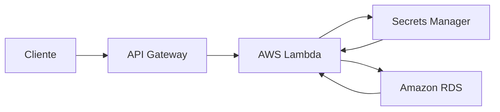
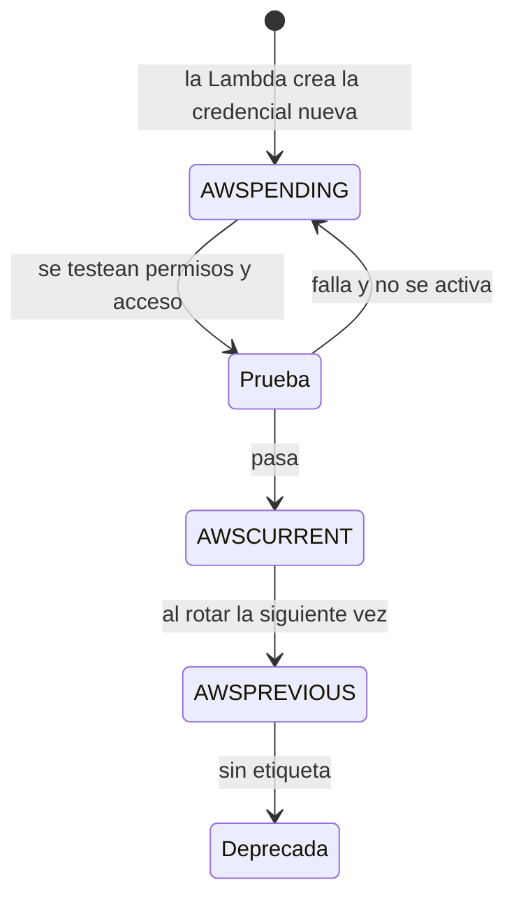

# AWS Secrets Manager

> [!abstract] Qué es este archivo
> Décima quinta lección del módulo y **la primera que no trata de claves criptográficas sino de credenciales**.
> Responde la pregunta que sigue a KMS y CloudHSM: **dónde viven las contraseñas, API keys y credenciales de
> base de datos** que usan las aplicaciones.
>
> Cubre **el problema del secreto embebido**, **qué se puede guardar**, **el flujo API Gateway → Lambda → RDS**,
> **la rotación de credenciales de RDS** con sus **staging labels**, **la rotación en contenedores**,
> **la rotación de access keys de IAM** y **cómo se combina con KMS y CloudHSM**. Video de **4 min 25 s** +
> **cinco lecturas**. **Dos imágenes**, ninguna en el vault.

> [!quote] La idea que ordena todo
> ***“El secreto ya no existe en el código.”*** Ese es el cambio: **no se protege mejor la contraseña, se la
> saca del código y se la pide por API**. Y el segundo movimiento: **rotarla sin romper nada**, porque el
> problema real nunca fue rotar, fue **rotar sin tumbar la aplicación**.

---

## Resumen en una frase

> **Secrets Manager** guarda **credenciales y textos sensibles cifrados**, las **entrega por API** a quien tenga
> permiso, las **rota con una Lambda** que **prueba la credencial nueva antes de activarla** —con las etiquetas
> **`AWSPENDING`**, **`AWSCURRENT`** y **`AWSPREVIOUS`**— y **registra cada acceso**, para que **nadie tenga que
> conocer el valor** y **nadie tenga que reiniciar nada** cuando cambia.

---

## 1. El problema: el secreto dentro del código

**La pregunta del caso, literal:**

> *“¿Cómo podemos **guardar y recuperar de forma segura los secretos** que usan nuestras aplicaciones en AWS?”*

**La respuesta:** **AWS Secrets Manager** fue **construido específicamente para ese desafío**. La fuente lo
presenta como *“tu **bóveda segura** para todas esas **credenciales sensibles**”*: **contraseñas**, **API keys**,
**credenciales de base de datos**, *“todas esas cosas que **mantienen despiertos a los equipos de seguridad**”*.

### 1.1 El pasado, según la lectura

**El patrón viejo:** cuando creabas una **aplicación propia para consultar una base de datos**, **embebías las
credenciales** —el **secreto**— **directamente en la aplicación**. Cuando llegaba el momento de **rotarlas**, no
alcanzaba con **crear credenciales nuevas**:

1. Había que **invertir tiempo en actualizar la aplicación** para que usara las nuevas.
2. Había que **distribuir la aplicación actualizada**.
3. Si había **varias aplicaciones con credenciales compartidas** y **te olvidabas de una**, **esa aplicación
   fallaba**.

**La consecuencia, textual:** *“por este riesgo, **muchos clientes eligen no rotar las credenciales
regularmente**, lo que **efectivamente sustituye un riesgo por otro**.”*

> [!important] La frase que hay que retener
> **No rotar también es una decisión de riesgo.** La lectura lo dice sin vueltas: **evitás el riesgo de romper
> la app** y **aceptás el riesgo de una credencial vieja y filtrada**. **Secrets Manager existe para que esa
> elección deje de ser un intercambio.**

> [!note] El caso que cuenta la presentadora
> Un cliente **compartía credenciales entre desarrolladores por correo cifrado y mensajes de chat**. Con Secrets
> Manager **eso desapareció**: **las aplicaciones recuperan las credenciales automáticamente** y *“nadie necesita
> conocer los valores reales”*. **El objetivo no es guardar mejor el secreto: es que deje de circular entre
> personas.**

---

## 2. Qué se puede guardar y qué hace el servicio

### 2.1 Los tipos de secreto

| Tipo | Ejemplo |
| --- | --- |
| **Credenciales de base de datos** | **Usuario y contraseña** de **RDS** o **Aurora** |
| **Contraseñas** | De aplicaciones y servicios |
| **API keys de terceros** | Claves de proveedores externos |
| **Credenciales de recursos on-premises** | Acceso a sistemas fuera de AWS |
| **Claves SSH** | **Secure shell (SSH) keys** |
| **Credenciales de aplicaciones SaaS** | **Software as a Service** |
| **Texto arbitrario** | Cualquier cadena que haya que proteger |

### 2.2 Las cuatro capacidades

| # | Capacidad | Qué resuelve |
| --- | --- | --- |
| **1** | **Crear y guardar credenciales** | El secreto deja de estar en el código |
| **2** | **Rotar automáticamente según un cronograma** | El secreto pasa a ser **de corto plazo** |
| **3** | **Distribuir el secreto de forma segura a las aplicaciones** | **Nadie lo conoce**: se pide por API |
| **4** | **Mantener logs detallados de cada acceso** | **Auditoría** de quién leyó qué y cuándo |

**El mecanismo central de la lectura:** **reemplazar credenciales hardcodeadas** —incluidas contraseñas— **por
una llamada a la API de Secrets Manager** que **recupera el secreto programáticamente**. **Eso asegura que el
secreto no pueda comprometerse porque alguien examine tu código**, *“porque **el secreto ya no existe en el
código**”*.

**Y el segundo efecto:** **configurar la rotación automática según un cronograma**, lo que **permite reemplazar
secretos de largo plazo por otros de corto plazo**, *“reduciendo significativamente el riesgo de
compromiso”*.

> [!important] Encrypted in transit and at rest
> El video lo dice explícito: *“tu código de aplicación **nunca necesita manejar credenciales crudas**, están
> **siempre cifradas en tránsito y en reposo**”*. **El secreto no viaja en claro ni siquiera en el primer salto.**

> [!warning] Lo que “no estar en el código” no arregla
> Sacar la contraseña del código **no alcanza** si **queda en una variable de entorno**, en un **archivo de
> configuración** o en un **log**. La lectura lo dice al hablar de contenedores: *“las configuraciones sensibles
> **no deberían pasarse en texto plano**, como las API keys”*. **La credencial tiene que pedirse, no viajar
> pegada al despliegue.**

---

## 3. Cómo se usa: el flujo de cuatro pasos

**El escenario de la lectura:** **asegurar credenciales de base de datos** y **entregarlas a una función AWS
Lambda**, que **las usa para conectarse y consultar** una base **Amazon RDS**. **Todo sin hardcodear los secretos
en el código ni pasarlos por variables de entorno.**

**El objetivo declarado:** *“esto ayuda a asegurar **los secretos de la última milla** y **proteger las bases de
datos de backend**”*.

| # | Paso | Qué ocurre |
| --- | --- | --- |
| **1** | **API Call** | El **cliente** llama a la **API RESTful** alojada en **Amazon API Gateway** |
| **2** | **API Gateway → Lambda** | **API Gateway inicia** la función **AWS Lambda** |
| **3** | **Lambda Function** | La función **pide los secretos de la base** con la **API de Secrets Manager**; el servicio **recupera el secreto, descifra el texto protegido y lo devuelve** por un **canal seguro** |
| **4** | **Connect to database** | La función **se conecta a Amazon RDS** con esas credenciales y **devuelve los resultados de la consulta** |

> [!important] El patrón de “última milla”
> **El secreto nunca llega al cliente**: llega **a la función**, **en el último salto**, y **solo si la función
> tiene permiso**. **API Gateway no guarda credenciales**: **solo dispara**. **El eslabón que hay que asegurar es
> el rol de la Lambda.**

> [!note] Lectura propia (no está en la fuente)
> Fijate **qué no aparece en el diagrama**: **ningún paso “descifrar en el cliente”**. **El descifrado lo hace
> Secrets Manager**, no la aplicación. **Eso es lo que hace que rotar sea barato**: la app **pide el valor
> vigente cada vez**, en lugar de **guardar uno que hay que reemplazar en cada despliegue**.

---

## 4. Rotación de credenciales de RDS

**Qué se puede rotar automáticamente:** **contraseñas de Amazon Aurora, MySQL, MariaDB, PostgreSQL y Oracle**
**alojadas en AWS**.

**Cómo:** **sin intervención humana**, con una **función Lambda**, **según un cronograma que vos especificás** o
**que lanzás manualmente**.

| Caso | Quién hace la rotación |
| --- | --- |
| **Credenciales de un motor de Amazon RDS** | **La función Lambda ya existe** (rotación integrada) |
| **Otras credenciales con expiración**, como un **login SAML** | **Hay que crear una función propia** para usarla con Secrets Manager |

### 4.1 Lo que hace la función de rotación

1. **Contacta el sistema de autenticación del servicio protegido.**
2. **Crea un juego nuevo de credenciales** para acceder a la base.
3. **Guarda esas credenciales nuevas** como **texto del secreto**, en **una versión nueva**, con la etiqueta
   **`AWSPENDING`**.

**Qué contienen las credenciales, típicamente:** **un nombre de usuario**, **una contraseña** y **detalles de
conexión** —aunque **varía de sistema a sistema**—.

### 4.2 La prueba antes de activar

**La función de rotación prueba la versión `AWSPENDING`** para **asegurar que las credenciales funcionan** y que
**otorgan el nivel de acceso requerido** al servicio protegido.

**Solo si las pruebas pasan**, la función:

| Acción | Etiqueta | Efecto |
| --- | --- | --- |
| **Mueve `AWSCURRENT`** a la versión nueva | **`AWSCURRENT`** | **Todos los clientes empiezan a usar esa versión** |
| **Asigna `AWSPREVIOUS`** a la versión vieja | **`AWSPREVIOUS`** | Queda marcada como **la última versión buena conocida** |
| **Deja sin etiqueta** la `AWSPREVIOUS` anterior | — | **Queda deprecada** |

> [!important] Rotar sin romper: la prueba es el producto
> **La credencial nueva se prueba antes de ser la vigente.** Eso es lo que evita **el llamado de madrugada**:
> *“tu deployment manager no va a tener que preocuparse por llamados a medianoche porque alguien se olvidó de
> actualizar una contraseña”*. **No es una comodidad: es el motivo por el que una empresa acepta rotar.**

> [!warning] Lo que el video dice y la lectura precisa
> El video habla de una **“etiqueta especial de AWS *pending*”** y de la **“versión *current*”**; la lectura usa
> los nombres reales: **`AWSPENDING`** y **`AWSCURRENT`**. **Es el mismo mecanismo con dos niveles de detalle**
> (§ registro, punto 1). **En el examen conviene recordar los nombres exactos.**

---

## 5. Versiones, metadatos y expiración

**Qué contiene un secreto, según la lectura:** **el texto cifrado del secreto** y **varios elementos de
metadatos** que **lo describen** y **definen cómo Secrets Manager debe manejarlo**.

**Uno de esos metadatos son las versiones del secreto.** **El versionado provee una estrategia de rotación y
despliegue tolerante a fallas**, que **soporta rollback y recuperación** en caso de **fallas de despliegue**.

**La expiración:** **los secretos se pueden hacer expirar** **según un cronograma** o **a demanda**, usando
**la consola**, **la AWS CLI** o **programáticamente con un SDK**.

> [!important] El valor de `AWSPREVIOUS`
> **No es basura: es el rollback.** Si el cliente nuevo falla con la versión nueva, **la anterior sigue
> disponible y marcada como la última buena**. **Por eso el versionado se describe como “tolerante a fallas” y no
> como “historial”.**

> [!note] Lectura propia (no está en la fuente)
> **`AWSCURRENT`, `AWSPREVIOUS` y `AWSPENDING` son etiquetas, no versiones.** Una misma versión **puede cambiar
> de etiqueta** sin que cambie el secreto. **Eso explica por qué el rollback es instantáneo**: no se reescribe
> nada, **se mueve una etiqueta**.

---

## 6. Contenedores: cachear, rotar y refrescar sin reiniciar

**Cómo se inyecta el secreto:** con **Amazon Elastic Container Service (Amazon ECS)**, **podés inyectar datos
sensibles en tus contenedores** **guardándolos en secretos de Secrets Manager** y **referenciándolos en la
definición del contenedor**.

**Cómo se exponen:** **como variables de entorno** o **como parte de la configuración de logs**.

### 6.1 El ciclo

| # | Paso | Qué pasa |
| --- | --- | --- |
| **1** | **La aplicación cachea el secreto** | Lo tiene localmente para no pedirlo en cada operación |
| **2** | **Secrets Manager rota el secreto** | La credencial cambia del lado del servicio |
| **3** | **La aplicación refresca el secreto** | Vuelve a pedirlo a Secrets Manager |
| **4** | **No hace falta reiniciar el contenedor** | **La operación continúa** |

**La promesa del video:** *“tus aplicaciones **refrescan automáticamente** sus secretos cacheados, **sin
reiniciar contenedores**”*. **El efecto:** *“tu equipo de seguridad puede rotar credenciales **tan seguido como
necesite**, y tus aplicaciones **siguen corriendo sin problemas, sin downtime**”*.

**El caso Fargate:** **las configuraciones sensibles no deberían pasarse en texto plano**, como las **API keys**.
**Por eso se usa Secrets Manager para guardarlas** y **leerlas dentro de la tarea de AWS Fargate de forma
segura**. **La integración entre Fargate y Secrets Manager** permite **configurar las interfaces de Fargate para
permitir la recuperación de secretos**.

> [!important] Cachear no es guardar para siempre
> **El caché es una optimización, no una copia de respaldo.** **La aplicación tiene que saber refrescar** cuando
> la credencial cambia; si no, **el caché se convierte en el secreto viejo que nadie rotó**. **El “sin reinicio”
> depende de que la app escuche el cambio, no de que el servicio la obligue.**

> [!warning] El matiz que el video no aclara
> El video dice que **Secrets Manager “maneja la rotación en segundo plano”** y que **la app “se refresca
> automáticamente”**. **La lectura no describe un mecanismo de notificación**: describe **el ciclo** —cachear,
> rotar, refrescar—. **No se agrega** ningún servicio de eventos que la fuente no nombre (§ registro, punto 4).

---

## 7. Rotación de access keys de IAM

**El contexto de la lectura:** con **multitenencia en la nube bajando los costos operativos**, **las grandes
empresas buscan formas de entrega de servicio sin fricción**. Este ejemplo muestra **cómo guardar access keys y
secret keys de usuarios de IAM en Secrets Manager** y **rotarlas automáticamente con Lambda a intervalos
deterministas**.

**Para qué:** *“mejorar la postura de seguridad general proveyendo un **ciclo de vida de claves auditable y
administrado** para usuarios de IAM con API keys y secretos”*. **Para algunos clientes es un requisito crítico**
de seguridad o de compliance.

### 7.1 Los cinco componentes

| Componente | Rol |
| --- | --- |
| **AWS Lambda** | **Genera las llamadas a la API de IAM** para **rotar y actualizar** las claves |
| **Amazon EventBridge** | **Inicia los eventos** **según un cronograma** para rotar |
| **IAM** | **Provee las access keys y secret keys** para acceder a recursos y servicios **desde fuera de AWS** |
| **Secrets Manager** | **Guarda los secretos** que consumen **aplicaciones o desarrolladores de contenido** |
| **Amazon SNS** | **Envía notificaciones** **cada vez que las claves cambian** |

### 7.2 Los cuatro pasos, con fechas

| # | Cuándo | Qué hace |
| --- | --- | --- |
| **1** | **Desde el 1 de julio**, cada **90 días** | **Una Lambda genera una clave de IAM nueva** y **la guarda como *current* en Secrets Manager** |
| **2** | **Desde el 11 de julio**, cada **90 días** | **Amazon SNS** (no mostrado en el diagrama) **notifica al dueño de la aplicación** que **una clave fue rotada** |
| **3** | **Desde el 21 de julio**, cada **90 días** | **Una segunda Lambda desactiva la clave anterior** y **notifica al usuario** |
| **4** | **Desde el 21 de julio**, cada **90 días** | **Una tercera Lambda borra las claves viejas** y **notifica al usuario** |

**La flexibilidad:** *“podés optar por rotar las claves **todos los días** y programar la función **todos los
días**, o programarla **cuando te convenga**”*.

**Lo que las aplicaciones deben hacer:** **usar la API de Secrets Manager para recuperar la clave vigente**, en
lugar de **hardcodearla en la aplicación**.

> [!important] Los dos relojes que no hay que confundir
> **90 días** es **el intervalo entre rotaciones**; **1, 11 y 21 de julio** son **los desfases internos** entre
> **crear**, **desactivar** y **borrar**. **No es que la clave se desactive a los 90 días**: se desactiva **10
> días después de nacer** y se borra **10 días después de eso** (§ registro, punto 2).

> [!warning] El orden importa
> **Primero se crea y se guarda; después se desactiva la vieja; después se borra.** **Si se borra antes de
> desactivar, la aplicación que todavía la usa se cae.** **El calendario escalonado es la ventana de gracia.**

---

## 8. Cómo encaja con KMS y CloudHSM

**La frase de cierre del video:**

> *“Recordá que **Secrets Manager, junto con AWS KMS y CloudHSM, pueden trabajar juntos** para crear una
> **estrategia integral de seguridad de datos**.”*

| Necesidad | Servicio | Rol |
| --- | --- | --- |
| **Cifrado general** | **AWS KMS** | **Claves administradas** para cifrar datos y secretos |
| **Requisitos de compliance específicos** | **AWS CloudHSM** | **Módulo dedicado bajo tu control** |
| **Credenciales de aplicación** | **Secrets Manager** | **Guardar, rotar y entregar secretos** |

> [!important] La división que propone la fuente
> **No compiten: se reparten el trabajo.** **KMS cifra**, **CloudHSM cumple el requisito de hardware propio** y
> **Secrets Manager administra el ciclo de vida del secreto**. **Y como el secreto está cifrado en reposo, la
> cadena termina en una clave de KMS** —propia o en un **custom key store**— **(lectura propia, no está literal
> en la fuente)**. **Las tres piezas del módulo, en una sola secuencia.**

> [!note] Lo que la fuente no dice (hueco registrado)
> **No se nombra la clave de KMS** que cifra los secretos, **ni el intervalo de rotación por defecto**, **ni
> precios**. **No se completa**: lo único que queda es la afirmación de que **todo está cifrado en tránsito y en
> reposo** y que **KMS participa** (§ registro, punto 3).

---

## 9. Traducción del contenido

> [!info] Sección de referencia (opcional)
> Esto es la **traducción fiel** de la fuente. **No hace falta leerla para estudiar**: lo que se estudia son las
> secciones **1 a 8** y se cierra con la **11**.

### 9.1 Video: Introduction to AWS Secrets Manager (transcripción)

**Ahora, vamos a la siguiente pregunta de tu deployment manager.** **¿Cómo podemos guardar y recuperar de forma
segura los secretos que usan nuestras aplicaciones en AWS?** **AWS Secrets Manager fue construido
específicamente para este desafío.** **Pensalo como tu bóveda segura para todas esas credenciales sensibles.**
**Contraseñas, API keys, credenciales de base de datos.** **Todas esas cosas que mantienen despiertos a los
equipos de seguridad.**

**Lo que hace único a Secrets Manager es cómo maneja todo el ciclo de vida de tus secretos.** **Podés crear y
guardar credenciales, claro, pero va mucho más allá.** **Puede rotar secretos automáticamente según un
cronograma, distribuirlos de forma segura a tus aplicaciones y mantener logs de auditoría detallados de cada
acceso.** **Tuve un cliente que compartía credenciales entre desarrolladores por correo cifrado y mensajes de
chat.** **Con Secrets Manager, todo eso desapareció.** **Sus aplicaciones ahora recuperan credenciales
automáticamente y nadie necesita conocer los valores reales.**

**Así es como funciona realmente.** **Tus aplicaciones hacen llamadas a la API a través de API Gateway, que
después dispara una función Lambda.** **Esa función recupera de forma segura los secretos que necesita de Secrets
Manager y los usa para acceder a servicios como RDS.** **Y la mejor parte: tu código de aplicación nunca necesita
manejar credenciales crudas, están siempre cifradas en tránsito y en reposo.**

**Y pasemos a una de mis características favoritas de Secrets Manager: la rotación automática de secretos.** **Una
función Lambda maneja todo el proceso detrás de escena.** **Cuando llega el momento de rotar credenciales, las
nuevas se guardan con una etiqueta especial de AWS, *pending*.** **Después, y esto es la parte divertida, el
sistema realmente prueba estas credenciales antes de activarlas.** **Solo después de confirmar que todo funciona
se convierten en la versión *current* de AWS.** **Esto resuelve uno de los mayores dolores de cabeza de la
seguridad.** **Asegurar que la rotación de credenciales no rompa tus aplicaciones.** **Tu deployment manager no
va a tener que preocuparse por llamados a medianoche porque alguien se olvidó de actualizar una contraseña en
algún lado.**

**¿Y los contenedores? Te preguntarás.** **Secrets Manager también tiene grandes trucos acá.** **Tus aplicaciones
containerizadas pueden cachear secretos localmente y Secrets Manager maneja la rotación en segundo plano.** **Tus
aplicaciones refrescan automáticamente sus secretos cacheados, sin necesidad de reiniciar contenedores.** **Esto
es enorme para mantener operaciones continuas.** **Tu equipo de seguridad puede rotar credenciales tan seguido
como necesite, y tus aplicaciones siguen corriendo sin problemas, sin downtime.**

**Por último, pero no menos importante, otra capacidad poderosa: automatizar la rotación de access keys de
IAM.** **El proceso es bastante prolijo.** **Lambda genera las llamadas a la API para rotar las claves de IAM,
EventBridge programa los eventos de rotación, IAM provee las access keys y secret keys nuevas y SNS envía
notificaciones cuando las claves cambian.** **Pensá en lo que esto significa para tu deployment manager.** **Se
terminó rastrear access keys viejas o preguntarse si se rotaron recientemente.** **El sistema crea
automáticamente claves nuevas, desactiva las viejas después de 90 días, borra las claves expiradas y mantiene a
todos informados de los cambios.**

**Así que ahora sabemos que AWS Secrets Manager provee administración centralizada de secretos, rotación
automática de secretos, distribución segura de credenciales e integración sin fricción con tus aplicaciones.**
**Recordá que Secrets Manager, junto con AWS KMS y CloudHSM, pueden trabajar juntos para crear una estrategia
integral de seguridad de datos.** **Podrías usar KMS para necesidades generales de cifrado, CloudHSM para
requisitos específicos de compliance, y Secrets Manager para credenciales de aplicación, todo trabajando junto
para proteger tus datos sensibles en AWS.**

*Duración del video: **4 minutos 25 segundos**.*

### 9.2 Lectura: Secrets Manager Solutions

**En el pasado, cuando creabas una aplicación propia para recuperar información de una base de datos, típicamente
embebías las credenciales —o el secreto— para acceder a la base directamente en la aplicación.** **Cuando llegaba
el momento de rotar las credenciales, tenías que hacer más que crear credenciales nuevas.** **Tenías que invertir
tiempo en actualizar la aplicación para que usara las credenciales nuevas.** **Después distribuías la aplicación
actualizada.** **Si tenías múltiples aplicaciones con credenciales compartidas y te olvidabas de actualizar una de
ellas, la aplicación fallaba.** **Por este riesgo, muchos clientes eligen no rotar las credenciales
regularmente, lo que efectivamente sustituye un riesgo por otro.**

**Con AWS Secrets Manager, podés reemplazar las credenciales hardcodeadas en tu código, incluidas las
contraseñas, con una llamada a la API de Secrets Manager para recuperar el secreto programáticamente.** **Esto
ayuda a asegurar que el secreto no pueda ser comprometido por alguien que examine tu código, porque el secreto ya
no existe en el código.** **También podés configurar Secrets Manager para que rote el secreto automáticamente
según un cronograma especificado.** **Esto significa que podés reemplazar secretos de largo plazo por otros de
corto plazo, reduciendo significativamente el riesgo de compromiso.**

**Podés guardar una variedad de secretos en AWS Secrets Manager, incluidos los siguientes:**

- **Credenciales de base de datos**
- **Contraseñas**
- **API keys de terceros**
- **Credenciales de recursos on-premises**
- **Claves de shell seguro (SSH)**
- **Credenciales de aplicaciones Software as a Service (SaaS)**
- **Texto arbitrario**

### 9.3 Lectura: Using Secrets Manager

**Este diagrama muestra cómo usar Secrets Manager para asegurar credenciales de base de datos y enviarlas a una
función AWS Lambda, que las usa para conectarse y consultar el servicio de base de datos de backend, Amazon
RDS.** **Todo esto se hace sin hardcodear los secretos en el código ni pasarlos por variables de entorno.** **Este
enfoque ayuda a asegurar los secretos de la última milla y proteger las bases de datos de backend.**

**Para aprender más, elegí cada uno de los marcadores numerados.**

1. **API Call**: **el cliente llama a la API RESTful alojada en Amazon API Gateway.**
2. **API Gateway to Lambda**: **API Gateway inicia la función AWS Lambda.**
3. **Lambda Function**: **la función Lambda recupera los secretos de la base de datos usando la API de Secrets
   Manager.** **Secrets Manager recupera el secreto, descifra el texto del secreto protegido y lo devuelve a la
   función por un canal seguro.**
4. **Connect to database**: **la función Lambda se conecta a la base de datos Amazon RDS, usando los secretos de
   base de datos de Secrets Manager, y devuelve los resultados de la consulta.**

**Cómo proveer credenciales de base de datos a una función Lambda de forma segura usando AWS Secrets Manager** —
**Para más información sobre esta solución, visitá el enlace del blog de AWS.**

### 9.4 Lectura: Rotating Amazon RDS Credentials

**Con Secrets Manager, podés rotar automáticamente contraseñas de bases de datos Amazon Aurora, MySQL, MariaDB,
PostgreSQL y Oracle alojadas en AWS.** **Esta rotación se hace sin intervención humana usando una función Lambda,
ya sea según un cronograma que especifiques o uno que lances manualmente.** **Para credenciales de motor de base
de datos de Amazon RDS, esta función Lambda ya existe, pero si tenés otras credenciales con expiración, como un
login SAML, podrías querer crear una función propia para usarla con Secrets Manager.**

**La función de rotación contacta el sistema de autenticación del servicio protegido y crea un juego nuevo de
credenciales para acceder a la base de datos.** **Las credenciales típicamente consisten en un nombre de usuario,
una contraseña y detalles de conexión, pero esto puede variar de sistema a sistema.** **Secrets Manager guarda
estas credenciales nuevas como el texto del secreto en una versión nueva del secreto que recibe la etiqueta de
staging AWSPENDING.**

**La función de rotación después prueba la versión AWSPENDING del secreto para asegurar que las credenciales
funcionan y que otorgan el nivel de acceso requerido al servicio protegido.** **Si las pruebas tienen éxito, la
función de rotación mueve la etiqueta AWSCURRENT a la versión nueva para marcarla como la versión por defecto.**
**Esto hace que todos los clientes empiecen a usar esta versión del secreto en lugar de la vieja.** **La función
también asigna la etiqueta AWSPREVIOUS a la versión vieja, marcándola como la última versión buena conocida.** **La
versión AWSPREVIOUS anterior ahora no tiene etiqueta de staging y por lo tanto queda deprecada.**

**En Secrets Manager, un secreto contiene el texto cifrado del secreto.** **También contiene varios elementos de
metadatos que describen el secreto y definen cómo Secrets Manager debe manejarlo.** **Uno de esos elementos de
metadatos son las versiones del secreto.** **El proceso de versionado provee una estrategia de rotación y
despliegue tolerante a fallas que soporta rollback y recuperación en caso de fallas de despliegue.** **Los
secretos se pueden configurar para expirar según un cronograma o a demanda usando la consola, la AWS CLI o
programáticamente usando un SDK.**

**Empezar con AWS Secrets Manager** — **Para más información sobre los metadatos del secreto, visitá el enlace de
la guía del usuario.**

### 9.5 Lectura: Rotate Container Secrets

**Con Amazon Elastic Container Service (Amazon ECS), podés inyectar datos sensibles en tus contenedores
guardando tus datos sensibles en secretos de Secrets Manager y después referenciándolos en la definición de tu
contenedor.** **Los datos sensibles guardados en secretos de Secrets Manager se pueden exponer a un contenedor
como variables de entorno o como parte de la configuración de logs.**

- **La aplicación cachea el secreto.**
- **Secrets Manager rota el secreto.**
- **La aplicación refresca el secreto desde Secrets Manager.**
- **No se requiere reiniciar el contenedor.**

**Las configuraciones sensibles no deberían pasarse en texto plano, como las API keys.** **Por esta razón, usá
Secrets Manager para guardar esa información sensible y después leerla dentro de la tarea de AWS Fargate de forma
segura.** **Esto es lo que podés lograr con la integración entre Fargate y Secrets Manager.** **Podés configurar
las interfaces de Fargate para permitir la recuperación de secretos desde Secrets Manager.**

### 9.6 Lectura: IAM Access Key Rotation with Secrets Manager

**Ahora que la multitenencia en la nube está bajando los costos operativos de TI, las grandes empresas buscan
métodos de entrega de servicio sin fricción que atiendan las actividades diarias de su entorno de nube.** **Este
ejemplo explica cómo las access keys y secret keys de usuarios de IAM se pueden guardar en AWS Secrets Manager y
rotar automáticamente usando Lambda a intervalos deterministas.** **De esta forma, los clientes pueden mejorar su
postura de seguridad general proveyendo un ciclo de vida de claves auditable y administrado para usuarios de IAM
con API keys y secretos de AWS.**

**Para algunos clientes, el ciclo de vida y la rotación de claves de IAM puede ser un requisito crítico de
seguridad para mantener la adherencia a estándares de seguridad o compliance para su entorno.** **Repasemos los
componentes requeridos para incorporar la rotación automática de access keys de IAM en tu flujo de operaciones de
IAM:**

- **Lambda genera llamadas a la API de servicios de IAM para rotar y actualizar claves.**
- **Amazon EventBridge inicia eventos según un cronograma para rotar claves.**
- **IAM provee access keys y secret keys de usuario para acceder a recursos y servicios de AWS desde sistemas
  fuera de AWS.**
- **Secrets Manager guarda los secretos que consumen aplicaciones o desarrolladores de contenido.**
- **Amazon Simple Notification Service (Amazon SNS) envía notificaciones cada vez que las claves cambian.**

**Una vez creados los componentes (usuario de IAM con API key o secreto, funciones Lambda, cronogramas de
EventBridge, secretos de Secrets Manager), la solución sigue estos pasos:**

1. **Invoke Lambda function**: **desde el 1 de julio, una función Lambda se invoca cada 90 días para generar una
   clave de IAM nueva y guardarla como *current* en Secrets Manager.**
2. **Update owner**: **Amazon SNS (no mostrado) actualiza al dueño de la aplicación que una clave fue rotada.**
   **Las aplicaciones pueden usar la API de Secrets Manager para recuperar la clave vigente en lugar de
   hardcodearla en la aplicación.**
3. **Second Lambda function**: **desde el 11 de julio, una segunda función Lambda se invoca cada 90 días para
   desactivar la clave de IAM anterior y enviar una notificación al usuario.**
4. **Third Lambda function**: **desde el 21 de julio, una tercera función Lambda se invoca cada 90 días para
   borrar las claves viejas y enviar una notificación al usuario.**

**Podés optar por rotar las claves todos los días y programar la función Lambda todos los días, o podés
programarla cuando te convenga.**

> [!note] Las dos imágenes de la fuente no están en el vault
> `W8KP82VFST.png` (rotación de credenciales de RDS) y `EMN1ZS6BHZ.png` (rotación de secretos en contenedores,
> desde Secrets Manager hacia Fargate y Aurora) **solo se citan por su descripción**. Los **dos esquemas** de la
> nota (§3 y §4.2) son **reconstrucciones declaradas**.

---

## 10. Cuadro de cierre: qué hace cada pieza

| Necesidad | Pieza | Mecanismo |
| --- | --- | --- |
| **Sacar la contraseña del código** | **Secrets Manager** | **Llamada a la API** en lugar de un valor embebido |
| **Que nadie del equipo conozca el valor** | **Secrets Manager** | **La aplicación lo pide**; **no circula por chat ni correo** |
| **Cifrado en reposo** | **AWS KMS** | **La clave que cifra el secreto** |
| **Cifrado en tránsito** | **Canal seguro** | **La API devuelve el secreto por un canal protegido** |
| **Entregar a una Lambda sin variables de entorno** | **API Gateway + Lambda + Secrets Manager** | **La función pide el secreto en el último salto** |
| **Rotar credenciales de base** | **Lambda de rotación** | **Motor soportado**: Aurora, MySQL, MariaDB, PostgreSQL, Oracle |
| **Rotar algo que no es una base** | **Lambda propia** | **Por ejemplo, un login SAML** |
| **No romper la app al rotar** | **`AWSPENDING` + prueba** | **Se testea antes de mover `AWSCURRENT`** |
| **Poder volver atrás** | **`AWSPREVIOUS`** | **La última versión buena conocida** |
| **Rotar en contenedores sin reiniciar** | **ECS / Fargate** | **Cachear, rotar, refrescar** |
| **Auditar cada acceso** | **Logs de Secrets Manager** | **Quién leyó qué secreto y cuándo** |
| **Rotar access keys de IAM** | **Lambda + EventBridge + SNS** | **Crear, desactivar y borrar en ciclos de 90 días** |
| **Cumplir con hardware propio** | **AWS CloudHSM** | **Custom key store de KMS detrás del secreto** |

---

## 11. Para el examen (SAP-C02)

> [!important] Lo que hay que retener
> 1. **Secrets Manager guarda secretos y los entrega por API**: **el secreto deja de existir en el código**.
> 2. **Guardar no alcanza: rotar.** **Reemplaza secretos de largo plazo por otros de corto plazo.**
> 3. **La rotación la hace una Lambda**, **según cronograma o manualmente**.
> 4. **Motores soportados**: **Aurora, MySQL, MariaDB, PostgreSQL y Oracle**. **Para el resto, Lambda propia**
>    (por ejemplo, **SAML**).
> 5. **El ciclo de etiquetas**: **`AWSPENDING`** → **prueba** → **`AWSCURRENT`**; la vieja pasa a
>    **`AWSPREVIOUS`** y la anterior **queda sin etiqueta y deprecada**.
> 6. **La prueba antes de activar** es lo que **evita romper la aplicación**.
> 7. **El versionado soporta rollback y recuperación** ante fallas de despliegue.
> 8. **Los secretos expiran** por cronograma o a demanda, **por consola, CLI o SDK**.
> 9. **En contenedores**: **cachear**, **rotar**, **refrescar**, **sin reiniciar**. **ECS y Fargate** inyectan
>    secretos **como variables de entorno o en la configuración de logs**.
> 10. **Rotación de access keys de IAM**: **Lambda** ejecuta, **EventBridge** programa, **IAM** provee las
>     claves, **Secrets Manager** las guarda y **SNS** notifica.
> 11. **Ciclo de claves de IAM**: **cada 90 días**, con **creación el día 1**, **desactivación el día 11** y
>     **borrado el día 21**.
> 12. **Secrets Manager, KMS y CloudHSM se combinan**: **KMS cifra**, **CloudHSM cumple el hardware propio** y
>     **Secrets Manager administra las credenciales**.

> [!warning] Trampa clásica del examen
> Escenario: *“la aplicación lee la contraseña de la base desde una **variable de entorno** y **cada rotación
> obliga a un despliegue**; además, **la auditoría pide saber quién leyó la credencial**”*. La respuesta **no** es
> **Parameter Store** (no rota credenciales de base ni ofrece el ciclo de versiones con staging labels) **ni
> guardar el secreto cifrado en S3**: es **Secrets Manager**. Y si el enunciado pide **rotar una credencial que
> no es de un motor soportado**, **no** es “usar la rotación integrada”: es **escribir una función Lambda propia**.

---

## Relacionado

- [[AWS Solutions Architect Advanced - Securing Networks and Data]] *(índice del módulo)*
- [[AWS KMS]] — la clave que **cifra el secreto** en reposo y el **custom key store** que lo lleva a CloudHSM
- [[AWS CloudHSM]] — el **módulo propio** detrás de un secreto cuando el compliance lo exige
- [[Demo - AWS KMS]] — la demo que mostró **permisos separados** y **default encryption**
- [[Cryptography]] — los **tres estados del dato** y la diferencia entre **cifrar** y **administrar credenciales**
- [[Gathering the Customer Requirements - Security]] — el **requisito 4** y la **evidencia para auditorías**
- [[Security Hub]] — el control de **compliance** que puede exigir rotación
- [[1.2 Prescribir controles de seguridad]] — la tarea que este módulo cubre
- [[2.3 Determinar los controles de seguridad en función de los requisitos]] — el cruce con Dominio 2
- [[Guia AWS]] — pesos y tareas oficiales del SAP-C02
- Siguiente paso del módulo: [[Finished Architecture - Security]] — **el cierre**: todos los servicios del módulo
  puestos en una sola arquitectura que resuelve el caso

---

## Registro de integración

| Fecha | Qué llegó | Dónde se integró |
| --- | --- | --- |
| 27/10/2026 | Lección 15 completa: Secrets Manager (problema del secreto embebido, tipos, flujo API Gateway → Lambda → RDS, rotación de RDS con staging labels, versionado, contenedores, access keys de IAM y combinación con KMS y CloudHSM) | Nota completa (secciones 1–11) |

**Discrepancias y vacíos registrados (no corregidos):**

1. **El video dice “etiqueta especial de AWS *pending*” y “versión *current*”**; la lectura usa los nombres
   exactos **`AWSPENDING`** y **`AWSCURRENT`**. **Se conservan las dos formulaciones** y se concilian en §4.2.
2. **El video dice que el sistema “desactiva las viejas después de 90 días”**; la lectura describe **tres Lambdas
   con desfases de 10 días** (crear el **1**, desactivar el **11**, borrar el **21** de julio, **cada 90 días**).
   **No es lo mismo**: **la desactivación ocurre 10 días después de crear la clave, no 90**. Se conservan las dos
   y se precisa en §7.2.
3. **La fuente no dice qué clave de KMS cifra los secretos**, **ni el intervalo de rotación por defecto**, **ni
   precios**. **No se completa.**
4. **El video afirma que la app “refresca automáticamente” el secreto cacheado**; la lectura describe **el ciclo**
   (cachear, rotar, refrescar) **sin nombrar mecanismo de notificación**. **No se agrega** ningún servicio de
   eventos que la fuente no mencione.
5. **La lectura dice “sin intervención humana” y, en la misma frase, “o uno que lances manualmente”**. **Se
   conserva la contradicción**: **la rotación es automática por defecto y también admite disparo manual**.
6. **La errata del paso 2 de IAM**: *“Amazon SNS (not shown) **updated** the application owner”* debe ser
   *notifica*. Se traduce al sentido evidente y se registra.
7. **El paso 2 y el paso 3 de IAM aparecen como cuatro filas** en §7.2 porque la fuente **separa la notificación
   del dueño** de la **desactivación de la clave**. **No se reordenó**: se mantiene el orden literal.
8. **Secrets Manager aparece sin precios ni cuotas** en toda la lección. **No se inventan.**
9. **No se define “multitenencia”** más allá de la mención de costos operativos. **No se completa.**
10. **No se detalla qué permisos de IAM necesita la Lambda de rotación** ni cómo se autoriza. **Queda como hueco.**
11. **No hay Knowledge Check** en esta lección.
12. **El nombre de archivo `AWS Secrets Manager.md` no colisiona** con ninguna nota del vault (verificado:
    **0 basenames duplicados**). **No había notas previas de Secrets Manager.**
13. **La fuente no menciona AWS Systems Manager Parameter Store** en ningún momento, así que **la comparación no
    se agrega**; queda solo como trampa de examen en §11.
14. **Las dos imágenes no están en el vault** (listadas en §9.6). Los **dos esquemas** de la nota (§3 y §4.2) son
    **reconstrucciones declaradas**.

**Decisiones de transcripción:**

- Se conservan **secret**, **secret text**, **rotation**, **rotation function**, **staging label**,
  **`AWSPENDING`**, **`AWSCURRENT`**, **`AWSPREVIOUS`**, **version**, **deprecated**, **hardcoded credentials**,
  **last-mile secrets**, **container definition**, **task**, **access key**, **secret key**, **last known good**,
  **rollback**, **SaaS**, **SSH keys** y **arbitrary text**.
- Las **cifras** se transcriben literales: **4 min 25 s**, **90 días**, **1, 11 y 21 de julio**, **cinco
  componentes**, **cuatro pasos**, **tres pasos de IAM**, **dos imágenes**.
- Se conservan los **nombres de servicio** tal como aparecen: **Amazon API Gateway**, **AWS Lambda**,
  **Amazon RDS**, **Amazon Aurora**, **Amazon ECS**, **AWS Fargate**, **Amazon EventBridge**, **Amazon SNS**,
  **AWS KMS**, **AWS CloudHSM**.
