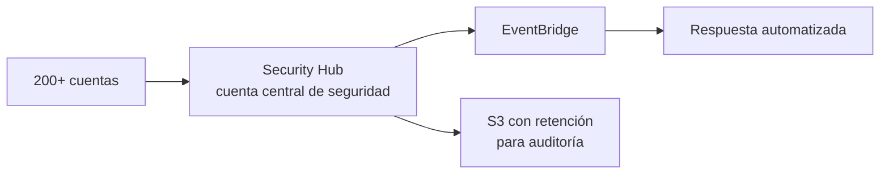
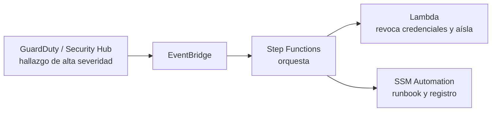

# Activity - Architecture Challenge - Security

> [!abstract] Qué es este archivo
> Decimoctava lección del módulo y **evaluación integradora**. No trae servicios nuevos: plantea **tres desafíos**
> sobre **Example Corp**, una empresa de salud, y pide **elegir tres opciones** y después **la óptima**.
>
> Cubre **monitoreo centralizado** (GuardDuty, Security Hub y Detective), **cifrado del pipeline** (KMS,
> CloudTrail y Lambda) y **respuesta automatizada** (EventBridge, Step Functions, Lambda y SSM), cerrando con
> **Security Lake + Athena + QuickSight** para investigación y reporte.
>
> **Sin imágenes y sin lecturas**: son **seis Knowledge Checks** en tres pares. **El nombre lleva sufijo** porque
> ya existen `Activity - Architecture Challenge` y `Activity - Architecture Challenge - Networking`.

> [!quote] La idea que ordena todo
> **La primera pregunta premia cobertura; la segunda, precisión.** Elegir tres servicios válidos es fácil;
> distinguir cuál **completa el flujo** —y no solo **detecta**, **notifica** o **guarda**— es lo que decide.

---

## Resumen en una frase

> Tres pares de respuestas: **GuardDuty + Security Hub + Detective** para ver, **KMS + bucket policies +
> CloudTrail** para cifrar y auditar, y **EventBridge + Step Functions + Lambda + SSM** para responder, con
> **Security Lake + Athena + QuickSight** para investigar y reportar.

---

## 1. El caso y el formato

**Example Corp:** proveedor global de **tecnología para la salud**. Desarrolla y mantiene **sistemas de historia
clínica electrónica (EHR)** y **plataformas de interacción con pacientes** usados por **hospitales y clínicas de
todo el mundo**.

| Dato | Cifra |
| --- | --- |
| **Instituciones de salud atendidas** | **más de 2.000** |
| **Pacientes cuyos registros administra** | **más de 50 millones** |
| **Crecimiento en los últimos tres años** | **300%** |
| **Cuentas de AWS** | **más de 200** |
| **Tiempo para centralizar el monitoreo** | **30 días** |
| **Tiempo de detección y respuesta del incidente previo** | **más de 4 horas** |

**El negocio se expandió** de su **EHR central** a **telemedicina**, **herramientas de diagnóstico con IA** y
**aplicaciones móviles de salud**.

**La arquitectura actual:**

| Capa | Cómo está hoy |
| --- | --- |
| **Cuentas** | **Multi-cuenta**, con cuentas dedicadas a **desarrollo**, **staging** y **producción** |
| **Regiones** | **Varias**, por **alta disponibilidad** y **residencia de datos** según la regulación de cada país |
| **Cómputo** | **Microservicios en contenedores** (portales de pacientes), **funciones serverless** (procesamiento de datos de salud en tiempo real) y **EC2 tradicional** (EHR central) |
| **Gobierno** | **AWS Organizations** para cuentas y gobierno básico; **AWS Control Tower** para gobierno de cuentas, **sin el baseline de seguridad completo** |
| **Cifrado** | **HIPAA variable por equipo**; **sistemas legacy con métodos obsoletos** |
| **Monitoreo** | **Reactivo**, **sin respuesta automatizada** y **sin rastros de auditoría completos** |

### 1.1 Los cinco problemas de negocio

| # | Problema | Qué dice la fuente |
| --- | --- | --- |
| **1** | **DDoS protection & application security** | La auditoría reveló **protección insuficiente contra DDoS** en los portales de pacientes |
| **2** | **Security monitoring & compliance** | **Falta de monitoreo centralizado** en la estructura multi-cuenta, sobre todo para **HIPAA** |
| **3** | **Data protection & encryption** | **Cifrado inconsistente** de datos de pacientes **en reposo y en tránsito** |
| **4** | **Secrets management** | *“Necesidad de mejorar la segmentación de red entre aplicaciones de cara al paciente y sistemas internos.”* |
| **5** | **Network architecture** | **El mismo texto que el problema 4** |

> [!warning] El problema 4 está mal armado en la fuente
> El título dice **“Secrets management”**, pero la descripción habla de **segmentación de red** — **idéntica a la
> del problema 5**. **Son dos problemas con el mismo texto y una etiqueta que no corresponde.** Se transcribe tal
> cual y se registra (§ registro, punto 1).
>
> **Consecuencia práctica:** **ningún desafío evalúa secrets management** ni **segmentación de red**, aunque el
> módulo tenga notas para ambos. **Los tres desafíos cubren monitoreo, cifrado y respuesta a incidentes.**

> [!important] El formato de cada desafío
> **Primera parte:** elegir **TRES** soluciones que **podrían** resolver la necesidad. **Segunda parte:**
> información nueva y **UNA** solución **óptima**. **Las tres de la primera son válidas**: la segunda no las
> invalida, elige la que **cierra el flujo**.

---

## 2. Desafío 1: monitoreo centralizado de seguridad

**El requisito:** el **CISO** dio **30 días** para implementar un **monitoreo centralizado** para las
aplicaciones de salud. Hoy **cada una de las más de 200 cuentas monitorea por su cuenta**, lo que **dificulta el
cumplimiento HIPAA** y la **respuesta a incidentes**.

**Lo que hay que lograr:**

1. **Visibilidad en tiempo real** en todas las cuentas.
2. **Respuesta automatizada** a las amenazas.
3. **Monitoreo continuo de compliance** para **información de salud protegida (PHI)**.

### 2.1 Primera parte — las tres correctas

| Opción | Qué aporta |
| --- | --- |
| **A. Amazon GuardDuty** | **Detección de amenazas** con **machine learning**: actividad maliciosa y comportamientos anómalos |
| **B. AWS Security Hub con Security Standards** | **Vista integral** de alertas y **estado de compliance**, con **controles HIPAA** e integración con los demás servicios |
| **D. Amazon Detective** | **Análisis y visualización** para **investigar** hallazgos y entender qué pasó |

**Por qué las tres:** cubren **tres funciones distintas** que no se reemplazan:

| Función | Servicio |
| --- | --- |
| **Detectar** | **GuardDuty** |
| **Agregar y evaluar contra un estándar** | **Security Hub** |
| **Investigar** | **Detective** |

> [!important] Detectar, agregar e investigar no son lo mismo
> **GuardDuty encuentra, Security Hub ordena y Detective explica.** Si el enunciado pide **“investigar la causa”**,
> la respuesta no es el agregador: es **Detective**. Si pide **“ver el estado de HIPAA”**, es **Security Hub**.

### 2.2 Distractores

| Opción | Por qué no |
| --- | --- |
| **C. AWS Systems Manager** | **Automatiza operaciones** —parches, inventario, runbooks—, **no detecta amenazas** ni evalúa compliance de seguridad |
| **E. AWS Config** | **Evalúa configuración de recursos** contra reglas; es **cumplimiento de configuración**, no **detección de amenazas en tiempo real** |
| **F. Amazon Inspector** | **Escanea vulnerabilidades** en cargas de trabajo; **no es** el monitoreo continuo de amenazas ni el tablero de compliance |

> [!warning] Config es el distractor más seductor
> **Config sí sirve para compliance** y de hecho aparece en el módulo. Pero la pregunta pide **la base del
> monitoreo de seguridad**: **detección + agregación + investigación**. **Config no detecta un ataque**: detecta
> **que un recurso se apartó de la regla**.

### 2.3 Segunda parte — la óptima

> **A. Configurar Security Hub para agregar hallazgos en una cuenta central de seguridad, usar EventBridge para
> disparar respuestas automatizadas y guardar logs detallados en un bucket de S3 con políticas de retención.**

**El razonamiento de la fuente:** es una **solución completa** con **visibilidad centralizada**, **capacidad de
respuesta automatizada** y **logging listo para auditoría**.

**Las tres piezas del flujo:**

> [!important] La cuenta central no es un lujo
> **Agregar en una cuenta de seguridad** separa **quien vigila de quien es vigilado**: el equipo de seguridad ve
> **todas las cuentas** sin tener que entrar a cada una. **Sin esa separación, “centralizado” es solo una palabra.**

> [!note] Lectura propia (no está en la fuente)
> La opción **A** es la única que cubre **las tres capas** del enunciado: **visibilidad** (Security Hub central),
> **respuesta** (EventBridge) y **evidencia** (S3 con retención). Las otras opciones cubren **una** y dejan las
> demás afuera.

### 2.4 Distractores de la segunda parte

| Opción | Por qué no |
| --- | --- |
| **B. GuardDuty por cuenta + CloudWatch** | **Detecta**, pero **no agrega** entre cuentas ni **automatiza** la respuesta; y **CloudWatch no es el archivo de auditoría** |
| **C. Agentes de CloudWatch Logs en todas las instancias** | **Recolecta logs**, no **hallazgos de seguridad**; no hay **evaluación de compliance** ni **respuesta** |
| **D. Organizations para aplicar políticas** | **Gobierno**, no **flujo de hallazgos**: una SCP **no investiga ni responde** |

---

## 3. Desafío 2: cifrado del pipeline de datos de pacientes

**La situación:** la auditoría encontró **datos de pacientes sin cifrar** en el **pipeline de analytics**.

**El flujo a proteger:** **ingesta desde el EHR** → **serie de funciones Lambda** → **resultados en Amazon S3**.

**Los requisitos:** **HIPAA**, **rotación de claves** y **rastros de auditoría detallados** de **todas las
operaciones de cifrado**.

### 3.1 Primera parte — las tres correctas

| Opción | Qué aporta |
| --- | --- |
| **A. KMS key multi-Region con rotación automática y aliases separados por entorno** | **Base del cifrado**: una clave **administrada**, **rotada** y **organizada por entorno** |
| **B. Bucket policies de S3 que exijan PUT cifrados con esa KMS key** | **Impide** que entre un objeto **sin la clave correcta** |
| **F. CloudTrail con un trail separado para eventos de uso de claves** | **Rastro de auditoría** de las **llamadas a KMS** |

**Cómo encajan:** **A** crea la clave, **B** obliga a usarla y **F** deja la **evidencia**. **Sin las tres, el
cifrado existe pero no se puede demostrar.**

> [!important] El cifrado se compone de tres decisiones
> **Qué clave** (A), **quién puede escribir sin cifrar** (B) y **quién puede probar qué pasó** (F). **Una sola no
> alcanza**: la clave sin política se puede esquivar; la política sin logs no se audita.

### 3.2 Distractores

| Opción | Por qué no |
| --- | --- |
| **C. Secrets Manager para guardar las credenciales de la KMS key** | **Una KMS key no es una credencial**: **el material nunca se exporta**. Secrets Manager guarda **secretos**, no **claves de KMS** |
| **D. Default encryption en S3 con AES-256** | Es **SSE-S3**: **sin control de la clave**, **sin rotación propia** y **sin auditoría por clave** |
| **E. Rol de IAM con permisos KMS completos para todos los servicios** | **Viola mínimo privilegio** y **amplía el radio de daño**: todos pueden **descifrar y administrar** |

> [!warning] El distractor C suena a “buena práctica”
> **Guardar secretos en Secrets Manager es correcto**… **para secretos**. Una **KMS key** se administra con
> **KMS**: **key policy**, **grants** y **aliases**. **No hay “credencial de la clave” que guardar.**

> [!note] Precisión externa (no está en la fuente)
> Un **trail separado** para KMS **no es obligatorio**: alcanza con que **un trail** registre los **eventos de
> gestión** de KMS. La opción **F** se conserva porque es la que el curso marca como correcta, y **se registra la
> salvedad** (§ registro, punto 4).

### 3.3 Segunda parte — la óptima

> **D. Crear roles de IAM para Lambda con permisos específicos `kms:Decrypt`, implementar validación de
> encryption context en el código y usar variables de entorno cifradas con la misma KMS key.**

**El razonamiento de la fuente:** da **cifrado de punta a punta** con **controles de acceso adecuados** y
**mantiene el contexto de seguridad** a lo largo del pipeline.

**Las tres piezas:**

| Pieza | Qué resuelve |
| --- | --- |
| **Rol con `kms:Decrypt` específico** | **Mínimo privilegio**: la función descifra **solo lo que necesita** |
| **Validación del encryption context** | **Integridad del contexto**: el descifrado **falla** si el contexto no coincide |
| **Variables de entorno cifradas con la misma clave** | **Configuración protegida**: no hay **IDs ni valores en claro** |

> [!important] El encryption context es el control que casi nadie elige
> **No es un secreto**: es un **par clave-valor** que **liga el ciphertext a un contexto** —por ejemplo, el
> paciente o el entorno—. **Si alguien reutiliza el ciphertext en otro contexto, el descifrado falla.** Es la
> diferencia entre **tener la clave** y **tener derecho a usarla sobre ese dato**.

### 3.4 Distractores de la segunda parte

| Opción | Por qué no |
| --- | --- |
| **A. Lambda layers para compartir código de cifrado** | **Organiza código**, no **controla permisos** ni **protege el contexto** |
| **B. Function URLs con mutual TLS** | **Autentica la entrada**, no **cifra los datos del pipeline** |
| **C. IDs de clave en variables de entorno y descifrar “según haga falta”** | **Variables en claro** y **sin mínimo privilegio**: el ID no es el problema, **el permiso amplio y la falta de contexto** sí |

---

## 4. Desafío 3: respuesta a incidentes y automatización

**La situación:** en un incidente reciente, el equipo tardó **más de 4 horas** en **detectar y responder** a
**intentos de acceso no autorizado** a registros de pacientes.

**El objetivo:** **detectar, remediar y reportar** en **minutos**, en **más de 200 cuentas**, manteniendo
**forense detallada** para compliance.

### 4.1 Primera parte — las tres correctas

| Opción | Qué aporta |
| --- | --- |
| **B. Reglas de EventBridge que disparen un flujo de Step Functions ante hallazgos de alta severidad** | **Orquesta** la respuesta: el hallazgo **dispara** el proceso |
| **E. Funciones Lambda que revoquen credenciales de sesión de IAM y aíslen los recursos afectados** | **Contención inmediata**: corta el acceso y saca el recurso de circulación |
| **F. Runbooks de Systems Manager Automation para pasos de remediación estandarizados** | **Estandariza** la remediación y **deja registro** de cada paso |

**Cómo encajan:** **B dispara**, **E contiene**, **F estandariza y documenta**.

> [!important] Contener no es destruir
> **Revocar credenciales y aislar** preserva **el recurso y la evidencia**. **Terminar todo** borra **ambos**.
> **En un incidente, la forense es parte del requisito**, no un extra.

### 4.2 Distractores

| Opción | Por qué no |
| --- | --- |
| **A. Enviar todos los hallazgos a un topic de SNS** | **Notifica**, no **responde**; y **todos** los hallazgos **sin filtro** generan **fatiga de alertas** |
| **C. Alertas de Amazon Macie en todos los buckets de S3** | **Macie descubre datos sensibles**; es **otro plano**, no el **flujo de respuesta** |
| **D. Terminación por defecto de todos los recursos de las cuentas afectadas** | **Destruye la evidencia** y **tumba el negocio**; la contención **no es un borrado masivo** |

> [!warning] El distractor D es el más peligroso
> Suena **“contundente”** y es **lo contrario de un control**: **un falso positivo apagaría cuentas de
> producción**. **La automatización se diseña para contener y preservar, no para castigar.**

### 4.3 Segunda parte — la óptima

> **C. Configurar Security Lake para recolectar y centralizar los datos de seguridad, crear consultas
> automatizadas de Athena para el análisis de incidentes y usar tableros de QuickSight para el reporte de
> compliance.**

**El razonamiento de la fuente:** es una **solución completa** para **investigación y reporte de compliance**,
**manteniendo los datos para los requisitos de auditoría**.

| Pieza | Rol |
| --- | --- |
| **Amazon Security Lake** | **Centraliza** los datos de seguridad en un **formato común** |
| **Amazon Athena** | **Consulta** esos datos para **analizar el incidente** |
| **Amazon QuickSight** | **Visualiza** y **reporta** el cumplimiento |

> [!important] Investigar no es mirar un tablero
> **Un dashboard de CloudWatch muestra métricas; Security Lake + Athena permiten preguntar.** **La diferencia es
> entre “veo que subió el error” y “sé qué pasó, con qué recurso y en qué cuenta”.**

### 4.4 Distractores de la segunda parte

| Opción | Por qué no |
| --- | --- |
| **A. Correos al equipo de seguridad** | **Aviso**, no **investigación** ni **reporte** |
| **B. Tableros de CloudWatch con métricas** | **Métricas operativas**, no **datos de seguridad consultables** |
| **D. Guardar todos los logs de CloudWatch en S3** | **Almacena**, pero **no analiza ni reporta**; **sin consulta, el log es un archivo muerto** |

---

## 5. Cómo se descartan los distractores

| Distractor | El error que comete |
| --- | --- |
| **Systems Manager como detección** | Confunde **automatizar operaciones** con **detectar amenazas** |
| **AWS Config como detección** | Confunde **cumplimiento de configuración** con **monitoreo de amenazas** |
| **Inspector como monitoreo central** | Confunde **vulnerabilidades** con **comportamiento malicioso** |
| **GuardDuty por cuenta + CloudWatch** | Confunde **detectar** con **agregar y responder** |
| **Agentes de logs** | Confunde **recolectar logs** con **producir hallazgos** |
| **Organizations / SCPs** | Confunde **gobierno** con **flujo de incidentes** |
| **Secrets Manager para una KMS key** | Confunde **secreto** con **material criptográfico** |
| **SSE-S3 (AES-256)** | Confunde **cifrar** con **controlar la clave y auditarla** |
| **Rol con KMS completo** | Confunde **simplicidad** con **mínimo privilegio** |
| **Lambda layers / mTLS** | Confunde **organizar código** o **autenticar entrada** con **cifrar el dato** |
| **SNS como respuesta** | Confunde **notificar** con **remediar** |
| **Macie como respuesta** | Confunde **descubrir datos sensibles** con **contener un incidente** |
| **Terminar todos los recursos** | Confunde **contener** con **destruir la evidencia** |
| **CloudWatch / S3 como reporte** | Confunde **almacenar** con **analizar y demostrar** |

---

## 6. Traducción del contenido

> [!info] Sección de referencia (opcional)
> Esto es la **traducción fiel** de la fuente. **No hace falta leerla para estudiar**: lo que se estudia son las
> secciones **1 a 5** y se cierra con la **8**. Usala si querés el texto exacto de una opción o si antes del
> examen querés chequear que no se escapó un matiz.

### 6.1 Enunciado: Activity — Architecture Challenge

En este challenge se te presentan **tres preguntas**. Cada pregunta tiene **dos partes**. Primero se te presenta
**un problema o una necesidad de negocio**. Tenés que **seleccionar TRES soluciones disponibles** que podrían
servir para resolver la necesidad. Después de responder, se te presenta **una evaluación adicional de
necesidades**, y en ese momento tenés que **decidir la solución óptima** con esa **información nueva**.

**Sobre el negocio.** **Example Corp** es un **proveedor global de tecnología para la salud** que **desarrolla y
mantiene sistemas de historia clínica electrónica (EHR)** y **plataformas de interacción con pacientes** usados
por **hospitales y clínicas de todo el mundo**. Sus soluciones **sirven a más de 2.000 instituciones de salud** y
**administran los registros de más de 50 millones de pacientes**.

**Con un compromiso con la innovación en la entrega de salud**, Example Corp **se expandió desde su negocio
central de EHR** para incluir **plataformas de telemedicina**, **herramientas de diagnóstico impulsadas por IA** y
**aplicaciones móviles de salud**. La compañía **experimentó un crecimiento del 300% en los últimos tres años**.

**Arquitectura de negocio actual.** Example Corp **opera en un entorno multi-cuenta de AWS estructurado para
soportar sus operaciones globales de salud**, con **cuentas dedicadas para desarrollo, staging y producción**. Su
infraestructura **está distribuida en múltiples Regiones de AWS** para **asegurar alta disponibilidad** y
**cumplir requisitos de residencia de datos** de las regulaciones de salud de distintos países. El stack
**incluye microservicios en contenedores** que corren sus **portales de pacientes**, **funciones serverless** para
**procesamiento de datos de salud en tiempo real** y **cargas tradicionales basadas en EC2** que alojan sus
**sistemas EHR centrales**.

**Si bien usan AWS Organizations para la administración de cuentas y gobierno básico**, su **implementación de
servicios de seguridad no está estandarizada** en la estructura de cuentas. El **cifrado de datos compatible con
HIPAA varía por equipo de desarrollo y por aplicación**, y **algunos sistemas legacy todavía usan métodos de
cifrado obsoletos**.

**Sus capacidades de monitoreo de seguridad son en gran medida reactivas**, **sin respuestas automatizadas a
amenazas potenciales** y **sin rastros de auditoría completos** que exige el compliance de salud. **A pesar de usar
AWS Control Tower para el gobierno de cuentas**, **no implementaron completamente su baseline de seguridad** en
todas las cuentas.

**Problemas de negocio.**

1. **DDoS protection & application security:** una **auditoría de seguridad reciente reveló protección
   insuficiente contra ataques DDoS** en sus **sistemas de portal de pacientes**.
2. **Security monitoring & compliance:** **falta de monitoreo de seguridad centralizado** en su **estructura
   multi-cuenta**, particularmente para los **requisitos de HIPAA**.
3. **Data protection & encryption:** **prácticas de cifrado inconsistentes** para **datos de pacientes en reposo
   y en tránsito** entre distintas aplicaciones.
4. **Secrets management:** **necesidad de mejorar la segmentación de red entre las aplicaciones de cara al
   paciente y los sistemas internos**.
5. **Network architecture:** **necesidad de mejorar la segmentación de red entre las aplicaciones de cara al
   paciente y los sistemas internos**.

### 6.2 Desafío 1 de 3: Centralizing Security Monitoring

Después de la **auditoría de seguridad reciente**, el **CISO** de Example Corp **dio 30 días para implementar una
solución de monitoreo de seguridad centralizada** para sus **aplicaciones de salud**. Actualmente, **cada una de
sus más de 200 cuentas de AWS maneja el monitoreo de seguridad de forma independiente**, lo que **dificulta
mantener el cumplimiento de HIPAA** y **responder a incidentes de seguridad con eficacia**.

**Necesitás diseñar una solución que provea visibilidad de seguridad en tiempo real en todas las cuentas**, que
**habilite respuesta automatizada a amenazas** y que **asegure monitoreo continuo de compliance** para la
**información de salud protegida (PHI)**.

> **Pregunta 1.** **¿Qué combinación de servicios deberías implementar como base de tu solución de monitoreo de
> seguridad centralizado?** (Elegí TRES.)

- **A.** **Amazon GuardDuty**
- **B.** **AWS Security Hub con Security Standards habilitados**
- **C.** **AWS Systems Manager**
- **D.** **Amazon Detective**
- **E.** **AWS Config**
- **F.** **Amazon Inspector**

**Correcto: A, B y D.**

**Rationale (A):** es correcto. **GuardDuty provee detección inteligente de amenazas en todas las cuentas**,
usando **machine learning** para **identificar problemas de seguridad potenciales y actividad maliciosa** dirigida
a **datos de salud**.

**Rationale (B):** es correcto. **Security Hub provee una vista integral de las alertas de seguridad y del estado
de compliance entre cuentas**, con **soporte incorporado para chequeos de seguridad de HIPAA** e **integración con
otros servicios de seguridad de AWS**.

**Rationale (D):** es correcto. **Detective ayuda a analizar y visualizar datos de seguridad para investigar
problemas potenciales entre cuentas**, proveyendo **análisis detallado de los hallazgos**.

> **Pregunta 2.** **Para asegurar una respuesta a incidentes adecuada y el reporte de compliance, ¿cómo deberías
> arquitecturar el flujo de hallazgos de seguridad?**

- **A.** **Configurar Security Hub para agregar hallazgos en una cuenta central de seguridad, usar EventBridge
  para disparar respuestas automatizadas y guardar logs detallados en un bucket de S3 con políticas de
  retención.**
- **B.** **Habilitar GuardDuty en cada cuenta y usar CloudWatch para monitorear los hallazgos.**
- **C.** **Desplegar agentes de CloudWatch Logs en todas las instancias y agregar los logs en una cuenta
  central.**
- **D.** **Usar AWS Organizations para aplicar políticas de seguridad en todas las cuentas.**

**Correcto: A.**

**Rationale:** **Esto provee una solución completa con visibilidad centralizada, capacidades de respuesta
automatizada y logging listo para compliance con fines de auditoría.**

### 6.3 Desafío 2 de 3: Encrypting Patient Data Pipeline

Example Corp **descubrió datos de pacientes sin cifrar en su pipeline de analytics** durante una **auditoría de
seguridad**. **Necesitás implementar cifrado para su flujo de procesamiento de datos**, que **ingiere registros de
pacientes desde su sistema EHR**, los **procesa a través de una serie de funciones Lambda** y **guarda los
resultados analizados en Amazon S3**.

**La solución debe mantener el cumplimiento de HIPAA**, **habilitar la rotación de claves** y **proveer rastros de
auditoría detallados de todas las operaciones de cifrado**.

> **Pregunta 1.** **¿Qué pasos iniciales deberías tomar para implementar cifrado en el pipeline de datos
> asegurando el cumplimiento?** (Elegí TRES.)

- **A.** **Crear una KMS key multi-Region con rotación automática habilitada, con aliases de clave separados para
  cada entorno.**
- **B.** **Implementar bucket policies de S3 que requieran operaciones PUT cifradas usando la KMS key
  específica.**
- **C.** **Configurar AWS Secrets Manager para guardar las credenciales de la KMS key.**
- **D.** **Habilitar cifrado por defecto en los buckets de S3 usando AES-256.**
- **E.** **Crear un rol de IAM con permisos completos de KMS para todos los servicios.**
- **F.** **Configurar CloudTrail con un trail separado para los eventos de uso de claves.**

**Correcto: A, B y F.**

**Rationale (A):** es correcto. **Esto establece la base para el cifrado**, pero **requiere configuración
adicional para completar la solución**.

**Rationale (B):** es correcto. **Esto asegura que todos los datos que entran a S3 deban estar cifrados**, pero
**necesitarás controles adicionales para el pipeline completo**.

**Rationale (F):** es correcto. **Esto provee el rastro de auditoría necesario para las operaciones de cifrado**,
**habilitando el reporte de compliance**.

> **Pregunta 2.** **Construyendo sobre tu base de cifrado, ¿cómo deberías configurar las funciones Lambda para
> procesar de forma segura los datos de pacientes cifrados?**

- **A.** **Usar Lambda layers para compartir el código de cifrado y descifrado entre funciones.**
- **B.** **Habilitar function URLs de Lambda con autenticación mutual TLS.**
- **C.** **Guardar los IDs de las KMS keys en variables de entorno de Lambda y descifrar los datos según haga
  falta.**
- **D.** **Crear roles de IAM para Lambda con permisos específicos `kms:Decrypt`, implementar validación de
  encryption context en el código y usar variables de entorno cifradas con la misma KMS key.**

**Correcto: D.**

**Rationale:** **Esto provee cifrado de punta a punta con controles de acceso adecuados y mantiene el contexto de
seguridad a lo largo del pipeline.**

### 6.4 Desafío 3 de 3: Security Incident Response and Automation

**Construyendo sobre tu implementación de monitoreo centralizado y pipelines de datos cifrados**, Example Corp
**necesita un sistema automatizado de respuesta a incidentes**. Durante un **evento de seguridad reciente**, su
equipo **tardó más de 4 horas en detectar y responder** a **intentos de acceso no autorizado** a sus **registros
de pacientes**. **Necesitás diseñar una solución de respuesta automatizada que pueda detectar, remediar y reportar
incidentes de seguridad** en su **entorno multi-cuenta en minutos**, **manteniendo forense detallada para los
requisitos de compliance**.

> **Pregunta 1.** **¿Cómo debería manejar el flujo de respuesta automatizada un intento de acceso no autorizado
> detectado en el pipeline de datos de pacientes cifrados?** (Elegí TRES.)

- **A.** **Enviar todos los hallazgos de seguridad directamente a un topic de SNS para notificación del equipo.**
- **B.** **Configurar reglas de EventBridge para disparar un flujo de Step Functions cuando GuardDuty o Security
  Hub detecten hallazgos de alta severidad.**
- **C.** **Habilitar alertas de Amazon Macie en todos los buckets de S3.**
- **D.** **Configurar la terminación por defecto de todos los recursos en las cuentas afectadas.**
- **E.** **Desplegar funciones Lambda que revoquen automáticamente credenciales de sesión de IAM y aíslen los
  recursos afectados.**
- **F.** **Crear runbooks de Systems Manager Automation para pasos de remediación estandarizados.**

**Correcto: B, E y F.**

**Rationale (B):** es correcto. **Esto inicia la respuesta automatizada**, pero **necesitarás componentes
adicionales para una solución completa**.

**Rationale (E):** es correcto. **Esto provee capacidades de respuesta inmediata mientras ocurre más
investigación.**

**Rationale (F):** es correcto. **Esto asegura acciones de respuesta consistentes y mantiene logs detallados de
los pasos de remediación.**

> **Pregunta 2.** **Construyendo sobre tu flujo de respuesta automatizada, ¿cómo asegurarías la investigación
> adecuada del incidente y el reporte de compliance?**

- **A.** **Enviar notificaciones por correo al equipo de seguridad.**
- **B.** **Crear tableros de CloudWatch con métricas de seguridad.**
- **C.** **Configurar Security Lake para recolectar y centralizar datos de seguridad, crear consultas
  automatizadas de Athena para el análisis de incidentes y usar tableros de QuickSight para el reporte de
  compliance.**
- **D.** **Guardar todos los logs de CloudWatch en un bucket de S3.**

**Correcto: C.**

**Rationale:** **Esto provee una solución completa para investigación y reporte de compliance**, **manteniendo los
datos para los requisitos de auditoría**.

**¡Felicitaciones! Completaste todos los Architecture Challenges de este curso.**

---

## 7. Las tres respuestas óptimas

| Desafío | Óptima | Por qué esa y no otra |
| --- | --- | --- |
| **1. Monitoreo central** | **Security Hub central + EventBridge + S3 con retención** | Es el único flujo que cubre **visibilidad, respuesta y evidencia** |
| **2. Cifrado del pipeline** | **Rol con `kms:Decrypt` + encryption context + variables cifradas** | Cierra **permisos, integridad de contexto y configuración protegida** |
| **3. Respuesta automatizada** | **Security Lake + Athena + QuickSight** | Es la única que **investiga y reporta** sobre datos centralizados |

**El hilo que ata los tres:** **cada par avanza de “tener el servicio” a “tener el flujo”.** Tener GuardDuty no
es monitorear; tener KMS no es cifrar con control; tener EventBridge no es responder.

---

## 8. Para el examen (SAP-C02)

> [!important] Lo que hay que retener
> 1. **GuardDuty detecta, Security Hub agrega y evalúa, Detective investiga.** **Tres funciones, tres servicios.**
> 2. **Security Hub con Security Standards** habilita **chequeos HIPAA** y la **vista de compliance**.
> 3. **AWS Config** evalúa **configuración**, no **amenazas en tiempo real**.
> 4. **Inspector** escanea **vulnerabilidades**; **Systems Manager** **automatiza operaciones**.
> 5. **El flujo de hallazgos** es **Security Hub central → EventBridge → respuesta**, con **S3 y retención** para
>    auditoría.
> 6. **KMS key multi-Region con rotación y aliases por entorno** es la **base** del cifrado.
> 7. **Bucket policies que exigen PUT cifrados** evitan **cargas sin la clave correcta**.
> 8. **CloudTrail** registra las **llamadas a KMS** y sostiene el **reporte de compliance**.
> 9. **Una KMS key no se guarda en Secrets Manager**: **no es una credencial** y **su material no se exporta**.
> 10. **SSE-S3** cifra, pero **no da control de clave, rotación propia ni auditoría por clave**.
> 11. **Lambda** debe usar **rol con `kms:Decrypt` específico**, **validar encryption context** y **cifrar sus
>     variables de entorno**.
> 12. **Respuesta automatizada** = **EventBridge → Step Functions → Lambda (revocar y aislar) + SSM Automation**.
> 13. **Contener no es terminar**: la **terminación masiva destruye evidencia** y **tumba producción**.
> 14. **Security Lake + Athena + QuickSight** es el patrón de **investigación y reporte**; **CloudWatch no
>     reemplaza** el análisis de datos de seguridad.

> [!warning] Trampa clásica del examen
> Escenario: *“200 cuentas, hay que **ver**, **responder** y **probar** el cumplimiento”*. La respuesta **no** es
> **Config** (evalúa configuración) **ni** **GuardDuty por cuenta** (detecta, no agrega): es **Security Hub
> central + EventBridge + S3 con retención**.
>
> Y si piden **investigar un incidente y reportar a un auditor**, la respuesta **no** es **un tablero de
> CloudWatch** ni **guardar logs en S3**: es **Security Lake + Athena + QuickSight**.

---

## Relacionado

- [[AWS Solutions Architect Advanced - Securing Networks and Data]] *(índice del módulo)*
- [[Amazon GuardDuty]] — la **detección** del Desafío 1
- [[Security Hub]] — la **agregación** y los **estándares** del Desafío 1
- [[Demo - AWS Security Hub]] — el recorrido por **score, estándares y workflow**
- [[Tech Talk - AWS Security Hub]] — el caso **PCI** y la lógica de **elegir marco**
- [[AWS KMS]] — **rotación**, **key policies**, **encryption context** y **CloudTrail**
- [[Demo - AWS KMS]] — la demo de **SSE-KMS** y **permisos separados**
- [[AWS Secrets Manager]] — por qué **no** se usa para una **KMS key**
- [[AWS CloudHSM]] — el **hardware propio** que este escenario no necesita
- [[Cryptography]] — los **tres estados** del dato
- [[Finished Architecture - Security]] — la arquitectura que el challenge pone a prueba
- [[BuildingBlocks Videos - Security]] — los **tres casos** que preceden a esta evaluación
- [[Gathering the Customer Requirements - Security]] — el **caso** que origina estos requisitos
- [[1.2 Prescribir controles de seguridad]] — la tarea que este módulo cubre
- [[2.3 Determinar los controles de seguridad en función de los requisitos]] — el cruce con Dominio 2
- [[Guia AWS]] — pesos y tareas oficiales del SAP-C02
- Siguiente paso del módulo: **sin lecciones pendientes conocidas** — la fuente cierra con “completaste todos los
  Architecture Challenges de este curso”

---

## Registro de integración

| Fecha | Qué llegó | Dónde se integró |
| --- | --- | --- |
| 27/10/2026 | Lección 18 completa: actividad integradora con tres desafíos y sus seis Knowledge Checks | Nota completa (secciones 1–8) |

**Discrepancias y vacíos registrados (no corregidos):**

1. **El problema de negocio 4 está mal armado**: el título dice **“Secrets management”** y la descripción es
   **idéntica a la del problema 5** (**segmentación de red**). **Se transcribe tal cual** y se advierte en §1.1.
2. **Ningún desafío evalúa** los problemas **1 (DDoS)**, **4 (secrets management)** ni **5 (segmentación de
   red)**. **La actividad cubre monitoreo, cifrado y respuesta a incidentes.** **No se inventan preguntas.**
3. **La fuente usa `****THREE****`** (cuatro asteriscos) para resaltar **TRES**. Es un **artefacto de formato**;
   se traduce como negrita normal.
4. **La opción F del Desafío 2 pide “un trail separado” para KMS.** Un **trail separado no es obligatorio**:
   alcanza con que un trail registre los **eventos de gestión** de KMS. Se conserva la opción y se advierte en
   §3.2.
5. **Las preguntas de tres respuestas no indican a qué opción pertenece cada rationale**; se reasignaron **por
   orden** (**A, B, D** en el Desafío 1; **A, B, F** en el Desafío 2; **B, E, F** en el Desafío 3), que es el
   único orden consistente con los textos.
6. **El enunciado dice “200+ cuentas”** y la arquitectura describe **solo tres entornos** (dev, staging, prod).
   **No se concilia**: se transcriben las dos cifras.
7. **“más de 4 horas”** de detección y respuesta se conserva literal; **no se agrega** el tiempo objetivo en
   minutos más allá de “within minutes”.
8. **No hay imágenes** en la lección: los **dos esquemas** de la nota (§2.3 y §4.1) son **reconstrucciones
   declaradas**.
9. **No hay lecturas de apoyo**: son **seis Knowledge Checks** y nada más.
10. **El nombre de archivo lleva sufijo `- Security`**: ya existían `Activity - Architecture Challenge` y
    `Activity - Architecture Challenge - Networking`. Verificado: **0 basenames duplicados**.
11. **La fuente no da costos, cuotas ni SLAs.** **No se agregan.**
12. **“Amazon Detective”, “Security Lake”, “Athena”, “QuickSight”, “Step Functions” y “Macie”** aparecen **sin
    nota propia** en el vault: **se mencionan sin wikilink** para no dejar enlaces rotos.

**Decisiones de transcripción:**

- Se conservan **Amazon GuardDuty**, **AWS Security Hub**, **Security Standards**, **Amazon Detective**,
  **AWS Config**, **Amazon Inspector**, **AWS Systems Manager**, **KMS key**, **multi-Region key**,
  **key rotation**, **bucket policy**, **default encryption**, **AES-256**, **CloudTrail**, **trail**,
  **encryption context**, **`kms:Decrypt`**, **EventBridge**, **Step Functions**, **Lambda**, **IAM session
  credentials**, **SSM Automation**, **runbook**, **Amazon Macie**, **Amazon Security Lake**, **Amazon Athena**,
  **Amazon QuickSight**, **HIPAA**, **PHI**, **EHR** y **encryption at rest / in transit**.
- Las **cifras** se transcriben literales: **2.000+ instituciones**, **50 millones+ de pacientes**, **300%**,
  **200+ cuentas**, **30 días**, **más de 4 horas**, **tres desafíos**, **seis Knowledge Checks**.
- Las **opciones** se traducen **completas**, incluidas las incorrectas: el valor del ejercicio está en
  **reconocer el error de cada distractor**.
