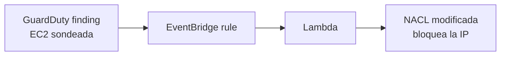

# Amazon GuardDuty

> [!abstract] Qué es este archivo
> Novena lección del módulo y **la más densa del bloque de detección**. Aunque el título dice **GuardDuty**, la
> lección **compara y contrasta con Amazon Inspector** todo el tiempo: son dos servicios que se confunden y que
> **responden preguntas distintas**.
>
> Cubre **las cuatro categorías de detección**, el **finding** y sus **severidades**, el **baseline de 7 a 14
> días**, las **listas de IP** con sus **cuotas**, el **Malware Protection**, las **suppression rules** y el
> **multi-cuenta**. Video: **4 min 46 s**.

> [!quote] La idea que ordena todo
> **Inspector pregunta “¿qué está mal configurado o sin parchear?”. GuardDuty pregunta “¿alguien está haciendo algo
> raro?”.** El primero mira **la postura**; el segundo, **el comportamiento**. **Uno se arregla; el otro se
> investiga.**

---

## Resumen en una frase

> **GuardDuty** vigila **comportamiento** con **threat intelligence + machine learning** sobre logs que AWS ya
> tiene; tarda **7 a 14 días** en aprender tu línea base, **no necesita agentes** y **se apaga con listas y
> suppression rules** cuando el ruido tapa la señal.

---

## 1. Dos servicios, dos preguntas

**El planteo de la fuente:** *“En la nube podés **detectar de forma proactiva, reaccionar y recuperarte** más
rápido y de forma más efectiva.”*

**Ambos servicios mejoran la postura de seguridad y ambos se sirven de algún tipo de automatización**, pero:

> **GuardDuty va más allá de la automatización e incorpora machine learning para detectar comportamientos
> anómalos.**

| | **Amazon Inspector** | **Amazon GuardDuty** |
| --- | --- | --- |
| **Qué es** | Herramienta de **vulnerability scanning** | Servicio de **intelligent threat detection** |
| **Qué mira** | **Problemas potenciales** en/sobre una **instancia EC2** (y más) | **Actividad inusual** de la **cuenta**, **no solo EC2** |
| **Pregunta** | **¿Qué está expuesto o sin parchear?** | **¿Alguien está haciendo algo raro?** |
| **Cómo** | **Escaneo continuo** con **auto-descubrimiento** | **Threat intelligence + machine learning** |
| **Resultado** | **Vulnerabilidades** priorizadas por **severidad** | **Findings** de amenazas con **actor y recurso** |

> [!important] La línea que decide el examen
> **GuardDuty monitorea la cuenta, no solo las instancias.** Esa frase de la fuente es la que separa los dos
> servicios cuando el enunciado es ambiguo.

> [!note] Lectura propia (no está en la fuente)
> Los dos son **detectives**, pero **detectan objetos distintos**: Inspector detecta **estado** (una CVE, un
> puerto abierto), GuardDuty detecta **eventos** (una llamada de API, una conexión). **Un estado se corrige; un
> evento se investiga.** Confundirlos lleva a “parché todo y sigo teniendo findings” o al revés.

---

## 2. Amazon Inspector

**Definición de la fuente:** **servicio automatizado de evaluación de seguridad** que **mejora la seguridad y el
compliance de las aplicaciones desplegadas en AWS**. **Evalúa automáticamente** las aplicaciones por **exposición,
vulnerabilidades y desviaciones de buenas prácticas**.

**Alcance del escaneo:**

| Recurso | Qué busca |
| --- | --- |
| **Instancias EC2** | **Vulnerabilidades** de software y **accesibilidad de red no intencional** |
| **Funciones AWS Lambda** | **Vulnerabilidades de software** |
| **Cargas de contenedores** | **Vulnerabilidades de software** |

**Cómo funciona, en palabras de la fuente:**

- **No hay que programar ni configurar escaneos manualmente.**
- **Descubre automáticamente** y **empieza a escanear** los recursos elegibles.
- **Evalúa continuamente a lo largo del ciclo de vida**, **re-escaneando** en respuesta a **cambios que podrían
  introducir una nueva vulnerabilidad**.

**Los findings:** **priorizados por nivel de severidad**, revisables **directo** o como **reportes de evaluación
detallados** en **consola o API**.

**Los paquetes de reglas:** las evaluaciones vienen como **rules packages predefinidos**, mapeados a **buenas
prácticas comunes** y **definiciones de vulnerabilidad**, **actualizados regularmente por investigadores de
seguridad de AWS**.

**Los seis beneficios que enumera la fuente:**

| # | Beneficio |
| --- | --- |
| **1** | **Identificar problemas de seguridad de aplicación** |
| **2** | **Integrar seguridad en DevOps** |
| **3** | **Aumentar la agilidad de desarrollo** |
| **4** | **Usar la expertise de seguridad de AWS** |
| **5** | **Agilizar el compliance de seguridad** |
| **6** | **Aplicar estándares de seguridad** |

> [!important] “Sin programar escaneos”
> Es el argumento de venta y la respuesta de examen: **Inspector no se agenda, se descubre**. Si la opción dice
> “configurar un cron para escanear”, **está describiendo otro producto**.

---

## 3. Amazon GuardDuty: qué es y cómo se activa

**Definición de la fuente:** **servicio de detección inteligente de amenazas** que da **una forma de monitorear y
proteger continuamente** las **cuentas y cargas de trabajo** de AWS.

**Cómo identifica atacantes:**

1. **Mediante feeds de threat intelligence integrados.**
2. **Usando machine learning** para **detectar anomalías** en la **cuenta** y en la **actividad de la carga**.

**Qué monitorea:**

| Tipo | Ejemplos |
| --- | --- |
| **Actividades** | **Llamadas de API inusuales**, **despliegues no autorizados** que **indican que la cuenta podría estar comprometida** |
| **Amenazas directas** | **Instancias comprometidas**, **reconocimiento (recon) por parte de un atacante** |

**La activación:** **con unos pocos clics en la consola**. **Al activarse, empieza inmediatamente a analizar
eventos de CloudTrail, VPC Flow Logs y DNS logs.**

> [!important] Lo que no hay que escribir
> La fuente lo dice: **“las detecciones, rule sets y threat intelligence son creados, mantenidos y actualizados
> por AWS”**, así que **no necesitás escribir reglas ni lógica de detección**. **GuardDuty no se configura: se
> enciende.**

> [!warning] Errata de la fuente (registrada, no corregida)
> El texto del tab dice que las detecciones son mantenidas por **“AWS Security Hub”**. Debe decir **AWS Security**
> —y así lo dice la propia fuente dos secciones más abajo: *“los algoritmos de detección son mantenidos y
> mejorados continuamente por **AWS Security**”*—. **Security Hub no crea detecciones de GuardDuty.** Se transcribe
> literal en §12 y se señala acá.

---

## 4. Las cuatro categorías de detección

**El marco:** GuardDuty da acceso a **técnicas de detección built-in**, **desarrolladas y optimizadas para la
nube**, que **ayudan a la eficiencia de la respuesta a incidentes**. Los **algoritmos se mantienen y mejoran
continuamente**.

| # | Categoría | Qué detecta |
| --- | --- | --- |
| **1** | **Reconnaissance** | **Actividad que sugiere reconocimiento**: **actividad de API inusual**, **port scanning intra-VPC**, **patrones inusuales de logins fallidos**, **port probing desde una IP conocida como mala** |
| **2** | **Account compromise** | **Llamadas de API desde una geolocalización inusual** o **proxy anonimizador**, **intentos de apagar el logging de CloudTrail**, **lanzamientos inusuales de instancias o infraestructura**, **despliegues en una Region inusual**, **API calls desde IPs maliciosas conocidas** |
| **3** | **Bucket compromise** | **Patrones de acceso sospechosos que indican uso indebido de credenciales**, **actividad inusual de API de S3 desde un host remoto**, **acceso no autorizado a S3 desde IPs maliciosas**, **API calls para leer datos de buckets por usuarios sin historial previo** o **invocados desde una ubicación inusual** |
| **4** | **Instance compromise** | **Criptominería (cryptocurrency mining)**, **malware que usa domain generation algorithms (DGAs)**, **actividad de denegación de servicio saliente**, **volúmenes inusualmente altos de tráfico**, **protocolos de red inusuales**, **comunicación saliente con IP maliciosa conocida**, **credenciales temporales de EC2 usadas desde una IP externa**, **exfiltración de datos por DNS** |

> [!important] Las dos que más se preguntan
> **Apagar CloudTrail** está en **account compromise** —es el gesto clásico de **esconder el rastro**—.
> **Exfiltración por DNS** está en **instance compromise**, y conecta directo con el **DNS Firewall** de la
> lección 05: **una la bloquea, la otra la detecta**.

> [!note] Lectura propia (no está en la fuente)
> Las cuatro categorías son, en realidad, **cuatro preguntas de perímetro**: **¿están mirando?** (recon), **¿ya
> entraron?** (account), **¿están sacando datos?** (bucket), **¿están usando cómputo?** (instance). El
> **criptominado** aparece en *instance* porque el objetivo **no son tus datos: es tu factura**.

---

## 5. El finding: qué trae y qué tan grave es

**Cuándo se emite:** cuando se detecta una **amenaza potencial**, GuardDuty **entrega un finding detallado** a
**la consola de GuardDuty** y a **EventBridge Events**. Eso **hace las alertas accionables** y **integrables** a
los **sistemas de event management y workflow** existentes.

**Qué incluye el finding:**

| Pregunta | Contenido |
| --- | --- |
| **¿Qué pasó?** | **Qué ocurrió** |
| **¿Qué recursos?** | **Qué recursos de AWS** estuvieron involucrados en la actividad sospechosa |
| **¿Cuándo y dónde?** | **Cuándo y dónde** ocurrió |
| **¿Quién?** | **Quién fue el actor** |
| **Metadatos** | **Categoría**, **recurso afectado** y **metadatos asociados** (incluida la **severidad**) |

### 5.1 El formato es compartido

> **Los findings de GuardDuty vienen en un formato JSON común, que también usan Amazon Macie y Amazon Inspector.**

**Eso permite** que **clientes y partners consuman findings de los tres servicios** e **incorporen** a
**soluciones de event management, workflow o seguridad más amplias**.

**Dónde se ven:** en la página **Findings** de la consola web, o con el comando **`list-findings`** de la **CLI**.

> [!important] JSON común = interoperabilidad
> Es **el mismo argumento** que en Security Hub: **formato estándar** para no convertir datos. **GuardDuty, Macie
> e Inspector hablan el mismo idioma**; Security Hub **es donde se juntan**.

### 5.2 Las tres severidades

| Severidad | Qué significa, según la fuente |
| --- | --- |
| **High** | **Tratar el problema como prioridad** y **tomar pasos de remediación inmediatos** |
| **Medium** | **Investigar el recurso implicado** **lo antes posible** |
| **Low** | **No hay acción inmediata recomendada**, pero **vale la pena anotar la información** para atenderla en el futuro |

> [!warning] High no es “crítico”: es **“ahora”**
> La fuente define **high** por **la acción que exige** (**remediación inmediata**), no por un puntaje. Y **low**
> **no es ruido**: es **“anotar para el futuro”**. Si el examen pregunta qué hacer con un finding **low**, la
> respuesta **no** es “ignorarlo”.

---

## 6. Cómo detecta: baseline, threat intelligence y fuentes

### 6.1 Los 7 a 14 días de aprendizaje

> **Cuando se trata de lo desconocido, las detecciones más avanzadas —de comportamiento y machine learning— tardan
> entre 7 y 14 días en establecer una línea base de comportamiento en tu cuenta. Después de ese tiempo, las
> detecciones de anomalía pasan de un modo de aprendizaje a un modo activo. En activo, ves findings de esas
> detecciones solo si el servicio observa un comportamiento que sugiere una amenaza.**

| Fase | Qué pasa |
| --- | --- |
| **Aprendizaje** | **7 a 14 días** construyendo la **baseline** de comportamiento de la cuenta |
| **Activo** | **Solo se emiten findings** si el comportamiento **sugiere una amenaza** |

> [!important] Por qué esto es una respuesta de examen
> *“Activamos GuardDuty y no vimos nada las primeras dos semanas”*. **Es el comportamiento esperado**: el
> servicio está **aprendiendo**. **La ausencia de findings al principio no es ausencia de protección.**

> [!warning] El efecto secundario del baseline
> La baseline **se construye con tu comportamiento**. Si **un atacante ya estaba dentro** cuando activaste el
> servicio, **su actividad se vuelve “normal”**. La detección por comportamiento **asume un estado inicial
> limpio**.

### 6.2 Threat intelligence

**Qué es:** **direcciones IP y dominios conocidos por ser usados por atacantes**.

**Quién la provee:** **AWS y proveedores de terceros**, que la fuente nombra: **Proofpoint** y **CrowdStrike**.

**Cómo llega:** **pre-integrada** y **actualizada continuamente** en GuardDuty, **sin costo adicional**.

**Qué podés agregar:** **tu propia threat intelligence** o **tu lista de IPs confiables**.

> [!important] “Solo a tu cuenta”
> Cuando usás listas propias, **se aplican solo a tu cuenta y no se comparten con otros clientes**.

### 6.3 Las fuentes de datos

**Las fuentes que analiza:**

| # | Fuente |
| --- | --- |
| **1** | **VPC Flow Logs** |
| **2** | **DNS logs** |
| **3** | **AWS CloudTrail logs** |
| **4** | **Eventos de Amazon S3** |
| **5** | **EKS audit logs** |
| **6** | **RDS protection profiles**, para proteger **bases de datos Amazon Aurora** |

**Los tipos de recurso sobre los que detecta anomalías:** **claves de acceso IAM**, **instancias EC2**, **buckets
S3** y **recursos de Amazon EKS**.

> [!important] El detalle de privacidad
> **Mientras viajan de las fuentes a GuardDuty, todos los logs están cifrados.** **GuardDuty extrae varios campos
> de esos logs para profiling y detección de anomalías, y después descarta los logs.**
>
> Eso significa: **GuardDuty no guarda tus logs** — **los procesa y los tira**. Es la razón por la que **no sirve
> como archivo histórico** y por la que **no reemplaza a CloudTrail**.

> [!note] Lectura propia (no está en la fuente)
> Las seis fuentes explican **por qué GuardDuty no necesita agentes**: **todo lo que analiza ya lo genera AWS**.
> No hay sensor que instalar porque **el sensor es la plataforma**.

---

## 7. Malware Protection

**Cuándo se activa:** **con Malware Protection encendido**, cada vez que GuardDuty **detecta comportamiento
sospechoso en una instancia EC2 o en una carga de contenedor**, **Malware Protection inicia automáticamente un
escaneo agentless** sobre el recurso.

**La secuencia:**

| # | Paso |
| --- | --- |
| **1** | **Crea snapshots** de los **volúmenes Amazon EBS relevantes** adjuntos a los recursos donde se detectó la actividad sospechosa |
| **2** | **Los comparte con la cuenta de servicio de Malware Protection** |
| **3** | **Crea réplicas cifradas** de los volúmenes EBS **desde esos snapshots**, **en la cuenta de servicio** |
| **4** | **Se escanean en busca de malware** |
| **5** | **Según la retención que elijas**, **pueden retenerse si se encuentra malware**, **para investigación posterior** |
| **6** | **Sin importar la retención: si no se encuentra malware, los snapshots se borran** |

> [!important] Agentless: la palabra que importa
> **No se instala nada en la instancia.** El escaneo ocurre **sobre una réplica del disco**, **en otra cuenta**. La
> instancia **sigue corriendo** y **el atacante no ve el análisis**.

> [!note] Lectura propia (no está en la fuente)
> La secuencia es **una cadena de custodia forense**: **snapshot → réplica cifrada → cuenta separada → retención
> si hay hallazgo**. Y el **borrado si está limpio** es **control de costos**, no de seguridad.

### 7.1 Los estados del escaneo

| Campo | Valores posibles |
| --- | --- |
| **Scan status** | **Completed**, **Running**, **Skipped**, **Failed** |
| **Scan result** (solo cuando **Completed**) | **Clean**, **Infected** |

> [!warning] “Skipped” no es “limpio”
> **Skipped** significa que **el escaneo no se hizo** — y **Failed** que **falló**. Solo **Completed + Clean**
> significa **sin malware**. Tratar un *skipped* como *clean* es **el error más caro** de este bloque.

---

## 8. Ajustar el alcance: trusted IP lists y threat lists

**El problema:** GuardDuty **analiza VPC Flow Logs, CloudTrail event logs y DNS logs**; podés **customizar el
alcance** para **dejar de alertar sobre IPs confiables** o **alertar sobre IPs maliciosas propias**.

### 8.1 Las dos listas, con sus cuotas

| | **Trusted IP list** | **Threat list** |
| --- | --- | --- |
| **Qué contiene** | **IPs en las que confiás** para **comunicación segura** | **IPs maliciosas conocidas** |
| **Efecto** | **GuardDuty NO genera findings** de **VPC Flow Logs ni de CloudTrail** para esas IPs | **GuardDuty SÍ genera findings** basados en esas IPs |
| **Máximo por lista** | **2.000** IPs y rangos CIDR | **250.000** IPs y rangos CIDR |
| **Cuántas por cuenta y Region** | **Solo una** | **Hasta seis** |
| **Origen** | Tuya | **Terceros o creada para tu organización** |

> [!important] Las cuatro cifras juntas
> **2.000 / 1** para trusted · **250.000 / 6** para threat. Son **las cuotas más preguntables** de la lección y
> **no son simétricas a propósito**: **confiar es caro, sospechar es barato**.

### 8.2 Las dos restricciones que se olvidan

1. **Las listas aplican solo a tráfico destinado a IPs públicamente ruteables.**
2. **Los efectos aplican a findings de VPC Flow Logs y CloudTrail, pero NO a findings de DNS.**

> [!warning] La trampa de DNS
> **Una IP confiable en la lista NO silencia un finding de DNS.** Y **una threat list no genera findings por
> nombres de dominio**: *“los findings no se generarán basados en nombres de dominio”*. **Las dos listas son de
> IPs, aunque el DNS también se monitoree.**

### 8.3 Los formatos aceptados

| Formato | Nombre completo |
| --- | --- |
| **TXT** | **Plaintext Text File** |
| **STIX** | **Structured Threat Information Expression** |
| **CSV** | **Comma-separated values** |

---

## 9. Alert fatigue: filters, archiving y suppression

**El problema:** **casos de uso únicos** que **generan muchos findings similares**, o **clases de findings ya
revisadas** que **no querés volver a ver**.

### 9.1 Archiving automático

**Cómo se arma:** **creás un filtro de GuardDuty**, **elegís criterios**, **lo nombrás** y **encendés el archiving
automático** de los findings que **coinciden**.

**El beneficio:** **ajustás GuardDuty a tu entorno sin degradar la capacidad de identificar amenazas**.

> [!important] La garantía que no hay que perder
> **Con el archiving activo, todos los findings se siguen generando**: **GuardDuty mantiene una historia completa e
> inmutable de toda la actividad sospechosa**. **Archivar no es borrar.**

### 9.2 El caso de Nikki (AnyCompany)

**La situación:** **Nikki**, ingeniera de seguridad de **AnyCompany**, **necesita correr escaneos de
vulnerabilidad**. **Están autorizados** y **no deben iniciar remediación**. **Configura una suppression rule**
para **evitar que la aplicación de evaluación autorizada genere alertas**.

**Los efectos de suprimir, literales:**

- **Los findings suprimidos NO se envían a AWS Security Hub, Amazon S3, Detective ni CloudWatch.**
- **Reduce el ruido** si consumís findings **vía Security Hub, un SIEM de terceros, u otras aplicaciones de
  alerting y ticketing**.
- **Si Malware Protection está encendido, los findings suprimidos no inician un escaneo de malware.**

> [!warning] Suprimir **sí** apaga cosas
> A diferencia del **archiving**, la **suppression rule** **corta la cadena**: el finding **no llega** a Security
> Hub, S3, Detective ni CloudWatch, y **no dispara el escaneo de malware**. **Es una decisión de seguridad, no de
> comodidad.**

### 9.3 Los findings archivados

| Dato | Valor |
| --- | --- |
| **Se siguen generando** | **Sí**, aunque coincidan con la suppression rule |
| **Estado** | **Automáticamente marcados como archived** |
| **Retención** | **90 días** dentro de GuardDuty |
| **Consulta** | Consola → **Archived** en la tabla de findings |
| **API** | **`ListFindings`** con **`findingCriteria`** de **`service.archived`** igual a **`true`** |

### 9.4 Cómo se arma la suppression rule del ejemplo

**Debe tener dos criterios:**

| # | Criterio | Valor |
| --- | --- | --- |
| **1** | **Finding type** | **`Recon:EC2/Portscan`** |
| **2** | **La instancia o instancias** que alojan las herramientas de evaluación | **Instance image ID** **o** **Tag value**, según cuál sea identificable |

> [!important] La lógica del ejemplo
> **Suprimir un tipo de finding** **solo en las instancias donde es esperable**. Si suprimís
> `Recon:EC2/Portscan` **en toda la cuenta**, **tapás el portscan de un atacante real**. **El segundo criterio es
> el que hace la regla segura.**

---

## 10. Respuesta automatizada

**La integración:** **GuardDuty + Amazon EventBridge + Lambda**.

**Qué permite:** **automatizar la respuesta a amenazas**, **incluidas acciones simples** como **aislar una
instancia EC2 comprometida** o **invalidar credenciales de AWS**.

**Por qué importa:** esas acciones son **críticas para contener la amenaza y limitar el blast radius** de un
ataque o incidente. **Después de contener, se hace la investigación forense.**

**El ejemplo de la fuente:** **una función Lambda que modifique tus security groups y las reglas de NACL** según
los findings.

### 10.1 El flujo del caso de uso

| # | Paso | Qué pasa |
| --- | --- | --- |
| **1** | **Findings** | Llega un finding de que **una instancia EC2 está siendo sondeada por una IP maliciosa conocida** |
| **2** | **Malicious IP detected** | Se atiende con **una regla de EventBridge Events que invoca una función Lambda** |
| **3** | **Modify network ACL** | **La Lambda modifica automáticamente las reglas de NACL** y **restringe el acceso a la instancia desde esa IP maliciosa** |

> [!note] Cierra el círculo con la lección 05
> Ese caso de uso es **exactamente** el patrón **“Automated Threat Response”** que la lección 05 describe para
> NACLs: **GuardDuty detecta → Lambda ajusta el borde**. **Acá está el mecanismo completo**, no solo el nombre.

---

## 11. Governance y multi-cuenta

| Eje | Qué aporta |
| --- | --- |
| **Monitoring y detección** | Identifica amenazas **monitoreando actividad de red, patrones de acceso a datos y comportamiento de la cuenta**. **Integrado con feeds actualizados** de **CrowdStrike** y **Proofpoint**; **threat intelligence + ML + modelos de comportamiento** detectan **criptominado**, **compromiso de credenciales**, **acceso no autorizado o inusual a datos**, **comunicación con servidores de command-and-control** y **API calls desde IPs maliciosas** |
| **Automatización de seguridad** | **Automatiza cómo responder**, **reduciendo tiempo de remediación y recuperación**. Los findings son **informativos y accionables**, con **detalles del recurso afectado e información del atacante: IP y geolocalización** |
| **Soporte multi-cuenta** | **Usa Organizations** para **encender GuardDuty en cuentas existentes y nuevas**. Los equipos **agregan los findings de la organización en una sola cuenta administradora de GuardDuty**. Los findings agregados **también están disponibles vía EventBridge** |
| **Gestión simplificada** | Al activarse, **analiza streams de actividad de cuenta y red casi en tiempo real y a escala**. **No hay software, sensores ni appliances de red que desplegar o administrar**. La threat intelligence **viene pre-integrada** y se **actualiza y mantiene regularmente** |

> [!important] La cuenta administradora
> **Un solo GuardDuty administrator account** agrega los findings de **toda la organización**. Eso es **el
> equivalente de Firewall Manager para la detección**: **un punto de vista, muchas cuentas**.

> [!note] Errata “en tiempo real”
> La fuente dice **“casi en tiempo real”** en governance y **“inmediatamente”** al activarse. **Ninguna de las dos
> es absoluta**: el **baseline de comportamiento tarda 7 a 14 días**, y las **detecciones por reglas** son las que
> responden rápido. **No se corrige la fuente; se lee con el §6.1 al lado.**

---

## 12. Traducción del contenido

> [!info] Sección de referencia (opcional)
> Esto es la **traducción fiel** de la fuente, para verificar que no se perdió nada. **No hace falta leerla para
> estudiar**: lo que se estudia son las secciones **1 a 11** y se cierra con la **14**.
> Usala solo si (a) algo de arriba te quedó dudoso, (b) querés el texto exacto de una cuota, o (c) antes del
> examen querés chequear un matiz.

### 12.1 Introduction to Amazon GuardDuty

**Con la nube, podés detectar, reaccionar y recuperarte de forma proactiva, más rápido y más efectivamente.**

**Tanto Amazon Inspector como Amazon GuardDuty son servicios que mejoran tu postura de seguridad.** **Ambos
servicios te sirven mediante alguna forma de automatización, pero GuardDuty va más allá de la automatización e
incorpora machine learning para detectar comportamientos anómalos.**

**En esta lección, el instructor revisa cómo podés detectar amenazas en la nube usando estos servicios.**

**Transcripción:** **A continuación vamos a revisar cómo podés detectar amenazas en la nube.** **Tanto Amazon
Inspector como GuardDuty son servicios que mejoran tu postura de seguridad.** **Ambos servicios te sirven mediante
alguna forma de automatización, pero GuardDuty va más allá de la automatización e incorpora machine learning para
detectar comportamientos anómalos.**

**Amazon Inspector es una herramienta de escaneo de vulnerabilidades que podés usar para identificar problemas
potenciales de seguridad en o sobre una instancia EC2.** **Escanea continuamente y puede auto-descubrir tus cargas
de trabajo de AWS en busca de vulnerabilidades.** **Amazon Inspector es un servicio automatizado de gestión de
vulnerabilidades que escanea continuamente instancias EC2, funciones AWS Lambda y cargas de contenedores en busca
de vulnerabilidades de software y exposición de red no intencional.** **Con Amazon Inspector, no necesitás
programar ni configurar escaneos de evaluación manualmente.** **Amazon Inspector descubre automáticamente y empieza
a escanear tus recursos elegibles.** **Evalúa continuamente tu entorno a lo largo del ciclo de vida de tus recursos,
re-escaneando automáticamente en respuesta a cambios que podrían introducir una nueva vulnerabilidad.**

**Ahora, GuardDuty es un servicio de detección inteligente de amenazas que les da a los clientes una forma de
monitorear y proteger continuamente sus cuentas y cargas de trabajo de AWS.** **GuardDuty identifica atacantes
sospechosos mediante feeds de threat intelligence integrados y usa machine learning para detectar anomalías en la
cuenta y en la actividad de la carga de trabajo.** **Monitorea actividades como llamadas de API inusuales o
despliegues no autorizados que indican que la cuenta de un cliente podría haber sido comprometida.** **También
monitorea amenazas directas, como instancias comprometidas o reconocimiento por parte de un atacante.**

**Cuando se trata de lo desconocido, las detecciones más avanzadas de comportamiento y machine learning tardan
entre siete y 14 días en establecer una línea base de comportamiento en tu cuenta.** **Después de ese tiempo, las
detecciones de anomalía pasan de un modo de aprendizaje a un modo activo.** **En modo activo, solo ves findings
generados por estas detecciones si el servicio observa comportamiento que sugiere una amenaza.**

**GuardDuty Threat Intelligence está compuesta por direcciones IP y dominios conocidos por ser usados por
atacantes.** **La threat intelligence de GuardDuty es provista por AWS y por proveedores de terceros.** **Estos
feeds de threat intelligence están pre-integrados y se actualizan continuamente en GuardDuty sin costo
adicional.** **También podés subir tu propia threat intelligence o tu lista de IPs confiables a GuardDuty.**

**Con la protección de malware activada, cada vez que GuardDuty detecta comportamiento sospechoso en una instancia
EC2 o en una carga de contenedor, GuardDuty Malware Protection inicia automáticamente un escaneo agentless sobre el
recurso.** **Malware Protection crea snapshots de los volúmenes Amazon EBS relevantes adjuntos a los recursos.**
**Después los comparte con la cuenta de servicio de Malware Protection.** **Luego, Malware Protection crea réplicas
cifradas del volumen EBS desde esos snapshots en la cuenta de servicio.** **Se escanean en busca de malware y,
según la configuración de retención que elijas, podrían retenerse si se encuentra malware.** **Se pueden usar para
una investigación posterior.** **Sin importar la configuración de retención, si no se encuentra malware, los
snapshots se borran.**

**GuardDuty está integrado con Amazon EventBridge y Lambda.** **Usando estos servicios de Amazon, podés automatizar
tu respuesta de seguridad a las amenazas.** **Esto incluye tomar una acción simple, como aislar una instancia EC2
comprometida, o invalidar credenciales de AWS.** **Estos tipos de acciones son críticos para contener una amenaza y
limitar el radio de explosión de un ataque.** **Con GuardDuty, EventBridge y Lambda, tenés la flexibilidad de
configurar acciones preventivas automatizadas basadas en findings de seguridad.** **Por ejemplo, podés crear una
función Lambda para modificar tus security groups de AWS y tu network access control list, basándote en findings de
seguridad.**

*Duración del video: **4 minutos 46 segundos**.*

### 12.2 Service comparison

**Ambos servicios, Amazon Inspector y Amazon GuardDuty, proveen controles preventivos y detectivos para tu entorno
cloud.**

- **Amazon Inspector es una herramienta de vulnerability scanning** que podés usar para **identificar problemas
  potenciales de seguridad en instancias EC2**. **Escanea continuamente** y **puede auto-descubrir tus cargas de
  trabajo de AWS en busca de vulnerabilidades.**
- **GuardDuty es un servicio de intelligent threat detection** que **monitorea continuamente tu cuenta de AWS,
  no solo tus instancias EC2, en busca de actividades inusuales.**

**Vulnerability Scanning — Amazon Inspector** — **es un servicio automatizado de evaluación de seguridad que ayuda
a mejorar la seguridad y el compliance de las aplicaciones desplegadas en AWS.** **El servicio evalúa
automáticamente las aplicaciones por exposición, vulnerabilidades y desviaciones de buenas prácticas.** **Los
findings de seguridad, priorizados por nivel de severidad, se pueden revisar directamente o como parte de reportes
de evaluación detallados en la consola o la API.**

**Las evaluaciones de Amazon Inspector ayudan a revisar la accesibilidad de red no intencional de tus instancias
EC2 y las vulnerabilidades en esas instancias.** **Estas evaluaciones se ofrecen como rules packages predefinidos
mapeados a buenas prácticas comunes de seguridad y definiciones de vulnerabilidad.** **Estas reglas son
actualizadas regularmente por investigadores de seguridad de AWS.** **Algunos beneficios clave incluyen:**
**identificar problemas de seguridad de aplicación**; **integrar seguridad en Development Operations (DevOps)**;
**aumentar la agilidad de desarrollo**; **usar la expertise de seguridad de AWS**; **agilizar el compliance de
seguridad**; **aplicar estándares de seguridad.**

**Threat Detection — Amazon GuardDuty** — **es un servicio de detección inteligente de amenazas que provee a los
clientes una forma de monitorear y proteger continuamente sus cuentas y cargas de trabajo de AWS.** **GuardDuty
identifica atacantes sospechosos mediante feeds de threat intelligence integrados y usa machine learning para
detectar anomalías en la actividad de la cuenta y de la carga de trabajo.** **Monitorea actividades como llamadas
de API inusuales o despliegues no autorizados que indican que las cuentas de un cliente podrían haber sido
comprometidas.** **También monitorea amenazas directas, como instancias comprometidas o reconocimiento por parte de
atacantes.**

**Cuando se detecta una amenaza potencial, el servicio entrega una alerta de seguridad detallada a la consola de
GuardDuty y a EventBridge Events.** **Esto hace que las alertas sean accionables y capaces de integrarse en
sistemas de event management y workflow existentes.**

**Podés activar GuardDuty con unos pocos clics en la AWS Management Console.** **Cuando se activa, el servicio
empieza inmediatamente a analizar eventos de CloudTrail, VPC Flow Logs y Domain Name System (DNS) logs.** **Las
detecciones, rule sets y threat intelligence son creados, mantenidos y actualizados por AWS Security Hub, así que
no necesitás escribir reglas ni lógica de detección.**

### 12.3 Amazon GuardDuty Detection Categories

**GuardDuty te da acceso a técnicas de detección built-in que están desarrolladas y optimizadas para la nube y, en
última instancia, ayudan a la eficiencia de la respuesta a incidentes.** **Los algoritmos de detección son
mantenidos y mejorados continuamente por AWS Security.**

**Reconnaissance** — **Actividad que sugiere reconocimiento por parte de un atacante.** **Esto incluye actividad
de API inusual, port scanning intra-VPC, patrones inusuales de peticiones de login fallidas, o port probing no
bloqueado desde una IP conocida como mala.**

**Account compromise** — **Patrones comunes que indican compromiso de cuenta incluyen llamadas de API desde una
geolocalización inusual o un proxy anonimizador, y intentos de apagar el logging de CloudTrail.** **También
incluyen lanzamientos inusuales de instancias o infraestructura, despliegues de infraestructura en una Region de
AWS inusual, y llamadas de API desde direcciones IP maliciosas conocidas.**

**Bucket compromise** — **Actividad que indica compromiso de un bucket, como patrones de acceso a datos
sospechosos que indican uso indebido de credenciales.** **También incluyen actividad inusual de API de Amazon S3
desde un host remoto y acceso no autorizado a Amazon S3 desde direcciones IP maliciosas conocidas.** **Otros
ejemplos incluyen llamadas de API para recuperar datos de buckets de S3 por parte de usuarios que no tenían
historial previo de acceso al bucket, o que fueron invocados desde una ubicación inusual.**

**Instance compromise** — **Actividad que indica compromiso de una instancia.** **Esto incluye criptominería de
moneda digital, malware que usa domain generation algorithms (DGAs), actividad de denegación de servicio saliente,
volúmenes inusualmente altos de tráfico de red y protocolos de red inusuales.** **También incluye comunicación
saliente de la instancia con una IP maliciosa conocida, credenciales temporales de Amazon EC2 usadas por una
dirección IP externa, y exfiltración de datos usando DNS.**

### 12.4 Finding details

**Cuando se detecta una amenaza, GuardDuty entrega un finding de seguridad detallado a la consola de GuardDuty y a
EventBridge Events.** **Los detalles del finding incluyen información sobre qué pasó, qué recursos de AWS
estuvieron involucrados en la actividad sospechosa, cuándo y dónde ocurrió la actividad, quién fue el actor, y otra
información.**

**Los findings de GuardDuty vienen en un formato JSON común que también usan Amazon Macie y Amazon Inspector.**
**Esto hace posible que clientes y partners consuman findings de seguridad de los tres servicios y los incorporen
en soluciones más amplias de event management, workflow o seguridad.** **Podés ver y administrar los findings en la
página Findings de la consola web.** **También podés usar el comando de interfaz de línea de comandos (CLI)
`list-findings`.**

**Los niveles de severidad indican un problema de seguridad que puede resultar en información comprometida —en
confidencialidad, integridad y disponibilidad— dentro de tu infraestructura de AWS.** **Los findings de GuardDuty
tienen asignado un nivel de severidad high, medium o low, definidos así:**

- **Un nivel high significa que necesitás tratar el problema de seguridad como prioridad y tomar pasos de
  remediación inmediatos.**
- **Un nivel medium requiere una investigación del recurso implicado lo antes posible.**
- **Un nivel low indica que no hay acción inmediata recomendada, pero vale la pena anotar la información para
  atenderla en el futuro.**

### 12.5 How GuardDuty detects threats

**Cuando se trata de amenazas desconocidas, las detecciones más avanzadas de comportamiento y machine learning
tardan entre 7 y 14 días en establecer una línea base de comportamiento en tu cuenta.** **Después de ese tiempo,
las detecciones de anomalía pasan de un modo de aprendizaje a un modo activo.** **En modo activo, solo ves
findings generados por estas detecciones si el servicio observa comportamiento que sugiere una amenaza.**

**La threat intelligence de GuardDuty está compuesta por direcciones IP y dominios conocidos por ser usados por
atacantes.** **La threat intelligence de GuardDuty es provista por AWS y por proveedores de terceros, como
Proofpoint y CrowdStrike.** **Estos feeds están pre-integrados y se actualizan continuamente en GuardDuty sin costo
adicional.** **GuardDuty te permite subir tu propia threat intelligence o tu lista de direcciones IP confiables.**
**Cuando se usa esta función, estas listas se aplican solo a tu cuenta y no se comparten con otros clientes.**

**1: Data Sources** — **Para detectar actividad no autorizada e inesperada en tu entorno de AWS, GuardDuty analiza
y procesa datos de fuentes como VPC flow logs, DNS logs, AWS CloudTrail logs, eventos de Amazon S3 y Amazon EKS
audit logs, y perfiles de RDS protection para proteger bases de datos Amazon Aurora.** **Además, GuardDuty usa
estas fuentes para detectar anomalías relacionadas con los siguientes tipos de recursos de AWS: claves de acceso
IAM, instancias EC2, buckets S3 y recursos de Amazon Elastic Kubernetes Service (Amazon EKS).** **Mientras están en
tránsito desde estas fuentes hacia GuardDuty, todos los datos de logs están cifrados.** **GuardDuty extrae varios
campos de estos logs para profiling y detección de anomalías, y después descarta los logs.**

**2: Findings** — **Cuando se detecta una amenaza potencial, GuardDuty entrega un finding de seguridad detallado a
la consola de GuardDuty y a EventBridge Events.** **Esto hace que las alertas sean más accionables y más fácilmente
integrables en sistemas de event management o workflow existentes.** **Los findings incluyen la categoría, el
recurso afectado y metadatos asociados al recurso, como el nivel de severidad.**

### 12.6 Adding GuardDuty Malware Protection

**Con Malware Protection activado, cada vez que GuardDuty detecta comportamiento sospechoso en una instancia EC2 o
en una carga de contenedor, GuardDuty Malware Protection inicia automáticamente un escaneo agentless sobre el
recurso.**

**Malware Protection crea snapshots de los volúmenes Amazon Elastic Block Store (Amazon EBS) relevantes adjuntos a
los recursos donde GuardDuty detectó actividad sospechosa.** **Después los comparte con la cuenta de servicio de
Malware Protection.** **Luego, Malware Protection crea volúmenes Amazon EBS réplica cifrados a partir de esos
snapshots en la cuenta de servicio.** **Se escanean en busca de malware y, según la configuración de retención que
elijas, podrían retenerse si se encuentra malware.** **Se pueden usar para una investigación posterior.**

**Podés monitorear el estado del escaneo de cada escaneo de Malware Protection.** **Los valores posibles para scan
Status son Completed, Running, Skipped y Failed.** **Después de que el escaneo se completa, el Scan result se
completa para los escaneos que tienen el Status en Completed.** **Los valores posibles para Scan result son Clean e
Infected.**

### 12.7 Customize your monitoring scope

**GuardDuty monitorea la seguridad de tu entorno de AWS analizando y procesando VPC Flow logs, CloudTrail event
logs y DNS logs.** **Podés customizar este alcance de monitoreo configurando GuardDuty para que deje de alertar
sobre IPs confiables de tus propias listas de IPs confiables.** **También podés alertar sobre IPs maliciosas
conocidas de tus propias listas de amenazas.** **Las listas de IPs confiables y las listas de amenazas aplican solo
al tráfico destinado a direcciones IP públicamente ruteables.** **Los efectos de una lista aplican a todos los
findings de VPC Flow logs y CloudTrail, pero no aplican a los findings de DNS.** **GuardDuty se puede configurar
para usar listas de IPs confiables y listas de amenazas.**

**Trusted IP list** — **Las listas de IPs confiables consisten en direcciones IP en las que confiaste para
comunicación segura con tu infraestructura y aplicaciones de AWS.** **GuardDuty no genera findings de VPC Flow logs
ni de CloudTrail para direcciones IP en las listas de IPs confiables.** **Podés incluir un máximo de 2.000
direcciones IP y rangos CIDR en una sola lista de IPs confiables.** **En cualquier momento dado, podés tener solo
una lista de IPs confiables subida por cuenta de AWS por Region.**

**Threat List** — **Las listas de amenazas consisten en direcciones IP maliciosas conocidas.** **Estas listas
pueden ser provistas por threat intelligence de terceros o creadas específicamente para tu organización.**
**GuardDuty genera findings basados en listas de amenazas.** **Podés incluir un máximo de 250.000 direcciones IP y
rangos CIDR en una sola lista de amenazas.** **GuardDuty solo genera findings basados en actividad que involucra
direcciones IP y rangos CIDR de tus listas de amenazas.** **Los findings no se generarán basados en nombres de
dominio.** **En cualquier momento dado, podés tener hasta seis listas de amenazas subidas por cuenta de AWS por
Region.**

**Los formatos:** **Plaintext Text File (TXT)**, **Structured Threat Information Expression (STIX)** y
**Comma-separated values (CSV)**.

### 12.8 Avoiding alert fatigue

**Para casos de uso únicos en tu entorno que generan muchos findings similares, podés configurar archiving
automático.** **También podés configurar archiving automático para situaciones en las que revisaste cierta clase de
findings y no querés que te alerten de nuevo.**

**Cuando creás un filtro de GuardDuty, elegís criterios específicos, nombrás el filtro y activás el archiving
automático de los findings que el filtro coincide.** **Después podés ajustar GuardDuty a tu entorno único sin
degradar la capacidad de identificar amenazas.** **Con el archiving automático configurado, todos los findings se
siguen generando en GuardDuty, así que tenés una historia completa e inmutable de toda la actividad sospechosa.**

**Caso de uso: evitar la fatiga de alertas** — **La ingeniera de seguridad de AnyCompany, Nikki, necesita realizar
escaneos de vulnerabilidad del entorno de la organización.** **Estos escaneos están autorizados y no necesitan
iniciar ninguna remediación.** **Nikki puede configurar una suppression rule para evitar que la aplicación de
evaluación de vulnerabilidades autorizada genere alertas.** **Los findings suprimidos no se envían a AWS Security
Hub, Amazon S3, Detective ni CloudWatch.** **Esto reduce el nivel de ruido de findings si consumís findings de
GuardDuty vía Security Hub, un SIEM de terceros, u otras aplicaciones de alerting y ticketing.** **Si activaste
Malware Protection, los findings suprimidos de GuardDuty no iniciarán un escaneo de malware.**

**Archived Findings** — **GuardDuty sigue generando findings incluso cuando coinciden con tus suppression rules,
sin embargo, esos findings se marcan automáticamente como archived.** **El finding archivado se almacena en
GuardDuty por 90 días y se puede ver en cualquier momento durante ese período.** **Podés ver los findings suprimidos
en la consola de GuardDuty seleccionando Archived en la tabla de findings, o a través de la API de GuardDuty usando
la API `ListFindings` con un criterio `findingCriteria` de `service.archived` igual a true.**

**Suppression Rules** — **Cuando creás una suppression rule, debe consistir en dos criterios de filtro.** **El
primer criterio debe usar el atributo Finding type con un valor de `Recon:EC2/Portscan`.** **El segundo criterio
debe coincidir con la instancia o instancias que alojan estas herramientas de evaluación de vulnerabilidades.**
**Podés usar el atributo Instance image ID o el atributo Tag value, dependiendo de cuáles criterios sean
identificables con las instancias que alojan estas herramientas.** **El ejemplo provisto representa el filtro que
usarías para suprimir este tipo de finding basado en instancias con cierta AMI.**

### 12.9 GuardDuty Use Case: Automated Response

**GuardDuty está integrado con Amazon EventBridge y Lambda.** **Usando estos servicios de Amazon, podés automatizar
tus respuestas a amenazas de seguridad.** **Esto incluye tomar acciones simples, como aislar una instancia EC2
comprometida o invalidar credenciales de AWS.** **Estos tipos de acciones son críticos para contener una amenaza y
limitar el radio de explosión de un ataque o incidente.** **Después de que estén contenidos, realizá las
investigaciones forenses adicionales que sean necesarias.**

**Con GuardDuty, EventBridge y Lambda, tenés la flexibilidad de configurar acciones preventivas automatizadas
basadas en un finding de seguridad.** **Por ejemplo, podés crear una función Lambda para modificar tus reglas de
security group de AWS y de network access control list (ACL) basándote en findings de seguridad.**

**1: Findings** — **Obtenés un finding de GuardDuty que indica que una de tus instancias EC2 está siendo sondeada
por una dirección IP maliciosa conocida.**

**2: Malicious IP detected** — **Atendés este finding a través de una regla de EventBridge Events que invoca una
función Lambda.**

**3: Modify network ACL** — **La función Lambda modifica automáticamente tus reglas de network ACL y restringe el
acceso a la instancia EC2 desde la dirección IP maliciosa.**

### 12.10 Amazon GuardDuty Governance

**Monitoring y detección de amenazas** — **GuardDuty identifica amenazas monitoreando actividad de red, patrones
de acceso a datos y comportamiento de la cuenta en AWS.** **Está integrado con feeds de threat intelligence
actualizados de AWS, como CrowdStrike y Proofpoint.** **La threat intelligence, junto con machine learning y
modelos de comportamiento, ayudan a detectar actividad como criptominería y comportamiento de compromiso de
credenciales.** **También podés detectar acceso a datos no autorizado e inusual, comunicación con servidores de
command-and-control conocidos, o llamadas de API desde direcciones IP maliciosas conocidas.**

**Automatización de seguridad** — **Además de detectar amenazas, GuardDuty automatiza cómo responder a las
amenazas, reduciendo el tiempo de remediación y recuperación.** **Los findings de seguridad de GuardDuty son
informativos y accionables para las operaciones de seguridad.** **Los findings incluyen los detalles del recurso
afectado y la información del atacante, como la dirección IP y la geolocalización.**

**Soporte multi-cuenta** — **GuardDuty provee soporte multi-cuenta usando Organizations, así los clientes pueden
encender GuardDuty en cuentas existentes y nuevas.** **Los equipos de seguridad pueden agregar los findings de una
organización entre cuentas en una sola cuenta administradora de GuardDuty para una gestión más fácil.** **Los
findings agregados también están disponibles a través de Amazon EventBridge, facilitando la integración con
sistemas de event management empresariales existentes.**

**Gestión simplificada** — **Cuando GuardDuty se activa, empieza inmediatamente a analizar streams de actividad de
cuenta y de red casi en tiempo real y a escala.** **No tenés software de seguridad, sensores ni appliances de red
adicionales para desplegar o administrar.** **La threat intelligence está preintegrada en el servicio y se
actualiza y mantiene regularmente.**

> [!note] Las ocho imágenes de la fuente no están en el vault
> `T4BAHZV5UN.png` (workflow de Inspector), `45YVK9HEU8.jpeg` (workflow de GuardDuty), `R7G4TZBK57.png` (finding
> details), `E1YDME16C1.jpeg` (cómo detecta), `VT2BRWJZJ3.png` (Malware Protection), `T831TXNMTW.png` (trusted IP
> list), `X1UN1CF1AE.png` (threat list) y `5XMF6M3P5A.png` (suppression rules). **No se describen más allá de su
> texto alternativo**; el esquema de §10 es una **reconstrucción**.

---

## 13. Cuadro de cierre

| Necesidad | Servicio | Mecanismo |
| --- | --- | --- |
| **Saber qué está sin parchear** | **Inspector** | **Escaneo continuo** de **EC2, Lambda y contenedores**, con **auto-descubrimiento** |
| **Saber si alguien está actuando raro** | **GuardDuty** | **Threat intelligence + ML** sobre **cuentas y cargas** |
| **Detectar sin instalar nada** | **GuardDuty** | **Sin software, sensores ni appliances** |
| **Análisis de comportamiento** | **GuardDuty** | **Baseline de 7 a 14 días**, después **modo activo** |
| **Revisar un disco sin apagar la instancia** | **Malware Protection** | **Snapshots → réplicas cifradas → escaneo agentless** |
| **Silenciar IPs propias** | **Trusted IP list** | **2.000** por lista, **una** por cuenta y Region |
| **Alertar sobre IPs maliciosas propias** | **Threat list** | **250.000** por lista, **hasta seis** por cuenta y Region |
| **Bajar el ruido sin perder historia** | **Filters + archiving** | Findings **se siguen generando**, **90 días** archivados |
| **Cortar la cadena de un finding esperado** | **Suppression rule** | **No llega** a Security Hub, S3, Detective ni CloudWatch |
| **Contener un ataque solo** | **EventBridge + Lambda** | **Aislar la instancia** o **modificar NACL** |
| **Ver toda la organización en un lugar** | **GuardDuty multi-cuenta** | **Cuenta administradora** vía **Organizations** |

---

## 14. Para el examen (SAP-C02)

> [!important] Lo que hay que retener
> 1. **Inspector = vulnerabilidades** (EC2, Lambda, contenedores) con **escaneo continuo y auto-descubrimiento**,
>    **sin programar escaneos**.
> 2. **GuardDuty = detección de amenazas** sobre **la cuenta entera**, no solo EC2, con **threat intelligence + ML**.
> 3. **Se activa con unos pocos clics** y **empieza a analizar CloudTrail, VPC Flow Logs y DNS logs** de inmediato.
> 4. **Baseline de 7 a 14 días**; después, **de aprendizaje a activo**.
> 5. **Threat intelligence de AWS y de terceros** (**Proofpoint**, **CrowdStrike**), **pre-integrada y sin costo
>    adicional**.
> 6. **Cuatro categorías**: **Reconnaissance**, **Account compromise**, **Bucket compromise**, **Instance
>    compromise**.
> 7. **Apagar CloudTrail** = *account compromise*. **Exfiltración por DNS** y **criptominado** = *instance
>    compromise*.
> 8. **JSON común con Macie e Inspector**; se consulta con **`list-findings`**.
> 9. **Severidades**: **high = remediar ya**, **medium = investigar pronto**, **low = anotar**.
> 10. **Seis fuentes de datos**: **VPC Flow Logs**, **DNS logs**, **CloudTrail**, **eventos S3**, **EKS audit
>     logs**, **RDS protection profiles** (Aurora). **Los logs se cifran en tránsito y se descartan después de
>     extraer campos.**
> 11. **Malware Protection**: **agentless**, **snapshots → réplicas cifradas en la cuenta de servicio**; **si no
>     hay malware, los snapshots se borran**; **status** Completed/Running/Skipped/Failed, **result**
>     Clean/Infected.
> 12. **Trusted IP list**: **2.000** y **una** por cuenta y Region. **Threat list**: **250.000** y **hasta seis**.
>     **Formato TXT, STIX o CSV.**
> 13. **Las listas aplican solo a IPs públicamente ruteables** y **no afectan findings de DNS**; **no se generan
>     findings por nombres de dominio**.
> 14. **Archiving** conserva la historia (**90 días**); **suppression** **corta la entrega** y **no dispara malware
>     scan**.
> 15. **Multi-cuenta con Organizations** y **una cuenta administradora** que agrega los findings.

> [!warning] Trampa clásica del examen
> Escenario: *“queremos detectar instancias EC2 comprometidas y vulnerabilidades de software, con **mínima
> operación**”*. La respuesta **no** es “instalar un agente”: **Inspector** para **vulnerabilidades** y
> **GuardDuty** para **comportamiento**, **los dos sin agentes**. Y si el enunciado dice *“activamos GuardDuty y no
> alerta hace dos semanas”*, **no está roto**: está en **baseline de 7 a 14 días**. Si dice *“el finding de DNS
> sigue apareciendo aunque la IP está en la trusted list”*, **es correcto**: **las listas no aplican a DNS**.

---

## Relacionado

- [[AWS Solutions Architect Advanced - Securing Networks and Data]] *(índice del módulo)*
- [[Security Hub]] — **GuardDuty es una de sus siete fuentes**; acá se ve el detalle del finding
- [[Demo - AWS Security Hub]] y [[Tech Talk - AWS Security Hub]] — el otro extremo del flujo: dónde se agregan
- [[Network Traffic Controls]] — **Route 53 Resolver DNS Firewall** (bloquea DNS) y el patrón **NACL + Lambda** que
  acá se ve completo
- [[AWS Firewall Manager]] — el otro servicio que manda findings a Security Hub
- [[Gathering the Customer Requirements - Security]] — el requisito **5** (detección en tiempo real) que se cubre acá
- [[1.2 Prescribir controles de seguridad]] — la tarea que este módulo cubre
- [[2.3 Determinar los controles de seguridad en función de los requisitos]] — el cruce con Dominio 2
- [[Guia AWS]] — pesos y tareas oficiales del SAP-C02
- Siguiente paso del módulo: [[Demo - AWS GuardDuty]] — la misma detección, **vista en consola**: protection
  plans, findings filtrados y el detalle de un clúster EKS

---

## Registro de integración

| Fecha | Qué llegó | Dónde se integró |
| --- | --- | --- |
| 27/10/2026 | Lección 09 completa: Inspector vs. GuardDuty, cuatro categorías, findings, baseline, fuentes, Malware Protection, listas, alert fatigue, respuesta automatizada y governance | Nota completa (secciones 1–14) |

**Discrepancias y vacíos registrados (no corregidos):**

1. **La fuente dice que las detecciones de GuardDuty son mantenidas por “AWS Security Hub”**. Debe decir **AWS
   Security**: la propia fuente lo corrige dos secciones más abajo. **Security Hub no crea detecciones.** Se
   transcribe literal (§12.2) y se señala (§3).
2. **“Casi en tiempo real” vs. baseline de 7 a 14 días**: la fuente usa las dos afirmaciones. **No se resuelven
   entre sí**: las **reglas** responden rápido, el **comportamiento** necesita baseline (§11).
3. **El título de la lección es “Amazon GuardDuty”**, pero **la mitad del contenido es Inspector**. Se respeta el
   título de la fuente y se aclara en el abstract.
4. **Las ocho imágenes no están en el vault** (listadas en §12.10). El esquema de §10 es una **reconstrucción** de
   los tres marcadores.
5. **La fuente no define el formato JSON con su nombre técnico** (ASFF): solo dice **“formato JSON común”**. **No se
   agrega el nombre.**
6. **La fuente no dice qué pasa con los findings archivados después de 90 días**: solo que **se almacenan 90 días**.
7. **La fuente no aclara si el `Skipped` de un escaneo de malware tiene causa explícita**; solo lista los estados.
8. **La fuente no da el límite de cuántos filtros de archiving** se pueden crear.
9. **El caso de Nikki describe la suppression rule pero no muestra el JSON**: se transcriben **los dos criterios**
   tal como se enuncian (§9.4).
10. **El nombre de archivo `Amazon GuardDuty.md` no colisiona** con ninguna nota del vault (verificado: **0
    basenames duplicados**). **No había notas previas de GuardDuty ni de Inspector.**

**Decisiones de transcripción:**

- Se conservan **vulnerability scanning**, **intelligent threat detection**, **threat intelligence**, **machine
  learning**, **baseline**, **finding**, **reconnaissance**, **account compromise**, **bucket compromise**,
  **instance compromise**, **agentless**, **blast radius**, **recon**, **DGAs**, **command-and-control**,
  **suppression rule**, **archiving**, **alert fatigue**, **trusted IP list**, **threat list**, **DevOps** y
  **SIEM**.
- Las **cifras** se transcriben literales: **7 a 14 días**, **2.000** IPs por trusted list, **una** trusted list
  por cuenta y Region, **250.000** IPs por threat list, **hasta seis** threat lists, **90 días** de retención,
  **4 min 46 s**, **cuatro** categorías, **seis** fuentes de datos, **tres** severidades.
- Se conservan los **nombres propios**: **Nikki**, **AnyCompany**, **Proofpoint**, **CrowdStrike**.
