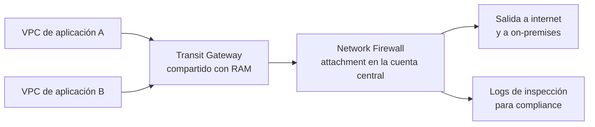
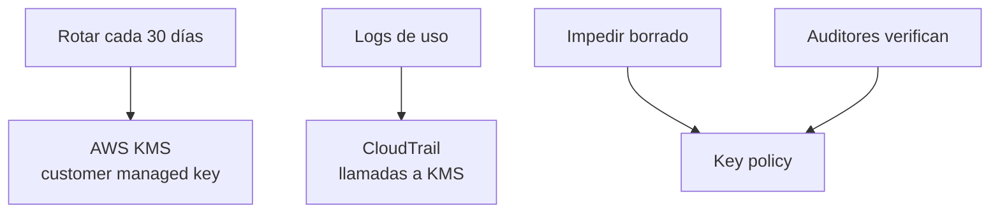

# BuildingBlocks Videos - Security

> [!abstract] Qué es este archivo
> Decimoséptima lección del módulo. **No enseña servicios nuevos**: son **tres diálogos de arquitectos** donde se
> evalúan opciones, se descartan con argumentos y se elige la que **cumple sin agregar operación**.
>
> Cubre **Firewall Manager para WAF y security groups**, **Network Firewall con Transit Gateway** para inspección
> multi-cuenta y **KMS + CloudTrail + key policy** para cifrado de S3 con auditoría.
>
> Duraciones: **2 min 34 s**, **3 min 21 s** y **2 min 41 s**. **Sin imágenes y sin Knowledge Check.**
>
> **El nombre lleva sufijo** porque ya existen `BuildingBlocks Videos` (Multi-Account) y
> `BuildingBlocks Videos - Networking` (redes).

> [!quote] La idea que ordena todo
> **La respuesta no es la más potente, es la que cubre el requisito con menos piezas nuevas.** En los tres casos
> se descarta la opción “más completa” —**Config + WAF por cuenta**, **flow logs + Lambda**, **CloudHSM**— porque
> agrega **operación, detección en lugar de prevención, o complejidad que el requisito no pedía**.

---

## Resumen en una frase

> Tres decisiones: **Firewall Manager** para aplicar **WAF y security groups** en toda la organización,
> **Network Firewall integrado con Transit Gateway** para **inspección profunda y filtrado** sin VPCs de
> inspección, y **KMS con rotación, CloudTrail y key policy** para cumplir **auditoría y protección contra
> borrado** sin llegar a **CloudHSM**.

---

## 1. Tres casos, un mismo método

**El formato:** dos arquitectos revisan un problema real, proponen opciones, las critican **contra los pilares de
Well-Architected** y cierran con una recomendación.

| Caso | Pilar que decide | Pieza ganadora |
| --- | --- | --- |
| **1. Web application security** | **Operational Excellence** + **Security** | **AWS Firewall Manager** |
| **2. Multi-account network security** | **Security** (+ **Operational Excellence**) | **AWS Network Firewall** + **Transit Gateway** + **AWS RAM** |
| **3. Encryption for S3** | **Security** | **AWS KMS** + **AWS CloudTrail** + **key policy** |

> [!important] Cómo se lee cada caso
> Fijate **qué se descarta y por qué**. La opción incorrecta del examen suele ser **técnicamente válida**: pierde
> por **overhead**, por **intervención manual**, por **detectar en lugar de prevenir** o por **costo**, no por no
> funcionar.

---

## 2. Caso 1: seguridad de aplicaciones web en varias cuentas

**La situación:** un cliente **corre aplicaciones en múltiples cuentas de AWS** y **no logra mantener controles
de seguridad consistentes**.

### 2.1 Los tres requisitos

| Qué quiere proteger | Requisito literal |
| --- | --- |
| **Instancias EC2** | Protegerlas con controles parejos en todas las cuentas |
| **Application Load Balancers** | **Reglas de WAF consistentes** en **todos** los ALB |
| **Security groups** | **Aplicar** las reglas de security group en **todas** las cuentas |

### 2.2 Las opciones que se evalúan

| Opción | Veredicto | Por qué |
| --- | --- | --- |
| **AWS Config rules** para los security groups **+ WAF desplegado cuenta por cuenta** | **Descartada** | **Config monitorea** el cumplimiento de los security groups, pero **no aplica** las reglas; y administrar WAF por cuenta *“sería una pesadilla de mantenimiento a medida que escalan”* |
| **Plantillas de CloudFormation** con WAF y security groups estandarizados | **Descartada** | **Estandariza**, pero **hay que desplegar y actualizar las plantillas a mano en cada cuenta** |
| **AWS Firewall Manager** | **Elegida** | **Crea la política una vez** y **la aplica a toda la estructura de AWS Organizations**; cubre **WAF y security groups**, y **alcanza cuentas y recursos nuevos** |

### 2.3 Cómo lo resuelve Firewall Manager

1. **Se define una política de seguridad una sola vez.**
2. **Se aplica automáticamente** a **toda la organización**.
3. **Cubre las dos familias de política**: **reglas de WAF** y **reglas de security group**.
4. **Se extiende sola**: al **agregar cuentas** o **desplegar ALBs nuevos**, la política **se aplica sin
   intervención manual**.

**El argumento de los pilares:** **Operational Excellence** pide **reducir el overhead operativo y los procesos
manuales**; **Security** pide **control centralizado y aplicación automatizada**. **Firewall Manager cumple las
dos.**

> [!important] Monitorear no es aplicar
> **AWS Config te dice si algo se desvía; Firewall Manager hace que no se desvíe.** Esa es la diferencia que
> decide el caso, y la que el examen cobra: **si el requisito es “enforce”, la respuesta no es un servicio de
> monitoreo**.

> [!warning] El matiz que la fuente no hace
> La conversación dice que **Config “no puede aplicar las reglas”**. En rigor, **Config puede disparar
> remediaciones automáticas** con **SSM Automation**. Lo que **no** hace es **administrar políticas de WAF** ni
> **reemplazar la gestión central** de Firewall Manager. **Se conserva la afirmación del video** y se registra el
> matiz (§ registro, punto 1).

> [!note] Lectura propia (no está en la fuente)
> **CloudFormation no compite con Firewall Manager: compite con el despliegue manual.** La plantilla **define** el
> estándar; Firewall Manager **lo sostiene** cuando alguien crea un ALB nuevo. **Estandarizar y aplicar son dos
> problemas distintos.**

---

## 3. Caso 2: seguridad de red en múltiples cuentas

**La situación:** una **empresa de servicios financieros** con aplicaciones en **múltiples VPCs y cuentas**.

### 3.1 Los cuatro requisitos

| # | Requisito | Qué implica |
| --- | --- | --- |
| **1** | **Deep packet inspection** de **todo** el tráfico | Inspeccionar lo que **entra y sale** de las VPCs |
| **2** | **Reglas de firewall administradas centralmente** | Una política, muchas cuentas |
| **3** | **Logging de todo el tráfico de red** | **Evidencia para compliance** |
| **4** | **Filtrado del tráfico de salida** | **Prevenir exfiltración de datos** |

**El dato que descarta atajos:** **ya tienen varios WAF** protegiendo sus aplicaciones web. **WAF no cubre este
requisito**: protege **capa 7**, no **todo el tráfico de la VPC**.

### 3.2 Las opciones que se evalúan

| Opción | Veredicto | Por qué |
| --- | --- | --- |
| **VPC Flow Logs + CloudTrail + EventBridge + Lambda propio** en cada cuenta | **Descartada** | **Sobreingeniería**. Los flow logs dan **visibilidad**, pero **no inspección profunda ni control preventivo** |
| **Amazon Inspector + GuardDuty** | **Descartada** | **Detectan**; el requisito pide **filtrar e inspeccionar en tiempo real** |
| **Solo Firewall Manager** | **Incompleto** | Da **gestión central**, pero **no inspecciona ni filtra** por sí solo |
| **Network Firewall con VPCs de inspección** en cada cuenta | **Elegida (primera versión)** | **Inspección profunda y filtrado** en el camino de entrada y salida, con **reglas centralizadas** |
| **Network Firewall integrado con Transit Gateway** | **Elegida (versión final)** | **Elimina las VPCs de inspección**: un **attachment** en la **cuenta central** |

### 3.3 La evolución: de VPCs de inspección a Transit Gateway

**Primera idea:** **VPCs de inspección centralizadas en cada cuenta**, que **examinan todo el tráfico que entra y
sale**. **Network Firewall** hace la **inspección profunda y el filtrado**; **Firewall Manager** administra las
políticas centralmente.

**La mejora:** **Network Firewall soporta integración nativa con Transit Gateway**. Entonces:

1. **Se eliminan las VPCs de inspección.**
2. **Se crea un attachment de Network Firewall en la cuenta central.**
3. **El tráfico de todas las VPCs pasa por el TGW y por ese attachment.**
4. Si el firewall debe vivir en **una cuenta de seguridad separada**, **también funciona**: el **Transit Gateway
   se comparte con AWS Resource Access Manager**.

> [!note] El diagrama es una reconstrucción
> La fuente **no trae imágenes**. Este esquema se arma con el relato: **el orden de las piezas es fiel; la
> disposición gráfica no.**

> [!important] Tres ideas que resuelven el caso
> 1. **Detección no es prevención**: GuardDuty e Inspector **avisan**; Network Firewall **bloquea**.
> 2. **Visibilidad no es inspección**: los **flow logs** dicen **quién habló con quién**, no **qué contenía el
>    paquete**.
> 3. **Inspección no exige VPC propia**: con **TGW**, el firewall es **un attachment**, no una VPC más.

> [!warning] Lo que la fuente no dice
> No se explican **cuotas**, **costo del attachment**, **orden de evaluación de reglas** ni **cómo se enruta
> exactamente** el tráfico de retorno. **No se completa** (§ registro, punto 3). **Lo único firme**: **la
> inspección queda registrada automáticamente** para compliance, *“mucho mejor que armar los logs con
> herramientas distintas”*.

> [!note] Lectura propia (no está en la fuente)
> **Firewall Manager y Network Firewall se reparten el trabajo**: uno **define y distribuye la política**; el
> otro **la ejecuta sobre el paquete**. **Sin el segundo, el primero es un catálogo de intenciones.** Es la misma
> división de la lección 16: **gestión central, ejecución distribuida**.

---

## 4. Caso 3: requisitos de cifrado para S3

**La situación:** un cliente con **cuatro requisitos de cifrado sobre Amazon S3** y la idea de **montar CloudHSM
con lógica de rotación propia**.

### 4.1 Los cuatro requisitos

| # | Requisito | Qué pide en la práctica |
| --- | --- | --- |
| **1** | **Rotar las claves cada 30 días** | Un **cronograma** bajo control del cliente |
| **2** | **Mantener logs de acceso por uso de claves** | **Auditoría** de quién usó qué clave |
| **3** | **Impedir el borrado de claves usadas para cifrar** | Protección contra borrado **accidental o malicioso** |
| **4** | **Permitir que auditores externos verifiquen las key policies** | **Transparencia** sobre los controles |

**El dato que descarta CloudHSM:** **no hay requisito de FIPS 140-2 Level 3** ni de **acceso directo al
hardware**.

### 4.2 Las opciones que se evalúan

| Opción | Veredicto | Por qué |
| --- | --- | --- |
| **CloudHSM con lógica de rotación propia** | **Descartada** | **Overkill**: más **complejo** y más **caro** de lo que el requisito pide |
| **SSE-S3** | **Descartada** | **Amazon administra todo**: **sin visibilidad** del uso de claves y **sin control** del cronograma de rotación |
| **KMS con key policy que exige MFA para borrar** | **Parcial** | Da **control de rotación** y **protección contra borrado**, pero **no resuelve la auditoría** |
| **KMS + rotación + CloudTrail + key policy** | **Elegida** | Cubre **los cuatro requisitos** con **tres piezas conocidas** |

### 4.3 Qué control cubre cada requisito

| Requisito | Control | Cómo |
| --- | --- | --- |
| **Rotar cada 30 días** | **Rotación de AWS KMS** | Cronograma definido sobre la **customer managed key** |
| **Logs de uso de claves** | **AWS CloudTrail** | Registra las **llamadas a la API de KMS** |
| **Impedir el borrado** | **Key policy** | **Niega** las operaciones de borrado sobre la clave que cifra datos |
| **Verificación de auditores** | **Consola o API de KMS** | Los auditores **leen la key policy** y confirman los controles |

> [!important] El cifrado se demuestra, no se declara
> **Cifrar es la mitad.** La otra mitad es **poder probar** quién usó la clave, **cuándo**, y **que nadie la
> borró**. **CloudTrail y la key policy son la evidencia**; el algoritmo no prueba nada por sí solo.

> [!warning] Los 30 días no cierran con KMS tal como suena (precisión externa, no está en la fuente)
> La fuente dice **“rotación automática cada 30 días a través de KMS”**. **La rotación administrada por KMS tiene
> un mínimo de 90 días** para el período personalizado; un ciclo de **30 días** exigiría **rotación manual** o
> **cambiar el alias** a una clave nueva. **Se conserva el requisito del cliente** y se advierte la diferencia
> (§ registro, punto 4). **En el examen, si el enunciado pide 30 días, conviene decir “rotación programada” y
> aclarar el mecanismo**, no atribuirla a la rotación automática de KMS.

> [!note] Lectura propia (no está en la fuente)
> **Una key policy no “marca” una clave como protegida.** Lo que hace es **negar** `kms:ScheduleKeyDeletion` y
> `kms:DisableKey`. **Y aun negado el borrado, la clave tiene una ventana de espera** de **7 a 30 días** antes de
> desaparecer (lección 12). **Las dos capas conviven**: política para el permiso, ventana para el arrepentimiento.

---

## 5. El patrón que se repite

| Se descartó… | Porque agrega… | Y el requisito pedía… |
| --- | --- | --- |
| **AWS Config + WAF por cuenta** | **Monitoreo** en lugar de aplicación, y **mantenimiento** distribuido | **Enforce** centralizado |
| **Plantillas de CloudFormation** | **Despliegue manual** en cada cuenta | **Aplicación automática** |
| **Flow logs + EventBridge + Lambda** | **Sobreingeniería** y solo **visibilidad** | **Inspección profunda** |
| **Inspector + GuardDuty** | **Detección** | **Prevención en tiempo real** |
| **VPCs de inspección** | **Una VPC más** por cuenta | **Inspección sin infraestructura extra** |
| **CloudHSM + rotación propia** | **Complejidad y costo** sin requisito de HSM | **Cifrado con auditoría** |
| **SSE-S3** | **Cero control** sobre claves y rotación | **Rotación y logs** |
| **KMS solo con MFA para borrado** | **Auditoría incompleta** | **Evidencia para auditores** |

---

## 6. Traducción del contenido

> [!info] Sección de referencia (opcional)
> Esto es la **traducción fiel** de las fuentes. **No hace falta leerla para estudiar**: lo que se estudia son
> las secciones **1 a 5** y se cierra con la **8**. Usala si querés el detalle textual de un diálogo o si antes
> del examen querés chequear que no se escapó un matiz.

### 6.1 Video: Web Application Security (transcripción)

**Bueno, Joe, hablemos de seguridad de aplicaciones web.** Dale. **En este ejemplo tenemos un cliente que corre
aplicaciones en múltiples cuentas de AWS y está teniendo problemas para mantener controles de seguridad
consistentes.** **¿Qué es lo que específicamente quieren proteger?** **Necesitan proteger sus instancias EC2 y
quieren reglas de WAF consistentes en todos los application load balancers.** **Además necesitan aplicar reglas
de security group en todas esas cuentas.**

**Mi primer pensamiento sería usar reglas de AWS Config para aplicar el cumplimiento de los security groups y
después desplegar las políticas de WAF individualmente en cada cuenta.** **Yo también lo consideré, pero hay un
par de problemas.** **Primero, AWS Config puede monitorear el cumplimiento de los security groups, pero no puede
aplicar realmente las reglas.** **Y administrar las políticas de WAF individualmente entre cuentas sería una
pesadilla de mantenimiento a medida que escalan, ¿no?** **Sí. Sí, ese es un buen punto.**

**Bueno, ¿qué tal usar plantillas de CloudFormation?** **Podemos estandarizar las configuraciones de WAF y los
security groups.** **Podríamos crear una plantilla y desplegarla en todas las cuentas.** **Eso ayudaría con la
estandarización, pero todavía tendríamos que desplegar y actualizar las plantillas manualmente en cada cuenta.**
**Mirando el pilar de excelencia operativa del Well-Architected Framework, queremos reducir el overhead operativo
y los procesos manuales.** **Sí, y desde la perspectiva del pilar de seguridad, necesitamos control centralizado
y aplicación automatizada.**

**¿Qué tal AWS Firewall Manager?** **Está diseñado específicamente para este tipo de gestión de seguridad
centralizada entre cuentas.** **Eso es exactamente lo que estaba pensando.** **Con Firewall Manager pueden crear
políticas de seguridad una vez y aplicarlas automáticamente en toda la estructura de su organización de AWS.**
**Maneja tanto las reglas de WAF como las políticas de security group.** **Y además aplica las políticas
automáticamente a las cuentas y recursos nuevos, ¿no?** **Exacto.** **Cuando agregan cuentas nuevas o despliegan
ALBs nuevos, Firewall Manager aplica automáticamente las políticas estandarizadas, sin intervención manual.**

**Perfecto.** **Esto se alinea con los pilares de seguridad y excelencia operativa: control centralizado,
aplicación automatizada y overhead operativo mínimo.** **Gracias por explorar este caso de cliente conmigo.**
**Gracias.**

*Duración del video: **2 minutos 34 segundos**.*

### 6.2 Video: Multi-Account Network Security (transcripción)

**Hola, Melissa. Tengo una pregunta sobre seguridad de red en múltiples cuentas.** **Claro. Dispará.** **Bueno,
dejame traerla.** **Esta es una arquitectura de una empresa de servicios financieros.** **Corren aplicaciones en
múltiples VPCs y cuentas, y necesitan implementar inspección profunda de paquetes para todo su tráfico.** **Eso
es un requisito común en servicios financieros.** **¿Mencionaron qué controles de seguridad específicos buscan?**
**Sí.** **Necesitan inspección profunda de paquetes para todo el tráfico que entra y sale de sus VPCs, reglas de
firewall administradas centralmente, logging de todo el tráfico de red para compliance, y filtrado del tráfico de
salida para prevenir exfiltración de datos.** **Ya tienen múltiples WAFs protegiendo sus aplicaciones web.**

**Así que estaba pensando en Firewall Manager, que sería bueno para el control centralizado que necesitan.**
**Claro. Firewall Manager es genial para la gestión centralizada entre cuentas, pero ¿qué pasa con los requisitos
de filtrado de tráfico?** **¿Qué vas a hacer con eso?** **Bueno, al principio pensé en VPC flow logs con
CloudTrail y Amazon EventBridge en cada cuenta y quizás algunas funciones Lambda propias para analizar patrones,
pero empezó a parecer que estaba sobreingenierizando la solución.** **Sí, creo que lo estabas haciendo.** **Los
VPC flow logs son geniales para visibilidad, pero no te dan la inspección profunda de paquetes ni los controles
preventivos que el cliente pide.** **Y WAF solo protege aplicaciones web.**

**Buen punto.** **¿Qué tal usar Amazon Inspector para escanear patrones de tráfico y GuardDuty para detección de
amenazas?** **Son herramientas de seguridad útiles, pero están más enfocadas en detección que en prevención.**
**Necesitan algo que realmente pueda filtrar e inspeccionar el tráfico en tiempo real.** **Yo iría con AWS
Network Firewall con VPCs de inspección centralizadas en cada cuenta.** **Las VPCs de inspección pueden examinar
todo el tráfico que entra y sale de su red.** **Network Firewall maneja la inspección profunda de paquetes y el
filtrado, y Firewall Manager les da el control centralizado que necesitan.**

**Ahora estamos hablando, y podemos mantener Firewall Manager para manejar la gestión centralizada de políticas
entre cuentas.** **Creo que podemos hacerlo aún más eficiente.** **Las VPCs de inspección son la solución clásica,
pero Network Firewall soporta integración nativa con Transit Gateway.** **Ahora podemos eliminar esas VPCs de
inspección y simplemente crear un attachment de Network Firewall en nuestra cuenta central.** **Incluso si
quisieran Network Firewall en una cuenta separada por seguridad, sigue funcionando, porque estamos compartiendo el
transit gateway con Resource Access Manager.**

**Esto es genial y se alinea perfectamente con sus requisitos.** **Además, toda la inspección del tráfico queda
registrada automáticamente para sus requisitos de compliance.** **Mucho mejor que tratar de armar los logs con
herramientas de seguridad distintas.** **Definitivamente, es una solución integral que se alinea con los
requisitos de seguridad y las mejores prácticas de Well-Architected.** **¿Se la recomiendo al cliente?** **Suena
bien.**

*Duración del video: **3 minutos 21 segundos**.*

### 6.3 Video: Encryption Requirements for S3 (transcripción)

**Hola, Joe, acá hay una arquitectura con requisitos detallados de cifrado en S3.** **Dejame traerla.** **El
cliente necesita rotar las claves cada 30 días, mantener logs de acceso por uso de claves, impedir el borrado de
claves que se usaron para cifrar, y permitir que auditores externos verifiquen las key policies.** **Están
considerando agregar CloudHSM con lógica de rotación de claves propia.** **En serio, eso no parece la opción más
costo-eficiente.** **¿Tienen otros requisitos que necesiten un módulo de seguridad de hardware, como FIPS 140-2
Level 3?** **No. Nada de eso.**

**Bueno, entonces creo que iría con una opción más simple.** **Por ejemplo, si usaran SSE-S3, Amazon manejaría
toda la gestión de claves automáticamente.** **Sabés qué, eso es cierto, pero creo que va demasiado lejos en la
otra dirección.** **Con SSE-S3 no tenemos visibilidad de los logs de uso de claves ni control sobre los
cronogramas de rotación.** **El cliente necesita específicamente esos rastros de auditoría.** **Buen punto.**

**Bueno, ¿qué tal usar KMS con una key policy que exija MFA para el borrado?** **Eso nos daría el control de
rotación y algo de protección contra el borrado accidental de claves.** **Sí, eso está más cerca, pero todavía
tenemos que resolver los requisitos de auditoría.** **Los auditores externos necesitan poder verificar las key
policies, y necesitamos logs completos de todo el uso de claves.** **Correcto.**

**Bueno, acá es donde entra CloudTrail.** **Si habilitamos el logging de CloudTrail para las llamadas a la API de
KMS, vamos a tener logs detallados de todo el uso de claves, y después podemos configurar la rotación automática
de claves cada 30 días a través de KMS y crear una key policy que impida el borrado de claves que se usaron para
cifrar.** **Eso es perfecto.** **Y se alinea con el énfasis del pilar de seguridad en proteger los datos mediante
múltiples controles.** **Tenemos la rotación de claves en nuestro cronograma, CloudTrail nos da los rastros de
auditoría y la key policy evita el borrado accidental o malicioso de claves que están protegiendo activamente
nuestros datos.**

**Sí, y los auditores externos pueden revisar las key policies a través de la consola de KMS o de la API para
verificar que los controles están configurados correctamente.** **Mucho mejor que tratar de construir esto
nosotros con CloudHSM, que sería mucho más complejo de lo necesario.** **De acuerdo.** **CloudHSM sería excesivo
acá, porque KMS ya provee todo lo que necesitan.** **Gracias por explicarme esto.** **De nada.**

*Duración del video: **2 minutos 41 segundos**.*

> [!note] La fuente no trae lecturas ni imágenes
> Los tres casos son **solo video**. **No hay diagramas originales**; los dos esquemas de esta nota son
> **reconstrucciones declaradas**.

---

## 7. Qué gana en cada caso

| Si el escenario dice… | La respuesta es… | Y no… |
| --- | --- | --- |
| “Aplicar **WAF y security groups** en **toda la organización**” | **Firewall Manager** | **AWS Config** o plantillas por cuenta |
| “**Monitorear** el cumplimiento de un security group” | **AWS Config** | Firewall Manager solo |
| “**Estandarizar** la configuración con IaC” | **CloudFormation** | Firewall Manager |
| “**Inspección profunda** y **filtrado preventivo** en varias VPCs” | **Network Firewall** | **Flow logs**, **Inspector** o **GuardDuty** |
| “**Reglas de firewall centralizadas** + inspección” | **Firewall Manager + Network Firewall** | Uno solo de los dos |
| “**Inspección sin VPCs dedicadas**” | **Network Firewall + Transit Gateway** | VPC de inspección por cuenta |
| “Firewall en **cuenta de seguridad separada**” | **TGW compartido con AWS RAM** | Duplicar el firewall en cada cuenta |
| “**Cifrar S3** con rotación y auditoría” | **KMS + CloudTrail + key policy** | **SSE-S3** o **CloudHSM** |
| “Requisito de **FIPS 140-2 Level 3** o control del hardware” | **CloudHSM** | KMS |
| “**Nadie puede borrar** la clave que cifra datos” | **Key policy** | Confiar en el borrado por defecto |

---

## 8. Para el examen (SAP-C02)

> [!important] Lo que hay que retener
> 1. **Firewall Manager** aplica **políticas de WAF y de security group** en **toda la organización** y **alcanza
>    cuentas y recursos nuevos**.
> 2. **AWS Config monitorea**; **no reemplaza** la aplicación de políticas de WAF.
> 3. **CloudFormation estandariza**, pero **hay que desplegar y actualizar** en cada cuenta.
> 4. **Flow logs dan visibilidad**, **no inspección profunda** ni **prevención**.
> 5. **Inspector y GuardDuty detectan**; **Network Firewall previene**.
> 6. **WAF protege capa 7**; **no cubre** todo el tráfico de la VPC.
> 7. **Network Firewall** hace **deep packet inspection** y **filtrado**, con **reglas centralizadas** por
>    **Firewall Manager**.
> 8. **Network Firewall se integra nativamente con Transit Gateway**: **attachment en la cuenta central**, **sin
>    VPCs de inspección**.
> 9. **El TGW se comparte con AWS RAM** cuando el firewall vive en **otra cuenta**.
> 10. **La inspección queda logueada automáticamente** para compliance.
> 11. **KMS + CloudTrail + key policy** cubre **rotación, auditoría, protección contra borrado y verificación de
>     auditores**.
> 12. **SSE-S3** no da **visibilidad de uso** ni **control de rotación**; **CloudHSM** es **overkill** si no hay
>     requisito de **FIPS 140-2 Level 3**.

> [!warning] Trampa clásica del examen
> Escenario: *“hay que **aplicar** reglas de WAF y security groups en **40 cuentas**, incluidas las que se creen
> el mes que viene”*. La respuesta **no** es **AWS Config** (monitorea) **ni** un **pipeline de CloudFormation
> por cuenta** (despliegue manual): es **Firewall Manager**.
>
> Y en cifrado: si el enunciado enumera **rotación + logs de uso + impedir borrado + auditores**, la respuesta
> **no** es **CloudHSM** ni **SSE-S3**: es **KMS con CloudTrail y key policy**.

---

## Relacionado

- [[AWS Solutions Architect Advanced - Securing Networks and Data]] *(índice del módulo)*
- [[AWS Firewall Manager]] — la **gestión centralizada** de WAF, security groups y Network Firewall
- [[Network Segmentation]] — las **VPCs de inspección** y la segmentación que el caso 2 mejora
- [[Network Traffic Controls]] — **Transit Gateway**, inspección centralizada y filtrado
- [[AWS KMS]] — **rotación**, **key policies** y **CloudTrail** del caso 3
- [[AWS CloudHSM]] — el **overkill** que el caso 3 descarta
- [[Cryptography]] — los **tres estados del dato** y la diferencia entre cifrar y demostrar
- [[Finished Architecture - Security]] — la arquitectura que estos tres casos ajustan
- [[Gathering the Customer Requirements - Security]] — los requisitos que originan los tres escenarios
- [[1.2 Prescribir controles de seguridad]] — la tarea que este módulo cubre
- [[2.3 Determinar los controles de seguridad en función de los requisitos]] — el cruce con Dominio 2
- [[Guia AWS]] — pesos y tareas oficiales del SAP-C02
- Siguiente paso del módulo: [[Activity - Architecture Challenge - Security]] — la **evaluación integradora**
  de los tres casos

---

## Registro de integración

| Fecha | Qué llegó | Dónde se integró |
| --- | --- | --- |
| 27/10/2026 | Lección 17 completa: tres BuildingBlocks (Firewall Manager, Network Firewall + TGW y KMS para S3) | Nota completa (secciones 1–8) |

**Discrepancias y vacíos registrados (no corregidos):**

1. **El caso 1 dice que AWS Config “no puede aplicar las reglas”.** Es una **simplificación**: Config puede
   disparar **remediaciones automáticas con SSM Automation**. Lo que **no** hace es **administrar políticas de
   WAF** ni **sustituir la aplicación central** de Firewall Manager. Se conserva la afirmación y se advierte en
   §2.3.
2. **El caso 2 presenta las VPCs de inspección como “la solución clásica” y después las reemplaza** por el
   **attachment de Network Firewall en Transit Gateway**. **No es una contradicción**: es **la evolución del
   diseño** dentro del mismo diálogo. Se registran las dos versiones.
3. **El caso 2 no explica** cuotas, costo del attachment, orden de evaluación de reglas ni el ruteo de retorno.
   **No se completa.**
4. **El caso 3 pide rotación cada 30 días y la atribuye a KMS.** La **rotación administrada por KMS** tiene un
   **mínimo de 90 días** para el período personalizado. **Se conserva el requisito del cliente** y se advierte en
   §4.3; **no se inventa** un mecanismo alternativo.
5. **El caso 3 dice que una key policy “impide el borrado”.** En rigor, **niega** `kms:ScheduleKeyDeletion` y
   `kms:DisableKey`, y el borrado además tiene una **ventana de espera de 7 a 30 días** (lección 12). Se registra
   como precisión.
6. **“cloud HSM”** y **“Cloud HSM”** aparecen separados y en minúsculas; el nombre correcto es **AWS CloudHSM**.
   Se normaliza.
7. **La transcripción corta palabras**: *“audit. Trails”* por **audit trails** y *“key. Deletion”* por **key
   deletion**. Se traduce al sentido evidente.
8. **No hay imágenes** en la lección: los **dos esquemas** de la nota (§3.3 y §4.3) son **reconstrucciones
   declaradas**.
9. **No hay Knowledge Check** ni lecturas de apoyo: **tres videos y nada más**.
10. **Las duraciones se transcriben literales**: **2:34**, **3:21** y **2:41**.
11. **El nombre de archivo lleva sufijo `- Security`**: ya existían `BuildingBlocks Videos` (Multi-Account) y
    `BuildingBlocks Videos - Networking` (redes). Verificado: **0 basenames duplicados**.
12. **La fuente no da cifras** de costo, cuotas ni ahorro. **No se agregan.**
13. **El caso 1 no dice qué cuentas ni cuántas**; el caso 2 tampoco. **No se completan** los números.

**Decisiones de transcripción:**

- Se conservan **Firewall Manager**, **WAF**, **security group**, **AWS Config**, **CloudFormation**, **AWS
  Organizations**, **Network Firewall**, **deep packet inspection**, **VPC flow logs**, **CloudTrail**,
  **EventBridge**, **Lambda**, **Inspector**, **GuardDuty**, **inspection VPCs**, **Transit Gateway**,
  **attachment**, **Resource Access Manager**, **KMS**, **SSE-S3**, **key policy**, **key rotation**,
  **CloudHSM** y **FIPS 140-2 Level 3**.
- Las **duraciones** se transcriben literales: **2:34**, **3:21** y **2:41**.
- Los **diálogos** se traducen completos, incluidas las muletillas, porque **el valor del caso está en cómo se
  descarta** cada opción.
