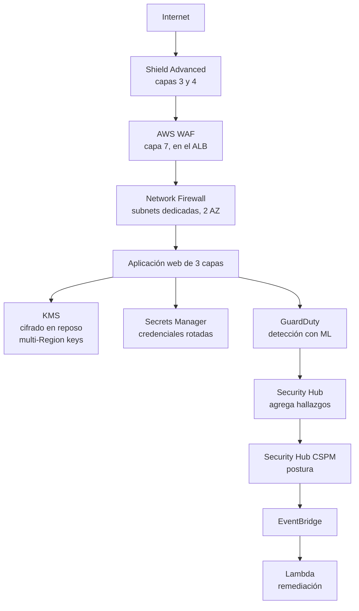

# Finished Architecture - Security

> [!abstract] Qué es este archivo
> Décima sexta lección y **cierre del caso**. No enseña un servicio nuevo: **muestra la arquitectura que
> resuelve el caso** de la lección 02, con **cada capa ya vista** puesta en su lugar.
>
> Recorre **red** (Network Firewall, Firewall Manager, Shield Advanced y WAF), **detección** (Security Hub y
> GuardDuty), **datos** (KMS, multi-Region keys y Secrets Manager), **compliance** (Security Hub CSPM con
> remediación por EventBridge y Lambda), **escala** y **costo**. Video de **5 min 28 s** + **una lectura de
> recapitulación**. **Una imagen**, que no está en el vault.
>
> **El nombre lleva sufijo** porque ya existe un `Finished Architecture` en el módulo Multi-Account y un
> `Finished Architecture - Networking` en el de redes.

> [!quote] La idea que ordena todo
> **Cada requisito de la auditoría tiene un servicio, y cada servicio tiene una capa distinta.** *“Múltiples
> capas de seguridad **manteniendo la performance y la confiabilidad** de su aplicación web de tres capas.”*
> **El cierre no es “más seguridad”: es seguridad que no rompe lo que ya funciona.**

---

## Resumen en una frase

> La arquitectura final **inspecciona la red** con **Network Firewall** gestionado por **Firewall Manager**,
> **absorbe DDoS** con **Shield Advanced** y **exploits web** con **WAF**, **detecta** con **GuardDuty** y
> **agrega** en **Security Hub**, **cifra** con **KMS** —**incluidas multi-Region keys** para el DR— y **administra
> credenciales** con **Secrets Manager**, y **cierra el ciclo de compliance** con **Security Hub CSPM** y
> **remediación automatizada**.

---

## 1. Qué es esta lección

**La presentadora:** **Melissa**, la misma de la demo de [[Demo - AWS KMS]]. **Lo que hace:** *“ahora que compartí
nuestro proceso de relevamiento de requisitos, **les voy a mostrar la arquitectura endurecida** que diseñé para
**atender los hallazgos de la auditoría**”*.

**El punto de partida:** la aplicación **web de tres capas** del caso, **production ready** en **dos Availability
Zones** y **funcional pero sin controles**. **El objetivo:** *“incorpora **múltiples capas de seguridad**
manteniendo **la performance y la confiabilidad** de la aplicación existente”*.

**Las cuatro capas que recorre:**

| Capa | Servicios |
| --- | --- |
| **Red** | **AWS Network Firewall**, **AWS Firewall Manager**, **AWS Shield Advanced**, **AWS WAF** |
| **Detección** | **AWS Security Hub**, **Amazon GuardDuty** |
| **Datos** | **AWS KMS** (con **multi-Region keys**), **AWS Secrets Manager** |
| **Monitoreo y compliance** | **Security Hub CSPM**, **EventBridge**, **Lambda** |

> [!note] El diagrama es una reconstrucción
> La imagen de la fuente (`af465363-…jpeg`) **no está en el vault**. Este esquema **se arma con el relato del
> video**, no con el diagrama original: **el orden de las capas es fiel; la disposición gráfica no.**

> [!important] Es una **revisión de diseño**, no una demo
> No hay consola ni clics: hay **decisiones y trade-offs**. **El valor está en lo que se descartó** —CloudHSM,
> reglas de firewall por equipo, secretos en archivos— **y en por qué**.

> [!note] Lectura propia (no está en la fuente)
> **Este es el único archivo del módulo que se puede leer como respuesta de examen completa**: un escenario con
> **seis requisitos**, **seis servicios** y **tres trade-offs**. **Si entendés por qué eligió KMS y no CloudHSM,
> entendés el módulo.**

---

## 2. Capa 1: la red

### 2.1 Network Firewall: la primera línea

**Dónde se despliega:** **en subnets dedicadas de firewall**, **en las dos Availability Zones**. **Qué da:**
**inspección stateful de todo el tráfico que entra y sale de la VPC**.

**Por qué le gusta a la presentadora:** *“su capacidad de hacer **deep packet inspection** y **bloquear patrones
maliciosos antes de que lleguen a la capa de aplicación**”*.

> [!important] La posición importa más que la función
> El firewall **no está delante de un servidor: está delante de la capa**. **El tráfico se inspecciona una vez, en
> subnets propias, antes de tocar la aplicación.** **Eso es lo que permite bloquear “antes de la capa de
> aplicación”** —y es la diferencia con un security group, que **filtra por puerto, no por contenido**.

### 2.2 Firewall Manager: el trade-off de la gestión

**Lo que hace:** **administrar los controles de seguridad a escala**, con **control centralizado en múltiples
cuentas y VPCs**, y **políticas consistentes en toda la organización**.

**El trade-off, dicho por la fuente:** *“fue un **trade-off interesante** que consideramos. **Mientras algunos
equipos prefieren administrar las reglas de firewall directamente**, Firewall Manager nos da **control centralizado
a través de múltiples cuentas y VPCs**.”*

| Opción | Ventaja | Costo |
| --- | --- | --- |
| **Reglas por equipo, en cada cuenta** | **Autonomía** y ajuste fino local | **Inconsistencia**; **deriva** entre cuentas |
| **Firewall Manager** | **Política única** y **consistencia** | **Menos autonomía** local |

**Por qué se elige acá:** *“podemos **imponer políticas de seguridad consistentes** en toda la organización, lo
que es **muy importante para mantener su postura de compliance**”*.

> [!important] Gestión centralizada, ejecución distribuida
> **La política vive en un lugar; el firewall corre en cada VPC y en cada AZ.** **Eso concilia la discusión del
> módulo sobre centralizar la inspección**: **centralizás la *decisión*, no el *paquete*.** Ver la **duda 3** en
> [[AWS Solutions Architect Advanced - Securing Networks and Data#❓ Dudas abiertas|las dudas abiertas del índice]].

### 2.3 Shield Advanced y WAF

**DDoS:** **AWS Shield Advanced**. **La condición que lo hace simple:** *“la aplicación **ya está detrás de un
application load balancer**, así que Shield Advanced **se integra sin fricción** para proteger contra ataques de
**capa tres y capa cuatro**”*.

**Exploits web:** **AWS WAF**, con **reglas personalizadas** para **defender contra exploits web comunes**.

**La sinergia:** *“**WAF y Shield Advanced trabajan juntos automáticamente**, dándonos **protección integral sin
agregar complejidad operativa**”*.

| Servicio | Capa | Qué ataca |
| --- | --- | --- |
| **Shield Advanced** | **3 y 4** (red y transporte) | **Volumétrico**: inundar el enlace |
| **AWS WAF** | **7** (aplicación) | **Exploits web**: inyección, bots, patrones maliciosos |
| **Network Firewall** | **3 a 7** dentro de la VPC | **Todo el tráfico**, con **inspección stateful** |

> [!important] Tres perímetros, no uno
> **Shield en el borde**, **WAF en el ALB** y **Network Firewall en la VPC**. **No se reemplazan**: **cubren
> puntos distintos del camino**. **Un examen que ofrece “WAF para DDoS volumétrico” está mezclando capas.**

> [!warning] Lo que la fuente no explica
> Dice que **WAF y Shield “trabajan juntos automáticamente”**, pero **no describe la integración** —ni reglas
> administradas, ni el rol del ALB en cada uno—. **No se completa** (§ registro, punto 4).

---

## 3. Capa 2: detección

### 3.1 Security Hub como centro de comando

**El rol:** **“nuestro centro de comando para el monitoreo de seguridad”**. **Qué hace:** **agrega hallazgos de
múltiples servicios de seguridad de AWS** y da **una vista integral de la postura**.

> [!important] Agregar no es detectar
> **Security Hub no encuentra nada por sí solo en este diseño**: **reúne lo que encuentran otros**. **GuardDuty
> detecta, Security Hub ordena.** **Si el examen pregunta “qué servicio detecta”, la respuesta no es Security
> Hub.**

### 3.2 GuardDuty

**Cómo corre:** **continuamente, en segundo plano**, **usando machine learning**.

**Qué detecta, según la fuente:** **actividades sospechosas** como **llamadas a la API inusuales** o
**instancias potencialmente comprometidas**.

**La decisión de costo que aparece después:** **configurar con cuidado las *sampling rates* de GuardDuty según su
threat model** (§6).

> [!warning] Un concepto nuevo, sin definición
> **“GuardDuty sampling rates”** aparece una sola vez y **nunca se explica qué se muestrea** —ni si afecta la
> detección, ni cómo se ajusta—. **No se completa** (§ registro, punto 5). **Lo único que queda firme**: **el
> volumen de datos que analiza GuardDuty es una palanca de costo.**

---

## 4. Capa 3: los datos

### 4.1 KMS en reposo, y el descarte de CloudHSM

**La estrategia:** **cifrado multicapa**. **Todo dato en reposo se cifra con AWS KMS.**

**La decisión que cierra el arco del módulo:** *“**consideramos AWS CloudHSM** para sus datos más sensibles,
pero **después de analizar sus requisitos**, **KMS con customer managed keys da el equilibrio correcto entre
seguridad y simplicidad operativa**”*.

| Criterio | **KMS con customer managed keys** | **AWS CloudHSM** |
| --- | --- | --- |
| **Control del material** | **Alto**: **key policies** y **rotación** | **Máximo**: **módulo dedicado** |
| **Carga operativa** | **Baja** | **Alta**: **clúster, backups, HA** |
| **Cumplimiento** | **FIPS 140-2** | **FIPS 140-2 Level 3** con **acceso directo** |
| **Cuándo gana** | **El caso real**: **equilibrio** | **Solo si el requisito exige el módulo** |

> [!important] El requisito mandaba, y no era “tener un HSM”
> **La auditoría pedía cifrado y control de claves, no acceso directo al hardware.** **CloudHSM se evaluó y se
> descartó por costo operativo, no por capacidad.** **Esa es la decisión de arquitecto: el servicio más fuerte no
> es el correcto si el requisito no lo pide.**

### 4.2 Multi-Region keys para el disaster recovery

**La frase textual:** *“lo notable acá es **cómo estamos usando KMS multi-Region keys** para **mantener un
cifrado consistente a través de su esquema de disaster recovery**”*.

**Qué resuelve:** **la misma clave lógica en varias Regions**, para que **los datos cifrados en una Region se
puedan descifrar en la otra** sin **replicar secretos ni re-cifrar**.

> [!important] La duda 5 del índice se cierra acá
> **Sí existen las multi-Region keys, y este es su caso de uso**: **DR y operación global**. **La demo 13 decía
> “necesitás claves en las dos Regions”** —cierto para **claves regionales**—; **la solución para no administrar
> dos claves distintas es una multi-Region key**. **Las dos afirmaciones conviven.**

> [!note] Lo que sigue sin explicarse
> La fuente **nombra** las multi-Region keys y **no describe** cómo se crean, cómo se replican, ni qué pasa con
> la key policy. **No se completa**: **la respuesta conceptual queda; el procedimiento, no.**

### 4.3 Secrets Manager

**Qué reemplaza:** *“**su enfoque anterior de guardar secretos en archivos de configuración**”*. **Qué administra:**
**todas las credenciales sensibles**, **API keys** y **contraseñas de base de datos**.

**Qué aporta:** **rotación automática** de credenciales e **integración con los roles de IAM existentes**.

> [!important] El cambio es de hábito, no de servicio
> **Pasar de un archivo de configuración a Secrets Manager no es “cifrar el archivo”: es dejar de distribuirlo.**
> **La credencial se pide con un rol, se rota sola y nadie la copia.** Ver [[AWS Secrets Manager]] §1.

---

## 5. Capa 4: monitoreo y compliance

### 5.1 Security Hub CSPM

**Qué hace:** **evalúa continuamente el entorno contra estándares de la industria y buenas prácticas**.

> [!warning] La sigla aparece sin definir
> **CSPM** (*Cloud Security Posture Management*) **se usa como si ya estuviera explicada y no se define en la
> fuente**. **No se agrega**: se registra el hueco (§ registro, punto 6). **Lo que sí queda**: es el **modo de
> evaluación de postura** de Security Hub, distinto de **agregar hallazgos de detección**.

### 5.2 Remediación automatizada

**Cómo:** **reglas de EventBridge** y **funciones Lambda** para **remediar automáticamente los hallazgos
comunes**.

**Qué habilita:** *“el **reporte automatizado de compliance** que necesitaban, **reduciendo la carga operativa**
del equipo de seguridad”*.

| Pieza | Rol |
| --- | --- |
| **Security Hub CSPM** | **Detecta** el desvío contra el estándar |
| **EventBridge** | **Enruta** el hallazgo como evento |
| **Lambda** | **Ejecuta** la remediación |

> [!important] El requisito 6 se cumple dos veces
> **La remediación arregla; el reporte prueba.** **El mismo flujo deja el registro que la auditoría futura va a
> pedir.** **Eso es “compliance automático”**: no solo cumplir, **demostrar**.

> [!note] Lectura propia (no está en la fuente)
> Es el **mismo patrón de la lección 09** (GuardDuty → EventBridge → Lambda), **con otro disparador**: allá el
> evento era **una detección**; acá es **un control que falló**. **La arquitectura de respuesta es idéntica**;
> cambia **qué la enciende**.

---

## 6. Escala y costo

### 6.1 Escala

**El argumento:** **a medida que agregan aplicaciones o cuentas**, **Firewall Manager y Security Hub extienden la
protección automáticamente a los recursos nuevos**. **La gestión centralizada por AWS Organizations** permite
**mantener controles consistentes aunque el entorno crezca**.

| Mecanismo | Qué escala |
| --- | --- |
| **Firewall Manager** | **Políticas a cuentas y VPCs nuevas** |
| **Security Hub** | **Agregación de hallazgos** de cuentas y Regions |
| **AWS Organizations** | **Base de la aplicación consistente** de políticas |

### 6.2 Costo

**El reconocimiento explícito:** *“agregar estos servicios **sí aumenta el gasto** en AWS”*. **Las dos
optimizaciones:**

| Optimización | Cómo |
| --- | --- |
| **Claves** | **Réplicas regionales de KMS** **en lugar de HSMs dedicados** |
| **Detección** | **Sampling rates de GuardDuty** ajustadas al **threat model** |

**El argumento final:** *“el costo de un **incidente de seguridad** normalmente **supera por mucho** el costo de
implementar los controles”*.

> [!important] La frase que se lleva el examen
> **“El costo de un incidente supera el costo de los controles.”** No es una opinión: es **el criterio con el que
> se justifica el gasto en seguridad** ante un CFO. **Y la optimización no es recortar controles: es elegir la
> variante más barata que cumple** —réplicas en vez de HSMs, sampling en vez de todo el tráfico—.

> [!warning] La inconsistencia de las “réplicas”
> El video dice **multi-Region keys** para el DR y, en la misma lección, **“réplicas regionales de KMS keys en
> lugar de HSMs dedicados”**. **Puede ser la misma cosa descrita dos veces, o dos cosas distintas**; **la fuente
> no lo aclara**. **Se conservan las dos formulaciones** (§ registro, punto 2).

---

## 7. Lo que queda para después

**La fuente lo dice como horizonte, no como deuda:**

> *“Pueden **agregar controles de seguridad más sofisticados**, como **Amazon Macie** para **descubrimiento de
> datos sensibles**, o **implementar marcos de compliance adicionales** a medida que sus necesidades evolucionen.”*

**Y el cierre del proceso:** *“voy a **revisar esto con el cliente** y **obtener su opinión sobre los flujos de
remediación automatizada** que diseñamos. Después de todo, **la seguridad es un esfuerzo colaborativo** y **su
experiencia con los requisitos de compliance específicos será invaluable**”*.

> [!important] La arquitectura no se entrega: se acuerda
> **El último paso es una reunión, no un despliegue.** **La remediación automática toca producción**: **el
> cliente tiene que aprobar qué se arregla solo y qué se escala a una persona.** **Ese es el límite profesional
> de la automatización.**

> [!note] Lectura propia (no está en la fuente)
> **Macie** aparece **una sola vez en todo el módulo**, acá y como opción futura. **No hay lección de Macie** en
> esta fuente: **si el examen la pregunta, esta nota no alcanza.** Queda como **pendiente de estudio externo**.

---

## 8. El recap de seis puntos

**La lectura de cierre enumera la arquitectura en seis líneas. Traducidas:**

| # | Punto | Servicios |
| --- | --- | --- |
| **1** | **Desplegar Network Firewall, Shield Advanced y WAF**, con **gestión centralizada** por **Firewall Manager** | **Network Firewall**, **Shield Advanced**, **WAF**, **Firewall Manager** |
| **2** | **Security Hub como tablero principal**, con **GuardDuty en todas las cuentas** para **detección automatizada** | **Security Hub**, **GuardDuty** |
| **3** | **KMS multi-Region keys** y **Secrets Manager** para **protección de datos** y **credenciales** | **KMS**, **Secrets Manager** |
| **4** | **Controles de compliance automatizados** con **Security Hub CSPM** y **remediación por EventBridge** | **Security Hub CSPM**, **EventBridge**, **Lambda** |
| **5** | **Políticas estandarizadas en cuentas y regiones** con **AWS Organizations** | **AWS Organizations** |
| **6** | **Respuesta a incidentes automatizada**, integrada con **el marco de IAM existente** | **IAM**, **EventBridge**, **Lambda** |

> [!important] El recap **no** dice “subnets” tres veces
> La lectura afirma que **Network Firewall, Shield Advanced y WAF** se despliegan *“across dedicated subnets”*.
> **Solo Network Firewall vive en subnets**; **Shield es un servicio gestionado** y **WAF se asocia al ALB**.
> **Se conserva la imprecisión y se registra** (§ registro, punto 1).

---

## 9. Traducción del contenido

> [!info] Sección de referencia (opcional)
> Esto es la **traducción fiel** de la fuente. **No hace falta leerla para estudiar**: lo que se estudia son las
> secciones **1 a 8** y se cierra con la **11**.

### 9.1 Video: Finished Architecture (transcripción)

**Ahora que compartí nuestro proceso de relevamiento de requisitos, déjenme mostrarles la arquitectura endurecida
que diseñé para atender los hallazgos de la auditoría de seguridad.** **Esta solución incorpora múltiples capas de
seguridad mientras mantiene la performance y la confiabilidad de su aplicación web de tres capas existente.**

**Empecemos por la base de seguridad de red.** **Estamos implementando AWS Network Firewall como nuestra primera
línea de defensa.** **Se despliega en subnets de firewall dedicadas en ambas Availability Zones, dándonos
inspección stateful de todo el tráfico que entra y sale de la VPC.** **Lo que realmente me gusta de Network
Firewall es su capacidad de hacer inspección profunda de paquetes y bloquear patrones maliciosos antes de que
lleguen a nuestra capa de aplicación.**

**Para administrar estos controles de seguridad a escala, estamos usando AWS Firewall Manager.** **Esto fue en
realidad un trade-off interesante que consideramos.** **Mientras algunos equipos prefieren administrar las reglas
de firewall directamente, Firewall Manager nos da control centralizado a través de múltiples cuentas y VPCs.**
**Esto significa que podemos imponer políticas de seguridad consistentes en toda la organización, lo que es muy
importante para mantener su postura de compliance.**

**Para la protección DDoS, estamos implementando AWS Shield Advanced.** **La aplicación ya está detrás de un
application load balancer, así que Shield Advanced se integra sin fricción para proteger contra ataques de capa
tres y capa cuatro.** **También agregamos AWS Web Application Firewall (o WAF) con reglas personalizadas para
defender contra exploits web comunes.** **La belleza de esta configuración es que WAF y Shield Advanced trabajan
juntos automáticamente, dándonos protección integral sin agregar complejidad operativa.**

**Ahora hablemos de detección de amenazas.** **Estamos implementando Security Hub como nuestro centro de comando
para el monitoreo de seguridad.** **Agrega hallazgos de múltiples servicios de seguridad de AWS y nos da una vista
integral de nuestra postura de seguridad.** **GuardDuty corre continuamente en segundo plano usando machine
learning para detectar actividades sospechosas, como llamadas a la API inusuales o instancias potencialmente
comprometidas.**

**Para la protección de datos, implementamos una estrategia de cifrado multicapa.** **Todos los datos en reposo se
cifran usando AWS KMS.** **Consideramos AWS CloudHSM para sus datos más sensibles, pero después de analizar sus
requisitos, KMS con customer managed keys provee el equilibrio correcto entre seguridad y simplicidad operativa.**
**La parte notable acá es cómo estamos usando KMS multi-Region keys para mantener un cifrado consistente a través
de su esquema de disaster recovery.**

**La administración de secretos fue otra consideración crítica.** **Estamos usando AWS Secrets Manager para
manejar todas las credenciales sensibles, API keys y contraseñas de base de datos.** **Esto reemplaza su enfoque
anterior de guardar secretos en archivos de configuración.** **Secrets Manager rota credenciales automáticamente y
se integra bien con sus roles de IAM existentes.**

**La pieza de monitoreo y compliance ata todo.** **Security Hub CSPM evalúa continuamente su entorno contra
estándares de la industria y buenas prácticas.** **Configuramos remediación automatizada para hallazgos comunes
usando reglas de EventBridge y funciones Lambda.** **Esto les da el reporte de compliance automatizado que
necesitaban, mientras reduce la carga operativa de su equipo de seguridad.**

**Uno de los aspectos más valiosos de esta arquitectura es su escalabilidad.** **A medida que agregan aplicaciones
o cuentas nuevas, Firewall Manager y Security Hub extienden automáticamente la protección a esos recursos nuevos.**
**La gestión centralizada a través de AWS Organizations significa que pueden mantener controles de seguridad
consistentes a medida que su entorno crece.**

**El costo se consideró con cuidado en este diseño.** **Si bien agregar estos servicios de seguridad aumenta su
gasto en AWS, estamos optimizando costos usando réplicas regionales de claves de KMS en lugar de HSMs dedicados, y
configurando cuidadosamente las sampling rates de GuardDuty según su modelo de amenazas.** **El costo de un
incidente de seguridad normalmente supera por mucho el costo de implementar controles de seguridad.**

**Mirando hacia adelante, esta arquitectura les da espacio para crecer.** **Pueden agregar fácilmente controles de
seguridad más sofisticados, como Amazon Macie para descubrimiento de datos sensibles, o implementar marcos de
compliance adicionales a medida que sus necesidades evolucionen.** **La base que construimos asegura que pueden
adaptarse a nuevos desafíos de seguridad manteniendo una postura sólida.**

**Voy a revisar esto con el cliente y obtener su opinión sobre los flujos de remediación automatizada que
diseñamos.** **Después de todo, la seguridad es un esfuerzo colaborativo y su experiencia con los requisitos de
compliance específicos será invaluable a medida que avanzamos hacia la implementación.**

*Duración del video: **5 minutos 28 segundos**.*

### 9.2 Lectura: Architecture recap

**La fuente trae **una imagen** —el diagrama de flujo de la arquitectura final, revisado en el video— y **seis
puntos** de recapitulación:**

- **Desplegar Network Firewall, Shield Advanced y WAF, con gestión centralizada a través de Firewall Manager.**
- **Configurar Security Hub como el tablero principal, con GuardDuty habilitado en todas las cuentas para
  detección automatizada de amenazas.**
- **Implementar KMS multi-Region keys y Secrets Manager para protección integral de datos y administración de
  credenciales.**
- **Habilitar controles de compliance automatizados a través de Security Hub CSPM, con flujos de remediación
  disparados por EventBridge.**
- **Estandarizar las políticas de seguridad en todas las cuentas y regiones usando AWS Organizations, para un
  control consistente.**
- **Integrar flujos automatizados de respuesta a incidentes con el marco de IAM existente, para operaciones de
  seguridad más simples.**

> [!note] La imagen no está en el vault
> `af465363-9611-4733-9155-5e9a0810beeb.jpeg` **no está descargada**. **No se describe más allá de su texto
> alternativo** (*“diagrama de flujo de la arquitectura final revisado en el video”*). **Los cuadros de esta nota
> son reconstrucciones del relato**, no del diagrama.

---

## 10. Cuadro de cierre: los seis requisitos, resueltos

| # | Requisito de la lección 02 | Decisión final | Servicio |
| --- | --- | --- | --- |
| **1** | **Centralized security management** | **Política única** para cuentas y VPCs | **AWS Firewall Manager** + **AWS Organizations** |
| **2** | **DDoS protection** | **Shield Advanced** detrás del **ALB**, capas **3 y 4** | **AWS Shield Advanced** |
| **3** | **Comprehensive firewall controls** | **Subnets dedicadas**, **inspección stateful** y **deep packet** | **AWS Network Firewall** + **WAF** |
| **4** | **Integrated encryption** | **KMS con customer managed keys**; **multi-Region keys** para DR; **secretos rotados** | **AWS KMS** + **AWS Secrets Manager** |
| **5** | **Real-time threat detection** | **GuardDuty** continuo con **ML**; **Security Hub** agrega | **Amazon GuardDuty** + **AWS Security Hub** |
| **6** | **Compliance reporting** | **Security Hub CSPM** + **remediación** y **reporte** automáticos | **Security Hub CSPM** + **EventBridge** + **Lambda** |

**Y lo que la arquitectura **no** incluye, a propósito:**

| Descartado | Por qué |
| --- | --- |
| **AWS CloudHSM** | **KMS con customer managed keys** daba el **equilibrio** que el requisito pedía |
| **Reglas de firewall por equipo** | **Inconsistencia** y **deriva** entre cuentas |
| **Secretos en archivos de configuración** | **Distribución** y **rotación manual** |
| **HSMs dedicados para el costo** | **Réplicas regionales de KMS** cumplen a menor costo |

> [!important] La lección que queda
> **Cada servicio del módulo entró por un requisito, no por moda.** **Y uno —CloudHSM— entró y salió en la misma
> frase.** **Eso es lo que separa una arquitectura de un catálogo.**

---

## 11. Para el examen (SAP-C02)

> [!important] Lo que hay que retener
> 1. **La arquitectura es por capas**: **red**, **detección**, **datos** y **compliance**. **Cada requisito tiene
>    su capa.**
> 2. **Network Firewall** en **subnets dedicadas**, **en varias AZs**, con **inspección stateful** y **deep packet
>    inspection**.
> 3. **Firewall Manager** centraliza la **política** en cuentas y VPCs; **el firewall sigue corriendo en cada
>    VPC**. **Gestión central, ejecución distribuida.**
> 4. **Shield Advanced** protege **capas 3 y 4**; **WAF**, **exploits web** de **capa 7**; **no se reemplazan**.
> 5. **Security Hub agrega; GuardDuty detecta.** **No confundir el tablero con el sensor.**
> 6. **Se eligió KMS con customer managed keys y se descartó CloudHSM** por **simplicidad operativa**: **el
>    requisito no pedía acceso directo al HSM.**
> 7. **KMS multi-Region keys** sostienen el **disaster recovery** con **cifrado consistente** entre Regions.
> 8. **Secrets Manager reemplaza los secretos en archivos de configuración**, **rota** y se integra con **roles de
>    IAM**.
> 9. **Security Hub CSPM** evalúa **postura**; **EventBridge + Lambda** **remedian** y dejan **reporte**.
> 10. **Firewall Manager y Security Hub escalan solos** a cuentas y recursos nuevos; **AWS Organizations** es la
>     base.
> 11. **Optimización de costo**: **réplicas regionales de KMS** en vez de **HSMs dedicados** y **sampling de
>     GuardDuty** según el **threat model**.
> 12. **El costo de un incidente supera el costo de los controles** —y la remediación automatizada **se acuerda con
>     el cliente** antes de tocar producción.

> [!warning] Trampa clásica del examen
> Escenario: *“la auditoría pide **cifrado en reposo con control de claves**, **detección en tiempo real**,
> **reporte de compliance** y **gestión centralizada en 40 cuentas**; el equipo quiere **la menor carga
> operativa**”*. La respuesta **no** es **CloudHSM** (aunque cumpla más) **ni un SIEM propio**: es **KMS con
> customer managed keys**, **GuardDuty**, **Security Hub** y **Firewall Manager** sobre **AWS Organizations**. **Y
> si el escenario pide el mismo cifrado en dos Regions para DR, no son dos claves independientes: es una
> multi-Region key.**

---

## Relacionado

- [[AWS Solutions Architect Advanced - Securing Networks and Data]] *(índice del módulo)*
- [[Gathering the Customer Requirements - Security]] — **los seis requisitos** que esta arquitectura resuelve
- [[AWS Firewall Manager]] — la **gestión centralizada** y **Shield**
- [[Network Segmentation]] — las **subnets dedicadas** y la **inspección** de la VPC
- [[Network Traffic Controls]] — los **cinco planos** de control que acá se combinan
- [[Security Hub]] y [[Tech Talk - AWS Security Hub]] — la **agregación**, los **estándares** y el **CSPM**
- [[Amazon GuardDuty]] — la **detección** que alimenta al tablero
- [[Cryptography]], [[AWS KMS]] y [[AWS CloudHSM]] — las **tres capas del cifrado** y el **trade-off** que se resolvió
- [[Demo - AWS KMS]] — la demo que mostró **SSE-KMS** y **permisos separados**
- [[AWS Secrets Manager]] — las **credenciales** que dejaron los archivos de configuración
- [[1.2 Prescribir controles de seguridad]] — la tarea que este módulo cubre
- [[2.3 Determinar los controles de seguridad en función de los requisitos]] — el cruce con Dominio 2
- [[Guia AWS]] — pesos y tareas oficiales del SAP-C02
- Siguiente paso del módulo: [[BuildingBlocks Videos - Security]] — **tres casos** que ponen a prueba las mismas
  piezas contra requisitos concretos

---

## Registro de integración

| Fecha | Qué llegó | Dónde se integró |
| --- | --- | --- |
| 27/10/2026 | Lección 16 completa: arquitectura final (red, detección, datos, compliance, escala, costo y cierre del caso) | Nota completa (secciones 1–11) |

**Discrepancias y vacíos registrados (no corregidos):**

1. **La lectura dice que Network Firewall, Shield Advanced y WAF se despliegan *“across dedicated subnets”*.**
   **Solo Network Firewall vive en subnets**; **Shield Advanced es un servicio gestionado** y **WAF se asocia al
   ALB**. **Se conserva la imprecisión** y se advierte en §8.
2. **“KMS multi-Region keys” (DR) y “réplicas regionales de KMS keys en lugar de HSMs dedicados” (costo)** aparecen
   en la misma lección **sin aclarar si son la misma cosa**. **Se conservan las dos formulaciones** (§6.2).
3. **“AWS Cloud HSM”** aparece separado en la transcripción; el nombre correcto es **AWS CloudHSM**. Se normaliza
   en el cuerpo y se registra.
4. **“WAF y Shield Advanced trabajan juntos automáticamente”** no se explica. **No se completa** el mecanismo.
5. **“GuardDuty sampling rates”** aparece una sola vez, **sin definición**, y **no existe en las lecciones 09 y
   10**. **No se completa.** Queda como el **único concepto nuevo sin explicar** de todo el módulo.
6. **“Security Hub CSPM”** usa la sigla **sin definirla**. **No se desarrolla**: se registra en §5.1.
7. **La transcripción escribe “event bridge” en minúsculas**; el servicio es **Amazon EventBridge**. Se normaliza.
8. **La lectura usa `****negrita****`** (cuatro asteriscos) en los seis puntos, **un artefacto de formato de la
   fuente**. **Se traduce como negrita normal sin alterar el texto.**
9. **La imagen `af465363-9611-4733-9155-5e9a0810beeb.jpeg` no está en el vault.** **No se describe más allá de
   su texto alternativo.**
10. **No hay Knowledge Check** en esta lección.
11. **El nombre de archivo lleva sufijo `- Security`**: **ya existían `Finished Architecture`** (Multi-Account) y
    **`Finished Architecture - Networking`** (redes). Verificado: **0 basenames duplicados** después del sufijo.
12. **La lección cierra la duda 5 del índice**: **las multi-Region keys existen y se usan para DR**. **No explica
    cómo se crean.**
13. **Macie se menciona como opción futura y no tiene lección en esta fuente.** **Queda como estudio externo.**
14. **La fuente dice “el costo de un incidente supera el costo de los controles” sin cifras.** **No se agregan
    números.**

**Decisiones de transcripción:**

- Se conservan **Network Firewall**, **Firewall Manager**, **Shield Advanced**, **WAF**, **Security Hub**,
  **GuardDuty**, **KMS**, **multi-Region keys**, **Secrets Manager**, **Security Hub CSPM**, **EventBridge**,
  **Lambda**, **AWS Organizations**, **Macie**, **deep packet inspection**, **stateful**, **sampling rates**,
  **threat model**, **trade-off**, **remediation**, **configuration files** y **hardened**.
- Las **cifras** se transcriben literales: **5 min 28 s**, **tres capas**, **dos Availability Zones**, **capas 3 y
  4**, **seis requisitos**, **seis puntos de recap**, **una imagen**.
- Se conservan los **nombres de servicio** tal como aparecen, incluidas las siglas **WAF**, **CSPM** y **DR**.
