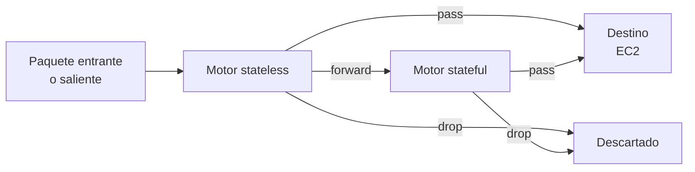

# Network Segmentation

> [!abstract] Qué es este archivo
> Cuarta lección del módulo y **la más larga**: seis bloques distintos bajo un mismo título. Va de la **política
> centralizada** (los **cuatro tipos** de política de Firewall Manager) a la **segmentación real del tráfico**
> (**north/south vs. east/west**), pasa por un **Tech Talk de 8 min 23 s** con un caso de retail, suma las
> **cuatro herramientas de análisis de acceso** y termina en **AWS Network Firewall**, el **troubleshooting** de
> controles de red y una Knowledge Check.
>
> Cubre el requisito **3** del caso: **controles de firewall integrales e inspección de tráfico**.

> [!quote] Las dos analogías del módulo
> **1. La orquesta** (lección 03): Firewall Manager **hace que todos toquen juntos**.
> **2. El castillo medieval** (acá): muro, foso, rejas, guardias — **todo enfocado en que no entren**. El problema
> es que **“en arquitecturas modernas también tenés que planear qué pasa cuando ya entraron”**. El castillo ahora
> es un museo, y hay un interruptor que apaga todas las luces **al lado de un Rembrandt**.

---

## Resumen en una frase

> Segmentar es **partir la red en dominios que no se hablan solos**: necesitan un **intermediario** —router o
> firewall— para cruzar, y **cada cruce es un punto de inspección**. Firewall Manager aplica la **política** en
> toda la organización; **Network Firewall** la **ejecuta** en la VPC.

---

## 1. Qué es segmentar y para qué sirve

**Definición de la fuente:** segmentar es **la práctica de dividir una red en segmentos más chicos, más
manejables y más seguros**.

**Es un principio fundamental de seguridad** y hace tres cosas:

| Beneficio | Qué significa |
| --- | --- |
| **Contener brechas potenciales** | Un incidente queda **encerrado** en su segmento |
| **Aplicar controles de acceso** | El cruce entre segmentos **se permite o se niega** explícitamente |
| **Cumplir requisitos de compliance** | La separación **es la evidencia** de que los dominios están aislados |

**La definición operativa que da el Tech Talk** —más útil que la anterior—: segmentar es **crear espacios de red
aislados que no pueden comunicarse entre sí por su cuenta**; **necesitan un dispositivo intermediario, como un
router o un firewall, para salvar esa brecha**.

> [!important] La frase que hay que poder repetir
> **“No pueden hablar solos: necesitan un intermediario.”** Si dos segmentos se alcanzan sin pasar por nada,
> **no están segmentados**: están en la misma red con dos nombres.

**Los tres mecanismos nativos de AWS** que enumera el Tech Talk: **VPCs**, **subnets** y **security groups**.

---

## 2. De la política amplia al diseño de red

**El puente explícito de la fuente:** Firewall Manager da **control centralizado de políticas**, pero las
arquitecturas cloud modernas **necesitan control de tráfico y aislamiento más granular** — y ahí entra la
segmentación, implementada con servicios como **AWS Network Firewall**.

**El movimiento de la lección:** de **gestión de política amplia** → a **diseño específico de red**.

### Los cuatro tipos de política de Firewall Manager

| # | Tipo de política | Qué estandariza |
| --- | --- | --- |
| **1** | **Network Firewall** con **rule groups estandarizados** | **Filtrado de tráfico de red consistente en tus VPCs** con rule groups centralizados |
| **2** | **DNS Firewall** | **Protección contra amenazas basadas en DNS** en toda la organización, **controlando a qué dominios se pueden conectar** los recursos |
| **3** | **Security group** | **Configuraciones de security group conformes**, con **remediación automática del drift** o de las violaciones |
| **4** | **WAF** | Reglas de WAF **consistentes** en **load balancers, distribuciones de CloudFront y API Gateways** |

> [!important] La lógica de los cuatro
> **1** y **2** filtran **tráfico y nombres**; **3** normaliza **quién puede hablar con quién a nivel recurso**;
> **4** protege **lo que está publicado**. Los cuatro juntos son el **requisito 1** del caso: **política
> consistente** sin configurar servicio por servicio en cada cuenta.

### Aplicación automática

| Capacidad | Qué hace |
| --- | --- |
| **Continuous Compliance** | **Remedia automáticamente** los recursos que **se desvían** de los estándares |
| **Resource Targeting** | Aplica políticas **por tags, tipo de cuenta o atributos del recurso** |
| **Centralized Visibility** | Monitorea el **estado de compliance en toda la organización** |

### Compliance y governance

| Capacidad | Qué hace |
| --- | --- |
| **Security Posture Management** | **Sigue el cumplimiento de políticas** por cuenta y por recurso |
| **Custom Policy Actions** | Define **acciones específicas** para recursos **no conformes** |
| **Change Management Integration** | **Valida los cambios de seguridad** contra los requisitos de política |

> [!note] Lectura propia (no está en la fuente)
> Las tres primeras capacidades son **de enforcement** (remediar, apuntar, ver). Las tres de governance son **de
> justificación** (medir postura, decidir la acción, integrar con el proceso de cambio). Es la diferencia entre
> **“lo apagué”** y **“puedo probar por qué lo apagué”** — el requisito **6** del caso otra vez.

### El ejemplo de implementación

**La fuente crea una security group policy que aplica reglas en toda la organización:**

```bash
aws fms put-policy \
  --policy-name "RestrictRDPAccess" \
  --policy-update-token "1:2:3:4:5" \
  --security-service '{"Type":"SECURITY_GROUPS_COMMON", "ManagedServiceData": "{\"type\":\"SECURITY_GROUPS_COMMON\",\";revertManualSecurityGroupChanges\":true,\"exclusiveResourceSecurityGroupManagement\":false,\"securityGroups\":[{\"id\":\"sg-1234567890abcdef0\"}]}"}'
```

**Qué se ve en el comando, más allá de la sintaxis:**

| Pieza | Qué indica |
| --- | --- |
| **`SECURITY_GROUPS_COMMON`** | Es el **tipo 3** de la tabla de §2: política de security groups |
| **`revertManualSecurityGroupChanges: true`** | **Si alguien edita el SG a mano, se revierte**: es la “continuous compliance” en acción |
| **`exclusiveResourceSecurityGroupManagement: false`** | El control **no es exclusivo**: convive con otros SG del recurso |
| **`sg-1234567890abcdef0`** | El SG **plantilla** que se replica |
| **`--policy-update-token "1:2:3:4:5"`** | Token de **control de concurrencia** del API |

> [!warning] El `;` suelto del JSON
> El `ManagedServiceData` de la fuente trae **`\",\";revertManualSecurityGroupChanges`**: hay **un punto y coma
> de más** antes de la clave. Se transcribe **literal**, tal como aparece. **No es sintaxis válida de JSON** y en
> un comando real habría que sacarlo. Queda registrado, no corregido.

---

## 3. North/south vs. east/west: dos problemas distintos

**El principio:** el tráfico en AWS **sigue patrones distintos** y **cada uno necesita un enfoque distinto**.
Entenderlo permite poner el control **donde es efectivo**, no donde es cómodo.

| | **North/South** | **East/West** |
| --- | --- | --- |
| **Qué es** | Tráfico que **entra y sale del límite de la VPC** | **Movimiento lateral entre dominios de seguridad** |
| **Dónde se controla** | **Network Firewall en el borde de la VPC**, con **inspección stateful de todo el ingress/egress** | **Route tables de Transit Gateway** para **forzar la inspección entre VPCs** |
| **Filtro grueso** | **NACLs de borde** que filtran **patrones de tráfico conocido-malo** | **Referencias de security group** que controlan **la comunicación entre servicios** con precisión |
| **Capa de aplicación** | **WAF** para HTTP/HTTPS con protecciones de capa 7 | **Endpoints internos de Network Firewall** para inspeccionar **entre zonas de seguridad** |
| **Servicios de AWS** | **VPC endpoints con políticas restrictivas** para el acceso a servicios | **Data flow controls** que **impiden que información sensible cruce** los límites del dominio |

> [!important] La traducción al caso del retail
> El ataque del Tech Talk **no fue north/south**: “una vez que pasaron el punto de acceso inicial, **no había nada
> que les impidiera llegar a los sistemas de pago**”. Eso es **east/west**. El firewall de borde **no ve** ese
> tráfico porque **nunca sale de la red**.

> [!note] Ampliación (no está en la fuente)
> La tabla de la fuente mezcla **dos ejes** en cada celda: **dónde** se pone el control (borde, TGW, endpoint) y
> **qué capa** cubre (NACL, SG, L7). Al estudiar conviene separarlos: **NACL ≠ security group** (stateless vs.
> stateful, subnet vs. recurso) y **WAF ≠ Network Firewall** (L7 vs. L3/L4). Ese cruce se ve en §7.

---

## 4. El Tech Talk: el caso del retail

**Formato:** conversación entre **Melissa** y **Joe**, **8 min 23 s**, sobre un **caso de retail** y el rol de la
segmentación, **AWS Transit Gateway** y **AWS Cloud WAN**.

### 4.1 El diagnóstico: movimiento lateral sin freno

**Lo que encontraron:** **falta de controles de red básicos**. La frase que lo resume: **“les dieron a usuarios no
autorizados un pase libre para el movimiento lateral”**. Una vez **pasado el punto de acceso inicial**, **nada
impedía llegar a los sistemas de pago**.

### 4.2 Cómo se habría diseñado

**Los segmentos propuestos:** uno para **procesamiento de pagos**, otro para **sistemas corporativos** y uno
**separado para desarrollo**, **cada uno con su propio dominio protegido**.

**El mecanismo clave:** usar **segment actions dentro de la core network policy** para **controlar la comunicación
entre segmentos**. En vez de comunicación directa, **el tráfico se inspecciona y se aplica la política cuando
cruza entre segmentos**.

> [!important] Segment actions
> No es “bloquear todo entre segmentos”: es **definir qué cruces existen y hacer que pasen por inspección**. La
> segmentación útil **no es un muro ciego**, es **una aduana**.

### 4.3 La comparación TGW vs. Cloud WAN

| | **AWS Transit Gateway** | **AWS Cloud WAN** |
| --- | --- | --- |
| **Segmentación** | Sí | Sí |
| **Inspección centralizada** | Sí | Sí |
| **Ventaja declarada** | — | **Es multi-Region por defecto** |
| **Valor agregado** | — | **Dominios de routing aislados** |

**Ambos hacen segmentación e inspección centralizada**; la diferencia que la fuente destaca es **el alcance
multi-Region por defecto de Cloud WAN**.

### 4.4 Inspección: centralizada o distribuida

**El giro del Tech Talk:** *“Yo solía favorecer la centralización por ahorro de costos, pero **cambié de postura
por completo**. Ahora **trato cada Region como su propio entorno protegido**.”*

**El argumento:** **cuesta más**, pero **evitás dependencias de una sola Region**. **“Tu punto de inspección
central se cae y, boom, se lleva puesto el entorno global entero del cliente.”**

> [!warning] La tensión que hay que saber sostener
> La Knowledge Check de §9 premia **la VPC de inspección centralizada con TGW**. El Tech Talk **desconfía de la
> centralización**. **No se contradicen**: la KC habla de **una Region** (centralizar **dentro**), el Tech Talk
> habla de **varias** (no centralizar **entre**). Mi lectura: **centralizado por Region, distribuido entre
> Regions**. La propia fuente no lo dice así —queda como criterio propio—.

### 4.5 Los detalles que se llevan el examen

| Tema | Lo que dice la fuente |
| --- | --- |
| **Firewall de terceros** | Se puede usar **Network Firewall** **o** un **firewall de terceros con Gateway Load Balancer** |
| **Routing simétrico** | **“La clave es configurar bien el appliance mode”**: si falta, **el tráfico de retorno corta el flujo** |
| **Route tables** | Cada **VPC nueva** obliga a **actualizar rutas estáticas y la route table del segmento de inspección** → **se resolvió con templates de infrastructure as code** |
| **Security group references** | Preferibles a **reglas por IP**; explicar **por qué hacen falta reglas por IP** “siempre da conversaciones interesantes” |
| **Monitoreo** | Empezó con **alerts básicos de CloudWatch** y **se ahogó en notificaciones** → **alert fatigue** |
| **La solución al ruido** | **GuardDuty** para **indicadores de compromiso (IOC)** y **análisis de tendencias automatizado** |

> [!note] Ampliación (no está en la fuente)
> **Appliance mode** es una opción de **Transit Gateway attachment** que **mantiene el flujo por la misma
> appliance** en ambas direcciones. Sin eso, el **routing asimétrico** manda la respuesta por otro camino y **la
> inspección stateful no reconoce la conexión**. La fuente lo menciona sin explicarlo; el nombre exacto del
> concepto no aparece en el texto.

### 4.6 La analogía del castillo — la parte que hay que entender

**El castillo medieval** = **defense in depth**: muro, foso, rejas con pinches, guardias en las torres, y
**“quizás un dragón en el foso”**.

**Su limitación:** **todo está enfocado en que no entren**.

**La versión moderna:** ese castillo **ahora es un museo**, con visitantes, y hay **un Rembrandt** en el pasillo
principal. **Al lado del cuadro hay un interruptor que apaga todas las luces del castillo.**

| Intento de arreglo | Por qué no alcanza |
| --- | --- |
| **Ponerle una cajita de plástico con candado** al interruptor | Es **control de acceso**, no solución: **el problema de raíz es que el interruptor no debería estar en un área pública** |
| **Moverlo a un cuarto de mantenimiento** con **lector de tarjeta** en la puerta | Mejor: limita **qué equipos** entran |
| **Ponerle candado al panel**, con **llaves para un grupo aún más chico** | Completa: **defensa en cada capa** |

> [!important] La conclusión textual
> **“Defense in depth no se detiene en las puertas: hay que diseñarlo en cada capa.”** Y el corolario: **asumí que
> van a entrar**, y diseñá **qué pueden tocar cuando ya están adentro**.

### 4.7 Cómo se diseñan los segmentos

| Regla | Detalle |
| --- | --- |
| **NO mapear al organigrama** | *“Eso nunca termina bien”*: **la estructura de la organización cambia demasiado seguido** para ser base de la arquitectura de seguridad |
| **Empezar por el security context** | **La intersección de tres cosas**: **políticas de seguridad**, **clasificación de datos** y **requisitos del framework de control** |
| **Planear el crecimiento** | Diseñar para el estado actual **obliga a rediseñar en tres meses** |
| **Flexibilidad** | La ventaja de **Cloud WAN**: **ajustar y escalar** la estrategia de segmentación **cuando cambian las necesidades** |

> [!note] Lectura propia (no está en la fuente)
> **“Security context”** es el mejor criterio de diseño que trae la lección, y **no es un servicio**: es **la
> intersección de tres preguntas** — qué política aplica, qué dato hay y qué exige el framework. Un segmento que
> no se puede justificar con esas tres **es un segmento por costumbre**.

### 4.8 El cierre del Tech Talk

**La advertencia final:** *“Todas las herramientas del mundo no ayudan si no entendés tus requisitos de seguridad
y la arquitectura de tu aplicación”*.

**La secuencia correcta:** **entender qué dato hay que proteger y qué nivel de protección requiere** → **y recién
después** implementar los controles **desde el principio**, en vez de **atornillarlos después**.

---

## 5. Network access: encontrar lo que sobra

**El principio:** el **acceso de red innecesario aumenta la exposición al riesgo**. **Identificar y quitar
permisos de más** fortalece la postura y **alinea con mínimo privilegio**.

**El proceso tiene cuatro pasos:** **detectar, validar y remediar** **rutas de red no intencionales** en el
entorno de AWS.

> [!important] De auditoría puntual a validación continua
> La fuente lo dice al principio del bloque y es la idea que ordena las cuatro herramientas: **el proceso
> transforma la seguridad de red de una evaluación en un momento dado a un sistema de validación permanente**,
> que **detecta y ayuda a remediar el acceso excesivo antes de que se explote**.

### 5.1 Network Access Analyzer

**Qué hace:** **valida los límites de seguridad comparando las rutas de acceso a red *previstas* con las
*reales*.**

| Paso | Acción |
| --- | --- |
| 1 | **Crear network access scopes** que definan los **límites de acceso esperados** |
| 2 | **Análisis automatizado de hallazgos** para **identificar desviaciones del mínimo privilegio** |
| 3 | **Generar reportes de compliance** con las **rutas que violan** las políticas |
| 4 | **Integrar con pipelines de CI/CD** para **validar cambios de red antes de desplegar** |

> **Best practice de la fuente:** **programar evaluaciones regulares de los access scopes** para **detectar drift**
> en la configuración de red a lo largo del tiempo.

### 5.2 AWS Verified Access

**Qué hace:** **elimina el acceso innecesario basado en red** implementando **controles conscientes del
contexto**.

| Paso | Acción |
| --- | --- |
| 1 | **Crear trust policies** basadas en **identidad del usuario**, **salud del dispositivo** y **contexto de red** |
| 2 | **Reemplazar el acceso de red amplio** por **acceso a aplicación fino y contextual** |
| 3 | **Aplicar autenticación y autorización continuas** durante la sesión del usuario |
| 4 | **Integrar con los identity providers** y los **sistemas de gestión de endpoints** |

**Cómo funciona, según el diagrama:** el usuario **pide acceso a una aplicación** → **Verified Access evalúa la
request contra la access policy del grupo** y **contra las endpoint policies específicas de la aplicación** → **si
se permite**, la request **llega a la aplicación a través del endpoint**.

> **Best practice de la fuente:** **empezar por las aplicaciones más sensibles** y **expandir según lo aprendido**.

> [!note] Lectura propia (no está en la fuente)
> Verified Access es **la alternativa a la VPN**: en vez de **meter al usuario en la red** y confiar en lo que
> haga después, **le da acceso a una aplicación** con **contexto**. Es la misma idea de §4.6: **si el interruptor
> no está en el pasillo, no hace falta el candado**.

### 5.3 Reachability Analyzer

**Qué hace:** **verifica que los controles de red funcionen como se pretende**, mediante **análisis de ruta**.

| Paso | Acción |
| --- | --- |
| 1 | **Visualizar rutas de red entre recursos** para **identificar huecos de control** |
| 2 | **Verificar que la segmentación funcione como se diseñó** |
| 3 | **Identificar qué control específico bloquea tráfico legítimo** al hacer troubleshooting |
| 4 | **Documentar rutas de red** para **revisión de seguridad y compliance** |

> **Best practice de la fuente:** **crear una biblioteca de análisis de rutas “conocidas-buenas”** para usarlas
> como **baseline** al validar cambios.

**El ejemplo de la fuente — cuatro análisis, dos rutas, dos Regions:**

| Path | Region | Analysis | Source Resource | Destination Resource |
| --- | --- | --- | --- | --- |
| **Path-1** | **Ohio** | **1a** | **Source Instance** | **TGW-Peering-1** |
| **Path-1** | **Oregon** | **1b** | **TGW-Peering-1** | **Destination Instance** |
| **Path-2** | **Ohio** | **2a** | **Source Instance** | **TGW-Peering-2** |
| **Path-2** | **Oregon** | **2b** | **TGW-Peering-2** | **Destination Instance** |

> [!important] Cómo se lee esa tabla
> Una ruta **cross-Region** se valida **en tramos**: **instancia origen → TGW peering** en **Ohio**, y **TGW
> peering → instancia destino** en **Oregon**. **No hay un análisis único de punta a punta**: se encadenan. El
> **Path-2** hace lo mismo por **otro peering**, para **probar redundancia**.

### 5.4 Amazon Inspector

**Qué hace:** provee **hallazgos automatizados de alcanzabilidad de red** para **identificar riesgos de
seguridad**.

| Paso | Acción |
| --- | --- |
| 1 | **Identificar acceso público no intencional** a recursos sensibles |
| 2 | **Detectar rutas potenciales de exfiltración de datos** |
| 3 | **Validar la efectividad de la segmentación** |
| 4 | **Crear acciones de remediación automática** para problemas de acceso comunes |

> **Best practice de la fuente:** **integrar los hallazgos de Inspector con reglas de EventBridge** para
> **disparar remediación automática** de problemas de exposición comunes.

### 5.5 Qué herramienta para qué pregunta

| Si la pregunta es… | Herramienta |
| --- | --- |
| **¿La red permite lo que yo creía que permitía?** | **Network Access Analyzer** |
| **¿Debe este usuario llegar a esta aplicación, con este dispositivo y en este contexto?** | **AWS Verified Access** |
| **¿Por qué este paquete no llega, y quién lo bloquea?** | **Reachability Analyzer** |
| **¿Hay recursos expuestos o caminos de exfiltración?** | **Amazon Inspector** |

---

## 6. AWS Network Firewall: qué trae

**La definición de la fuente:** trae **seguridad de red carrier-grade** al entorno de VPC. Puede **inspeccionar
cada paquete**, **mantener estado para millones de conexiones** y **escalar automáticamente** para manejar picos
de tráfico.

**El caso de uso que usa de ejemplo — salud:** clientes de healthcare lo implementan para **proteger sistemas con
datos de pacientes**. Necesitan **inspeccionar todos los flujos —north-south y east-west—** manteniendo
**cumplimiento estricto de HIPAA**. Network Firewall les permite **crear reglas sofisticadas que identifican y
controlan patrones de tráfico de aplicación específicos, incluso en flujos cifrados**.

> [!warning] “Incluso en flujos cifrados”
> Es la frase que más se malinterpreta. **Network Firewall no descifra TLS por sí solo**: lo que hace es
> **identificar patrones de aplicación** en flujos cifrados con reglas que no dependen del contenido. La fuente no
> explica el mecanismo; **no se amplía acá**.

### 6.1 Servicio administrado: dos motores

**Junta capacidades de inspección *stateful* y *stateless* en un servicio totalmente administrado.**

| Motor | Qué hace |
| --- | --- |
| **Stateless** | Evalúa **cada paquete por separado**, sin memoria del flujo |
| **Stateful** | **Mantiene la información de conexión de cada flujo**: **hasta 500.000 conexiones concurrentes por Firewall Endpoint** |

**El orden de evaluación, según el diagrama:** los paquetes **entrantes o salientes** pasan **primero por el motor
stateless**, que puede: **pasarlos al destino** (instancias EC2), **descartarlos**, o **derivarlos al motor
stateful**. El **stateful** los evalúa contra sus reglas y decide **pasar o descartar**.



### 6.2 Detección de intrusiones: Suricata

**Las capacidades de prevención de intrusiones van más allá del pattern matching tradicional.** Network Firewall
**detecta y bloquea amenazas con reglas compatibles con Suricata**, lo que da acceso a **miles de firmas
preconstruidas** y permite **crear reglas propias** para necesidades específicas.

> [!important] Stateless primero, stateful después
> El orden **no es un detalle**: el **stateless es barato y rápido** (filtra volumen), el **stateful es caro y
> preciso** (entiende la conexión). Poner el filtro grueso **primero** es lo que hace que el preciso **escale**.

### 6.3 Escala y flexibilidad

| Idea | Detalle |
| --- | --- |
| **Sin límite de appliance físico** | **Cada firewall endpoint escala automáticamente** según los patrones de tráfico |
| **Cientos de VPCs** | Modelo de **despliegue distribuido**, con **endpoints dedicados en cada Availability Zone** que **procesan tráfico localmente para mantener baja latencia** |
| **Integración con el stack de red** | Inspecciona tráfico **entre VPCs**, **hacia internet** y **a través de Direct Connect o VPN** |
| **Routing** | **Se maneja automáticamente** con **Transit Gateway** y las **route tables de VPC** |

> [!note] Los “millones” y el “500.000”
> El resumen dice **“millones de conexiones”**; la ficha técnica dice **500.000 concurrentes *por Firewall
> Endpoint*.** **No se contradicen**: el número grande es **la suma de varios endpoints** —uno por AZ, o varios
> por VPC—. Se transcriben ambos; **la lectura agregada es propia**.

---

## 7. Network Firewall vs. AWS WAF

**La idea:** **no compiten, se complementan**, porque **operan en capas distintas**.

| | **AWS Network Firewall** | **AWS WAF** |
| --- | --- | --- |
| **Capa** | **3 y 4** (red y transporte) | **7** (aplicación) |
| **Alcance** | **Nivel VPC** | Aplicaciones web y APIs |
| **Qué inspecciona** | **Todo tipo de tráfico**, no solo web | **HTTP/HTTPS** |
| **Capacidades** | **Detección y prevención de intrusiones**, stateful | Contra **SQL injection**, **cross-site scripting** y **OWASP Top 10** |
| **Dónde se engancha** | **Borde de la VPC**, subred de firewall | **CloudFront**, **API Gateway**, **Application Load Balancer** |
| **Cuándo usarlo** | Protección **a nivel red en toda la VPC**: **protocolos no web**, **east-west**, detección avanzada | **Aplicaciones y APIs web**, reglas por **headers HTTP**, **cuerpo de la request** o **geografía** |

**La estrategia de defensa en profundidad que propone la fuente:**

1. **Network Firewall** como **primera línea de defensa en el borde de la VPC**.
2. **WAF** como **protección especializada de las aplicaciones web publicadas**.

> [!warning] Trampa: “¿WAF o Network Firewall?”
> Si el enunciado dice **“proteger la VPC”**, **“todo el tráfico”** o **“tráfico entre VPCs”** → **Network
> Firewall**. Si dice **“SQL injection”**, **“XSS”**, **“OWASP”** o **“proteger una distribución de CloudFront”**
> → **WAF**. Y si pide **“defensa en capas”**, la respuesta es **los dos**, **no el mejor de los dos**.

> [!note] Erratas de la fuente (registradas, no corregidas)
> En el texto aparece **“APLI Gateway”** (por **API Gateway**) y **“traffice”** (por **traffic**). Se transcriben
> tal cual en §10 y se usan las formas correctas en el cuerpo.

---

## 8. Troubleshooting de controles de red

**El diagnóstico:** los problemas de control de red **se manifiestan de muchas formas**, desde **fallas de
conectividad** hasta **problemas de performance**. El método es **sistemático, en cinco pasos**.

| # | Paso | Qué se hace |
| --- | --- | --- |
| **1** | **Identificar síntomas y alcance** | Determinar **qué exactamente no funciona** (conectividad, performance, alertas); **identificar recursos afectados y su ubicación**; **revisar cambios recientes**; **recolectar logs y métricas** de **CloudWatch** y **VPC Flow Logs** |
| **2** | **Trazar la ruta** | Usar **VPC Flow Logs** para ver patrones **ACCEPT** y **REJECT**; **aplicar Reachability Analyzer** para **visualizar rutas previstas**; **mapear todos los puntos de control** entre origen y destino; **identificar dónde el comportamiento real difiere del esperado** |
| **3** | **Revisar los puntos de control, en orden** | **Route tables** (next-hop); **NACLs** (que permitan **entrada y respuesta de salida**); **security groups** (reglas faltantes o **referencias incorrectas**); **propagación y attachments de TGW**; **endpoint policies** demasiado restrictivas; **métricas de reglas de Network Firewall** para ver **tráfico bloqueado** |
| **4** | **Monitorear y verificar** | **Monitoring mejorado temporal** en puntos específicos: **estadísticas de uso de reglas de SG**, **flow logs de TGW** para routing cross-VPC, **métricas de alertas de Network Firewall**; **validar con CloudWatch** que el tráfico **volvió a lo esperado**; **crear alarmas puntuales** para verificar que la solución **se sostiene** |
| **5** | **Remediar y documentar** | **Cambios puntuales a la causa raíz**; **probar la conectividad**; **documentar hallazgos y soluciones**; **actualizar los umbrales de monitoreo** según el comportamiento normal esperado |

**La consulta de CloudWatch Logs Insights que trae la fuente para el paso 2:**

```
fields @timestamp, srcAddr, dstAddr, srcPort, dstPort, action
| filter dstAddr like "10.0.1." and action="REJECT"
| stats count(*) by srcAddr
```

> [!important] Cómo se lee la consulta
> No busca **todo** el tráfico: busca **lo rechazado** hacia **10.0.1.x** y lo **agrupa por origen**. Es decir,
> responde **“¿quién está rebotando contra esta subred?”**. En el paso 3 la pregunta es **“¿qué control lo
> rechaza?”**: la consulta **no lo dice**, solo **acota el sospechoso**.

> [!warning] El paso que casi nadie hace
> **NACLs son stateless**: si abrís la entrada, **tenés que abrir la salida de la respuesta** en el **ephemeral
> port**. Es literal en la fuente —**“verificar que las NACLs permitan tanto el tráfico entrante como las
> respuestas salientes”**— y es la causa más común de **“abrí el puerto y sigue sin andar”**.

---

## 9. La Knowledge Check

**Enunciado:** un equipo de seguridad necesita **asegurar que todo el tráfico entre sus VPCs de aplicación e
internet sea inspeccionado**, **minimizando la sobrecarga de gestión**. **¿Qué enfoque de implementación deberían
elegir?**

| Opción | Veredicto |
| --- | --- |
| **A.** **VPC Flow Logs con intervalos de 1 minuto** para monitorear todo el tráfico | ❌ **Registra**, no inspecciona ni bloquea |
| **B.** **NACLs que nieguen todo** salvo puertos esenciales | ❌ Filtra por puerto: **no inspecciona** contenido ni amenazas |
| **C.** **WAF en todos los recursos públicos** de cada VPC | ❌ **Solo L7 y solo web**: no cubre todo el tráfico |
| **D.** **VPC de inspección centralizada con Network Firewall**, y **Transit Gateway para enrutar todo el tráfico** por ahí | ✅ **Correcta** |

**Rationale literal:** *“Esta arquitectura provee **inspección integral** mientras **centraliza la gestión de las
políticas de seguridad** y **reduce el número de Network Firewall endpoints requeridos**.”*

> [!important] Las tres distractoras fallan por la misma razón
> **A registra, B filtra por puerto, C filtra una capa.** Ninguna **inspecciona todo el tráfico**, y el enunciado
> dice **“todo”**. La palabra que decide es **“inspeccionado”**: en cuanto aparece, **es Network Firewall**.

---

## 10. Traducción del contenido

> [!info] Sección de referencia (opcional)
> Esto es la **traducción fiel** de la fuente, para verificar que no se perdió nada. **No hace falta leerla para
> estudiar**: lo que se estudia son las secciones **1 a 9** y se cierra con la **12**.
> Usala solo si (a) algo de arriba te quedó dudoso, (b) querés el texto exacto de una definición, o (c) antes del
> examen querés chequear que no se escapó un matiz.

### 10.1 Network Segmentation (introducción)

**Implementando este enfoque sistemático para identificar acceso innecesario, mantenés visibilidad continua sobre
tu postura de seguridad de red.** **Este proceso transforma la seguridad de red de una evaluación en un momento
dado a un sistema de validación permanente que detecta automáticamente y te ayuda a remediar el acceso excesivo
antes de que pueda ser explotado.**

**Mientras AWS Firewall Manager provee control centralizado de las políticas de seguridad en toda tu organización,
las arquitecturas cloud modernas a menudo requieren control de tráfico de red y aislamiento más granulares.** **Acá
es donde la segmentación de red, implementada a través de servicios como AWS Network Firewall, se vuelve
crucial.**

**La segmentación de red es la práctica de dividir una red en segmentos más pequeños, más manejables y más
seguros.** **Es un principio fundamental de seguridad que ayuda a contener brechas potenciales, aplicar controles
de acceso y cumplir requisitos de compliance.** **A medida que movemos el foco de la gestión amplia de políticas al
diseño específico de red, explorás cómo AWS Network Firewall habilita estrategias de segmentación sofisticadas**,
permitiéndote **crear límites seguros entre distintas partes de la infraestructura de tu aplicación**, **controlar
flujos de tráfico** y **mejorar tu postura de seguridad general**.

### 10.2 Cross-account policies

**Firewall Manager elimina el desafío de mantener seguridad consistente en múltiples cuentas y recursos.** **En vez
de configurar cada servicio de seguridad individualmente en toda tu organización, definís políticas centralizadas
una vez y las aplicás en todos lados.**

**Tipos de política de seguridad:**

1. **Políticas de Network Firewall con rule groups estandarizados** — **Crear y aplicar filtrado de tráfico de red
   consistente en tus VPCs usando rule groups centralizados.**
2. **Políticas de DNS Firewall para filtrado de dominios consistente** — **Implementar protecciones en toda la
   organización contra amenazas basadas en DNS controlando a qué dominios se pueden conectar tus recursos.**
3. **Políticas de security group que aplican estandarización de reglas** — **Mantener configuraciones de security
   group conformes y remediar automáticamente el drift o las violaciones.**
4. **Políticas de WAF para proteger recursos públicos** — **Desplegar reglas de firewall de aplicaciones web de
   forma consistente en load balancers, distribuciones de CloudFront y API Gateways.**

**Aplicación automática:** **Continuous Compliance** (remediar automáticamente recursos que se desvían);
**Resource Targeting** (aplicar políticas por tags, tipo de cuenta o atributos de recurso); **Centralized
Visibility** (monitorear el estado de compliance en toda la organización).

**Compliance y governance:** **Security Posture Management** (seguir el cumplimiento de políticas por cuentas y
recursos); **Custom Policy Actions** (definir acciones específicas para recursos no conformes); **Change
Management Integration** (validar los cambios de seguridad contra los requisitos de política).

**Ejemplo de implementación:** *“En este ejemplo, creás una política de security group que aplica reglas en toda
tu organización.”* (El comando aparece en §2, transcripto **literal**, incluido el **`;`** sobrante del JSON.)

### 10.3 North/south vs. east/west

**El tráfico de red en AWS sigue patrones distintos que requieren enfoques de seguridad distintos.** **Entender
estos patrones ayuda a implementar controles específicos donde serán más efectivos.**

| **Protección North/South** — *Diseñar controles para el tráfico que entra y sale del límite de la VPC* | **Protección East/West** — *Controlar el movimiento lateral entre dominios de seguridad* |
| --- | --- |
| **Desplegar Network Firewall en el borde de la VPC con inspección stateful de todo el tráfico de ingreso y egreso** | **Usar route tables de Transit Gateway para aplicar inspección entre VPCs** |
| **Crear NACLs de borde que hagan filtrado inicial de patrones de tráfico conocido-malo** | **Implementar referencias de security group que controlen con precisión la comunicación entre servicios** |
| **Implementar WAF para tráfico HTTP/HTTPS con protecciones de capa de aplicación** | **Desplegar endpoints internos de Network Firewall para inspeccionar el tráfico entre zonas de seguridad** |
| **Configurar VPC endpoints con políticas restrictivas para el acceso a servicios de AWS** | **Crear controles de flujo de datos que impidan que información sensible cruce los límites del dominio** |

### 10.4 Network segmentation Tech Talk (transcripción)

> [!note] Normalización de la transcripción
> El texto original es **transcripción automática** y escribe el servicio como **“Cloudin”**, **“CloudWA”**,
> **“cloudan”** y **“cloudin”**. En la traducción se usa **Cloud WAN**, que es el nombre real y el que el resto de
> la fuente usa. **No se corrige nada más**: se conservan los giros hablados, el **“defense and depth”** y las
> repeticiones.

**Bienvenidos al tech talk de hoy sobre controles de seguridad de red.** **Mis colegas cloud technologists y yo
vamos a discutir la importancia de la segmentación de red y otras medidas de seguridad importantes usando un caso
real.**

**— Melissa, ¿querés arrancar explicando qué es la segmentación de red para nuestros espectadores y por qué es
importante?**

**Por supuesto, Joe.** **La segmentación de red es la práctica de crear espacios de red aislados que no pueden
comunicarse entre sí por su cuenta**, es decir, **necesitan un dispositivo intermediario, como un router o un
firewall, para salvar esa brecha**. **Y lo realmente bueno de este enfoque es que mejora la seguridad limitando el
alcance de un posible evento de seguridad y permitiendo controles de acceso más granulares.** **En AWS podemos
lograrlo con herramientas como virtual private clouds (VPCs), subnets y security groups.**

**— Y eso suena muy importante para mantener una red segura, ¿no?** **Absolutamente.** **Y encaja perfecto con el
caso de estudio de hoy.** **¿Por qué no contamos un poco más sobre eso?**

**— Sí, estuve investigando este caso de retail, y la falta de controles de red básicos es honestamente muy
preocupante.** **— Yo también lo estaba mirando, y es como si les hubieran dado a usuarios no autorizados un pase
libre para el movimiento lateral.** **Una vez que pasaron el punto de acceso inicial, no había nada que les
impidiera llegar a esos sistemas de pago.**

**— Tenés toda la razón, y sabés qué es interesante: conozco varios clientes que implementaron Cloud WAN
últimamente, y este caso ilustra perfectamente por qué la segmentación adecuada es tan crítica.** **La forma en que
Cloud WAN maneja los segmentos de red podría haber prevenido todo este escenario.** **TGW y Cloud WAN hacen
segmentación e inspección centralizada, pero la gran ventaja de Cloud WAN es que es multi-Region por defecto.**

**— Yo también estuve trabajando un poco con Cloud WAN, y esos dominios de routing aislados son un valor agregado
enorme.** **¿Cómo habrías abordado esta situación de forma distinta al cliente de retail?**

**— Bueno, primero creo que habría creado segmentos distintos: uno para procesamiento de pagos, otro para sistemas
corporativos y uno separado para desarrollo, cada uno con su propio dominio protegido.** **Pero acá es donde creo
que se pone interesante: usar segment actions en la core network policy para controlar las comunicaciones entre
segmentos.** **— Exacto: en vez de comunicación directa, el tráfico se inspecciona y se aplica cuando cruza entre
segmentos.**

**— Y hablando de esos puntos de inspección, yo estuve lidiando con despliegues multi-Region.** **¿Qué opinás de
la inspección centralizada versus la distribuida?** **— Yo solía favorecer la centralización por ahorro de costos,
pero en realidad cambié de postura por completo.** **Ahora trato cada Region como su propio entorno protegido.** **—
Sí, puede ser más caro, pero evitás dependencias de una sola Region.** **Muchos ingenieros cloud aprenden esto a
la mala: tu punto de inspección central se cae y boom, se lleva puesto el entorno global entero del cliente.**
**— Auch. Sí, no me gustaría ser el que tenga que explicárselo a la dirección.**

**— Entonces, ¿estás usando Network Firewall o un firewall de terceros con Gateway Load Balancer para tus puntos
de inspección?** **— En realidad tuve éxito con ambos, pero la clave es configurar bien el appliance mode para el
routing simétrico.** **Tuve un caso el mes pasado en el que el tráfico de retorno estaba cortando nuestro flujo de
datos porque nos faltó esa configuración.** **Y los problemas de routing asimétrico son un dolor de cabeza.**

**— Hablando de desafíos, ¿cómo estás manejando la gestión de route tables?** **Estoy viendo patrones muy
interesantes en despliegues grandes.** **— Sí, esa fue una de mis peores jaquecas.** **Cada vez que necesitamos una
VPC nueva, tenemos que actualizar esas rutas estáticas y la route table del segmento de inspección.** **Finalmente
me cansé del trabajo manual y armé algunos templates de infrastructure as code.** **— Lindo. Eso es una movida muy
inteligente. Yo estoy empujando a todos mis clientes a la automatización.**

**— Y ni me hagas empezar con las referencias de security group entre segmentos.** **Explicar por qué necesitamos
reglas basadas en IP siempre lleva a conversaciones muy interesantes.** **— Decime a mí.**

**— Pero hablemos de monitoreo.** **Estuve ajustando mi setup de CloudWatch.** **¿Cómo manejás las alertas sin
crear fatiga de alertas?** **¿Estás usando GuardDuty para crear notificaciones de forma automatizada?** **Eso
también fue una evolución real.** **Empecé con alertas básicas de CloudWatch, pero me encontré ahogándome en las
notificaciones.** **Seguro que pasaste por eso también.** **Así que estuve favoreciendo GuardDuty para identificar
indicadores de compromiso (IOC) y automatizar el análisis de tendencias.**

**— Eso es inteligente, porque mirando otra vez este caso de retail, la segmentación de red adecuada podría haber
contenido el acceso inicial no intencional.** **¿Conocés la analogía del castillo medieval?** **— Sí, es una
analogía de defensa en profundidad, ¿no?** **— Sí.** **Tenés medidas de seguridad en capas como firewalls,
cifrado, auditorías de seguridad, y son como las defensas de un castillo medieval.** **No tenés solo muros: tenés
un foso, rejas con pinches, guardias en las torres, quizás incluso un dragón en el foso.** **— Definitivamente un
dragón en el foso.**

**— Y todo eso está muy bien, pero la limitación de esa analogía es que está toda enfocada en mantener todo
afuera.** **En una arquitectura moderna, también tenés que planear qué pasa cuando la gente entra.** **Imaginá que
ese viejo castillo ahora es un museo con visitantes, y hay un hermoso Rembrandt en la pared del pasillo principal
para que lo miren, y justo al lado hay un interruptor que apaga todas las luces del castillo.** **Ahora podés
decir: “Che, Joe, ¿y el control de acceso?”** **Puedo ponerle una de esas cajitas de plástico con candado encima
del interruptor, y podés.** **Pero ese no es el problema de raíz, ¿no?** **— No.** **El problema de raíz es que ese
interruptor no debería estar en un área pública.** **Suponiendo que tengas que tener un interruptor así, debería
estar en un cuarto de mantenimiento en algún lado, con un lector de tarjeta en la puerta para limitar el acceso a
ciertos equipos, y un candado en el panel del que un grupo aún más chico tenga las llaves.** **— Exactamente: la
defensa en profundidad no se detiene en las puertas.** **Tenés que diseñarla en cada capa.**

**— Pensando en diseño, ¿cómo manejás el diseño de segmentos?** **Porque vi algunas organizaciones intentar
mapearlo directamente a su organigrama.** **— Eso nunca termina bien.** **Yo siempre empiezo por el security
context.** **El security context es la intersección de las políticas de seguridad, la clasificación de datos y los
requisitos del framework de control.** **La estructura de la organización cambia demasiado seguido para ser una
base confiable de la arquitectura de seguridad.** **— Claro, y tenés que planear el crecimiento, porque vi clientes
que diseñan sus segmentos para el estado actual sin margen de expansión.** **Y tres meses después, hace falta un
rediseño completo.** **Por eso me encanta Cloud WAN: la flexibilidad para ajustar y escalar la estrategia de
segmentación cuando cambian las necesidades es increíble comparada con los enfoques de red tradicionales.**

**— Absolutamente.** **Y mirando de nuevo este caso de retail y cómo AWS podría resolver este problema del mundo
real, la capacidad de implementar este nivel de segmentación con servicios administrados como Cloud WAN hace que la
seguridad sea mucho más accesible.** **— Es verdad.** **Aunque todo sigue dependiendo de un diseño cuidadoso y una
implementación consistente, ¿no?** **Todas las herramientas del mundo no ayudan si no entendés tus requisitos de
seguridad y la arquitectura de tu aplicación.** **Y esa es probablemente la conclusión clave.** **Entender qué
datos hay que proteger y qué nivel de protección pueden requerir.** **Y en base a esas respuestas, podés
implementar los controles de red para asegurar el acceso adecuado desde el principio, en lugar de atornillarlos
después.** **— Exacto: prevenir siempre es mejor que curar, sobre todo en seguridad de red.**

**— Che, ¿querés ir a tomar un café y meternos con los otros casos de estudio de clientes que íbamos a
comentar?** **— Absolutamente.** **Tengo algunos escenarios interesantes y me encantaría conocer tu opinión.** **—
Genial, vamos.**

*Duración del video: **8 minutos 23 segundos**.*

### 10.5 Network access

**El acceso de red innecesario aumenta tu exposición al riesgo de seguridad.** **Identificando y removiendo
sistemáticamente permisos excesivos, fortalecés tu postura de seguridad y te alineás con los principios de mínimo
privilegio.** **Este proceso de cuatro pasos ayuda a detectar, validar y remediar rutas de red no intencionales en
tu entorno de AWS.**

**Network Access Analyzer** — **valida tus límites de seguridad comparando las rutas de acceso a red previstas
con las reales.** *Pasos:* crear **network access scopes** que definan los límites esperados; implementar
**análisis automatizado de hallazgos** para identificar desviaciones del mínimo privilegio; **generar reportes de
compliance** con rutas que violan las políticas; **integrar con pipelines de CI/CD** para validar cambios de red
antes de desplegar. *Best practice:* **programar evaluaciones regulares de access scopes para identificar drift** en
la configuración de red a lo largo del tiempo.

**AWS Verified Access** — **elimina el acceso innecesario basado en red implementando controles conscientes del
contexto.** *Pasos:* crear **trust policies** basadas en **identidad del usuario, salud del dispositivo y contexto
de red**; **reemplazar el acceso de red amplio por acceso a aplicación fino y contextual**; **aplicar autenticación
y autorización continuas** durante las sesiones; **integrar con los identity providers y los sistemas de gestión de
endpoints**. *Best practice:* **empezar por las aplicaciones más sensibles** y expandir según lo aprendido. **El
diagrama muestra cómo los usuarios envían requests, Verified Access las evalúa contra la access policy del grupo y
las endpoint policies específicas de la aplicación, y si se permite, la request va a la aplicación a través del
endpoint.**

**Reachability Analyzer** — **verifica que tus controles de red funcionen como se pretende mediante análisis de
ruta.** *Pasos:* **visualizar rutas de red entre recursos** para identificar huecos; **verificar que la
segmentación funcione como se diseñó**; **identificar qué control específico bloquea tráfico legítimo** al hacer
troubleshooting; **documentar rutas de red** para revisión de seguridad y compliance. *Best practice:* **crear una
biblioteca de análisis de rutas conocidas-buenas** para usarlas como baseline. (La tabla de los cuatro análisis y
el diagrama de arquitectura aparecen en §5.3.)

**Amazon Inspector** — **provee hallazgos automatizados de alcanzabilidad de red para identificar riesgos de
seguridad.** *Pasos:* **identificar acceso público no intencional a recursos sensibles**; **detectar rutas
potenciales de exfiltración**; **validar la efectividad de la segmentación**; **crear acciones de remediación
automática** para problemas de acceso comunes. *Best practice:* **integrar hallazgos con reglas de EventBridge**
para disparar remediación automática.

### 10.6 AWS Network Firewall overview

**AWS Network Firewall trae seguridad de red de nivel carrier a tu entorno de VPC.** **Puede inspeccionar cada
paquete, mantener estado para millones de conexiones y escalar automáticamente para manejar picos de tráfico.**

**Otro caso de uso común: clientes de healthcare lo implementan para proteger sus sistemas de datos de pacientes.**
**Necesitan inspeccionar todos los flujos —tanto north-south como east-west— manteniendo estricto cumplimiento de
HIPAA.** **Network Firewall les permite crear reglas sofisticadas que identifican y controlan patrones específicos
de tráfico de aplicación, incluso en flujos cifrados.**

**Servicio de firewall administrado** — **Network Firewall reúne capacidades de inspección stateful y stateless en
un servicio totalmente administrado.** **El motor stateful mantiene la información de conexión de cada flujo,
rastreando hasta 500.000 conexiones concurrentes por Firewall Endpoint.** **Y las capacidades de prevención de
intrusiones van más allá del pattern matching tradicional: Network Firewall detecta y bloquea amenazas usando
reglas compatibles con Suricata, dando acceso a miles de firmas preconstruidas y permitiendo crear reglas propias
para necesidades específicas.**

**Escala y flexibilidad** — **La escala y flexibilidad distinguen a Network Firewall de las soluciones
tradicionales.** **No estás limitado por las capacidades de un appliance físico, porque cada firewall endpoint
escala automáticamente según los patrones de tráfico.** **Los clientes pueden proteger cientos de VPCs con un modelo
de despliegue distribuido, con endpoints de firewall dedicados en cada Availability Zone que procesan tráfico
localmente para mantener baja latencia.** **Lo que lo hace particularmente potente es la integración con el stack de
networking de AWS: Network Firewall puede inspeccionar tráfico entre VPCs, hacia internet, e incluso tráfico que
fluye por conexiones Direct Connect o VPN.** **El routing se maneja automáticamente a través del transit gateway de
AWS y las route tables de VPC.**

**Network Firewall y WAF trabajando juntos** — **Para una estrategia de defensa integral, se pueden usar juntos.**
**Network Firewall opera en capas 3 y 4 (red y transporte) y provee inspección stateful del tráfico a nivel VPC**,
con **protecciones más amplias, incluida detección y prevención de intrusiones para todos los tipos de tráfico, no
solo web**. **WAF, en cambio, es un firewall de aplicaciones web que provee protección de capa 7 (aplicación)**,
**diseñado para proteger aplicaciones web y APIs de exploits comunes como SQL injection, cross-site scripting y
otras vulnerabilidades del OWASP Top 10**. **WAF puede integrarse con CloudFront, APLI Gateway y Application Load
Balancers para filtrar tráfico HTTP/HTTPS con reglas personalizables antes de que las requests lleguen al servidor
de aplicación.** **Usados juntos crean un enfoque multicapa: Network Firewall da defensa perimetral para la VPC
filtrando a nivel de red, y WAF agrega protección especializada a nivel de aplicación.**

> [!note] Las ocho imágenes de la fuente no están en el vault
> `assets/images/SRZBRK6BH3.jpeg` (aplicación automática), `5XDQHTHKU6.jpeg` (compliance), `JNGSH4NA1F.jpeg`
> (componentes de Verified Access), `AQSBRWZKU2.jpeg` (arquitectura de Reachability Analyzer), `DQWYSEP3TU.svg`
> (Network Firewall), `T3YCJFBQKQ.png` (VPC con firewall subnet), `AZN2KW7N6N.png` (rules engine) y
> `BPWKWVKWNA.png` (Network Firewall + WAF). **No se describen más allá de su texto alternativo**, y el esquema de
> §6.1 es una **reconstrucción** de lo que ese texto alternativo describe.

### 10.7 Network control troubleshooting

**Los problemas de control de red pueden manifestarse de muchas formas, desde fallas de conectividad hasta
problemas de performance.** **Siguiendo un enfoque sistemático de troubleshooting podés identificar y resolver
eficientemente los problemas con tus controles de red de AWS.**

**Paso 1 — Identificar síntomas y alcance:** determinar **qué exactamente no funciona** (conectividad,
performance, alertas de seguridad); **identificar los recursos afectados y su ubicación de red**; **revisar cambios
recientes** que puedan haber disparado el problema; **recolectar logs y métricas relevantes de CloudWatch y VPC
Flow Logs**.

**Paso 2 — Trazar la ruta de red:** usar **VPC Flow Logs** para identificar patrones **ACCEPT** y **REJECT**;
**aplicar Reachability Analyzer** para visualizar las rutas previstas; **mapear todos los puntos de control** entre
origen y destino; **identificar dónde el comportamiento real del tráfico difiere del esperado**.

**Paso 3 — Revisar los puntos de control sistemáticamente:** examinar **route tables** para una **configuración
correcta de next-hop**; **verificar que las NACLs permitan tanto el tráfico entrante como las respuestas
salientes**; **revisar security groups** por **reglas de permitir faltantes o referencias incorrectas**; **probar
la propagación y los attachments de Transit Gateway**; **validar endpoint policies** con condiciones demasiado
restrictivas; **revisar las métricas de actividad de reglas de Network Firewall** para identificar tráfico
bloqueado.

**Paso 4 — Monitorear y verificar:** **habilitar temporalmente monitoring mejorado** en puntos de control
específicos: **estadísticas de uso de reglas de security group** para identificar qué reglas se usan realmente;
**flow logs de Transit Gateway** para verificar el routing cross-VPC; **métricas de alertas de Network Firewall**
para identificar tráfico bloqueado; **usar métricas de CloudWatch** para validar que los patrones de tráfico
vuelven a los niveles esperados; **crear alarmas puntuales de CloudWatch** para verificar que la resolución se
sostiene.

**Paso 5 — Remediar y documentar:** **hacer cambios puntuales que ataquen la causa raíz**; **implementar un fix
basado en el diagnóstico**; **probar la conectividad** para verificar que la solución funciona; **documentar
hallazgos y soluciones** para referencia futura; **actualizar los umbrales de monitoreo** según el comportamiento
normal esperado.

### 10.8 Knowledge Check

**Pregunta** — **Un equipo de seguridad necesita asegurar que todo el tráfico entre sus VPCs de aplicación e
internet sea inspeccionado, minimizando la sobrecarga de gestión. ¿Qué enfoque de implementación deberían elegir?**

- A. **Habilitar VPC Flow Logs con intervalos de 1 minuto** para monitorear todo el tráfico.
- B. **Aplicar NACLs que nieguen todo el tráfico** excepto en los puertos esenciales.
- C. **Desplegar AWS WAF en todos los recursos públicos** de cada VPC.
- D. **Implementar una VPC de inspección centralizada con Network Firewall y usar Transit Gateway para enrutar todo
  el tráfico a través de ella.** ✅

**Correcto.** *Rationale:* **Esta arquitectura provee inspección integral mientras centraliza la gestión de las
políticas de seguridad y reduce el número de Network Firewall endpoints requeridos.**

---

## 11. Cuadro de cierre: quién hace qué

| Necesidad | Herramienta | Mecanismo |
| --- | --- | --- |
| **Aplicar política de firewall en toda la organización** | **Firewall Manager** | **Cuatro tipos de política**: Network Firewall, DNS Firewall, security groups, WAF |
| **Encontrar rutas de red que no deberían existir** | **Network Access Analyzer** | **Access scopes** previstos vs. rutas reales |
| **Quitar el acceso de red y dar acceso a la aplicación** | **AWS Verified Access** | **Trust policies** por identidad, dispositivo y contexto |
| **Saber por qué un paquete no llega** | **Reachability Analyzer** | **Análisis de ruta** entre origen y destino |
| **Detectar exposición o exfiltración** | **Amazon Inspector** | **Hallazgos de alcanzabilidad** de red |
| **Inspeccionar todo el tráfico de la VPC, L3/L4** | **Network Firewall** | **Stateless → stateful**, **Suricata**, **500.000 conexiones por endpoint** |
| **Proteger aplicaciones web, L7** | **AWS WAF** | Reglas HTTP/HTTPS en **CloudFront, API Gateway, ALB** |
| **Enrutar el tráfico entre VPCs por la inspección** | **Transit Gateway** | **Route tables** y **attachments** |
| **Segmentar multi-Region con dominios aislados** | **AWS Cloud WAN** | **Core network policy** + **segment actions** |

**La jerarquía, en una línea:** **Firewall Manager define**, **Transit Gateway / Cloud WAN enrutan**, **Network
Firewall y WAF inspeccionan**, **Access Analyzer / Reachability Analyzer / Inspector verifican**.

---

## 12. Para el examen (SAP-C02)

> [!important] Lo que hay que retener
> 1. **Segmentar** = espacios aislados que **no se comunican solos**: **necesitan un intermediario** (router,
>    firewall). Mecanismos nativos: **VPC, subnet, security group**.
> 2. **Cuatro tipos de política de Firewall Manager**: **Network Firewall**, **DNS Firewall**, **security
>    groups**, **WAF**.
> 3. **North/South** = cruzar el **borde** de la VPC; **East/West** = **movimiento lateral** entre dominios.
>    **El caso del retail fue east/west.**
> 4. **Network Firewall**: **stateful + stateless**, **Suricata**, **hasta 500.000 conexiones concurrentes por
>    Firewall Endpoint**, **endpoint por AZ**, escala automática.
> 5. **Orden de evaluación**: **stateless primero** (pass / drop / forward) → **stateful** (pass / drop).
> 6. **Network Firewall = L3/L4 y nivel VPC**; **WAF = L7** y solo **HTTP/HTTPS**. Juntos, **defensa en capas**.
> 7. **Inspección centralizada** = **VPC de inspección + Transit Gateway**. La respuesta correcta de la KC.
> 8. **Multi-Region**: **Cloud WAN** es **multi-Region por defecto** y aporta **dominios de routing aislados**;
>    **TGW y Cloud WAN** ambos segmentan e inspeccionan centralizadamente.
> 9. **Appliance mode** es lo que garantiza **routing simétrico** con firewall de terceros + **Gateway Load
>    Balancer**.
> 10. **Diseñar por security context** (políticas + clasificación de datos + framework), **nunca por organigrama**,
>     y **con margen de crecimiento**.
> 11. **NACL stateless**: hay que abrir **también la respuesta** (puertos efímeros).
> 12. **Verified Access** reemplaza **acceso de red amplio** por **acceso contextual a la aplicación**.

> [!warning] Trampa clásica del examen
> Escenario: *“hay que inspeccionar **todo** el tráfico entre VPCs e internet, con **mínima sobrecarga**”*. La
> respuesta **no** es **VPC Flow Logs** (registra), **NACLs** (filtra puertos) ni **WAF** (solo L7). Es **VPC de
> inspección centralizada + Network Firewall + Transit Gateway**. Y si el enunciado habla de **movimiento
> lateral**, el control es **east/west**: **TGW route tables**, **referencias de security group** y **endpoints
> internos de Network Firewall** — no el firewall de borde.

---

## Relacionado

- [[AWS Solutions Architect Advanced - Securing Networks and Data]] *(índice del módulo)*
- [[AWS Firewall Manager]] — los **cuatro tipos de política** que esta lección enumera en §2
- [[Gathering the Customer Requirements - Security]] — el requisito **3** (firewalls e inspección) que se cubre acá
- [[Course Overview - Securing Networks and Data]] — el bloque 1 del curso: **Firewall Manager + Network
  Firewall**
- [[AWS Solutions Architect Advanced - Designing Advanced Network Architectures]] — el módulo anterior: **TGW**,
  **Cloud WAN**, **VPCs** y **route tables** sin el eje de seguridad
- [[1.1 Diseñar estrategias de conectividad de redes]] — **Transit Gateway**, **Cloud WAN** y segmentación
- [[1.2 Prescribir controles de seguridad]] — la tarea que este módulo cubre
- [[2.3 Determinar los controles de seguridad en función de los requisitos]] — el cruce con Dominio 2
- [[Guia AWS]] — pesos y tareas oficiales del SAP-C02
- Siguiente paso del módulo: [[Network Traffic Controls]] — los cinco planos de control con código, y la
  segmentación global con **Cloud WAN**

---

## Registro de integración

| Fecha | Qué llegó | Dónde se integró |
| --- | --- | --- |
| 27/10/2026 | Lección 04 completa: segmentación, cuatro tipos de política, north/south vs. east/west, Tech Talk (8:23), análisis de acceso, Network Firewall, troubleshooting y Knowledge Check | Nota completa (secciones 1–12) |

**Discrepancias y vacíos registrados (no corregidos):**

1. **El JSON del ejemplo trae un `;` sobrante**: `\",\";revertManualSecurityGroupChanges`. Se transcribe
   **literal**; **no es JSON válido**. No se corrige (§2).
2. **Las ocho imágenes no están en el vault** (listadas en §10.6). El esquema de §6.1 es una **reconstrucción**
   basada en el **texto alternativo** del diagrama del rules engine.
3. **La transcripción garabatea el nombre del servicio**: **“Cloudin”**, **“CloudWA”**, **“cloudan”**,
   **“cloudin”**. Se normaliza a **Cloud WAN** en §10.4 y se declara en el bloque de normalización.
4. **Erratas literales**: **“APLI Gateway”** (API Gateway) y **“traffice”** (traffic). Se conservan en la
   traducción.
5. **“Millones de conexiones” vs. “500.000 por Firewall Endpoint”**: ambos literales. **La lectura de que el
   número grande es la suma de endpoints es propia** (§6.3).
6. **La Knowledge Check premia la inspección centralizada**, mientras el **Tech Talk desconfía de centralizar
   entre Regions**. Se registra la tensión y se propone la lectura —**centralizado por Region, distribuido entre
   Regions**— **marcada como propia** (§4.4).
7. **La fuente dice “defense and depth”** en la transcripción (por *defense in depth*). Se conserva.
8. **Appliance mode se menciona sin definirse.** La explicación de §4.5 es **ampliación marcada**.
9. **No hay Knowledge Check sobre segmentación**: la única KC de la lección es sobre inspección centralizada.
10. **El nombre de archivo `Network Segmentation.md` no colisiona** con ninguna nota del vault (verificado: **0
    basenames duplicados**). *En el módulo de redes no hay nota con ese nombre, así que no hizo falta sufijo.*

**Decisiones de transcripción:**

- Se conservan **network segmentation**, **north/south**, **east/west**, **security context**, **segment
  actions**, **core network policy**, **appliance mode**, **Suricata**, **HIPAA**, **IOC**, **alert fatigue**,
  **drift** y **defense in depth**.
- Las **cifras** se transcriben literales: **8 min 23 s**, **500.000 conexiones concurrentes por Firewall
  Endpoint**, **cientos de VPCs**, **1 minuto** (intervalo de Flow Logs), **10.0.1.** (filtro de la consulta).
- El **comando `aws fms put-policy`** se transcribe **carácter por carácter**, incluidos el token
  `--policy-update-token "1:2:3:4:5"` y el `sg-1234567890abcdef0`.
