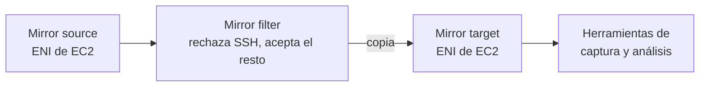

# Network Traffic Controls

> [!abstract] Qué es este archivo
> Quinta lección del módulo y la **más práctica**: cinco planos de control de tráfico, cada uno con sus patrones
> avanzados y **cuatro ejemplos de código**. Va de los **security groups** (microsegmentación, JIT access) a los
> **NACLs** de borde de zona, el **DNS Firewall**, los **VPC endpoints** como control de seguridad, la
> segmentación con **Transit Gateway** y **Cloud WAN**, y termina en las **arquitecturas de inspección**
> (**Network Firewall**, **Gateway Load Balancer**, **Traffic Mirroring**).
>
> Cubre el requisito **3** del caso —**inspección y control de tráfico**— y el **1** —**consistencia entre
> cuentas**— desde el diseño, no desde la política central.

> [!quote] La idea que ordena todo
> **Cada control responde a una pregunta distinta**: *¿quién puede hablar conmigo?* (security group), *¿qué entra
> a mi subred?* (NACL), *¿a qué nombre me conecto?* (DNS Firewall), *¿por dónde sale el tráfico?* (endpoint), *¿por
> dónde puede ir?* (route tables y segmentos). **Superponerlos es la defensa en capas; elegir uno solo es una
> ilusión de seguridad.**

---

## Resumen en una frase

> La lección enseña a **controlar el tráfico por cinco ejes a la vez** —recurso, subred, nombre, servicio y
> camino—, con **segmentación por referencia y no por CIDR**, y con **inspección** que puede ser distribuida,
> centralizada, híbrida o **fuera del camino** (mirroring).

---

## 1. Los cinco planos de control

**El encuadre de la fuente:** controles de red efectivos **establecen límites de seguridad**, **administran flujos
de tráfico** y **protegen recursos**; combinando **arquitectura de VPC** + **mecanismos de filtrado** + **servicios
avanzados** se logra una postura robusta **que habilita el negocio** mientras protege.

> [!note] Lectura propia (no está en la fuente)
> La fuente presenta los bloques en orden, pero no los ordena por capa. Este cuadro es mío y sirve para ubicarse:
> **cada control actúa en un eje distinto, y por eso se superponen sin repetirse**.

| # | Control | Eje | Alcance | Estado |
| --- | --- | --- | --- | --- |
| **1** | **Security group** | **¿Quién me habla?** | **Recurso** (ENI) | **Stateful** |
| **2** | **Network ACL** | **¿Qué entra a la subred?** | **Subred** | **Stateless** |
| **3** | **Route 53 Resolver DNS Firewall** | **¿A qué nombre resuelvo?** | **Resolución DNS** | — |
| **4** | **VPC endpoint + endpoint policy** | **¿Por dónde sale a un servicio?** | **Servicio de AWS o PrivateLink** | — |
| **5** | **TGW route tables / segmentos de Cloud WAN** | **¿Por dónde puede ir?** | **Camino entre VPCs y dominios** | — |

---

## 2. Security groups avanzados: microsegmentación

**El objetivo:** implementar **patrones avanzados de security group** para lograr **microsegmentación
sofisticada**. La fuente da **cinco patrones**, y cada uno resuelve un problema que el SG “normal” no resuelve.

| # | Patrón | Qué hace | Qué problema elimina |
| --- | --- | --- | --- |
| **1** | **Service-oriented design** | Crear SGs **por función de servicio**, no por **ubicación de red** | Que la seguridad se rompa **cuando cambia la infraestructura** |
| **2** | **Reference chaining** | **Referencias jerárquicas entre SGs** | La **dependencia de CIDR** y el **mantenimiento de reglas** |
| **3** | **Just-in-time access** | **Funciones Lambda** que **modifican reglas temporalmente** y **las revierten solas** | El acceso administrativo **permanente** |
| **4** | **Cross-account references** | **Referenciar SGs entre cuentas** | Controles **inconsistentes** en entornos multi-cuenta |

> [!important] El patrón 1 es el que más rinde en el examen
> **Por función, no por ubicación.** Un SG llamado `web-subnet-sg` **se rompe** cuando movés la instancia. Un SG
> llamado `app-to-db-sg` **sobrevive** a cualquier rediseño, porque **describe una relación, no un lugar**.

> [!note] Lectura propia (no está en la fuente)
> **Reference chaining** es el patrón más subestimado: encadenar **SG → SG → SG** permite expresar **“este
> servicio habla con este otro”** sin saber **una sola IP**. El costo es **profundidad**: una cadena de tres
> saltos es difícil de auditar, y **ahí es donde conviene dibujarla**.

### 2.1 Just-in-time access: el código

**La fuente trae una función Lambda que otorga acceso temporal y programa la remoción:**

```python
def grant_temp_access(event, context):
    ec2 = boto3.client('ec2')
    sg_id = event['security_group_id']
    ip = event['source_ip']

    # Add temporary rule
    ec2.authorize_security_group_ingress(
        GroupId=sg_id,
        IpPermissions=[{
            'IpProtocol': 'tcp',
            'FromPort': 22,
            'ToPort': 22,
            'IpRanges': [{'CidrIp': f'{ip}/32', 'Description': 'Temporary emergency access'}]
        }]
    )

    # Schedule removal after 4 hours
    lambda_client = boto3.client('lambda')
    lambda_client.invoke(
        FunctionName='remove_temp_access',
        InvocationType='Event',
        Payload=json.dumps({
            'security_group_id': sg_id,
            'rule_description': 'Temporary emergency access'
        })
    )
```

**Qué hace, en orden:** **abre el puerto 22 (SSH)** solo para **la IP recibida en `/32`**, con la descripción
`Temporary emergency access`, y **dispara otra Lambda** (`remove_temp_access`) **de forma asíncrona**
(`InvocationType='Event'`) para que borre la regla.

> [!warning] Lo que el código **no** hace
> El comentario dice **“Schedule removal after 4 hours”**, pero **no hay ningún `sleep` ni ningún delay**: la
> Lambda de remoción **se invoca de inmediato** y **arranca enseguida**. Para que sean **4 horas** de verdad hace
> falta un **EventBridge Scheduler**, una **cola con delay** o un **timestamp en el payload** que la otra función
> valide. **La fuente no lo resuelve** y **no se corrige**: se registra.

> [!note] Erratas del ejemplo (registradas, no corregidas)
> El código usa **`json.dumps`** pero **no importa `json`** (solo se ve `boto3`), y en el original viene
> **aplanado en una sola línea** dentro de una celda de tabla. Acá se **reindentó para poder leerlo**, **sin
> cambiar ni un token**. Ninguna de las dos cosas se arregla en la nota.

---

## 3. NACLs en los bordes de zona

**El encuadre:** los **security groups son la defensa principal**, pero **en los límites de las zonas de
seguridad** conviene **sumar patrones avanzados de NACL**.

| Patrón | Qué hace |
| --- | --- |
| **Automated Threat Response** | **Funciones Lambda que actualizan NACLs en respuesta a hallazgos de Amazon GuardDuty**, para **defensa perimetral adaptativa** |
| **Zone-Based Design** | **Configuraciones de NACL consistentes por tipo de zona**, aplicando **patrones de tráfico apropiados a cada zona** |
| **Ephemeral Port Handling** | **Rule sets que manejan correctamente el tráfico de retorno** de protocolos con **puertos dinámicos**, **minimizando reglas demasiado permisivas** |

> [!important] El patrón 3 es el que rompe producciones
> **NACLs son stateless**: la respuesta **no se permite sola**. Si abrís `443` de entrada, **tenés que abrir el
> rango efímero de salida** (`1024-65535` en el caso clásico). La tentación es **abrir todo el rango** —y eso es
> exactamente lo que la fuente pide **evitar**: hay que **diseñar el rule set**, no **abrirlo entero**.

> [!note] Lectura propia (no está en la fuente)
> **Automated Threat Response** es NACL **+ GuardDuty + Lambda**: el hallazgo **no se queda en un panel**, se
> convierte en **una regla de denegación**. Es el mismo movimiento que Firewall Manager hace **declarativo**,
> pero **imperativo y reactivo**. Sirve para **ataques en curso**, no como estrategia principal.

---

## 4. Route 53 Resolver DNS Firewall

**Por qué importa:** es un **control crítico para prevenir exfiltración de datos y comunicaciones de
command-and-control (C2)**. El DNS es el canal que **casi nadie mira** y que **casi siempre está abierto**.

| Patrón | Qué hace |
| --- | --- |
| **Domain Classification Strategy** | **Rule groups de dominios por categoría de amenaza**: **malware**, **phishing**, **command-and-control** |
| **Data Exfiltration Detection** | **Consultas de CloudWatch Logs Insights** para **analizar patrones de consulta DNS** e **identificar DNS tunneling** |
| **Custom Intelligence Integration** | **Actualizar las listas de dominios automáticamente** a partir de **feeds de threat intelligence** |

> [!important] DNS tunneling, en una línea
> Si el ataque **no puede sacar los datos por HTTP**, los **codifica en nombres de dominio** y los pide por DNS.
> El firewall DNS **no necesita ver el contenido**: le alcanza con **ver el nombre**.

> [!note] Ampliación (no está en la fuente)
> La fuente **nombra** la consulta de Logs Insights pero **no la transcribe**. En el módulo de redes la lógica
> equivalente se armó **agrupando por dominio y contando consultas por origen**: **muchas consultas a dominios
> únicos y largos** es la firma del tunneling. **No se agrega la consulta acá** para no inventar sintaxis que la
> fuente no trae.

---

## 5. VPC endpoints como control de seguridad

**El principio:** los **VPC endpoints aumentan la seguridad manteniendo el tráfico dentro de la red de AWS** y
**reduciendo el riesgo de exposición a internet público**.

> Es decir: **el endpoint no es solo una optimización de red ni de costos**; es **un control** — el tráfico **no
> sale**, y eso **se puede verificar**.

### 5.1 Endpoint policies: control granular más allá de IAM

**La política que trae la fuente:**

```json
{
  "Version": "2012-10-17",
  "Statement": [
    {
      "Sid": "RestrictS3Access",
      "Effect": "Allow",
      "Principal": "*",
      "Action": "s3:GetObject",
      "Resource": "arn:aws:s3:::approved-buckets/*",
      "Condition": {
        "StringEquals": {
          "aws:PrincipalOrgID": "o-a1b2c3d4e5"
        }
      }
    }
  ]
}
```

| Pieza | Qué hace |
| --- | --- |
| **`Principal: "*"`** | **Cualquier principal** — el filtro **no es quién**, es **desde dónde y de qué organización** |
| **`Action: s3:GetObject`, `Resource: approved-buckets/*`** | Solo **lectura de objetos** de **buckets aprobados** |
| **`aws:PrincipalOrgID`** | **Solo principals de esa organización** (`o-a1b2c3d4e5`) |

> [!important] La clave del ejemplo: `Principal` abierto + condición cerrada
> Un endpoint policy con **`Principal: "*"`** **no es un agujero**: la restricción está en la **condición**. El
> endpoint **solo permite** `GetObject` sobre **buckets aprobados** y **solo a la organización**. Es
> **`aws:PrincipalOrgID`** el que convierte un endpoint abierto en **un perímetro de datos**.

> [!note] Lectura propia (no está en la fuente)
> Este es **el mismo recurso** que aparece en el checklist del módulo como **perímetro de datos**. La diferencia
> con una bucket policy es **el punto de aplicación**: el endpoint policy **corta el camino**, la bucket policy
> **corta el permiso**. **El endpoint actúa antes.**

### 5.2 Security domain enforcement

| Patrón | Qué hace |
| --- | --- |
| **Data Classification Boundaries** | **Políticas de endpoint distintas por dominio de seguridad**, para **aplicar límites de clasificación de datos** |
| **Defense in Depth** | **Aplicar endpoint policies *y* IAM policies**: **protección en capas** |
| **Cross-Account Controls** | **Restringir qué cuentas pueden acceder a servicios a través de tus endpoints** |

> [!warning] “Defense in depth” acá significa **las dos**
> La fuente lo dice explícito: **endpoint policy + IAM policy**. Si la pregunta ofrece “endpoint policy **o** IAM
> policy”, **la respuesta correcta es el `and`**, no el `or`.

### 5.3 PrivateLink para servicios propios

**El patrón se extiende a tus propias aplicaciones y a servicios de terceros:**

| Patrón | Qué hace |
| --- | --- |
| **Service Provider Controls** | **Permisos de endpoint service** que **restringen qué principals pueden crear endpoints** hacia tus servicios |
| **Consumer VPC Validation** | **Verificar las propiedades de seguridad de las VPCs consumidoras** antes de **aceptar conexiones** |
| **Complementary Security Controls** | **Combinar los permisos de endpoint service con security groups** para defensa en capas |

> [!note] Hueco declarado: las flashcards
> El texto cierra el bloque con: *“Para aprender más sobre cómo mejorar tu postura de seguridad con estos
> patrones avanzados de endpoints, **elegí las siguientes flashcards**”*. **El contenido no viene en la fuente.**
> No se reconstruye — es el **tercer** hueco de este tipo en el módulo.

---

## 6. Transit Gateway: segmentar por route tables

### 6.1 El diagrama de las cuatro VPCs

**Lo que describe la fuente:** **cuatro VPCs** conectadas **en el centro** por un **AWS Transit Gateway**, que
**funciona como hub de red** y **les permite comunicarse entre sí**. **Cada VPC tiene la misma estructura**: una
**subred privada** que **mantiene los recursos protegidos de internet**, y **dentro de cada subred privada un
security group** que **controla qué tráfico llega a los recursos**.

**Para qué sirve:** es un setup **común en empresas que necesitan espacios de red separados**; el TGW **hace
simple que esos espacios se hablen** **sin dejar de estar separados**.

> [!note] Lectura propia (no está en la fuente)
> El diagrama es **el mínimo viable de segmentación**: hub + VPCs + subred privada + SG. Lo que **no** muestra es
> **quién controla los cruces** —eso lo agregan las route tables de §6.2—. Un TGW **conecta todo con todo por
> default**: **la segmentación no viene del TGW, viene de sus route tables**.

### 6.2 Las cinco capacidades de seguridad del TGW

| # | Capacidad | Qué hace |
| --- | --- | --- |
| **1** | **Route Table Segmentation** | **Route tables separadas por dominio de seguridad**: **producción**, **desarrollo**, **shared services** |
| **2** | **Blackhole Routes** | **Rutas blackhole estratégicas** para **impedir tráfico no autorizado entre dominios** |
| **3** | **Appliance Mode** | **Routing simétrico** para **dispositivos de inspección stateful** |
| **4** | **Attachment Controls** | **Resource Access Manager** para **compartir el TGW** con **control preciso de qué cuentas pueden crear attachments** |
| **5** | **Flow Logs** | **Logging detallado de flujos** con **integración a CloudWatch Insights** para **analítica de seguridad** |

**La regla que produce aislamiento real:** **implementar restricciones de propagación de rutas entre route tables
del TGW**. Ejemplo textual: **route tables separadas para desarrollo, testing y producción**, **asegurando que el
tráfico nunca fluya entre esos entornos sin routing explícito a través de puntos de inspección**.

> [!important] La frase que hay que retener
> **“Sin routing explícito a través de puntos de inspección.”** No es “bloqueado”: es **no enrutado**. La
> diferencia es que **blackhole niega** y **la falta de propagación simplemente no existe como camino**. Para el
> examen, **las dos cosas aíslan**; la segunda es **más limpia**.

### 6.3 Código: aislar una route table por dominio

```bash
aws ec2 create-transit-gateway-route-table \
  --transit-gateway-id tgw-123456789abc \
  --tag-specifications 'ResourceType=transit-gateway-route-table,Tags=[{Key=SecurityDomain,Value=Production}]'
```

**Qué hace:** crea una **route table nueva** en el TGW y **la etiqueta** con `SecurityDomain=Production`. **La
etiqueta no es decorativa**: es el criterio con el que después se **asocian attachments** y se **audita** qué
tabla pertenece a qué dominio.

### 6.4 Código: la ruta blackhole

```bash
aws ec2 create-transit-gateway-route \
  --destination-cidr-block 10.1.0.0/16 \
  --blackhole \
  --transit-gateway-route-table-id tgw-rtb-prod
```

**Qué hace:** en la route table de **producción**, **manda a la basura todo el `10.1.0.0/16`** —que es el rango
de **desarrollo**—. **Resultado:** producción **puede alcanzar** lo que sus rutas permitan, **pero nunca
desarrollo**.

> [!warning] El `--blackhole` **gana**
> Una ruta blackhole **descarta** el tráfico **aunque exista otra ruta más específica o un attachment válido**. Es
> la forma de decir **“este camino no existe”** sin tocar el attachment. Y es **más difícil de romper por
> accidente** que confiar en que nadie propague la ruta.

> [!note] Erratas de los dos comandos (registradas, no corregidas)
> En la fuente, ambos comandos vienen **aplanados en una línea**, con el **backslash de continuación absorbido**
> (`... \ --transit-gateway-id ...`), y el título del primero dice **“Islolate”** (por *Isolate*). Acá se
> **repartieron en líneas para poder leerlos**; **los argumentos son idénticos**.

### 6.5 Lo que Cloud WAN hace por detrás

> **AWS Cloud WAN aprovisiona y administra automáticamente Transit Gateways regionales en segundo plano**,
> proveyendo **segmentación de red global** **sin requerir que configures manualmente relaciones de peering
> cross-Region entre Transit Gateways**.

> [!important] La diferencia en una línea
> **Con TGW, el peering entre Regions lo construís vos. Con Cloud WAN, no hay peering que construir.**

---

## 7. Cloud WAN: límites de seguridad globales

**El objetivo:** **extender la segmentación globalmente**.

| Capacidad | Qué hace |
| --- | --- |
| **Global network policy** | **Definir segmentos de red que abarcan múltiples Regions** en **un único documento de política** |
| **Security domain isolation** | **Segmentos de core network alineados con dominios de seguridad** que **mantienen el aislamiento entre Regions** |
| **Consistent controls** | **Aplicar las mismas políticas de seguridad en toda la huella global** |
| **Regional compliance** | **Controles específicos por Region** **manteniendo la arquitectura de conectividad global** |

**El diagrama que describe la fuente:** en **dos Regions**, dos **VPCs de producción segmentadas** con Cloud WAN,
y **también segmentadas** la **VPC compartida (shared)** y la **VPC de desarrollo**.

### 7.1 La política

```json
{
  "version": "2021.12",
  "core-network-configuration": {
    "vpcs": [
      { "region": "us-east-1", "asn": 64512 }
    ],
    "segments": [
      { "name": "prod", "require-attachment-acceptance": true },
      { "name": "dev", "require-attachment-acceptance": true },
      { "name": "shared", "require-attachment-acceptance": false }
    ],
    "segment-actions": [
      {
        "action": "create-route",
        "mode": "attachment",
        "segment": "shared",
        "destination-segment": "prod"
      }
    ]
  }
}
```

> [!note] Formato del ejemplo
> En la fuente viene **aplanado en una línea**. Se **reindentó** como JSON legible **sin cambiar claves ni
> valores**. La **estructura de anidamiento** (`segments` dentro de `core-network-configuration`) se transcribe
> **tal cual**, aunque en la documentación real de Cloud WAN los segmentos son de nivel superior. **Se registra,
> no se corrige.**

### 7.2 Qué hace esa política, según la fuente

**Network foundation**

- **Establece una core network con una VPC en `us-east-1`**.
- **Configura el ASN 64512** para **capacidades de routing BGP**.

**Security segmentation** — **tres dominios de seguridad distintos:**

| Segmento | `require-attachment-acceptance` | Qué significa |
| --- | --- | --- |
| **Production** | **`true`** | **Requiere aprobación explícita** para **cualquier attachment**: **control estricto** sobre qué recursos entran al entorno sensible |
| **Development** | **`true`** | **También requiere aprobación explícita**, **previniendo que recursos de desarrollo no autorizados se conecten** |
| **Shared services** | **`false`** | **Permite attachments automáticos**, **facilitando el acceso a servicios comunes** manteniendo governance |

**Traffic control**

- **Flujo controlado y unidireccional desde shared services hacia producción.**
- **“Security by design”: notablemente ausente está cualquier camino entre desarrollo y producción**, manteniendo
  **aislamiento estricto**.
- **Routing en modo attachment**: **crea rutas específicas solo para attachments autorizados**.

**Security benefits**

- **Previene el movimiento lateral entre desarrollo y producción.**
- **Permite que los servicios centralizados alcancen recursos de producción de forma controlada.**
- **Mantiene requisitos de aprobación para conectarse a segmentos sensibles.**
- **Provee una arquitectura de seguridad global consistente, extensible entre Regions.**

**La conclusión textual:** *“Esta política implementa **el principio de mínimo privilegio en la capa de red**,
**permitiendo solo caminos de comunicación explícitamente definidos** mientras **aplica aislamiento de dominios de
seguridad**.”*

> [!important] La pieza que hay que poder explicar
> La política **no** dice “dev no puede llegar a prod”. **Simplemente no crea esa ruta.** Y crea **una sola**:
> `shared → prod`. **La ausencia de regla es la regla** — es la misma lógica de §6.2: **no es que se bloquee, es
> que no existe el camino**.

> [!note] Lectura propia (no está en la fuente)
> Los **tres valores de acceptance** cuentan la historia del modelo: **prod y dev son cerrados** (nadie entra sin
> permiso), **shared es abierto** (es el punto de encuentro). Si `shared` también exigiera aceptación, **nadie
> podría ofrecer servicios comunes**. El diseño **elige dónde está la fricción**, y la pone **en los extremos, no
> en el medio**.

---

## 8. Arquitecturas de inspección

### 8.1 AWS Network Firewall

**Tres ejes de decisión:**

**Rule group types**

| Tipo | Qué hace |
| --- | --- |
| **Stateless rule groups** | **Filtran paquetes por headers**: **bloques CIDR, puertos, protocolos** |
| **Stateful rule groups** | **Analizan flujos de tráfico** con **reglas compatibles con Suricata** |
| **Domain filtering** | **Bloquean comunicaciones con dominios maliciosos** |

**Deployment models**

| Modelo | Cómo funciona | Cuándo |
| --- | --- | --- |
| **Distributed** | **Endpoints en cada VPC** | **Protección directa** por VPC |
| **Centralized inspection** | **Transit Gateway enruta el tráfico por una VPC de inspección** | **Menos endpoints**, política en un lugar |
| **Hybrid** | **Inspección dirigida** a **flujos de alto riesgo** | Cuando **no todo merece inspección** |

**Advanced configurations**

- **Reglas custom compatibles con Suricata** para **amenazas específicas de aplicación**.
- **Logging a S3 y CloudWatch** para **analítica de seguridad**.
- **Alerting automatizado** basado en **coincidencias de reglas críticas**.

> [!important] Los tres modelos, en una frase cada uno
> **Distribuido** = **cobertura total, costo total**. **Centralizado** = **un punto, un costo, un riesgo**.
> **Híbrido** = **inspección donde duele**. Y ese trade-off es **el mismo** que el Tech Talk de la lección 04
> plantea entre **centralizar y distribuir**.

### 8.2 Gateway Load Balancer para appliances de terceros

**Cuándo:** cuando hace falta **capacidades de inspección especializadas más allá de Network Firewall**.

| Patrón | Qué hace |
| --- | --- |
| **Service Insertion Architecture** | **Inspección transparente del tráfico** usando **endpoints de Gateway Load Balancer (GWLB)** |
| **Scalable Appliance Deployment** | **Auto scaling groups de appliances de seguridad de terceros** |
| **High-Availability Design** | **Servicios de inspección en múltiples AZs** con **failover adecuado** |
| **Multi-Vendor Strategy** | **Combinar varios productos de seguridad** para **defensa en capas** |

> [!warning] GWLB no inspecciona: **inserta**
> GWLB **no es un firewall**. Es **el mecanismo** que pone un appliance **en el camino** sin cambiar la
> arquitectura de red. Si la pregunta pide **“inspección con un producto de terceros”**, la respuesta es
> **GWLB + appliances**; si pide **“inspección administrada de AWS”**, es **Network Firewall**.

### 8.3 Traffic Mirroring: ver sin tocar el camino

**El objetivo:** **visibilidad profunda sin afectar el tráfico de producción**.

| Patrón | Qué hace |
| --- | --- |
| **Selective Mirroring Strategy** | **Apuntar a cargas críticas** para **controlar volumen de datos y costos** |
| **Advanced Analysis Pipeline** | **Análisis con Traffic Mirroring + Athena + Detective** |
| **Threat Hunting** | **Analizar el tráfico espejado** para **identificar ataques sofisticados que evaden los controles preventivos** |

**Cómo funciona, según la fuente:** **el origen del mirror y el destino del mirror son instancias EC2**. El
**mirror filter** **determina qué paquetes se copian**. Ejemplo textual: **reglas de entrada y salida que
rechacen tráfico SSH pero acepten todo lo demás**. Traffic Mirroring **aplica las reglas del filtro** y **copia el
tráfico aceptado** desde la **interfaz de red del origen** hacia la **interfaz del destino**. En el destino
**corrés tus herramientas de captura y análisis**.



> [!important] La diferencia con todo lo demás de la lección
> **Todo lo anterior previene; esto observa.** El tráfico **sigue su camino normal** y **una copia** va al
> destino. Por eso sirve para **threat hunting**: encontrar **lo que ya pasó los filtros**.

> [!note] Las nueve imágenes de la fuente no están en el vault
> `3c81ccb3-5226-4a5a-92c0-4b2965b0ebba`, `5b4580de-b6b5-44db-9d10-5eda9cdd6286`,
> `00334a24-3f6e-4c05-8bcf-31af2358a62c`, `284ed7e4-9a5a-49a7-a04f-a49d860d9286` (los cuatro patrones de SG),
> `5HVBHN6BDY` (las cuatro VPCs + TGW), `9PF1XQFEMW` (TGW), `D49MNRGNPY` (Cloud WAN),
> `8K85UPPTDV` (política de segmentación Cloud WAN) y `4Y6BQU427T` (traffic mirroring). **No se describen más
> allá del texto alternativo**, y el esquema de §8.3 es una **reconstrucción**.

---

## 9. Traducción del contenido

> [!info] Sección de referencia (opcional)
> Esto es la **traducción fiel** de la fuente, para verificar que no se perdió nada. **No hace falta leerla para
> estudiar**: lo que se estudia son las secciones **1 a 8** y se cierra con la **11**.
> Usala solo si (a) algo de arriba te quedó dudoso, (b) querés el texto exacto de un patrón, o (c) antes del
> examen querés chequear que no se escapó un matiz.

### 9.1 Introduction to Network Traffic Controls

**Los controles de red efectivos en AWS establecen límites de seguridad, administran flujos de tráfico y protegen
recursos en toda tu infraestructura cloud.** **Combinando arquitectura de VPC con mecanismos de filtrado de
tráfico y servicios de seguridad avanzados, podés crear una postura de seguridad de red robusta que habilita
operaciones de negocio seguras mientras protege contra amenazas.**

**Controles avanzados de filtrado de tráfico** — **Implementá estos patrones avanzados de security group para
lograr microsegmentación sofisticada:**

- **Service-oriented design**: **Crear security groups basados en la función del servicio en lugar de la ubicación
  de red, para mantener la seguridad durante los cambios de infraestructura.**
- **Reference chaining**: **Implementar referencias jerárquicas de security groups para eliminar la dependencia de
  CIDR y simplificar la gestión de reglas.**
- **Just-in-time access**: **Desplegar funciones AWS Lambda que modifiquen reglas de security group temporalmente
  para acceso administrativo, y después reviertan los cambios automáticamente.**
- **Cross-account references**: **Referenciar security groups a través de los límites de cuenta para mantener
  controles consistentes en entornos multi-cuenta.**

**Ejemplo de código: función Lambda para modificar un security group** — el código aparece en §2.1.

**Network ACLs para límites de zona** — **Mientras los security groups proveen tu defensa principal, implementá
estos patrones avanzados de NACL en los límites de las zonas de seguridad:**

- **Automated Threat Response**: **Crear funciones Lambda que actualicen NACLs en respuesta a hallazgos de Amazon
  GuardDuty para una defensa perimetral adaptativa.**
- **Zone-Based Design**: **Implementar configuraciones de NACL consistentes para cada tipo de zona de seguridad,
  aplicando patrones de tráfico apropiados a cada zona.**
- **Ephemeral Port Handling**: **Diseñar rule sets que manejen correctamente el tráfico de retorno para protocolos
  con puertos dinámicos, minimizando las reglas demasiado permisivas.**

**Route 53 Resolver DNS firewall** — **Implementá DNS Firewall como un control crítico para prevenir exfiltración
de datos y comunicaciones de command-and-control:**

- **Domain Classification Strategy**: **Crear rule groups de dominios basados en categorías de amenaza (malware,
  phishing, command-and-control).**
- **Data Exfiltration Detection**: **Desplegar consultas de CloudWatch Log Insights para analizar patrones de
  consulta DNS e identificar potencial DNS tunneling.**
- **Custom Intelligence Integration**: **Actualizar las listas de dominios automáticamente en base a tus feeds de
  threat intelligence.**

### 9.2 VPC Endpoints as security controls

**Los VPC endpoints aumentan la seguridad manteniendo el tráfico dentro de la red de AWS y reduciendo el riesgo de
exposición a internet público.**

**Control de acceso granular con endpoint policies** — **Crear endpoint policies que apliquen control de acceso
fino más allá de IAM:** (la política `RestrictS3Access` aparece en §5.1).

**Security Domain Enforcement**

- **Data Classification Boundaries**: **Implementar políticas de endpoint distintas para distintos dominios de
  seguridad, para aplicar límites de clasificación de datos.**
- **Defense in Depth**: **Aplicar tanto endpoint policies como IAM policies para protección en capas.**
- **Cross-Account Controls**: **Restringir qué cuentas pueden acceder a servicios a través de tus endpoints.**

**PrivateLink para servicios custom** — **Extender los patrones de seguridad de endpoints a tus propias
aplicaciones y a servicios de terceros:**

- **Service Provider Controls**: **Crear permisos de endpoint service que restrinjan qué principals pueden crear
  endpoints hacia tus servicios.**
- **Consumer VPC Validation**: **Verificar las propiedades de seguridad de las VPCs consumidoras antes de aceptar
  conexiones de endpoint.**
- **Complementary Security Controls**: **Combinar permisos de endpoint service con security groups para defensa en
  capas.**

### 9.3 Advanced Network Segmentation with TGW and Cloud WAN (diagrama)

**Este diagrama muestra cómo cuatro Virtual Private Clouds (VPCs) se conectan en la nube de AWS.** **En el centro
está un AWS Transit Gateway, que funciona como un hub de red.** **El Transit Gateway se conecta a las cuatro VPCs,
permitiéndoles comunicarse entre sí.** **Cada VPC tiene la misma estructura básica: dentro de cada VPC hay una
subred privada, que mantiene los recursos protegidos de internet público; y dentro de cada subred privada hay un
security group que controla qué tráfico puede llegar a tus recursos.**

**Este setup es común en empresas que necesitan espacios de red separados.** **El Transit Gateway hace simple que
esos espacios se hablen.** **Este diseño ayuda a mantener las cosas seguras mientras permite la comunicación
necesaria entre distintas partes de tu red.**

### 9.4 AWS Transit Gateway

**Transit Gateway habilita segmentación de red sofisticada a través de estas capacidades de seguridad:**

- **Route Table Segmentation**: **Crear route tables separadas para distintos dominios de seguridad (producción,
  desarrollo, shared services).**
- **Blackhole Routes**: **Implementar rutas blackhole estratégicas para prevenir tráfico no autorizado entre
  dominios.**
- **Appliance Mode**: **Habilitar routing simétrico para dispositivos de inspección stateful.**
- **Attachment Controls**: **Usar Resource Access Manager para compartir Transit Gateway con control preciso sobre
  qué cuentas pueden crear attachments.**
- **Flow Logs**: **Habilitar logging detallado de flujos con integración a CloudWatch Insights para analítica de
  seguridad.**

**Implementá restricciones de propagación de rutas entre route tables de Transit Gateway para crear aislamiento
de red verdadero.** **Por ejemplo, creá route tables separadas para los entornos de desarrollo, testing y
producción, asegurando que el tráfico nunca fluya entre esos entornos sin routing explícito a través de puntos de
inspección.**

**AWS Cloud WAN aprovisiona y administra automáticamente Transit Gateways regionales en segundo plano, proveyendo
segmentación de red global sin requerir que configures manualmente relaciones de peering cross-Region entre
Transit Gateways.**

### 9.5 AWS Cloud WAN for Global Security Boundaries

**Extendé tu segmentación de red globalmente con Cloud WAN:**

- **Global network policy**: **Definir segmentos de red que abarquen múltiples regions dentro de un único documento
  de política.**
- **Security domain isolation**: **Crear segmentos de core network alineados con dominios de seguridad que
  mantengan el aislamiento entre regions.**
- **Consistent controls**: **Aplicar las mismas políticas de seguridad en toda tu huella de red global.**
- **Regional compliance**: **Implementar controles específicos por region manteniendo la arquitectura de
  conectividad global.**

**Ejemplo de política de segmentación de Cloud WAN** — **En este diagrama de arquitectura, dos VPCs de producción
están segmentadas en la Region uno y la Region dos usando AWS Cloud WAN.** **La VPC del segmento Shared y la VPC de
Development también están segmentadas en la Region 1 y la Region 2.** (La política aparece en §7.1.)

**Descripción de la política:** **Este documento de política de Cloud WAN crea una arquitectura de segmentación de
red global con límites de seguridad fuertes.**

***Network Foundation:*** **Establece una core network con una VPC en la region US East 1.** **Configura el ASN
64512 para capacidades de routing BGP.**

***Security Segmentation:*** **Crea tres dominios de seguridad distintos:** **Production segment** (requiere
aprobación explícita para cualquier attachment, proveyendo control estricto sobre qué recursos pueden unirse a este
entorno sensible); **Development segment** (también requiere aprobación explícita, previniendo que recursos de
desarrollo no autorizados se conecten); **Shared services segment** (permite attachments automáticos, facilitando
el acceso para servicios comunes mientras mantiene governance).

***Traffic Control:*** **Implementa un flujo de tráfico controlado y unidireccional desde shared services hacia
production.** **Security by design: notablemente ausente está cualquier camino entre development y production,
manteniendo aislamiento estricto.** **Usa routing en modo attachment, creando rutas específicas solo para
attachments autorizados.**

***Security Benefits:*** **Previene el movimiento lateral entre entornos de desarrollo y producción.** **Habilita
que servicios centralizados alcancen recursos de producción de manera controlada.** **Mantiene requisitos de
aprobación para conectarse a segmentos sensibles.** **Provee una arquitectura de seguridad global consistente que
puede extenderse entre regions.**

**Esta política implementa el principio de mínimo privilegio en la capa de red, permitiendo solo caminos de
comunicación explícitamente definidos mientras aplica aislamiento de dominios de seguridad.**

### 9.6 Network inspection architectures

**Implementación de AWS Network Firewall** — **Diseñá arquitecturas de inspección sofisticadas usando AWS Network
Firewall:**

- **Rule Group Types**: **Stateless rule groups** (filtran paquetes por headers: bloques CIDR, puertos,
  protocolos); **Stateful rule groups** (analizan flujos con reglas compatibles con Suricata); **Domain
  filtering** (bloquean comunicaciones con dominios maliciosos).
- **Deployment Models**: **Distributed** (endpoints en cada VPC para protección directa); **Centralized
  inspection** (Transit Gateway enruta el tráfico por una VPC de inspección); **Hybrid** (inspección dirigida a
  flujos de alto riesgo específicos).
- **Advanced Configurations**: **crear reglas custom compatibles con Suricata para amenazas específicas de
  aplicación**; **implementar logging a S3 y CloudWatch**; **configurar alerting automatizado basado en
  coincidencias de reglas críticas**.

**Gateway Load Balancer para appliances de terceros** — **Cuando necesitás capacidades de inspección
especializadas más allá de Network Firewall:**

- **Service Insertion Architecture**: **Crear inspección transparente del tráfico usando endpoints de Gateway Load
  Balancer (GWLB).**
- **Scalable Appliance Deployment**: **Implementar auto scaling groups de appliances de seguridad de terceros.**
- **High-Availability Design**: **Desplegar servicios de inspección en múltiples AZs con failover adecuado.**
- **Multi-Vendor Strategy**: **Combinar múltiples productos de seguridad para defensa en capas.**

**Traffic Mirroring para detección avanzada de amenazas** — **Implementá Traffic Mirroring para visibilidad
profunda sin afectar el tráfico de producción:**

- **Selective Mirroring Strategy**: **Apuntar a cargas críticas para manejar el volumen de datos y los costos.**
- **Advanced Analysis Pipeline**: **Crear análisis de tráfico usando Traffic Mirroring, Athena y Detective.**
- **Threat Hunting**: **Analizar el tráfico espejado para identificar ataques sofisticados que evaden los
  controles preventivos.**

**Cómo funciona el mirroring:** **el mirror source y el mirror target son instancias EC2.** **El mirror filter
determina qué paquetes de red se espejan.** **Por ejemplo, podés agregar reglas de entrada y salida al filtro de
modo que rechace tráfico SSH pero acepte todo el demás tráfico.** **Traffic Mirroring aplica las reglas del filtro
y después copia el tráfico aceptado desde la interfaz de red del mirror source hacia la interfaz de red del mirror
target.** **Podés correr tus herramientas de captura y análisis en los paquetes entregados al mirror target.**

---

## 10. Cuadro de cierre: quién bloquea qué

| Si el problema es… | Control | Mecanismo |
| --- | --- | --- |
| **Un servicio habla con otro** | **Security group** | **Referencia a otro SG**, no CIDR |
| **Dar acceso admin por horas** | **Security group + Lambda** | **JIT**: agrega regla y la revierte |
| **Un dominio malicioso resuelve** | **Route 53 Resolver DNS Firewall** | **Rule groups por categoría** |
| **Sacar datos por DNS** | **DNS Firewall + Logs Insights** | **Análisis de patrones de consulta** |
| **Abrir un puerto sin abrir la respuesta** | **Network ACL** | **Rango efímero + zone-based design** |
| **Reaccionar a un hallazgo de GuardDuty en el borde** | **NACL + Lambda** | **Automated threat response** |
| **Que el tráfico a S3 no salga a internet** | **VPC endpoint** | **Endpoint policy** con `aws:PrincipalOrgID` |
| **Publicar mi servicio a otras cuentas** | **PrivateLink** | **Endpoint service permissions** |
| **Que desarrollo no llegue a producción** | **TGW route table** | **Blackhole route** o **sin propagación** |
| **Lo mismo, entre Regions** | **Cloud WAN** | **Segmentos + `segment-actions`** |
| **Inspeccionar con un producto de terceros** | **Gateway Load Balancer** | **Service insertion** |
| **Analizar tráfico sin frenarlo** | **Traffic Mirroring** | **Mirror filter + target** |

**La jerarquía, en una línea:** **SG y NACL filtran**, **DNS Firewall nombra**, **endpoint policies acotan el
destino**, **TGW y Cloud WAN definen el camino**, **Network Firewall / GWLB inspeccionan** y **Traffic Mirroring
observa**.

---

## 11. Para el examen (SAP-C02)

> [!important] Lo que hay que retener
> 1. **Cinco patrones de SG**: **service-oriented**, **reference chaining**, **just-in-time**, **cross-account**.
> 2. **Diseñá por función, no por ubicación**: el SG sobrevive a los cambios de infraestructura.
> 3. **JIT access** = **Lambda que agrega la regla y la revierte**. La fuente **no implementa los 4 horas**.
> 4. **NACL**: **automated threat response** con **GuardDuty**, **zone-based design**, **ephemeral ports**.
> 5. **DNS Firewall** previene **exfiltración y C2**; se organiza por **rule groups de categorías de amenaza**.
> 6. **Endpoint policies** dan control **más allá de IAM**, y **`aws:PrincipalOrgID`** es el perímetro.
> 7. **Defense in depth en endpoints** = **endpoint policy + IAM policy**, **las dos**.
> 8. **TGW**: **route table segmentation**, **blackhole routes**, **appliance mode**, **RAM para attachments**,
>    **flow logs**. El aislamiento real viene de **restringir la propagación de rutas**.
> 9. **Cloud WAN** **aprovisiona TGWs regionales automáticamente**: **no hay peering manual entre Regions**.
> 10. **`require-attachment-acceptance`**: **prod y dev `true`**, **shared `false`**.
> 11. **Los tres modelos de Network Firewall**: **distribuido**, **centralizado**, **híbrido**.
> 12. **GWLB inserta appliances de terceros**; **Traffic Mirroring observa sin alterar el camino**.

> [!warning] Trampa clásica del examen
> Escenario: *“hay que impedir que desarrollo llegue a producción”*. La respuesta **no** es un **security group**
> (no ve el camino entre VPCs) ni “cerrar el peering”: es **aislar en la route table** del TGW con **blackhole** o
> **sin propagación**. Y si el escenario dice **“entre varias Regions, sin peering manual”**, la respuesta es
> **Cloud WAN**, no Transit Gateway —porque **Cloud WAN aprovisiona los TGWs regionales solo**.

---

## Relacionado

- [[AWS Solutions Architect Advanced - Securing Networks and Data]] *(índice del módulo)*
- [[Network Segmentation]] — el marco **north/south vs. east/west** y **Network Firewall** de la lección anterior
- [[AWS Firewall Manager]] — los **cuatro tipos de política** que aplican estos controles a escala
- [[Gathering the Customer Requirements - Security]] — el requisito **3** (firewalls e inspección) que se cubre acá
- [[AWS Transit Gateway Setup]] — la configuración base del TGW, sin el eje de segmentación
- [[Use Cases - Transit Gateway]] — **appliance mode**, segmentación y casos de uso
- [[VPC Endpoints]] — el mecanismo; acá se usa como **control de seguridad**
- [[AWS PrivateLink Components]] — endpoint services y permisos de proveedor
- [[1.1 Diseñar estrategias de conectividad de redes]] — **TGW**, **Cloud WAN** y rutas
- [[1.2 Prescribir controles de seguridad]] — la tarea que este módulo cubre
- [[2.3 Determinar los controles de seguridad en función de los requisitos]] — el cruce con Dominio 2
- [[Guia AWS]] — pesos y tareas oficiales del SAP-C02
- Siguiente paso del módulo: [[Security Hub]] — donde todos los hallazgos se juntan, se priorizan y se
  convierten en remediación

---

## Registro de integración

| Fecha | Qué llegó | Dónde se integró |
| --- | --- | --- |
| 27/10/2026 | Lección 05 completa: cinco planos de control, cuatro ejemplos de código, TGW, Cloud WAN, inspección y mirroring | Nota completa (secciones 1–11) |

**Discrepancias y vacíos registrados (no corregidos):**

1. **El código de JIT no programa las 4 horas**: el comentario dice *“Schedule removal after 4 hours”* pero **invoca
   la Lambda de inmediato**, sin delay. **No se corrige** (§2.1).
2. **El código de JIT usa `json.dumps` sin importar `json`**, y viene **aplanado en una línea**. Se **reindentó
   sin cambiar tokens** (§2.1).
3. **Los dos comandos de TGW vienen aplanados** con el backslash absorbido, y el título del primero dice
   **“Islolate”**. Se repartieron en líneas; **los argumentos son idénticos** (§6.3, §6.4).
4. **La política de Cloud WAN anida `segments` y `segment-actions` dentro de `core-network-configuration`**; en la
   documentación real son de nivel superior. **Se transcribe literal** y se registra (§7.1).
5. **Las flashcards de endpoints avanzados no traen contenido.** Es el **tercer** hueco de este tipo (§5.3).
6. **La consulta de Logs Insights para DNS tunneling se nombra pero no se transcribe** (§4).
7. **Las nueve imágenes no están en el vault** (listadas en §8.3). El esquema de mirroring es una
   **reconstrucción**.
8. **La fuente no da cifras** en esta lección: no hay límites de reglas, ni de endpoints, ni de conexiones.
9. **`AWS Cloud WAN` aparece con espacio en el título de sección y como `Cloud WAN` en el cuerpo**; se unifica en
   el cuerpo y se conserva la forma de la fuente en las citas.
10. **El nombre de archivo `Network Traffic Controls.md` no colisiona** con ninguna nota del vault (verificado: **0
    basenames duplicados**). El módulo de redes tiene **`AWS Transit Gateway Setup`**, **`VPC Endpoints`** y
    **`AWS PrivateLink Components`**, que se enlazan desde *Relacionado* sin duplicar contenido.

**Decisiones de transcripción:**

- Se conservan **microsegmentation**, **service-oriented design**, **reference chaining**, **just-in-time access**,
  **ephemeral port**, **DNS tunneling**, **command-and-control**, **blackhole route**, **appliance mode**,
  **attachment**, **segment**, **segment-actions**, **require-attachment-acceptance**, **Suricata**, **service
  insertion**, **threat hunting** y **IOC**.
- Las **cifras** se transcriben literales: **4 horas**, **puerto 22**, **`/32`**, **`10.1.0.0/16`**,
  **`64512`**, **`2021.12`**, **cuatro VPCs**, **dos Regions**, **tres segmentos**.
- Los **cinco identificadores de código** se transcriben **carácter por carácter**: `tgw-123456789abc`,
  `tgw-rtb-prod`, `o-a1b2c3d4e5`, `approved-buckets`, `sg_id`.
