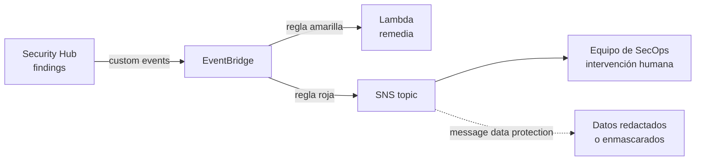

# Security Hub

> [!abstract] Qué es este archivo
> Sexta lección del módulo y la **primera del bloque de detección y compliance** que anunciaba el overview. Cubre
> **AWS Security Hub**: qué agrega, de dónde recibe hallazgos, cómo los **prioriza con insights**, cómo los
> convierte en **acción** (EventBridge + Lambda + SNS) y cómo se relaciona con **Config**, **Systems Manager** y
> **GuardDuty**.
>
> Cubre el requisito **6** del caso —**reporte de compliance y evidencia**— y el **5** —**detección en tiempo
> real**— desde el lado de la **agregación**.

> [!quote] La idea que ordena todo
> **Security Hub no detecta: agrega.** GuardDuty encuentra la amenaza, Inspector la vulnerabilidad, Macie el dato
> expuesto, Firewall Manager la política incumplida. **Security Hub junta todo, lo ordena por severidad y lo
> convierte en una decisión.** Es el **único** de la familia que **acepta logs de terceros**.

---

## Resumen en una frase

> **Un solo lugar donde todos los hallazgos de seguridad se encuentran, se priorizan contra estándares de la
> industria y se convierten en remediación automática o en una alerta para humanos.**

---

## 1. Qué es y qué problema resuelve

**Definición de la fuente:** AWS Security Hub es un **servicio totalmente administrado** que provee **una vista
integral del estado de seguridad en AWS**, con **estándares de la industria y buenas prácticas**.

**Las cuatro cosas que hace:**

| # | Qué hace |
| --- | --- |
| **1** | **Recolecta datos de seguridad** de **cuentas, servicios y productos de partners third-party soportados** |
| **2** | **Ayuda a analizar tendencias** de seguridad |
| **3** | **Identifica los problemas de seguridad de mayor prioridad** |
| **4** | Provee **dashboards preconstruidos** con **resúmenes de estado y tendencias** de seguridad y compliance |

> [!important] El problema real que resuelve
> No es “detectar mejor”: es **que el analista no tenga que abrir ocho consolas**. Con **50 cuentas** y **siete
> fuentes de hallazgos**, el cuello de botella **no es la detección, es el triaje**. Security Hub **existe para el
> triaje**.

> [!note] Lectura propia (no está en la fuente)
> La frase **“vista integral”** es la clave y también el límite: Security Hub **agrega**, **no reemplaza**. Si la
> pregunta dice **“detectar actividad maliciosa en las cuentas”**, la respuesta **no** es Security Hub — es
> **GuardDuty**. Si dice **“ver todo junto y priorizado”**, es Security Hub.

---

## 2. De dónde recibe los hallazgos

**La regla:** Security Hub **recolecta e ingiere automáticamente** hallazgos de **integraciones de partners de AWS**
y de **ciertos servicios de AWS**.

### 2.1 Las siete fuentes nombradas

| # | Servicio | Qué aporta |
| --- | --- | --- |
| **1** | **Amazon GuardDuty** | **Hallazgos de amenazas** (actividad maliciosa, comportamiento anómalo) |
| **2** | **Amazon Inspector** | **Vulnerabilidades y exposición** de recursos |
| **3** | **AWS Firewall Manager** | **Incumplimientos de política** de firewall |
| **4** | **AWS IAM Access Analyzer** | **Políticas que permiten acceso público o cross-account** |
| **5** | **Amazon Macie** | **Datos sensibles** en S3 |
| **6** | **AWS Config** | **Incumplimiento de reglas de configuración** |
| **7** | **AWS Systems Manager Patch Manager** | **Parches faltantes** |

> [!note] Errata de la fuente (registrada, no corregida)
> El texto escribe **“AWS Firewall Manger”** (falta la segunda “a”). En el cuerpo se usa **Firewall Manager**;
> se conserva la forma de la fuente en la traducción.

### 2.2 El formato estándar

> **Security Hub usa un formato de datos estándar, eliminando la necesidad de esfuerzos de conversión de datos que
> consumen tiempo.**

**Eso es lo que hace posible mezclar siete fuentes y productos de terceros** en la misma tabla: **todos llegan al
mismo esquema**.

**Definición que trae la fuente:** **un finding es un problema de seguridad potencial**.

### 2.3 Dos ejemplos de integración

**IAM Access Analyzer** — **envía findings a Security Hub cuando las políticas permiten acceso público o
cross-account a recursos**. Y **Security Hub activa esta integración automáticamente si ya estás usando IAM Access
Analyzer**.

> [!important] “Se activa sola”
> Es el detalle más preguntable del bloque: **no hay que configurar nada** si ya usás Access Analyzer. **La
> integración con Access Analyzer es automática.**

**Firewall Manager** — **envía cuatro tipos de findings**:

| # | Finding |
| --- | --- |
| **1** | **Recursos que no están protegidos adecuadamente por reglas de AWS WAF** |
| **2** | **Recursos que no están protegidos adecuadamente por Shield Advanced** |
| **3** | **Findings de Shield Advanced que indican que hay un ataque DDoS en curso** |
| **4** | **Security groups que se usan incorrectamente** |

> [!warning] El finding 3 no es como los otros tres
> **1, 2 y 4 son de postura** (algo **está mal configurado**). **3 es un evento** (algo **está pasando ahora**).
> Por eso el 3 **necesita respuesta inmediata** y los otros tres **entran a la cola de remediación**. Es el mismo
> eje que la lección 04 separa como **estado** vs. **tráfico**.

---

## 3. Insights: priorizar sin leer todo

**Qué son:** con **insights**, podés **correlacionar y agrupar findings** para **identificar los de mayor
prioridad más rápido**.

| Dato | Detalle |
| --- | --- |
| **Cantidad out of the box** | **más de 100 insights** |
| **Origen** | **AWS** y **partners de AWS** |
| **Propios** | Podés **crear tus propios insights** para **problemas únicos de tu entorno** |
| **Dashboard** | **Snapshot de tendencia** de los **top insights**, **priorizados por severidad** |
| **“My favorites”** | **Grupo de insights favoritos** con los **top de AWS y de partners** |
| **Drill-down** | **Detalle de recurso y de finding**, **recomendaciones de remediación** y **anotaciones** |

**Los dos ejemplos de insight que da la fuente:**

- **Instancias EC2 con parches de seguridad faltantes**.
- **Buckets S3 con credenciales almacenadas, o con permisos públicos de escritura o lectura**.

> [!important] “Más de 100” es el número
> Es la única cifra de la lección y es **la que se pregunta**. No son “decenas” ni “cientos”: **más de 100
> insights out of the box**.

> [!note] Lectura propia (no está en la fuente)
> Un **insight** no es un hallazgo nuevo: es **una consulta guardada sobre los hallazgos**. Por eso **crear los
> propios** es tan importante en una empresa real: los 100 de fábrica **priorizan lo genérico**; el insight propio
> **prioriza lo que a tu negocio le duele**.

---

## 4. Del hallazgo a la acción: automatización de respuesta

**El flujo que describe la fuente:** Security Hub **envía los findings como eventos custom a Amazon EventBridge**;
con **reglas de EventBridge** se **determina el tipo de respuesta**.

**Los cinco marcadores de la fuente:**

| # | Marcador | Qué hace |
| --- | --- | --- |
| **1** | **Security Findings** | Security Hub **envía los findings como eventos custom a EventBridge**; las **reglas** determinan **el tipo de respuesta** |
| **2** | **Rule** | Si el evento **coincide con una regla**, **puede activar una respuesta**. En el escenario hay **una regla amarilla** para un tipo de finding y **una roja** para otro |
| **3** | **Yellow Alarm Response** | Se **invoca una Lambda** que **actúa sobre la recomendación y remedia el finding**. **Se puede crear una Lambda por cada recomendación de remediación posible** |
| **4** | **Red Alarm Response** | El finding **se publica en un topic de Amazon SNS**; el topic **notifica al equipo de security operations** e **indica que la situación puede requerir intervención humana** |
| **5** | **Protected messaging** | Con **message data protection para Amazon SNS**, el equipo puede **des-identificar datos en el payload en tiempo real** mediante **redacción o enmascarado (masking)** |

> [!warning] “Amarillo” y “rojo” no son niveles de AWS
> La fuente lo dice explícito: **son solo ejemplos** de **cómo representar el riesgo organizacional** y **simplificar
> las respuestas**. **No son severidades de Security Hub.** Si una opción del examen dice “la severidad amarilla de
> Security Hub”, **está inventando una categoría que no existe**.

> [!important] La regla que separa los dos caminos
> **Amarillo = se puede arreglar solo** (hay playbook, hay Lambda). **Rojo = necesita un humano**. La decisión de
> qué va a cada lado **no la toma AWS**: la toma **el diseño de las reglas**.

> [!note] Por qué el marcador 5 está ahí
> **Los findings traen datos del recurso** —y a veces **datos sensibles**. Mandarlos **crudos** a un topic de SNS
> **los expone** a todo el que esté suscrito. **Message data protection** permite **redactar o enmascarar** antes
> de que salgan. Es **protección de datos aplicada al canal de las alertas**.

---

## 5. La solución de AWS: Automated Response and Remediation

**Qué es:** **un add-on que funciona con Security Hub**. Provee **acciones de respuesta y remediación predefinidas**
basadas en **estándares de compliance de la industria** y **buenas prácticas** para amenazas de seguridad. **Ayuda
a resolver findings comunes y a mejorar la postura**.

### 5.1 Los tres estándares soportados

| # | Estándar | Versión |
| --- | --- | --- |
| **1** | **CIS AWS Foundations Benchmark** | **v1.2.0** |
| **2** | **AWS Foundational Security Best Practices** | **v1.0.0** |
| **3** | **PCI DSS** (Payment Card Industry Data Security Standard) | **v3.2.1** |

> [!important] Las versiones son parte de la respuesta
> **v1.2.0**, **v1.0.0**, **v3.2.1**. Son los tres números que la fuente da y **no son intercambiables**: si la
> pregunta nombra **CIS**, espera **v1.2.0**; si nombra **PCI DSS**, **v3.2.1**.

### 5.2 Los cuatro pasos del playbook

| # | Paso | Qué pasa |
| --- | --- | --- |
| **1** | **Detect** | Security Hub **recolecta eventos y datos** de otros servicios; se **analizan contra estándares** (por ejemplo **CIS AWS Foundations Benchmark**); **las excepciones se afirman como findings** en la consola; **los findings nuevos se envían a Amazon CloudWatch Logs** |
| **2** | **Ingest** | Se **despliegan dos reglas de EventBridge por cada control soportado**: una **coincide con el evento de custom action** (**remediación iniciada por el usuario**) y otra, **apagada por defecto**, **coincide con el evento de finding en tiempo real** |
| **3** | **Remediate** | Con **roles IAM cross-account**, la remediación **usa la API de AWS** para **hacer las tareas necesarias**. **Todos los playbooks llaman funciones Lambda**; **algunas remedian directo** y **otras usan documentos de AWS Systems Manager Automation** |
| **4** | **Log** | El playbook **registra los resultados**, **envía una notificación a un topic de SNS** y **actualiza el finding de Security Hub**. Se **mantiene un audit trail de acciones en las notas del finding**, con **workflow status y detalles de la remediación realizada** |

> [!important] El detalle del paso 2 que decide el examen
> **La regla de remediación automática viene APAGADA por defecto.** El cliente usa el **menú de custom actions**
> para **iniciar la remediación a mano**, o **después de probar cuidadosamente**, **la enciende** para que se
> dispare sola. **Auto-remediación es opt-in, no default.**

> [!note] Lectura propia (no está en la fuente)
> El paso **4** es el que contesta el requisito **6** del caso: **“mantener evidencia de los controles para
> auditorías futuras”**. El **audit trail en las notas del finding** —con workflow status y qué se hizo— es
> **exactamente esa evidencia**. Sin el paso 4, la remediación **no deja prueba**.

---

## 6. Governance

> [!note] Hueco declarado: las flashcards de governance
> La fuente dice: *“Acá hay algunas características importantes de Security Hub desde la perspectiva de
> governance. Para aprender cómo Security Hub encaja en el **ciclo de vida de governance**, **seleccioná cada una
> de las siguientes flashcards**”*.
>
> **El contenido no viene en el texto**: es un componente interactivo. **No se reconstruye.** Es el **cuarto**
> hueco de este tipo en el módulo (Shield en la 03, endpoints en la 04/05, governance acá).

---

## 7. Los cuatro roles de servicio

**La idea que los une, en palabras de la fuente:** **todos estos servicios comparten un rol similar** — permiten
**configurar requisitos de seguridad**, **monitorear los recursos según esos requisitos**, **detectar cuándo
ocurre una violación** e **iniciar una remediación**.

| # | Servicio | Rol específico según la fuente |
| --- | --- | --- |
| **1** | **AWS Config** | **Control detective**: **definís y evaluás políticas de configuración**; **rastrea los cambios**, **detecta cuándo violan las políticas** y **envía alertas en tiempo real**. Se puede configurar para que **tome acción** —**auto-remediation**— cuando ocurren violaciones |
| **2** | **AWS Systems Manager** | **Automatiza el compliance de recursos**: **al crear recursos nuevos (por ejemplo EC2) quedan automáticamente en cumplimiento**. **Mantiene grupos de políticas** a través de **muchos recursos** mediante **categorización**. **Automatiza la remediación**, y **se integra con Config, Security Hub y GuardDuty**: cuando cualquiera detecta un problema y **lanza una alerta**, SSM **ejecuta la acción de remediación configurada sobre los recursos correctos** |
| **3** | **Amazon GuardDuty** | **Tres pasos**: **ingiere logs de AWS** y **analiza decenas de miles de millones de eventos** de **múltiples fuentes** —**CloudTrail Event logs**, **VPC Flow Logs** y **logs de DNS**—; **con machine learning genera alertas accionables** que se **agregan entre múltiples cuentas**; y **esas alertas pueden iniciar eventos**, como **acciones de remediación**, y **son fáciles de mover a sistemas de event management y workflow existentes** |
| **4** | **AWS Security Hub** | **Agrega findings** de servicios y herramientas de seguridad de AWS, y **los correlaciona** para **identificar los de mayor prioridad**. **Se diferencia de GuardDuty por aceptar logs de terceros.** Además **hace chequeos de compliance automatizados usando estándares abiertos** y **devuelve los resultados para remediación**. Finalmente, **revisás los findings en la consola** y **elegís los que van a acciones específicas**: **ticketing, chat, email o remediación automatizada vía EventBridge y Lambda** |

> [!important] La distinción GuardDuty ↔ Security Hub
> **GuardDuty detecta comportamiento malicioso con ML sobre logs de AWS. Security Hub acepta, además, logs de
> terceros.** Esa es **la** diferencia que la fuente marca explícitamente, y es **la pregunta más probable** de
> este bloque.

> [!warning] El detalle de los DNS logs
> La fuente lo dice entre paréntesis: **“generalmente los usuarios no pueden acceder a los DNS logs, algo que solo
> GuardDuty provee”**. Es una ventaja difícil de reemplazar: **si el análisis depende de DNS, no lo hagas con otra
> herramienta**.

> [!note] Ampliación (no está en la fuente)
> **GuardDuty no requiere agentes**: consume logs que AWS ya tiene. **No hay que instalar nada** en las
> instancias. La fuente no lo dice en esta lección, pero explica **por qué** puede analizar **VPC Flow Logs y DNS
> logs** sin tocar la carga.

### 7.1 Quién hace qué, en cuatro preguntas

| Pregunta | Servicio |
| --- | --- |
| **¿Este recurso cambió y ahora viola una política?** | **AWS Config** |
| **¿Hay actividad maliciosa ocurriendo?** | **Amazon GuardDuty** |
| **¿Todo esto junto, priorizado, con estándares y terceros?** | **AWS Security Hub** |
| **¿Y quién aplica el arreglo en los recursos correctos?** | **AWS Systems Manager** |

**La secuencia completa:** **Config y GuardDuty detectan** → **Security Hub agrega y prioriza** → **EventBridge
enruta** → **SSM o Lambda remedian** → **SNS avisa cuando hace falta un humano**.

---

## 8. Traducción del contenido

> [!info] Sección de referencia (opcional)
> Esto es la **traducción fiel** de la fuente, para verificar que no se perdió nada. **No hace falta leerla para
> estudiar**: lo que se estudia son las secciones **1 a 7** y se cierra con la **10**.
> Usala solo si (a) algo de arriba te quedó dudoso, (b) querés el texto exacto de una cifra, o (c) antes del
> examen querés chequear que no se escapó un matiz.

### 8.1 Introduction to AWS Security Hub

**AWS Security Hub es un servicio totalmente administrado.** **Te provee una vista integral del estado de
seguridad en AWS con los estándares de la industria de la seguridad y las buenas prácticas.** **Security Hub
recolecta datos de seguridad de cuentas, servicios y productos de partners third-party soportados de AWS.**
**Ayuda a analizar tus tendencias de seguridad e identificar los problemas de seguridad de mayor prioridad.**

### 8.2 AWS Security Hub integration

**Security Hub recolecta e ingiere automáticamente findings de integraciones de partners de AWS y de ciertos
servicios de AWS.** **Estos servicios incluyen Amazon GuardDuty, Amazon Inspector, AWS Firewall Manager, AWS
Identity and Access Management Access Analyzer, Amazon Macie, AWS Config y AWS Systems Manager Patch Manager.**

**Security Hub usa un formato de datos estándar, eliminando la necesidad de esfuerzos de conversión de datos que
consumen tiempo.** **Un finding es un problema de seguridad potencial.** **Por ejemplo, la integración de IAM
Access Analyzer con Security Hub envía findings a Security Hub cuando las políticas permiten acceso público o
cross-account a recursos.** **Security Hub activa automáticamente esta integración si ya estás usando IAM Access
Analyzer.**

**Otro ejemplo es la integración de Firewall Manager con Security Hub, que envía los siguientes cuatro tipos de
findings:**

1. **Recursos que no están protegidos adecuadamente por reglas de AWS WAF.**
2. **Recursos que no están protegidos adecuadamente por Shield Advanced.**
3. **Findings de Shield Advanced que indican que un ataque de denegación de servicio distribuida (DDoS) está en
   curso.**
4. **Security groups que se usan incorrectamente.**

**Security Hub genera dashboards preconstruidos, que proveen resúmenes del estado y las tendencias clave de
seguridad y compliance.** **Esto simplifica el proceso de monitorear y visualizar problemas de seguridad.**

### 8.3 Security Hub insights

**Con los insights de Security Hub, podés correlacionar y agrupar findings de seguridad para ayudar a identificar
más rápido los de mayor prioridad.** **Security Hub provee más de 100 insights out of the box para empezar.**
**Además de los insights por defecto que proveen AWS y los partners de AWS, podés crear tus propios insights para
trackear problemas únicos de tu entorno.**

**El dashboard de Security Hub muestra un snapshot de tendencia de tus top insights de seguridad, priorizados por
severidad.** **También podés crear un grupo de insights “my favorites” que contenga tus top insights de AWS y de
los partners de AWS.** **Cuando hacés drill-down en los findings de seguridad desde los insights, podés ver
detalles adicionales, incluidos detalles del recurso y del finding, recomendaciones de remediación y
anotaciones.** **Algunos ejemplos de insights son instancias EC2 con parches de seguridad faltantes y buckets S3
con credenciales almacenadas o con permisos públicos de escritura o de lectura.**

### 8.4 Use Case: Threat Response Automation

**En el caso de uso mostrado abajo, Security Hub envía findings de seguridad como eventos custom a Amazon
EventBridge.** **Usando reglas de EventBridge, podés determinar el tipo de respuesta.** **En este ejemplo, si se
activa la regla asociada a un estado amarillo, entonces se invoca una función Lambda para actuar sobre la
recomendación y remediar el finding.** **Se puede crear una función Lambda por cada recomendación de remediación
existente posible.**

**1: Security Findings** — **Security Hub envía findings de seguridad como eventos custom a Amazon EventBridge.
Usando reglas de EventBridge, podés determinar el tipo de respuesta.**

**2: Rule** — **Si el evento está asociado a una regla, puede activar una respuesta.** **En este escenario, tenés
una regla amarilla para un tipo de finding y una regla roja para otro tipo de finding.** **Usar “amarillo” o
“rojo” son solo ejemplos de formas de representar el riesgo organizacional y ayudar a simplificar las
respuestas.**

**3: Yellow Alarm Response** — **Si se activa la regla asociada a una alarma amarilla, entonces se invoca una
función Lambda para actuar sobre la recomendación y remediar el finding.** **Se puede crear una función Lambda por
cada recomendación de remediación existente posible.**

**4: Red Alarm Response** — **Si se activa la regla asociada a un estado rojo, el finding se publica en un topic
de Amazon Simple Notification Service (Amazon SNS).** **El topic de Amazon SNS notifica al equipo de security
operations e indica que la situación puede requerir intervención humana.**

**5: Protected messaging** — **Con message data protection para Amazon SNS, el equipo de seguridad puede
des-identificar datos dentro del payload de un mensaje en tiempo real mediante redacción o enmascarado de datos.**
**Esto es útil para el equipo de seguridad cuando se envían mensajes de incidentes, pero puede usarse más
ampliamente en todo un entorno.**

### 8.5 AWS Solutions: Security Hub Automated Response and Remediation

**La solución AWS Security Hub Automated Response and Remediation es un add-on que funciona con Security Hub.**
**Provee acciones de respuesta y remediación predefinidas basadas en estándares de compliance de la industria y
buenas prácticas para amenazas de seguridad.** **Ayuda a los clientes de Security Hub a resolver findings de
seguridad comunes y a mejorar su postura de seguridad en AWS.**

**Con esta solución, podés acceder a playbooks de remediación que soportan el Center for Internet Security (CIS)
AWS Foundations Benchmark v1.2.0, AWS Foundational Security Best Practices v1.0.0 y el Payment Card Industry Data
Security Standard (PCI DSS) v3.2.1.**

**1: Detect** — **Security Hub recolecta eventos y datos de otros servicios de AWS.** **Estos ítems se analizan
contra estándares de seguridad, como CIS AWS Foundations Benchmark.** **Las excepciones se afirman como findings
en la consola de Security Hub.** **Los findings nuevos se envían como Amazon CloudWatch Logs.**

**2: Ingest** — **Se despliegan dos reglas de EventBridge por cada control soportado por la solución.** **Una
regla coincide con el evento de custom action, o remediación iniciada por el usuario.** **La otra regla, apagada
por defecto, coincide con el evento de finding en tiempo real.** **Los clientes pueden usar el menú de custom
actions de Security Hub para iniciar la remediación automática, o después de un testeo cuidadoso, pueden activar
el disparo automático por remediación.**

**3: Remediate** — **Usando roles IAM cross-account, la remediación automatizada usa la API de AWS para realizar
las tareas necesarias para remediar los findings.** **Todos los playbooks de esta solución llaman funciones
Lambda.** **Algunas funciones Lambda realizan la remediación directamente.** **Otras usan documentos de AWS
Systems Manager Automation.**

**4: Log** — **El playbook registra los resultados, envía una notificación a un topic de Amazon SNS y actualiza el
finding de Security Hub.** **Se mantiene un audit trail de acciones en las notas del finding, como el workflow
status y los detalles de la remediación realizada.**

### 8.6 Security Hub governance

**Acá hay algunas características importantes de Security Hub desde la perspectiva de governance.** **Para
aprender cómo Security Hub encaja en el ciclo de vida de governance, seleccioná cada una de las siguientes
flashcards.** — **Contenido no disponible en la fuente** (§6).

### 8.7 Service process roles

**Todos estos servicios comparten un rol similar.** **Hacen posible que configures tus requisitos de seguridad,
monitorees tus recursos de acuerdo con los requisitos, detectes cuándo ocurre una violación e inicies una
remediación.**

**1: AWS Config** — **Con AWS Config como control detective, podés definir y evaluar políticas de configuración.**
**Después rastrea los cambios, detecta cuándo los cambios violan las políticas y envía alertas en tiempo real.**
**Los clientes pueden configurar AWS Config para que tome acción —llamada auto-remediation— cuando ocurren
violaciones.**

**2: AWS Systems Manager** — **Systems Manager automatiza el compliance de recursos.** **Cuando creás recursos
nuevos, como instancias EC2, automáticamente estás en cumplimiento con tus políticas.** **Podés mantener
automáticamente grupos de políticas en una gran cantidad de recursos mediante categorización.** **Systems Manager
también automatiza la remediación de problemas.** **Se integra con múltiples servicios como AWS Config, Security
Hub y GuardDuty.** **Cuando cualquiera de los servicios detecta un problema e inicia una alerta, Systems Manager
puede correr la acción de remediación configurada sobre los recursos correctos.**

**3: Amazon GuardDuty** — **Primero, GuardDuty ingiere logs de AWS.** **Analiza decenas de miles de millones de
eventos en múltiples fuentes de datos de AWS.** **Esto incluye CloudTrail Event logs, virtual private cloud (VPC)
Flow Logs y logs de Domain Name System (DNS).** **(Generalmente, los usuarios no pueden acceder a los DNS logs,
que es algo que solo GuardDuty provee.)** **Segundo, usando machine learning, GuardDuty genera alertas accionables
que pueden agregarse entre múltiples cuentas.** **Y tercero, las alertas pueden usarse para iniciar eventos, como
acciones de remediación.** **Estas alertas son fáciles de mover a sistemas de event management y workflow
existentes.**

**4: AWS Security Hub** — **Security Hub agrega findings de servicios y herramientas de seguridad de AWS, y los
correlaciona para identificar los findings de mayor prioridad.** **Se diferencia de GuardDuty por aceptar logs de
terceros.** **Como paso adicional, Security Hub hace chequeos de compliance automatizados usando estándares
abiertos, y provee los resultados para remediación.** **Finalmente, podés revisar tus findings en la consola.**
**Podés seleccionar los que van a acciones específicas, como enviar findings a ticketing, chat, email o
remediación automatizada a través de Amazon EventBridge y Lambda.**

> [!note] Las tres imágenes de la fuente no están en el vault
> `0447f5e0-4be5-44ed-8f20-39f551d38d96.png` (Security Hub), `53ZJPDJNM8.png` (las siete integraciones) y
> `4RJXGGQJBP.jpeg` (la solución de respuesta automatizada). **No se describen más allá de su texto alternativo**,
> y el diagrama de §4 es una **reconstrucción** del flujo que describen los cinco marcadores.

---

## 9. Cuadro de cierre

| Necesidad | Herramienta | Mecanismo |
| --- | --- | --- |
| **Ver el estado de seguridad de todas las cuentas en un lugar** | **Security Hub** | **Agregación con formato estándar** |
| **Priorizar qué atender primero** | **Security Hub insights** | **Más de 100 out of the box** + propios |
| **Medir contra un estándar** | **Security Hub** | **CIS**, **AWS Foundational**, **PCI DSS** |
| **Remediar solo lo previsible** | **EventBridge + Lambda** | **Regla “amarilla” → Lambda** |
| **Escalar lo que necesita un humano** | **EventBridge + SNS** | **Regla “roja” → topic** |
| **No filtrar datos sensibles en la alerta** | **SNS message data protection** | **Redacción o masking** |
| **Playbooks listos para findings comunes** | **Automated Response and Remediation** | **Add-on con 4 pasos** |
| **Detectar cambios de configuración que violan política** | **AWS Config** | **Control detective + auto-remediation** |
| **Detectar actividad maliciosa** | **GuardDuty** | **ML sobre CloudTrail, VPC Flow Logs y DNS** |
| **Aplicar el arreglo en los recursos correctos** | **Systems Manager** | **Automation documents, integrado con los tres** |

---

## 10. Para el examen (SAP-C02)

> [!important] Lo que hay que retener
> 1. **Security Hub es totalmente administrado** y da **vista integral** con **estándares y buenas prácticas**.
> 2. **Siete fuentes**: **GuardDuty**, **Inspector**, **Firewall Manager**, **IAM Access Analyzer**, **Macie**,
>    **Config** y **Systems Manager Patch Manager**.
> 3. **Formato de datos estándar**: no hay conversión. **Un finding es un problema de seguridad potencial.**
> 4. **La integración con IAM Access Analyzer se activa automáticamente** si ya lo usás.
> 5. **Firewall Manager envía cuatro tipos**: **WAF**, **Shield Advanced**, **DDoS en curso**, **SG mal usados**.
> 6. **Más de 100 insights out of the box**, más los propios.
> 7. **Amarillo y rojo son ejemplos de riesgo organizacional**, no severidades de AWS.
> 8. **Amarillo → Lambda remedia; rojo → SNS avisa a humanos.**
> 9. **Message data protection** en SNS: **redacción o masking** del payload.
> 10. **La solución de remediación soporta CIS v1.2.0, AWS Foundational v1.0.0 y PCI DSS v3.2.1.**
> 11. **La regla de remediación automática viene apagada por defecto**: **opt-in después de probar**.
> 12. **Audit trail en las notas del finding**: workflow status y qué se remedió. **Esa es la evidencia.**
> 13. **Security Hub se diferencia de GuardDuty por aceptar logs de terceros.**
> 14. **GuardDuty analiza decenas de miles de millones de eventos** de **CloudTrail**, **VPC Flow Logs** y **DNS
>     logs** —**DNS logs que solo GuardDuty provee**.

> [!warning] Trampa clásica del examen
> Escenario: *“necesitamos un **único panel** con el estado de cumplimiento de **todas las cuentas**, contra
> **PCI DSS**, y **remediar automáticamente** lo que se pueda”*. La respuesta **no** es **GuardDuty** (detecta
> amenazas, no cumplimiento) ni **Config** solo (evalúa reglas, no agrega ni prioriza). Es **Security Hub** con
> **insights + estándares + EventBridge/Lambda**. Y si la pregunta dice **“incluye hallazgos de productos de
> terceros”**, es **la** señal de Security Hub: **GuardDuty no los acepta**.

---

## Relacionado

- [[AWS Solutions Architect Advanced - Securing Networks and Data]] *(índice del módulo)*
- [[AWS Firewall Manager]] — una de las siete fuentes; sus **cuatro findings** llegan acá
- [[Network Segmentation]] — **north/south vs. east/west** y la inspección que genera los hallazgos
- [[Network Traffic Controls]] — los controles cuyos incumplimientos se reportan
- [[Gathering the Customer Requirements - Security]] — el requisito **6** (reporte y evidencia) que se cubre acá
- [[Course Overview - Securing Networks and Data]] — el bloque 2 del curso: **GuardDuty + Security Hub**
- [[1.2 Prescribir controles de seguridad]] — la tarea que este módulo cubre
- [[2.3 Determinar los controles de seguridad en función de los requisitos]] — el cruce con Dominio 2
- [[Guia AWS]] — pesos y tareas oficiales del SAP-C02
- Siguiente paso del módulo: [[Demo - AWS Security Hub]] — el mismo servicio, visto en la consola: score,
  estándares, workflow y **configuration timeline**

---

## Registro de integración

| Fecha | Qué llegó | Dónde se integró |
| --- | --- | --- |
| 27/10/2026 | Lección 06 completa: Security Hub, siete integraciones, insights, automatización con EventBridge/Lambda/SNS, la solución de remediación y los cuatro roles de servicio | Nota completa (secciones 1–10) |

**Discrepancias y vacíos registrados (no corregidos):**

1. **Las flashcards de governance no traen contenido.** Cuarto hueco de este tipo en el módulo (§6).
2. **Las tres imágenes no están en el vault** (listadas en §8.7). El diagrama del flujo de §4 es una
   **reconstrucción** de los cinco marcadores.
3. **Errata literal “AWS Firewall Manger”** (por *Manager*). Se conserva en la traducción (§2.1).
4. **Errata literal “multiples services”** (por *multiple*). Se conserva en la traducción.
5. **La fuente no nombra el formato estándar** (ASFF) ni lo describe: solo dice **“formato de datos estándar”**.
   **No se agrega el nombre**, para no introducir terminología que la lección no usa.
6. **La fuente no dice cuántos estándares soporta Security Hub** en general: solo lista los **tres benchmarks** que
   soporta **la solución de remediación**. No se extrapola.
7. **El contenido del bloque de governance queda vacío**, pero la sección se conserva con el marcador de hueco:
   **borrarla sería perder la referencia** de que existe.
8. **La fuente no da cifras de cuántos findings ni cuántas cuentas**; la única cifra es **más de 100 insights**.
9. **GuardDuty “analiza decenas de miles de millones de eventos”**: se transcribe literal, sin convertir a
   notación científica.
10. **El nombre de archivo `Security Hub.md` no colisiona** con ninguna nota del vault (verificado: **0 basenames
    duplicados**). **No hay notas previas de GuardDuty, Config ni SSM** en el vault: los enlaces de *Relacionado*
    apuntan solo a lo que existe.

**Decisiones de transcripción:**

- Se conservan **finding**, **insight**, **add-on**, **playbook**, **auto-remediation**, **custom action**,
  **workflow status**, **audit trail**, **message data protection**, **redaction**, **masking**, **third-party**,
  **event management** y **ticketing**.
- Las **cifras y versiones** se transcriben literales: **más de 100 insights**, **siete servicios**, **cuatro
  findings** de Firewall Manager, **cuatro pasos** de la solución, **decenas de miles de millones de eventos**,
  **CIS v1.2.0**, **AWS Foundational Security Best Practices v1.0.0**, **PCI DSS v3.2.1**.
- Se conserva el **orden de los cinco marcadores** de la automatización y el de los **cuatro pasos** de la solución.
