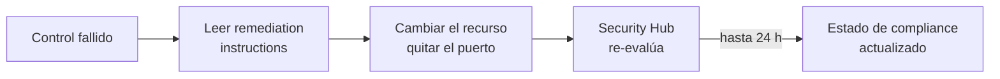

# Tech Talk - AWS Security Hub

> [!abstract] Qué es este archivo
> Octava lección del módulo, **segunda sobre Security Hub** y **segunda en formato conversación**. Acá el eje no
> es “qué es Security Hub” sino **cómo se responde una pregunta de compliance**: el cliente **no sabe el estado de
> sus recursos** y necesita saber **si cumplen PCI**.
>
> Complementa a [[Demo - AWS Security Hub]]: esa muestra **el recorrido**; esta muestra **el criterio de
> remediación** —no tocar a ciegas, leer la guía, y **dejar que el check vuelva a correr**. Video: **5 min 44 s**.

> [!quote] La idea que ordena todo
> **“¿Debería simplemente hacerlo a ciegas? Probablemente no.”** La demo anterior enseñaba a **encontrar**; esta
> enseña a **no arreglar sin entender** — y a **cerrar el ciclo** esperando la re-evaluación.

---

## Resumen en una frase

> Un cliente que **no conoce el estado de sus recursos** se resuelve en **cuatro movimientos**: elegir **el
> estándar** que le importa (**PCI**), **filtrar por severidad**, **leer las instrucciones de remediación** antes
> de tocar nada, y **esperar el ciclo de 24 horas** para confirmar.

---

## 1. El caso: “no sé en qué estado están mis recursos”

**El planteo, tal como llega:** un cliente **tiene problemas dentro de sus cuentas de AWS**: **no sabe el estado de
sus recursos** ni **si cumplen con los niveles de compliance que tiene que alcanzar**.

> [!important] El problema está mal formulado a propósito
> “No sé el estado de mis recursos” **no es una pregunta técnica**: es **dos preguntas** — *¿qué tengo?* y *¿qué
> me exigen?*. Security Hub **no contesta la primera** (eso es inventario) y **sí contesta la segunda**, **contra
> un estándar**. La respuesta correcta empieza por **elegir el estándar**.

**La respuesta de la instructora:** *“Tenemos un servicio particular para esto: **veamos Security Hub**.”*

> [!note] Cómo está armada la conversación
> **Alex** trae el caso del cliente; **Charisma** maneja la consola y explica. El video **no enseña la interfaz
> desde cero**: **responde una consulta de negocio** usando la interfaz. Ese es el valor del formato.

---

## 2. Elegir el estándar: PCI primero, el resto después

**La pregunta que ordena todo:** *“¿Hay algún requisito particular que esté buscando tu cliente?”*

**La respuesta:** **está muy preocupado por el cumplimiento de PCI**. Y **la proyección**: *“a medida que
construyan más recursos, probablemente haya unos cuantos más que agreguen”*.

> [!important] Un estándar a la vez
> El cliente **no dice “quiero cumplir todo”**: dice **“me preocupa PCI”**. Security Hub tiene **varios estándares
> por defecto**, y la conversación **elige uno** y lo recorre. **Elegir el marco es el primer acto de diseño**, no
> un detalle de configuración.

> [!note] Lectura propia (no está en la fuente)
> La frase de la proyección es la más útil para un arquitecto: **los estándares se van a sumar**. Eso significa que
> **el trabajo no termina cuando el score sube** — y que conviene **diseñar el flujo de remediación** (workflow,
> asignación, supresión) **antes** de que lleguen los marcos nuevos.

---

## 3. Del estándar al control

**Lo primero que aparece al abrir el marco:** **recursos no conformes**, con **severidades** —la instructora
menciona **altas** y **medias**—.

**El control que se abre:** **“VPC default security groups should not allow inbound or outbound traffic”** — el
mismo de la lección 07.

**Por qué ese:** el cliente **venía hablando de redes** y **le preocupaba que actores maliciosos entraran y vieran
sus datos**.

> [!important] El control se elige por contexto, no por severidad sola
> Había **severidades altas y medias**, pero se elige **ese** porque **conecta con la preocupación del cliente**
> (redes y acceso a datos). Es el mismo criterio de la lección 06: **priorizar lo que al negocio le duele**, no
> solo lo que el sistema marca más alto.

**El estado de los checks:** *“tengo **dos que pasaron y dos que fallaron** entre estos checks”*.

> [!warning] Discrepancia entre las dos demos
> En [[Demo - AWS Security Hub]] el mismo control mostraba **dos checks específicos**. Acá se habla de **cuatro**
> (**dos pasados y dos fallidos**). **Son cuentas distintas**, así que el número **no tiene por qué coincidir** —
> pero **la fuente no lo aclara**. Se registra: **no se toma ninguno de los dos números como el “real”**.

---

## 4. El recurso: el puerto abierto a todo

**Lo que se ve al abrir el security group:** **tráfico de entrada y flujo de salida**, y **un puerto abierto a todo
el acceso desde cualquier lado**.

**La interpretación:** para **PCI** y **muchas otras buenas prácticas de estándares de seguridad**, **normalmente
hay una restricción sobre no permitir eso** — lo que **coincide con el título del control**.

> [!important] El hallazgo y el recurso dicen lo mismo, en dos idiomas
> El control dice **“los default security groups no deberían permitir tráfico”**; el recurso muestra **un puerto
> abierto a `0.0.0.0/0`**. **Security Hub no inventó nada**: tradujo **una configuración real** a **un
> incumplimiento de un marco**. Ese puente —**configuración → control → marco**— es lo que hay que poder explicar.

---

## 5. La timeline: “a los auditores les encanta eso”

**Lo que se abre:** **cuándo pasó**, en **una línea de tiempo**.

**La reacción del cliente:** *“es realmente importante tenerlo: **quieren poder ver cuándo ocurrieron los cambios**
y **si apareció algo que no debería estar**”*.

**La respuesta:** *“**A los auditores les encanta eso**.”*

> [!important] La frase que vale el módulo entero
> La timeline **no es una función de diagnóstico**: es **una función de auditoría**. Responde **“¿cuándo empezó
> esto?”**, que es **la pregunta que un auditor hace primero** y **la que no se puede reconstruir después** si
> nadie la registró.

> [!note] Lectura propia (no está en la fuente)
> Esto es **otra vez** el requisito **6** del caso —**evidencia para auditorías futuras**—. Ya van **cuatro
> lecciones** que lo tocan desde ángulos distintos: **el audit trail** de la solución de remediación (06), **la
> timeline** (07), **la timeline como valor de auditoría** (08) y **los reportes de compliance** (02). **Es el
> requisito más veces repetido del módulo.**

---

## 6. Remediación: no hacerlo a ciegas

**La tentación:** ver el puerto abierto y **quitarlo**.

**La pregunta que la frena:** *“¿debería simplemente hacerlo a ciegas? **Probablemente no**.”*

**La herramienta:** **abrir las instrucciones de remediación**.

> [!important] Qué abre exactamente
> **La guía del usuario de AWS, directamente en el control de ese framework.** La fuente lo dice dos veces: *“me
> encanta que **abra la guía del usuario** y **me lleve directo al control de ese framework**”* y *“**vinculado
> justo donde lo necesitás**, así no tenés que salir a buscarlo”*.
>
> **No es un texto genérico**: es **la documentación oficial del control**, en contexto.

**Los pasos que indica la guía:**

| # | Paso |
| --- | --- |
| **1** | **Quitar el security group** o **quitar el puerto abierto en cuestión** |
| **2** | **Re-evaluar la actividad de remediación** |

> [!warning] Quitar “el security group” no es lo mismo que quitar “el puerto”
> La guía ofrece **dos caminos**: **eliminar el SG** o **eliminar la regla**. En un **default security group**, lo
> correcto casi siempre es **quitar la regla**, no el grupo: el default **existe por diseño** en cada VPC. **La
> fuente no elige por vos** — deja las dos opciones.

> [!note] Lectura propia (no está en la fuente)
> Que las instrucciones **se abran en la guía oficial** es un detalle de diseño importante: **la remediación no
> vive en el hallazgo**, vive **en la documentación**. Security Hub **te lleva**, no **te dicta**.

---

## 7. Cerrar el ciclo: los 24 horas

**Lo que la instructora destaca como su parte favorita:** Security Hub **va a re-evaluar** ese framework o ese
check. **No hay que re-evaluar a mano**: *“puedo dejar que corra su **check de 24 horas** y volver **mañana** para
ver si eso efectivamente se ocupó del estado de compliance”*.

> [!important] El ciclo completo, en cuatro pasos
> **Detectar → entender → corregir → esperar la re-evaluación.** El cuarto paso **no es opcional**: sin él,
> **no sabés si arreglaste**. Y el que **confirma** no es el humano: es **el chequeo**.

> [!warning] La trampa del “ya lo arreglé”
> Si removés el puerto y **volvés a mirar la consola en el mismo minuto**, **seguís viendo el hallazgo**. No es un
> error: **el ciclo corre hasta una vez cada 24 horas**. **Confundir latencia con fallo** lleva a **tocar de nuevo
> algo que ya estaba bien**.

---

## 8. El cierre: no se recorre todo

**La admisión honesta:** *“No podemos pasar por **todos** los checks hoy, pero **los voy a orientar**”*. Y el
cliente: *“parece que tienen **un gran lugar por dónde empezar**”*.

> [!important] Lo que se lleva el cliente
> **No se llevó un entorno compliant**: se llevó **el método** — cómo elegir el marco, cómo llegar al control, cómo
> leer la remediación y cómo verificar. **Eso escala; un arreglo puntual no.**

---

## 9. Traducción del contenido

> [!info] Sección de referencia (opcional)
> Esto es la **traducción fiel** de la fuente, para verificar que no se perdió nada. **No hace falta leerla para
> estudiar**: lo que se estudia son las secciones **1 a 8** y se cierra con la **11**.
> Usala solo si (a) querés el texto exacto de un paso de remediación, o (b) antes del examen querés chequear una
> cifra.

### 9.1 Tech Talk: AWS Security Hub (transcripción)

**— Hola, Alex, ¿qué pasa hoy?**

**— Hola, Charisma. Necesito tu ayuda.**

**— Dale, ¿qué pasa?**

**— Tengo un cliente que vino a mí y está teniendo algunos problemas dentro de sus cuentas de AWS.** **Puntualmente,
no conocen el estado de sus recursos, ni si cumplen —(risas)— o no con los niveles de compliance que tienen que
alcanzar.**

**— Entiendo, entiendo.** **Mirá, ¿sabés qué? Tenemos un servicio particular para vos.** **Veamos Security Hub y
fijémonos qué podemos encontrar.**

**— Eso sería genial, gracias.**

**— Bueno, tenemos mi Security Hub abierto, y estoy mostrando un par de estándares distintos que ya tenemos por
defecto.** **Ahora, tengo curiosidad: con tu cliente, ¿hay algún requisito particular que estén buscando?**

**— Sí, están muy preocupados ahora por el cumplimiento de PCI.** **Pero sé que a medida que construyan más
recursos, probablemente —(risas)— haya unos cuantos más que agreguen.**

**— Entiendo, tiene sentido, tiene sentido.** **Así que profundicemos un poco más en el framework de cumplimiento
de PCI que tenemos acá, y veamos qué tenemos.**

**— Genial.**

**— Ahora, lo primero que veo —y obviamente esta es mi cuenta— es que tenemos algunos intentos de login fallidos, o
mejor dicho, tenemos algunos recursos no conformes.** **Profundicemos un poco más acá.** **También veo severidades,
¿verdad?** **Tengo severidades altas, también tengo severidades medias.**

**— Ahora, tenemos unas cuantas formas distintas de encarar esto, pero voy a empezar por la primera que tengo
abierta.** **El título muestra: *los security groups por defecto de la VPC no deberían permitir tráfico de entrada
ni de salida*.** **Hmm.** **¿Eso suena como algo en lo que querríamos profundizar?**

**— Sí, de hecho estaban hablando mucho de redes.** **Ahora están muy preocupados por que actores maliciosos
entren y vean sus datos, y bueno, eso no sería bueno para nadie.**

**— Suena bien.** **Así que déjame profundizar un poco más en el mío, y después vemos qué se nos ocurre.**

**— Dale.**

**— Ahora, de nuevo, puedo ver rápidamente que tengo cierto workflow.** **Tengo dos que pasaron y dos que fallaron
entre estos checks.** **Pero vayamos un poco más a fondo.**

**— Ahora, lo que hice fue traer mi security group en cuestión para ver exactamente qué está pasando con el
tráfico de entrada y el flujo de salida.** **Miremos.**

**— Ahora sí veo que tengo un puerto abierto a todo el acceso desde todos lados, a través de un puerto particular.**

**— Ahora, cuando se trata de PCI y muchas otras buenas prácticas de estándares de seguridad, normalmente está esa
restricción sobre no permitir eso, que suena coherente con el título que vimos originalmente.**

**— Pero profundicemos un poco más.** **Ahora, lo que hice fue entrar a ver exactamente cuándo ocurrió esto,
mostrándome una especie de línea de tiempo.**

**— Sí, eso es realmente importante tenerlo.** **Sé que quieren poder mirar y ver cuándo ocurrieron los cambios y,
bueno, si apareció algo que no debería estar ahí.**

**— Tiene sentido.** **A los auditores les encanta eso.** **(risas)**

**— Sí.**

**— Ahora, podemos ver en mi regla que tenemos un par de reglas conformes o no conformes distintas.** **Profundicemos
un poco más acá.**

**— Ahora, de nuevo, lo que estoy viendo es que tengo un security group abierto, tengo un puerto abierto que no
debería tener según el framework de PCI que estamos buscando seguir.** **Y lo que puedo hacer fácilmente es entrar y
remediarlo.** **Lo que eso significa en este caso es que puedo quitar ese puerto, ¿verdad?** **¿Tiene sentido para
vos?**

**— Sí, probablemente sea algo que querríamos hacer.** **No queremos —(risas)— tráfico extra entrando que no
debería estar ahí.**

**— Entendido.** **Ahora, la realidad es, sin embargo: ¿debería simplemente hacerlo a ciegas?** **Probablemente no.**

**— Así que digamos: ¿y si tu cliente no estuviera seguro de qué necesita hacer?** **¿Sabrían qué hacer o qué pasos
seguir?**

**— Sí, probablemente eso sea algo con lo que se van a encontrar.** **¿Hay algún recurso o guía que les pueda
señalar?**

**— Me leíste la mente, ¿verdad?** **Con eso, volvamos a nuestra consola.** **Ahora lo que voy a hacer es
**abrir las instrucciones de remediación**, porque por alguna razón puede que no esté 100 % seguro de si quiero
hacer este cambio.** **Revisemos.**

**— Me encanta el hecho de que **se abre a la guía del usuario, y me lleva directamente al control de ese
framework**.** **Hmm.** **Y voy a bajar para mirar las instrucciones de acá.**

**— Sí, eso es genial tenerlo, sobre todo **vinculado justo donde lo necesitás**, para no tener que salir a
buscarlo por tu cuenta.**

**— Absolutamente.** **Así que parece que lo que puedo hacer para remediar este problema es simplemente **quitar el
security group**, o **quitar ese puerto abierto en cuestión**, y después **re-evaluar la actividad de
remediación**.** **Veamos si puedo hacer eso.**

**— Suena como un camino bastante bueno a seguir.**

**— Ahora, lo que realmente me encanta de Security Hub es que **va a re-evaluar este framework particular, o este
check particular**.** **Así que **no tengo ni que re-evaluarlo acá en el momento**: puedo **dejar que corra su
check de 24 horas** y **volver mañana** para ver si eso efectivamente se ocupó del estado de compliance.**

**— Pero antes de hacerlo, ¿eso ayuda a resolver el problema, o al menos a orientar tu pregunta hacia tu base de
clientes?**

**— Sí, absolutamente.** **Me voy a asegurar de pasárselo a mi cliente.** **Sé que no podemos pasar por cada check
hoy, pero **los voy a orientar en la dirección**, y parece que tienen **un gran lugar por dónde empezar**.**

**— Perfecto.** **Suena bien, Alex.**

*Duración del video: **5 minutos 44 segundos**.*

---

## 10. Qué agrega esta lección sobre la anterior

| | **Demo (lección 07)** | **Tech Talk (lección 08)** |
| --- | --- | --- |
| **Formato** | Recorrido guiado de consola | **Conversación con un caso de cliente** |
| **Punto de partida** | “Miremos Security Hub más a fondo” | **“No sé el estado de mis recursos”** |
| **Estándar** | **AWS Foundational** | **PCI** (y aviso de que vendrán más) |
| **Qué se enfatiza** | El **recorrido** finding → recurso | **El criterio de remediación** |
| **La pregunta clave** | “¿Quizás hay una razón por la que falla?” | **“¿Debería hacerlo a ciegas? Probablemente no”** |
| **La guía** | Se menciona *remediation instructions* | **Se abre y se lee**: user guide → control del framework |
| **El cierre** | *Manage Resource* al recurso | **Los 24 horas de re-evaluación** |
| **Lo que se lleva el cliente** | El flujo de investigación | **El método** para empezar |

**La diferencia de fondo:** la 07 enseña **a investigar**; la 08 enseña **a no arreglar sin leer** y **a esperar la
confirmación**. Juntas son **el ciclo completo**.

---

## 11. Para el examen (SAP-C02)

> [!important] Lo que hay que retener
> 1. **Security Hub responde “¿cumplo?” contra un estándar**, no “¿qué tengo?”. **El estándar se elige primero**.
> 2. **Se puede trabajar un marco a la vez**: **PCI** en este caso.
> 3. **Los estándares se van a sumar** a medida que crecen los recursos: **el trabajo no termina**.
> 4. **El control se elige por contexto de negocio**, no solo por severidad: acá, por la preocupación de **redes y
>    datos**.
> 5. **Las severidades son high y medium** (y low, según la lección 07).
> 6. **Remediation instructions abren la guía del usuario de AWS, en el control de ese framework.**
> 7. **Los dos caminos de remediación**: **quitar el SG** o **quitar el puerto**.
> 8. **Security Hub re-evalúa solo**: **hasta 24 horas**. **No hace falta forzar la re-evaluación**.
> 9. **La timeline es el argumento de auditoría**: *“a los auditores les encanta eso”*.
> 10. **Arreglar a ciegas es el error**: primero la documentación, después el cambio.

> [!warning] Trampa clásica del examen
> Escenario: *“el equipo removió la regla y el hallazgo **sigue apareciendo**”*. La respuesta **no** es “el cambio
> falló” ni “hay que re-evaluar a mano”: **el chequeo corre hasta una vez cada 24 horas**. Y si la pregunta ofrece
> “remediar automáticamente todos los hallazgos altos”, **cuidado**: la fuente insiste en **leer la guía antes**, y
> en la lección 06 la regla de auto-remediación **viene apagada por defecto**.

---

## Relacionado

- [[AWS Solutions Architect Advanced - Securing Networks and Data]] *(índice del módulo)*
- [[Demo - AWS Security Hub]] — el recorrido de consola que esta conversación complementa
- [[Security Hub]] — el concepto: estándares, insights, workflow y automatización
- [[AWS Firewall Manager]] — una de las fuentes de findings del dashboard
- [[Gathering the Customer Requirements - Security]] — el requisito **6** (evidencia para auditorías) que la
  timeline materializa
- [[1.2 Prescribir controles de seguridad]] — la tarea que este módulo cubre
- [[2.3 Determinar los controles de seguridad en función de los requisitos]] — el cruce con Dominio 2
- [[Guia AWS]] — pesos y tareas oficiales del SAP-C02
- Siguiente paso del módulo: [[Amazon GuardDuty]] — el servicio que **alimenta** la mitad de los findings que
  esta lección muestra: detección de amenazas con **ML**, **cuatro categorías** y **respuesta automatizada**

---

## Registro de integración

| Fecha | Qué llegó | Dónde se integró |
| --- | --- | --- |
| 27/10/2026 | Lección 08 completa: caso de compliance PCI, control de SG por defecto, timeline, instrucciones de remediación y ciclo de 24 h | Nota completa (secciones 1–11) |

**Discrepancias y vacíos registrados (no corregidos):**

1. **El número de checks del mismo control no coincide con la lección 07**: acá son **cuatro** (**dos pasados, dos
   fallidos**); en la 07 eran **dos**. Son **cuentas distintas**, pero **la fuente no lo aclara** (§3).
2. **La instructora se autocorrige en la primera frase**: dice **“intentos de login fallidos”** y después **“recursos
   no conformes”**. Se conserva la autocorrección en la traducción (§9.1).
3. **La fuente no dice cuántos estándares tiene Security Hub por defecto**: solo **“un par”**.
4. **No se nombra la versión de PCI** en esta lección (la lección 06 sí: **PCI DSS v3.2.1**, para los playbooks de
   la solución de remediación). **No se cruzan automáticamente**: son contextos distintos.
5. **La guía de remediación ofrece dos caminos** —**quitar el SG** o **quitar el puerto**— **sin recomendar uno**.
   No se elige por la fuente (§6).
6. **No hay imágenes ni diagramas**: es **transcripción de video** pura. El esquema de §7 es una
   **reconstrucción** del ciclo que describe la conversación.
7. **No hay Knowledge Check.**
8. **No se explica qué pasa si el check sigue fallando** después de la corrección: la fuente **cierra en “volver
   mañana”** y no cubre el caso de error.
9. **El nombre de archivo `Tech Talk - AWS Security Hub.md` no colisiona** con ninguna nota del vault (verificado:
   **0 basenames duplicados**). **No había ninguna nota previa con “Tech Talk” en el nombre**, aunque la lección 04
   contiene un Tech Talk embebido.

**Decisiones de transcripción:**

- Se conservan **compliance**, **standard**, **framework**, **severity**, **workflow**, **remediation
  instructions**, **timeline**, **security group**, **default security group**, **check**, **score** y
  **auditor**.
- Las **cifras** se transcriben literales: **5 min 44 s**, **dos pasados / dos fallidos**, **24 horas**, **un
  par** de estándares.
- Se conservan los **nombres propios** de los instructores, **Alex** y **Charisma**, y las **risas** marcadas en la
  transcripción, porque forman parte del tono del video.
