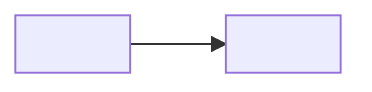

# <Título de la lección>

> [!abstract] Qué es este archivo
> <Qué cubre la lección, en dos o tres líneas. Nombra los servicios y a qué bloque del examen pertenece.>

> [!quote] <La idea que ordena todo | Las dos analogías del módulo>
> <La frase o analogía que hace que el resto se explique solo.>

---

## Resumen en una frase

> <Una sola frase con los dos o tres conceptos que sostienen la lección.>

---

## 1. <Primer concepto>

| Concepto | Definición |
| --- | --- |
| **<Término>** | <Definición literal, con cifras si las hay> |

> [!warning] <Buena práctica / cuidado>
> <Lo que se paga caro si se ignora.>

---

## 2. <Segundo concepto>

<Desarrollo.>

### <Subconcepto> — sin número

> <Definición o regla en una línea.>

- **<Punto>** — <explicación>
- **<Punto>** — <explicación>

> [!important] <Regla de troubleshooting / criterio>
> <La frase que resuelve el caso ambiguo.>

### <Otro subconcepto>

---

## 3. <Tercer concepto>

<Paso a paso, tabla de pasos, o comparación.>

| # | Paso | Resultado |
| --- | --- | --- |
| 1 | <Acción> | <Qué queda> |

---

## N. <Último concepto del cuerpo>

---

## N+1. Traducción del contenido

> [!info] Sección de referencia (opcional)
> Esto es la **traducción fiel** de las fuentes, para verificar que no se perdió nada. **No hace falta leerla
> para estudiar**: lo que se estudia son las secciones **1 a N** y se cierra con la **N+3**.
> Usala solo si (a) algo de arriba te quedó dudoso, (b) querés el detalle textual de la demo, o (c) antes del
> examen querés chequear que no se escapó un matiz.

### N+1.1 Video principal (transcripción)

<Transcripción literal, con negritas en los términos clave.>

### N+1.2 Lectura: <título de la lectura>

<Traducción literal de la lectura.>

### N+1.3 Demo: <título> (transcripción)

<Transcripción de la demo, con los pasos en orden.>

---

## N+2. <Sección de cierre conceptual: cuadro comparativo / quién hace qué>

| Necesidad | Herramienta | Mecanismo |
| --- | --- | --- |
| <Necesidad> | **<Servicio>** | <Cómo lo resuelve> |

---

## N+3. Para el examen (SAP-C02)

> [!important] Lo que hay que retener
> 1. **<Concepto>.** <Regla en una línea>.
> 2. **<Concepto>.** <Regla en una línea>.
> 3. **<Concepto>.** <Regla en una línea>.

> [!warning] Trampa clásica del examen
> Escenario: "<lo que dice el enunciado>". La respuesta **no** es <atajo obvio>: es <lo que hay que mirar>.

---

## Relacionado

- [[<Nota del módulo>]] — <por qué se conecta>
- [[<Nota del módulo>]] — <por qué se conecta>
- [[<Índice del módulo>]] *(índice del módulo)*
- Siguiente paso del módulo: **<lección siguiente>**
